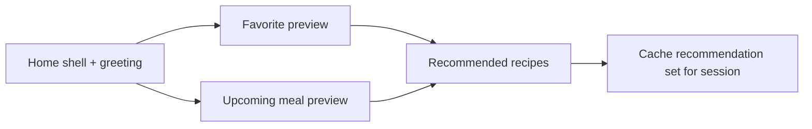

# F-006 — Home Page

**Status:** Active
**Implementation status:** Partially implemented
**Version:** 1.0
**Owner:** Mathieu Galidie
**Last updated:** 2026-08-06
**Dependencies:** F-007 — Recipe Card and Quick Preview; Recipe Discovery and Search (ID pending); Recipe Favorites (ID pending); Manual Meal Planning (ID pending)
**Related engineering initiatives:** E-010, E-013, E-014, E-017, E-019

## Goal

Give an authenticated user a personal starting point whose primary purpose is to begin discovering something to cook while also showing a small useful preview of recommendations, favorites, and upcoming meals.

## User Problem

The user should not have to understand the full Appetee navigation before finding food. Home must immediately feel personal, provide an easy recipe/ingredient search, and surface a small amount of relevant account data without becoming a second Recipes page.

## Current Behavior

Implementation baseline reviewed from frontend `main` on 2026-08-06.

### Implemented foundation

- Authenticated `/home` route exists.
- Home renders through the private layout.
- A search-shaped UI and Explore Recipes action exist.
- A shared recipe-card component is already imported.
- Current card data and interactions are placeholders/static.
- Current copy still includes ingredient/pantry and meal-type concepts that are not part of the approved Home scope.

### Missing approved behavior

- Personal welcome using display name.
- Approved search routing.
- Random compatible recommendations.
- Favorite preview.
- Upcoming meal preview.
- Stable Home caching/invalidation behavior.
- Shared F-007 card/preview behavior.
- Loading/error/empty states connected to real data.

## Main Page Structure

```text
1. Personalized welcome and recipe search
2. Recommended for you
3. Upcoming meals
4. Favorite recipes
5. Explore all recipes
```

Home shows limited previews only. Full filtering/browsing belongs to Recipe Discovery; complete planning belongs to Meal Planning.

## Welcome and Search

Recommended copy:

```text
Welcome back, {displayName}!
What are we cooking today?
```

The initial version does not change the greeting by time of day.

Search placeholder:

```text
Search recipes or ingredients...
```

Search matches recipe names and ingredient names.

Submitting search navigates to:

```text
/recipes?search={query}
```

Home itself does not execute the full search query.

`Browse all recipes` / `Explore more recipes` navigates to `/recipes`.

## Recommended Recipes

The initial strategy is intentionally simple:

1. Start from recipes compatible with all selected diets.
2. Exclude recipes containing any avoided ingredient.
3. Exclude recipe IDs already displayed in the Home favorite/upcoming-meal previews during initial recommendation generation.
4. Randomly select up to five compatible recipes.
5. Do not use AI or behavioral preference learning in the current implementation.

A future recommendation/AI ranking system may replace random ranking, but it is not planned for the next few months and must not require the Home UI contract to change.

### Responsive presentation

Card count is a layout concern rather than a different backend contract:

```text
Very wide desktop: up to 5
Typical desktop/laptop: 4 visible
Tablet: 2–3 visible
Mobile: horizontal swipeable row
```

The exact breakpoints are selected during implementation based on the final card width and container behavior.

## Upcoming Meals

Home shows the next **3–4 upcoming meal entries**, with a target request limit of four.

The preview is chronological, not tied to Monday/Tuesday/Wednesday.

If the user has multiple meal slots on one day, they appear in chronological/slot order before later meals.

When no active plan/upcoming meal exists, the section remains visible as an invitation:

```text
Plan your meals for the week
Start Meal Planning
```

The full plan route is initially `/meal-plan`.

## Favorite Recipes

Home shows up to four favorite recipe cards on typical desktop layouts, using the same responsive card behavior as the rest of Appetee.

When no favorite exists:

```text
No favorite recipes yet.
Save recipes you enjoy to see them here.
Browse Recipes
```

The section remains visible.

The full favorites experience is not a recipe tag. The target frontend route is:

```text
/recipes/favorites
```

Full favorite search/list behavior is owned by the Recipe Favorites feature.

## Shared Recipe Interaction

F-006 does not own card or Quick Preview behavior.

F-007 owns the shared interaction contract:

- clicking a recipe card opens Quick Preview;
- the heart control toggles favorite state without opening the preview;
- the same card behavior is used across Home, Recipes, Favorites, and Meal Planning;
- Quick Preview can lead to Add to Meal Plan or Start Cooking.

Home consumes that capability.

## Home Data Lifecycle

Home does not refetch every section every time `/home` is activated.

### Recommendations

First required load in an authenticated browser session:

1. Load favorite and upcoming-meal preview information.
2. Build the small exclusion ID set from recipes currently shown in those two sections.
3. Request up to five recommendations.
4. Store the returned recommendation IDs/card data for the current authenticated session.

Returning to Home reuses the same recommendation set.

Regenerate recommendations only when:

- the user logs in again / identity changes;
- the browser is fully refreshed and in-memory state is lost;
- diets change;
- avoided ingredients change;
- a future explicit Refresh Recommendations action is introduced.

If the user later favorites or meal-plans one of the already displayed recommendations, Home does not reshuffle the row immediately.

### Favorites

Home keeps a small preview plus cursor/count metadata.

When a favorite is added anywhere:

- update favorite state everywhere through the shared Favorites state;
- add it to the Home preview if appropriate;
- trim the Home preview to its display capacity.

When a displayed favorite is removed:

- remove it immediately;
- if the preview has an available next cursor/remaining results, request only the number of missing cards;
- do not refetch the complete favorite list unnecessarily.

On full reload/new identity, fetch the first favorite preview page again.

### Upcoming meals

Home reuses the cached upcoming preview while it remains valid.

Meal-plan mutations mark the preview stale. After add/remove/replace/reschedule/plan activation changes, refetch the next four upcoming items as one ordered set because the mutation may change the entire chronological preview.

The preview is also stale when its cached first item is now in the past.

### Logout/identity change

Clear every account-scoped Home/query/cache state through E-013/E-019.

## Data Requirements

### Home composition state

The Home-specific store keeps composition/freshness, not duplicate full recipe details:

```ts
interface HomeState {
  recommendedRecipeIds: number[];
  recommendationsLoaded: boolean;

  favoritePreviewIds: number[];
  favoriteTotalCount: number;
  favoriteNextCursor: string | null;

  upcomingMealItemIds: number[];
  upcomingMealsStale: boolean;
}
```

Recipe details are not downloaded for Home cards.

F-007 owns the shared lightweight `RecipeCardDto` contract and the lazy full-recipe detail cache.

### Recommended response

```ts
interface RecommendedRecipesResponse {
  items: RecipeCardDto[];
}
```

### Favorite preview response

```ts
interface FavoriteRecipePage {
  items: RecipeCardDto[];
  totalCount: number;
  nextCursor: string | null;
}
```

### Upcoming meal response

```ts
interface UpcomingMealDto {
  mealPlanItemId: number;
  scheduledAt: string;
  mealLabel: string | null;
  recipe: RecipeCardDto;
}

interface UpcomingMealsResponse {
  hasActivePlan: boolean;
  mealPlanId: number | null;
  items: UpcomingMealDto[];
}
```

## Database Impact

### Existing tables used by Home recommendation

- `recipes`
- `user_diets`
- `diet_recipes`
- `user_ingredient_restrictions`
- `recipe_ingredients`
- `favorite_recipes`

The current composite primary keys and reverse indexes are sufficient for the initial small-catalog compatibility query.

### Schema changes

No Home-owned schema change is required for random compatible recommendations or frontend cache behavior.

Meal-plan tables do not exist in the current schema. Their schema is owned by Manual Meal Planning.

### Index changes

No new F-006 index is required for the first recommendation implementation.

Dependent features must design indexes for their own access patterns:

- Recipe Favorites must support newest-first/cursor preview retrieval.
- Manual Meal Planning must support current-plan + chronological upcoming-item retrieval.

Those indexes must be finalized and validated with `EXPLAIN` in their owning feature/E-008 work rather than being silently added by Home.

### Data migration

None for Home itself.

## API Endpoints

| Method | Endpoint | Owner | Home usage |
|---|---|---|---|
| `GET` | `/api/recipes/recommended?limit=5&excludeRecipeId=...` | F-006 | Initial session recommendation set |
| `GET` | `/api/recipes/favorites?limit=4&cursor=...` | Recipe Favorites | Initial preview and targeted refill |
| `GET` | `/api/meal-plans/current/upcoming?limit=4` | Manual Meal Planning | Upcoming chronological preview |
| — | `/recipes?search=...` | Recipe Discovery frontend route | Search submission navigation |

Home does not own favorite mutations or recipe-detail retrieval.

## Request Contracts

### Recommended recipes

```http
GET /api/recipes/recommended?limit=5&excludeRecipeId=12&excludeRecipeId=18
```

Rules:

- authenticated user comes from the cookie/session, never a client-supplied user ID;
- default limit `4`;
- maximum limit `6`;
- repeated `excludeRecipeId` values are allowed;
- exclusions are a small UI de-duplication set, not a database-owned recommendation history.

### Favorite preview/refill

Initial:

```http
GET /api/recipes/favorites?limit=4
```

Refill after two displayed favorites were removed:

```http
GET /api/recipes/favorites?limit=2&cursor={nextCursor}
```

### Upcoming meals

```http
GET /api/meal-plans/current/upcoming?limit=4
```

## Response Contracts

### Recommended recipes

```json
{
  "items": [
    {
      "id": 42,
      "name": "Mediterranean Grilled Salmon",
      "imageUrl": "https://...",
      "prepTimeMinutes": 25,
      "servings": 4,
      "difficulty": "Easy",
      "caloriesPerServing": 350,
      "estimatedCostPerServing": 6.25,
      "diets": [],
      "badges": []
    }
  ]
}
```

`RecipeCardDto` is finalized by F-007. The Home contract requires lightweight card data only; instructions and full ingredient details are excluded.

### Favorite preview

```json
{
  "items": [],
  "totalCount": 12,
  "nextCursor": "opaque-cursor-or-null"
}
```

### Upcoming meals

With plan:

```json
{
  "hasActivePlan": true,
  "mealPlanId": 12,
  "items": [
    {
      "mealPlanItemId": 81,
      "scheduledAt": "2026-08-07T12:00:00-06:00",
      "mealLabel": "Lunch",
      "recipe": {
        "id": 42,
        "name": "Mediterranean Grilled Salmon",
        "imageUrl": "https://..."
      }
    }
  ]
}
```

Without plan:

```json
{
  "hasActivePlan": false,
  "mealPlanId": null,
  "items": []
}
```

No active plan is a successful empty state, not an error.

## Error Behavior

Each Home section fails independently.

- Recommendation failure: keep Home usable and show retry for recommendations.
- Favorite preview failure: preserve existing cached preview when available and show retry status.
- Upcoming-meal failure: preserve existing valid cached preview when available and mark it retryable.
- One section failure must not block the others.
- Empty results are not errors.
- Invalid `limit`: `400`.
- Unauthenticated endpoint access: `401` and normal session handling.
- Exact ProblemDetails envelope is owned by E-010.

## Loading Order

On the first recommendation load:



Favorite and upcoming requests may run in parallel. Recommendations begin after both have either returned or failed so the available displayed recipe IDs can be excluded. A failure in one preview must not prevent recommendations from loading with the exclusion IDs that are available.

## Delivery Phases

### Phase 1 — Authenticated Home foundation

**Status:** Completed

- Authenticated `/home`.
- Initial responsive Home layout.
- Search-shaped UI.
- Explore Recipes action.
- Shared recipe-card placeholder integration.
- Empty-state concepts.

### Phase 2 — Approved welcome and search routing

**Status:** Not started

- Use authenticated display name.
- Apply approved welcome copy.
- Search recipe names/ingredients through `/recipes?search=...`.
- Trim empty submissions.
- Remove unsupported pantry/meal-type Home concepts.
- Add routing and component tests.

### Phase 3 — Random compatible recommendations

**Status:** Not started

- Implement recommendation endpoint.
- Apply diet/restriction compatibility.
- Apply small displayed-ID exclusion list.
- Return lightweight F-007 card data.
- Cache one recommendation set for the authenticated browser session.
- Invalidate when identity/diet/restriction state changes.
- Add empty/error/retry behavior and tests.

### Phase 4 — Upcoming meal preview

**Status:** Not started

- Consume the Manual Meal Planning upcoming endpoint.
- Show next 3–4 entries.
- Keep invitation empty state.
- Reuse valid cache and refetch after relevant mutations/staleness.
- Add tests.

### Phase 5 — Favorite preview

**Status:** Not started

- Consume the Recipe Favorites cursor endpoint.
- Show limited responsive preview.
- Keep empty invitation.
- Update from shared favorite mutations.
- Refill only missing preview positions when possible.
- Add tests.

### Phase 6 — Responsive/integration validation

**Status:** Not started

- Validate desktop/tablet/mobile card counts and swipe behavior.
- Validate independent loading/failure.
- Validate shared F-007 card behavior.
- Validate logout/identity state cleanup through E-019.
- Complete accessibility and E2E coverage.

## Work Status

### Completed

- Phase 1 foundation.

### In Progress

None.

### Remaining

- [ ] Phase 2
- [ ] Phase 3
- [ ] Phase 4
- [ ] Phase 5
- [ ] Phase 6

## Acceptance Criteria

- [ ] Home greets the user by display name.
- [ ] Search navigates to recipe discovery using the submitted name/ingredient query.
- [ ] Recommendations are compatible and stable for the current session.
- [ ] Home does not load full recipe details for card lists.
- [ ] Favorite preview updates/refills without full unnecessary reloads.
- [ ] Upcoming meals are the next chronological items, not fixed weekdays.
- [ ] Empty sections remain visible as invitations.
- [ ] Section errors are isolated.
- [ ] Recipe cards use the same F-007 behavior everywhere.
- [ ] Administrator users see the same Home experience as normal users.

## Design References

- [`assets/home-reference-chatgpt-concept.png`](./assets/home-reference-chatgpt-concept.png)
- [`assets/home-reference-builder-01.png`](./assets/home-reference-builder-01.png)
- [`assets/home-reference-builder-02.png`](./assets/home-reference-builder-02.png)

The references are direction, not pixel-perfect implementation requirements.

## Decisions

- Home's primary purpose is recipe discovery.
- Search remains on Home.
- Recommendation v1 is random compatible selection, not AI.
- Recommendation set is stable for the authenticated browser session.
- Home owns composition, not the full recipe/favorite/meal-plan domains.
- Favorites use `/recipes/favorites`, not a fake recipe tag.
- Admin users see the normal product Home; administration has its own console.
