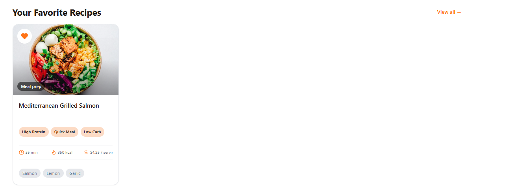
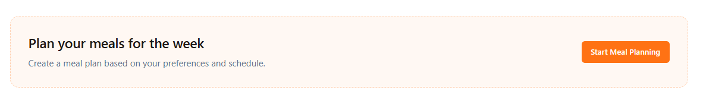
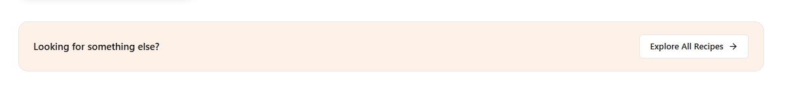
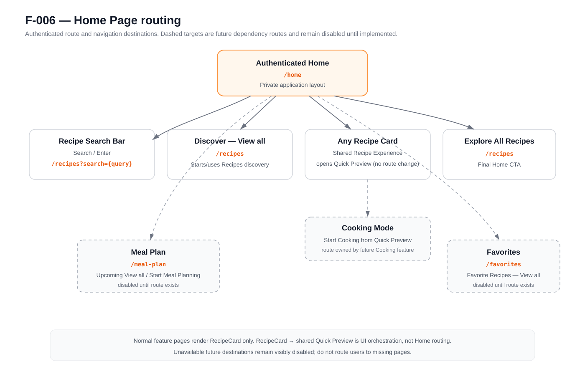

# F-006 — Home Page

**Status:** Frontend implemented and backend dependencies validated; manual browser/session validation pending<br>
**Implementation status:** Frontend phases 1–3 implemented; frontend and relevant backend automated checks passing<br>
**Backend status:** Complete — F-006 owns no backend code and all current owning-backend dependencies are validated<br>
**Version:** 1.1  
**Owner:** Mathieu Galidie  
**Last updated:** 2026-08-30<br>
**Dependencies:** F-008 — Recipe Discovery, Recipe Card, and Quick Preview; F-009 — Favorites; Manual Meal Planning feature (ID pending)<br>
**Related engineering initiatives:** E-013, E-017, E-019

## Goal

Give an authenticated user a simple starting point for finding something to cook, seeing their next planned meals when meal planning exists, and quickly returning to favorite recipes without turning Home into a second Recipes page.

Home is a **composition feature**. It reuses recipe discovery, recipe cards, Quick Preview, favorite behavior, and future meal-plan data owned by their respective features. F-006 must not duplicate those domains.

## User Problem

After signing in, the user should immediately be able to:

- search for a recipe or ingredient;
- discover a small set of compatible recipes;
- see the next planned meals when a plan exists;
- revisit favorite recipes when favorites exist;
- reach the complete recipe catalogue easily.

The user should not have to learn a separate Home-specific recipe interaction model. Any recipe card shown on Home must behave exactly like the same card shown on Recipes, Favorites, or Meal Planning.

## Current Behavior

The authenticated `/home` route exists, but the approved Home feature described by this specification has **not been implemented**.

Any existing Home markup, placeholder recipe data, pantry/ingredient callouts, old meal-type controls, or static card interactions are implementation scaffolding only and are not the source of truth for this feature.

The current Recipes page already contains the approved visual direction for the recipe search input plus Search button. F-006 requires that search UI to be extracted into a reusable shared component rather than recreated independently on Home.

## Product Principles

1. **One recipe experience everywhere.** A Home recipe card uses the shared F-008 `RecipeCardComponent`. The card itself enters the shared Recipe Card → Quick Preview → Cooking Mode flow. Home does not import or open Quick Preview directly.
2. **One reusable recipe search bar.** Home, Recipes, and future Meal Plan use the same shared search-bar component. The Recipes page's current search input + Search button is the visual and behavioral source to extract.
3. **One reusable recipe-list section.** Discover, Upcoming Meals, and Favorite Recipes share the same section presentation: title, `View all` action, and a horizontal row of shared Recipe Cards.
4. **Home is not recommendation logic.** The initial Discover section uses the same compatible randomized discovery behavior as the Recipes catalogue. Personalized recommendation/scoring is a separate future feature.
5. **Home sections load independently.** Discover, Favorites, and future meal-plan data must not block one another.
6. **No fake domain data.** If a dependent feature is not implemented, do not invent recipe or meal-plan data to make the page look complete.

## Main Page Structure

The approved Home structure is:

```text
Authenticated Home (/home)

Welcome back, {displayName}!
What are we cooking today?

[ Search recipes or ingredients...                         ] [ Search ]

Discover                                                    View all →
[ RecipeCard ][ RecipeCard ][ RecipeCard ][ RecipeCard ][ RecipeCard ]

IF an active meal plan/upcoming meals exist:
    Upcoming Meals                                          View all →
    [ RecipeCard ][ RecipeCard ][ RecipeCard ][ RecipeCard ]
ELSE:
    ┌──────────────────────────────────────────────────────────────────────┐
    │ Plan your meals for the week                       [Start Meal Planning]
    │ Create a meal plan based on your preferences and schedule.          │
    └──────────────────────────────────────────────────────────────────────┘

IF one or more favorites exist:
    Your Favorite Recipes                                   View all →
    [ RecipeCard ][ RecipeCard ][ RecipeCard ][ RecipeCard ]
ELSE:
    render no Favorites section

┌──────────────────────────────────────────────────────────────────────────┐
│ Looking for something else?                    [ Explore All Recipes → ] │
└──────────────────────────────────────────────────────────────────────────┘
```

The three recipe-bearing sections use the same shared `RecipeListSectionComponent`. Feature-specific empty states do not get pushed into that shared component.

## Visual References

Codex must inspect and use the files under `assets/` before implementing the page.

- `assets/home-reference-recipe-list-section.png` — reference for the **section composition**: section title on the left, `View all` on the right, and the recipe-card row below. The Recipe Card shown in this screenshot is an older visual reference; **do not copy its internal card content, overlay, badge behavior, or dimensions if they conflict with the current shared F-008 Recipe Card.** The current shared Recipe Card is authoritative.
- `assets/home-reference-meal-plan-empty-state.png` — reference for the no-meal-plan CTA layout, copy hierarchy, bordered container, and action placement. Use Appetee's current theme variables and shared button/text styles rather than hard-coded values copied from the image.
- `assets/home-reference-explore-all-recipes.png` — reference for the final bottom CTA layout and copy hierarchy.
- `assets/home-routing.svg` — canonical F-006 route/navigation diagram, following the same documentation purpose as F-001's `landing-routing.svg`.

Visual assets define **layout direction**, not architecture. Existing Appetee components, F-008 contracts, CSS variables, `_button.scss`, `_text.scss`, `_theme.scss`, and current responsive conventions remain the implementation source of truth.

### Recipe list section reference



### No-meal-plan reference



### Final Explore All Recipes reference



### Routing reference



## Routing

The canonical Home routing is documented in `assets/home-routing.svg`.

### Route ownership

| User action | Destination | Owner | Availability rule |
| --- | --- | --- | --- |
| Open Home | `/home` | F-006 | Authenticated route |
| Submit Home search | `/recipes?search={query}` | F-008 / Recipes | Active when query is non-empty after trim |
| Discover `View all` | `/recipes` | F-008 / Recipes | Active |
| Click any Recipe Card | Shared Quick Preview | F-008 Recipe Experience | Modal/UI flow; no Home route change |
| Quick Preview → Start Cooking | Future Cooking Mode route | Cooking Mode feature | F-006 must not invent this route |
| Upcoming Meals `View all` | `/meal-plan` | Manual Meal Planning | Disabled until route exists |
| No-plan `Start Meal Planning` | `/meal-plan` | Manual Meal Planning | Disabled until route exists |
| Favorite Recipes `View all` | `/favorites` | Recipe Favorites | Disabled until route exists; active once Favorites feature is implemented |
| Bottom `Explore All Recipes` | `/recipes` | F-008 / Recipes | Active |

If a destination feature is not implemented, the Home action may be visible to preserve the intended layout, but it must be genuinely disabled and must not navigate to a missing/404 route.

## Welcome and Search

Approved copy:

```text
Welcome back, {displayName}!
What are we cooking today?
```

The initial version does not use time-of-day greetings.

Search placeholder:

```text
Search recipes or ingredients...
```

### Shared Recipe Search Bar

F-006 requires a reusable component under the shared UI area, conceptually:

```text
src/app/core/shared/ui/recipe-search-bar/
```

The implementation must **extract/refactor the existing Recipes-page search input + Search button**, not create a visually similar second implementation.

At implementation time Codex must inspect the latest `development` branch because F-008 may have moved the Recipes page. The current Recipes search UI is the source for:

- search icon if currently present;
- input height, border, radius, padding, typography, and focus treatment;
- Search button appearance and disabled/loading behavior if currently present;
- desktop/mobile layout;
- full-width behavior inside the parent container.

The shared component contains only the search input/form and Search button. It does **not** own Recipes filters.

Conceptual contract:

```ts
value / initialValue: string
placeholder: string = 'Search recipes or ingredients...'
searchSubmitted: output<string>
```

Exact Angular API shape may follow current project conventions, but the responsibilities are fixed:

- take the width made available by the parent (`width: 100%` behavior);
- submit on Search button or Enter;
- trim surrounding whitespace;
- do not issue HTTP requests itself;
- do not own router navigation;
- preserve entered text visually;
- remain reusable by Home, Recipes, and future Meal Plan.

### Home search behavior

Home submission does not call the discovery endpoint directly.

Example:

```text
User enters: rice chicken
Home navigates to: /recipes?search=rice%20chicken
Recipes reads URL criteria
Shared RecipeSearchBar on Recipes displays: rice chicken
F-008 performs the actual search
```

A blank/whitespace-only submission must not navigate.

Search semantics themselves remain owned by F-008, including recipe-name/ingredient-name matching and backend normalization.

## Shared Recipe List Section

The most important Home presentation primitive is a reusable section component, conceptually:

```text
src/app/core/shared/ui/recipe-list-section/
```

It renders this pattern consistently:

```text
Section Title                                           View all →

[ RecipeCard ][ RecipeCard ][ RecipeCard ][ RecipeCard ] ...
```

It is reused for:

- Discover;
- Upcoming Meals when planned recipes exist;
- Your Favorite Recipes when favorites exist.

### Responsibilities

The component owns:

- title placement and typography;
- `View all` action placement and visual style;
- horizontal Recipe Card row;
- card gap and section spacing;
- responsive overflow behavior;
- loading/skeleton presentation for the row when requested;
- optional generic error/retry presentation if implemented through the shared contract;
- rendering the shared `RecipeCardComponent` for every item.

The component does **not** own:

- HTTP requests;
- Home state;
- route destinations;
- recommendation logic;
- favorite mutation logic;
- meal-plan logic;
- Quick Preview;
- Cooking Mode.

Conceptual input/output contract:

```ts
title: string
recipes: readonly RecipeCardDto[]
actionLabel: string = 'View all'
actionDisabled: boolean = false
loading: boolean
error: string | null        // if the implementation chooses shared error rendering
actionTriggered: output<void>
retryRequested: output<void> // only if shared error rendering is used
```

Codex may make minor API-shape adjustments to match the project's current signal/input conventions, but it must not turn the component into a Home-domain component.

### Recipe Card behavior inside the section

The section renders only the current shared F-008 Recipe Card:

```html
@for (recipe of recipes(); track recipe.id) {
  <app-recipe-card [recipe]="recipe" />
}
```

Normal feature consumers do not import Quick Preview directly. The shared Recipe Card/Recipe Experience owns:

```text
RecipeCard
    → RecipeExperienceFacade
    → RecipeQuickPreview
    → Cooking Mode later
```

The exact same card component, card content, heart behavior, accessibility, and preview interaction must be used in Discover, Upcoming Meals, and Favorites.

Do not create `HomeRecipeCard`, `FavoriteHomeCard`, or `UpcomingMealCard` variants.

## Discover Section

### Current product behavior

Discover is **not** a recommendation engine.

The initial Home implementation uses F-008's normal compatible, randomized discovery behavior:

```http
GET /api/recipes?limit=5
```

F-006 does not add recommendation scoring, user-behavior ranking, AI, meal-history learning, or a `/recommended` endpoint.

F-008 already applies:

- authenticated user identity;
- required diet compatibility;
- avoided/restricted ingredient compatibility;
- the shared Recipe Card projection;
- seeded/random-looking browse ordering.

Home uses the returned `items` only and does not paginate the Discover row.

### Count and presentation

Home requests **5** Discover cards.

The backend is not viewport-aware. The frontend row decides how many are visible at once.

Expected behavior:

```text
wide desktop        up to 5 visible
normal desktop      approximately 4 visible, remaining cards horizontally reachable
tablet              fewer visible, same horizontal row
mobile              horizontal scrolling/swiping row
```

Do not create smaller Home-specific Recipe Cards to force five cards into every viewport.

### Session stability

The first required Discover load in an authenticated SPA session stores the returned five cards in Home state.

```text
Home → Recipes → Home
```

must reuse the same Home Discover result when the authenticated identity and Home state are still valid.

A full browser refresh may create a new cursorless discovery request and therefore a new randomized set.

F-006 does not carry Home's seed/cursor into `/recipes` when the user selects `View all`.

### Discover View all

```text
Discover → View all → /recipes
```

The Recipes page starts/uses its own discovery query state.

### Future recommendation feature

A later recommendation feature may replace the selection/ranking behind the Discover row. It must not require a Home layout, Recipe Card, Quick Preview, or RecipeListSection redesign.

Recommendation logic is explicitly excluded from F-006.

## Upcoming Meals Section

Upcoming Meals is owned by the future Manual Meal Planning feature. F-006 defines how Home presents that domain when available.

### When upcoming meals exist

Render the same shared RecipeListSection:

```text
Upcoming Meals                                         View all →
[ RecipeCard ][ RecipeCard ][ RecipeCard ][ RecipeCard ]
```

Target preview size: up to **4** upcoming recipe cards.

The underlying meal-plan feature owns chronology, slot ordering, current-plan selection, stale-time rules, and meal-plan mutations.

Home consumes the recipe projection and does not create a separate Home recipe card DTO.

### When no active plan/upcoming meals exist

Do **not** render an empty RecipeListSection.

Render the dedicated Home meal-plan CTA matching `assets/home-reference-meal-plan-empty-state.png`:

```text
Plan your meals for the week
Create a meal plan based on your preferences and schedule.
[ Start Meal Planning ]
```

This CTA is Home-specific presentation and may live under:

```text
src/app/features/home/components/meal-plan-empty-state/
```

It does not belong inside `RecipeListSectionComponent`.

Until `/meal-plan` exists, `Start Meal Planning` is visible but disabled. Once the dependency is implemented, it routes to `/meal-plan`.

### Meal Plan View all

When meals exist:

```text
Upcoming Meals → View all → /meal-plan
```

The action remains disabled until the route exists.

## Favorite Recipes Section

Home uses the Recipe Favorites feature's bounded list endpoint, target contract:

```http
GET /api/recipes/favorites?limit=4
```

The endpoint is owned by the Recipe Favorites feature, not F-006.

Home expects up to **4** newest saved compatible recipes using the existing F-008 `RecipeCardDto`.

### When favorites exist

Render:

```text
Your Favorite Recipes                                  View all →
[ RecipeCard ][ RecipeCard ][ RecipeCard ][ RecipeCard ]
```

The section must match the same RecipeListSection presentation as Discover and Upcoming Meals.

### When no favorites exist

The Favorites section does **not** exist on the rendered Home page.

Do not render:

- an empty Favorites heading;
- an empty-state card;
- fake recipes;
- a “save recipes first” CTA.

The page simply proceeds from the previous section to the final Explore All Recipes CTA.

### Loading distinction

Do not confuse `loading` with `loaded empty`.

- while the favorites request is loading, a section-level loading/skeleton state may reserve the normal section area;
- loaded + one or more recipes → render Favorite Recipes section;
- loaded + zero recipes → render nothing;
- error → follow the independent section-error behavior; do not fail the whole Home page.

### Favorite mutations while Home is open

Home must reuse the shared F-008 favorite mutation mechanism; it must not call favorite PUT/DELETE endpoints from Home components.

Expected synchronized behavior:

- unsaving a recipe currently shown in Home Favorites removes it from the preview after the shared mutation succeeds (or according to the shared optimistic/revert behavior established by F-008);
- if the last favorite is removed, the Home Favorites section disappears;
- saving a recipe from Discover may cause the Favorites section to appear/update using the shared favorite synchronization mechanism;
- Home must not create a parallel favorite source of truth.

### Favorite View all

Target route:

```text
/favorites
```

If the Favorites route is not yet implemented, the `View all` action remains visible but disabled.

Once the Recipe Favorites feature is implemented, no Home layout change is required; the action becomes active and routes to `/favorites`.

## Final Explore All Recipes CTA

The bottom CTA is always present and matches `assets/home-reference-explore-all-recipes.png`.

Approved copy:

```text
Looking for something else?
Explore All Recipes →
```

The action routes to:

```text
/recipes
```

This CTA remains even though Discover also has `View all`. It provides a clear end-of-page catalogue action after the user has reviewed Home content.

The CTA may remain directly in the Home page template if it is small and Home-specific; do not create a global shared component merely for abstraction unless the implementation discovers a real second consumer.

## Responsive Behavior

Home must remain a vertically composed page with horizontally scrollable recipe rows.

### Desktop

- Home content uses the established private-layout content width/padding.
- Search uses the full width allocated by its parent.
- RecipeListSection title and `View all` align on one header row.
- Recipe cards retain their established shared width; the row may overflow horizontally rather than shrinking cards.
- Meal-plan CTA and final Explore CTA span the Home content width.

### Tablet/mobile

- Search preserves the same responsive behavior extracted from the Recipes implementation.
- Recipe rows remain horizontal and touch-scrollable.
- Cards are not converted to a Home-only compact variant.
- Section title/action remain readable and reachable.
- CTA layouts may stack copy/action if required by available width.
- No horizontal page-level overflow may be introduced by the recipe rows.

## Users and Permissions

| Actor | Behavior |
| --- | --- |
| Guest | Cannot access `/home`; normal authentication routing applies. |
| Authenticated user | Can access Home and receives data scoped to their account/preferences. |
| Administrator | Uses the same Home behavior unless another admin-specific feature overrides navigation elsewhere. |

All recipe/favorite/meal-plan data is scoped from authenticated server identity. F-006 never accepts a client-supplied user ID for account-owned data.

## User Flows

### Flow 1 — Open Home

1. Authenticated user opens `/home`.
2. Home renders the page shell immediately.
3. Home reads the user's display name from existing account/session state.
4. Discover and available dependent preview requests begin independently.
5. Each section renders as soon as its own data/state resolves.
6. A failure in one section does not block the other sections or navigation actions.

### Flow 2 — Search from Home

1. User enters `rice chicken` in the shared RecipeSearchBar.
2. User presses Enter or Search.
3. Shared component emits the trimmed query.
4. Home routes to `/recipes?search=rice%20chicken`.
5. Recipes initializes its search from URL state and displays the same query in the same shared search component.
6. F-008 performs the search.

### Flow 3 — Open a recipe

1. User selects any Home Recipe Card.
2. Shared `RecipeCardComponent` delegates to the Recipe Experience.
3. Shared Quick Preview opens.
4. F-006 does not perform preview HTTP/loading/dialog work.
5. Future Start Cooking behavior remains owned by Cooking Mode.

### Flow 4 — Browse all Discover recipes

1. User selects Discover `View all`.
2. Home routes to `/recipes`.
3. `/recipes` owns its own discovery session/cursor.

### Flow 5 — No meal plan

1. Home resolves no active/upcoming meal plan, or Meal Planning is not yet available.
2. Home renders the meal-plan CTA rather than an empty recipe section.
3. If `/meal-plan` is unavailable, the action is disabled.
4. Once available, Start Meal Planning routes to `/meal-plan`.

### Flow 6 — Favorites exist

1. Favorite preview resolves with one or more recipes.
2. Home renders `Your Favorite Recipes` using RecipeListSection.
3. Selecting a card uses the same Recipe Experience.
4. `View all` routes to `/favorites` once that route exists.

### Flow 7 — No favorites

1. Favorite preview resolves successfully with zero recipes.
2. Home renders no Favorites section.
3. No empty-state placeholder is shown.

### Flow 8 — Explore from page end

1. User reaches the final CTA.
2. User selects Explore All Recipes.
3. Home routes to `/recipes`.

## Functional Requirements

- **FR-001:** `/home` must remain an authenticated route inside the private application layout.
- **FR-002:** Home must display the user's existing display name in the approved welcome copy.
- **FR-003:** Home must use the reusable shared RecipeSearchBar extracted from the current Recipes-page search UI.
- **FR-004:** RecipeSearchBar must be reusable by Home, Recipes, and future Meal Plan and must not own routing or HTTP.
- **FR-005:** Home search submission must route to `/recipes?search={query}` and must not run a Home search request.
- **FR-006:** Blank/whitespace Home search must not navigate.
- **FR-007:** Discover must always be a Home content section and initially use F-008 compatible randomized discovery, not recommendation scoring.
- **FR-008:** Discover must request up to five `RecipeCardDto` items and must not paginate on Home.
- **FR-009:** Discover `View all` must route to `/recipes`.
- **FR-010:** `RecipeListSectionComponent` must be the shared presentation for Discover, populated Upcoming Meals, and populated Favorite Recipes.
- **FR-011:** RecipeListSection must render only the shared F-008 RecipeCard component; it must not own Quick Preview or favorite HTTP behavior.
- **FR-012:** Home recipe rows must be horizontal/responsive and must not introduce Home-specific compact Recipe Cards.
- **FR-013:** When upcoming meals exist, Home must show up to four recipe cards in the shared section presentation.
- **FR-014:** When no active/upcoming meal plan exists, Home must show the approved meal-plan CTA instead of an empty recipe section.
- **FR-015:** Meal Plan actions must be disabled until `/meal-plan` exists, then route to `/meal-plan`.
- **FR-016:** When favorites exist, Home must show up to four favorite Recipe Cards using the shared section presentation.
- **FR-017:** When zero favorites exist after a successful load, Home must render no Favorites section.
- **FR-018:** Favorite `View all` must target `/favorites` and remain disabled until that route exists.
- **FR-019:** Home must reuse the shared favorite mutation/synchronization mechanism; it must not issue favorite mutations independently.
- **FR-020:** Bottom `Looking for something else? / Explore All Recipes` CTA must always render and route to `/recipes`.
- **FR-021:** Each data section must have independent request state so one failure does not block the rest of Home.
- **FR-022:** Home must reuse its loaded Discover set during normal in-app navigation within the same authenticated session.
- **FR-023:** Full refresh/identity reset may generate a new Discover set.
- **FR-024:** F-006 must not create recommendation scoring, a recommendation endpoint, or recommendation-history persistence.
- **FR-025:** All unavailable destination actions must be genuinely disabled instead of navigating to missing routes.

## Business Rules

- **BR-001:** Discover currently means compatible randomized discovery, not personalized recommendation.
- **BR-002:** Diets and avoided ingredients are mandatory compatibility constraints inherited from F-008.
- **BR-003:** A recipe may appear in both Discover and Favorites/Upcoming Meals; F-006 does not delay requests to de-duplicate Home sections.
- **BR-004:** Home does not own recipe card data definitions. It consumes F-008 `RecipeCardDto`.
- **BR-005:** Home does not own Quick Preview, favorite mutation, recipe search SQL, or Cooking Mode.
- **BR-006:** A zero-favorite result hides the entire Favorites section.
- **BR-007:** No-plan state uses a purpose-built meal-plan CTA rather than a generic recipe-list empty state.
- **BR-008:** Home should remain simple; advanced filters remain on `/recipes`.
- **BR-009:** Shared UI must use existing Appetee design tokens/components and must not copy Builder/Tailwind architecture from screenshots.

## Home Data Lifecycle

### Independent loading

The initial Home page must not use the old dependency chain of loading Favorites/Upcoming first and then waiting to request Discover.

Preferred flow:

```text
render Home shell
    ├── load Discover (if not already valid in Home session state)
    ├── load Favorites preview (when Favorites list endpoint exists)
    └── consume/load Upcoming Meals (when Meal Planning exists)
```

These requests are independent.

### Discover state

Home owns only its **small query result/session presentation state**, not canonical recipe entities.

Recommended state shape conceptually:

```ts
interface HomeRecipeSectionState {
  items: readonly RecipeCardDto[];
  status: 'idle' | 'loading' | 'loaded' | 'error';
  error: string | null;
}

interface HomeState {
  discover: HomeRecipeSectionState;
  favorites: HomeRecipeSectionState;
}
```

Exact state primitives should follow current E-019/signal conventions.

Do not add cursor/hasMore to Home Discover because Home does not paginate.

### Return to Home

When the user leaves and returns to `/home` in the same authenticated SPA session:

- reuse the existing valid Discover set;
- reuse valid Favorites preview state if consistent with shared favorite mutations;
- do not blindly refetch every section in `ngOnInit`/constructor activation.

### Logout/identity change

Clear Home account-scoped state using the existing session-reset mechanism defined by E-013/E-019.

No Home data may leak across identities.

## Data Requirements

F-006 does not define new recipe DTOs.

### Discover

Consumes F-008:

```ts
RecipeDiscoveryPageDto {
  items: RecipeCardDto[];
  nextCursor: string | null;
  hasMore: boolean;
}
```

Home uses only the first `items` collection requested with `limit=5`.

### Favorites preview

Consumes Recipe Favorites target contract:

```ts
RecipeCardDto[]
```

or a thin response envelope if the Favorites feature standardizes one. Home does not require total count or cursor because it displays at most four and the dedicated Favorites page is bounded to approximately 50 saved recipes.

### Upcoming meals

When Manual Meal Planning exists, Home may consume a contract conceptually containing:

```ts
interface UpcomingMealDto {
  mealPlanItemId: number;
  scheduledAt: string;
  mealLabel: string | null;
  recipe: RecipeCardDto;
}

interface UpcomingMealsResponse {
  hasActivePlan: boolean;
  mealPlanId: number | null;
  items: readonly UpcomingMealDto[];
}
```

The owning Meal Planning feature finalizes that contract.

## Database Impact

### Schema changes

None owned by F-006.

### Index changes

None owned by F-006.

### Data migration

None.

Recipe discovery indexes/compatibility are owned by F-008. Favorite list ordering/indexes are owned by Recipe Favorites. Meal-plan tables/indexes are owned by Manual Meal Planning.

## API Endpoints

F-006 owns **no new backend endpoint**.

| Method | Endpoint | Owner | Home usage |
| --- | --- | --- | --- |
| `GET` | `/api/recipes?limit=5` | F-008 | Discover row |
| `GET` | `/api/recipes/favorites?limit=4` | Recipe Favorites | Favorite preview |
| `GET` | `/api/meal-plans/current/upcoming?limit=4` or final Meal Planning equivalent | Manual Meal Planning | Future Upcoming Meals preview |
| — | `/recipes?search={query}` | F-008 frontend route | Home search destination |
| — | `/recipes` | F-008 frontend route | Discover View all + Explore All Recipes |
| — | `/favorites` | Recipe Favorites frontend route | Favorites View all |
| — | `/meal-plan` | Manual Meal Planning frontend route | Meal Plan View all / Start Meal Planning |

Home does not own favorite mutations or preview retrieval. Recipe Card/Recipe Experience handles those through F-008.

## Request Contracts

### Discover

```http
GET /api/recipes?limit=5
```

No cursor is supplied. Home intentionally starts a fresh bounded F-008 discovery stream when its session state needs initialization.

### Favorites preview

```http
GET /api/recipes/favorites?limit=4
```

Owned by Recipe Favorites.

### Upcoming meals

Target:

```http
GET /api/meal-plans/current/upcoming?limit=4
```

Owned/finalized by Manual Meal Planning.

## Response Contracts

F-006 does not redefine F-008 Recipe Card fields.

All recipe-bearing Home sections consume the shared `RecipeCardDto` contract exactly as defined by F-008.

No Home-specific `RecommendedRecipeDto`, `FavoriteHomeRecipeDto`, or `UpcomingHomeRecipeDto` may be introduced merely to duplicate card fields.

## Error and Empty Behavior

### General

- One section failure must not block the other Home sections.
- Authentication/session failures use the application's existing 401/session-expiration handling.
- Empty domain results are not errors.
- Keep existing valid cached Home section data if the project's established request-state patterns support stale-while-retry behavior; do not create a special global Home loading screen.

### Discover

- loading → RecipeListSection skeleton/loading state;
- success with recipes → normal Discover row;
- success with zero recipes → show a small Discover-specific no-compatible-recipes state rather than hiding the entire Home page;
- error → section-level error/retry; search and bottom catalogue CTA remain usable.

### Favorites

- loading → section-level loading/skeleton may render;
- success + recipes → render Favorites section;
- success + zero → render no Favorites section;
- error → section-level retry/error behavior; do not interpret an error as “zero favorites.”

### Meal plan

- no active plan → approved meal-plan CTA;
- active plan with upcoming recipes → RecipeListSection;
- unavailable feature/route → CTA/action visible but disabled according to the implementation phase;
- backend error after feature exists → independent retry/error behavior defined with Manual Meal Planning.

## Accessibility

- Home search uses a semantic `<form role="search">` or equivalent existing Recipes implementation.
- Search input has an accessible label.
- `View all` actions are real buttons/links with keyboard support.
- Disabled future actions expose true disabled/`aria-disabled` behavior and do not route.
- Horizontal recipe rows remain keyboard reachable; horizontal overflow must not make cards inaccessible.
- Recipe Card accessibility remains owned by the shared Recipe Card.
- Section headings use a consistent semantic heading level beneath the Home page heading/welcome hierarchy.
- Loading status and errors use appropriate status/alert semantics consistent with Appetee shared patterns.
- Focus styles use existing theme behavior.

## Performance

- Home requests only five Discover cards and up to four Favorite cards.
- Home does not fetch full recipe instructions/details for lists.
- Recipe Preview remains lazy and shared through F-008.
- Recipe images preserve F-008 card-image lazy-loading/LCP rules.
- No recommendation de-duplication waterfall is introduced.
- No `COUNT(*)`, Home cursor, or whole-catalog fetch is required by F-006.
- Route return should reuse Home Discover state rather than refetching randomized cards unnecessarily.

## Delivery Phases

Only three implementation phases are defined. They are intentionally detailed so each phase can be assigned to Codex with medium reasoning without asking Codex to redesign the architecture.

### Phase 1 — Shared recipe UI primitives and Home structural foundation

**Status:** Frontend implementation complete; manual validation pending

#### User value delivered

- Establish the reusable Search and Recipe List Section UI foundation used by Home now and Recipes/Meal Plan elsewhere.
- Render the approved Home shell and static navigation/empty-state structure without duplicating Recipe Card or Quick Preview behavior.

#### Implementation tasks

- [ ] Inspect the **latest frontend `development` branch** before changing code, especially the current Recipes page/search implementation after any F-008 work. Current working-tree contracts were inspected; no remote branch refresh was performed.
- [x] Identify the exact current Recipes search markup, TypeScript behavior, SCSS, shared button/text classes, Material icon usage, responsive breakpoints, and URL/search initialization behavior.
- [x] Create a reusable `RecipeSearchBarComponent` under `src/app/core/shared/ui/recipe-search-bar/` (or the closest current shared UI convention if the repository has been reorganized by F-008).
- [x] Extract/refactor the current Recipes search input + Search button into `RecipeSearchBarComponent`; do not visually redesign it.
- [x] Preserve current Recipes search behavior after extraction: Enter submission, Search button submission, search icon if present, input styling, focus behavior, and responsive width.
- [x] Keep Recipes-only Filters/advanced-filter controls outside `RecipeSearchBarComponent`.
- [x] Replace the Recipes page's duplicated inline search form with the new shared component so Home and Recipes prove they use one implementation.
- [x] Ensure the shared search component accepts/displays an initial/current search value so `/recipes?search=rice%20chicken` can render `rice chicken` in the field.
- [x] Ensure the shared search component emits the trimmed submitted string and performs no HTTP/router work itself.
- [x] Ensure the shared search component expands to the width supplied by its parent and does not hard-code a desktop width.
- [x] Create `RecipeListSectionComponent` under `src/app/core/shared/ui/recipe-list-section/` using the contract in this README/frontend.md.
- [x] Implement title + right-aligned `View all` action + horizontal Recipe Card row as one reusable presentation.
- [x] Render only the canonical F-008 `RecipeCardComponent` inside RecipeListSection; do not import Quick Preview from the section.
- [x] Implement responsive horizontal overflow without shrinking or forking the canonical Recipe Card.
- [x] Add section-level skeleton/loading structure consistent with the final card footprint; reuse existing shared skeleton patterns if available.
- [x] Keep route destinations outside RecipeListSection; expose an action output rather than hard-coding `/recipes`, `/favorites`, or `/meal-plan`.
- [x] Remove/avoid any `HomeRecipeCard`, `FavoriteRecipeCard`, or Upcoming-specific card duplication.
- [x] Build/rework `HomePage` shell at `/home` with approved welcome copy and shared RecipeSearchBar.
- [x] Implement Home search submission: non-empty query → Angular Router navigation to `/recipes` with `search` query param.
- [x] Ensure whitespace-only search does nothing.
- [x] Add the Discover RecipeListSection shell.
- [x] Add the no-meal-plan CTA matching `assets/home-reference-meal-plan-empty-state.png`; because Meal Planning is not implemented, keep its route action disabled until the route exists.
- [x] Add the final Explore All Recipes CTA matching `assets/home-reference-explore-all-recipes.png`, routing to `/recipes`.
- [x] Use `assets/home-reference-recipe-list-section.png` only for section layout/header/action direction; do not recreate stale card internals from the screenshot.
- [x] Reuse `_button.scss`, `_text.scss`, `_theme.scss`, existing CSS variables, and existing layout spacing conventions before introducing any new style token.
- [x] Do not copy Tailwind/shadcn/Builder implementation code.
- [x] Confirm `assets/home-routing.svg` matches the implemented route behavior and keep unavailable routes clearly treated as disabled/planned.

#### Tests and validation

- [x] Unit/component test: RecipeSearchBar emits on Enter.
- [x] Unit/component test: RecipeSearchBar emits on Search button click.
- [x] Unit/component test: RecipeSearchBar trims submitted values.
- [x] Unit/component test: whitespace-only value does not trigger Home navigation.
- [x] Unit/component test: RecipeSearchBar reflects provided initial/current value.
- [x] Recipes regression test: `/recipes` still uses the same search behavior after extraction.
- [x] Recipes regression test: Recipes filters remain feature-owned and are not accidentally moved into the shared search component.
- [x] RecipeListSection test: renders supplied title and Recipe Cards.
- [x] RecipeListSection test: action emits once and respects disabled state.
- [x] RecipeListSection test: does not directly instantiate/import Quick Preview behavior.
- [x] Home routing test: `rice chicken` submission navigates to `/recipes?search=rice%20chicken` through Angular query params.
- [x] Home routing test: Discover `View all` targets `/recipes`.
- [x] Home routing test: Explore All Recipes targets `/recipes`.
- [x] Home test: unavailable Meal Plan action is disabled and does not route.
- [ ] Validate desktop, tablet, and mobile search layout against the current Recipes search implementation.
- [ ] Validate horizontal RecipeListSection overflow does not create page-level horizontal scrolling.
- [x] Run frontend unit tests, type checking, linting if configured, and production build.

#### Phase completion criteria

- [x] Home and Recipes use the same RecipeSearchBar implementation.
- [x] Discover/Upcoming/Favorites have one reusable RecipeListSection implementation available.
- [x] Home shell matches the approved structural/visual references.
- [x] No duplicate Recipe Card or Quick Preview architecture is created.
- [x] Known Home routes/actions behave according to the routing asset.
- [x] Frontend build/tests pass.

### Phase 2 — Live Discover and Favorites composition

**Status:** Frontend implementation and backend dependency validation complete; manual session validation pending

#### User value delivered

- Home displays real compatible Discover recipes and real saved-recipe previews while preserving shared Recipe Card behavior.

#### Preconditions

- [x] F-008 discovery/card/preview/favorite architecture required by this phase is implemented or the current branch exposes equivalent final contracts.
- [x] Recipe Favorites list endpoint `GET /api/recipes/favorites?limit=4` is available before enabling the real Favorites preview. If it is not yet implemented, do not invent an F-006-only endpoint; complete the one-phase Recipe Favorites feature first or leave Favorites absent.

#### Implementation tasks

- [x] Inspect E-019/current state patterns and use signals/current project conventions; do not reintroduce the old whole-catalog `RecipesFacade` pattern.
- [x] Add a lightweight Home state/facade responsible only for Home composition/query state.
- [x] Keep Discover and Favorites request states independent.
- [x] Do not put full recipe details/instructions in Home state.
- [x] Do not reuse `/recipes` RecipeDiscoveryStore as Home's query store if doing so would overwrite/contaminate the Recipes route's discovery session.
- [x] Reuse the shared recipe HTTP/data-access API for the bounded Discover query rather than creating a Home-specific HTTP client.
- [x] Load Discover with `GET /api/recipes?limit=5` using F-008's normal compatible browse semantics.
- [x] Ignore Discover `nextCursor/hasMore` on Home; Home shows only the first five returned items.
- [x] Store/reuse the five Discover cards for the current authenticated SPA session so Home → another route → Home does not reshuffle automatically.
- [x] Allow a full browser refresh or account/session reset to load a fresh cursorless Discover set.
- [x] Remove any old Home recommendation endpoint/query/exclusion logic; F-006 must not call `/api/recipes/recommended`.
- [x] Do not wait for Favorites or Meal Plan before loading Discover.
- [x] Wire the real Discover items into `RecipeListSectionComponent`.
- [x] Verify every Discover card is only `<app-recipe-card [recipe]="...">` and therefore automatically uses shared Quick Preview/favorite/Cooking flow.
- [x] Load Favorites preview from `GET /api/recipes/favorites?limit=4` when the Favorites dependency is available.
- [x] Use the shared F-008 `RecipeCardDto`; do not create a Home favorites DTO with duplicate recipe fields.
- [x] On successful Favorites response with one or more items, render `Your Favorite Recipes` with RecipeListSection.
- [x] On successful Favorites response with zero items, render no Favorites section at all.
- [x] Do not interpret a Favorites error as an empty result.
- [x] Implement independent Favorite loading/error/retry behavior without blocking Discover/search/Explore actions.
- [x] Reuse the shared F-008 favorite mutation synchronization path; Home must not duplicate PUT/DELETE calls.
- [x] When a displayed favorite is successfully unsaved, remove/update it in Home preview according to shared optimistic/revert semantics.
- [x] If the final favorite is removed, remove the Favorite Recipes section.
- [x] When a recipe is newly saved from Discover and shared favorite state exposes the mutation, update the Home favorite preview consistently (newest-first intent, maximum four) without creating a second favorite source of truth.
- [x] Wire Favorite `View all` to `/favorites` only when the Favorites route exists; otherwise keep the action visible but disabled.
- [x] Keep Discover `View all` active to `/recipes` regardless of Favorites state.
- [x] Ensure loading image behavior continues to follow F-008 Recipe Card image policies.
- [x] Ensure Home uses card data only; Preview data remains lazy through Recipe Experience.

#### Tests and validation

- [x] Home service/facade test: Discover requests `limit=5` without a cursor.
- [x] Home state test: valid Discover cards are reused on Home re-entry in the same authenticated session.
- [x] Home state test: logout/identity reset clears Discover/Favorites state.
- [x] Home test: Discover renders returned RecipeCardDto items through RecipeListSection.
- [x] Home test: Discover request failure does not block search, Explore CTA, or Favorites.
- [x] Home test: Favorites success with >0 renders the section.
- [x] Home test: Favorites success with 0 renders no section.
- [x] Home test: Favorites error is not treated as loaded-empty.
- [x] Home test: successful unsave removes/updates the visible favorite preview without duplicating the mutation HTTP call.
- [x] Home test: last favorite removal hides the entire Favorites section.
- [x] Home test: Favorite View all is disabled when `/favorites` is unavailable and active once the route is registered.
- [x] Integration test: clicking a Home Recipe Card opens the shared F-008 Quick Preview, not a Home-specific modal.
- [x] Integration test: heart click performs shared favorite behavior and does not open Quick Preview.
- [x] Integration test: Quick Preview cache/data behavior is identical whether the card originated on Home or Recipes.
- [ ] Session test: expired authentication receives normal application 401/redirect/message behavior.
- [ ] Multi-browser/manual validation: Home account-scoped data does not leak between different authenticated sessions.
- [x] Run frontend/backend relevant automated tests and production frontend build.

#### Phase completion criteria

- [x] Home renders real Discover recipes using F-008.
- [x] Home renders Favorites only when favorites exist.
- [x] No recommendation logic/endpoint was introduced.
- [x] Home and Recipes share Recipe Card/Quick Preview/favorite behavior.
- [x] Home route reuse does not reshuffle Discover on every navigation.
- [x] Independent section loading/error behavior works.

### Phase 3 — Routing completion, responsive/accessibility hardening, and dependency-ready Meal Plan presentation

**Status:** Frontend implementation complete; interactive browser validation pending

#### User value delivered

- Home is production-ready as the authenticated landing composition, with stable navigation, polished responsive behavior, correct disabled future actions, and a clean integration point for Meal Planning.

#### Implementation tasks

- [ ] Compare the implemented page against all three provided visual references at desktop width.
- [x] Ensure all populated recipe sections use exactly the same RecipeListSectionComponent and shared RecipeCardComponent.
- [x] Ensure no Favorite/Discover-specific section markup has drifted into separate copies.
- [x] Polish desktop spacing so title, `View all`, and card row alignment follow `home-reference-recipe-list-section.png` while preserving current shared card dimensions/content.
- [x] Polish no-meal-plan CTA against `home-reference-meal-plan-empty-state.png` using Appetee tokens/shared buttons instead of screenshot-derived hard-coded styles.
- [x] Polish bottom Explore CTA against `home-reference-explore-all-recipes.png`.
- [ ] Verify Search, section rows, CTA blocks, and page padding at supported mobile/tablet/desktop widths.
- [x] Ensure horizontal rows use contained overflow and do not create page-level overflow.
- [x] Ensure keyboard users can tab through `View all`, each card, card heart controls, search controls, and CTA actions in a logical order.
- [x] Ensure section headings use correct semantic hierarchy.
- [x] Ensure disabled `/meal-plan` and, when applicable, `/favorites` actions cannot navigate and expose disabled semantics to assistive technologies.
- [x] Keep `/favorites` as the canonical Favorite View all route; do not restore the obsolete `/recipes/favorites` target.
- [x] Keep `/recipes` as both Discover View all and final Explore All Recipes route.
- [x] Verify Home search query values are URL encoded by Angular Router and are restored/displayed by Recipes through the shared RecipeSearchBar.
- [x] Ensure route transitions do not manually pass RecipeCard/Preview objects through navigation state when not required.
- [x] Preserve the no-plan CTA as the current behavior until Manual Meal Planning is implemented; do not fabricate active-plan data.
- [x] Document/prepare the future Meal Planning integration point: when the owning feature provides upcoming meal data, map up to four returned `recipe: RecipeCardDto` items into the same RecipeListSection; if `hasActivePlan=false`/no upcoming data according to the final Meal Plan contract, retain the CTA.
- [x] Do not implement meal-plan SQL/schema/API inside F-006.
- [x] Verify Home state is cleared by the established identity/logout reset path.
- [x] Remove old placeholder Home recipe data, obsolete ingredient/pantry CTA code, outdated meal-type filters, and unused Home-only recipe card handlers left from scaffolding.
- [x] Remove obsolete F-006 references/implementation code for recommendation exclusion IDs, favorite cursors, and Home-owned recipe preview behavior.
- [x] Confirm no new hard-coded Appetee colors/typography/button implementations were introduced.
- [x] Confirm all imports resolve through current shared UI/data-access paths after F-008 Recipe Experience refactor.

#### Tests and validation

- [x] Router test: authenticated `/home` renders through private layout.
- [x] Router test: search → `/recipes?search={query}`.
- [x] Router test: Discover View all → `/recipes`.
- [x] Router test: Explore All Recipes → `/recipes`.
- [x] Router test: Favorites View all → `/favorites` when registered.
- [x] Router test: missing Favorites route leaves the action disabled/no navigation.
- [x] Router test: missing Meal Plan route leaves Start Meal Planning/View all disabled/no navigation.
- [x] Accessibility test/manual audit: search form labeling, section headings, action names, disabled semantics, card keyboard behavior, focus visibility.
- [ ] Responsive manual validation: narrow phone, wider phone, tablet, typical laptop, wide desktop.
- [x] Verify RecipeListSection behavior with 1, 2, 4, and 5 cards.
- [x] Verify long recipe titles remain constrained by the shared Recipe Card rather than changing section height rules.
- [x] Verify loading and error states do not cause unrelated sections to disappear.
- [x] Verify Favorites loaded-empty creates no empty vertical section gap beyond normal Home spacing.
- [x] Verify no-plan CTA is rendered when Meal Planning is unavailable/no plan exists.
- [x] Verify Home → Recipes → Home retains Discover set during current SPA session.
- [ ] Verify full refresh may load a different Discover set without breaking state.
- [ ] Verify logout/login as another account clears previous Home data.
- [ ] Verify remembered and non-remembered session behavior follows existing authentication cookie/session rules; F-006 introduces no alternate auth persistence.
- [ ] Verify frontend expired-session redirect/message behavior while Home requests are in flight.
- [ ] Validate supported browser behavior for horizontal rows, search submission, and disabled actions.
- [x] Run complete relevant frontend unit/integration suite and production build.

Frontend validation recorded on 2026-08-29: application and test TypeScript checks passed; 50 frontend test files passed with 283 tests passed and 1 skipped; the production frontend build passed with the existing Admin Recipes and Recipes List SCSS budget warnings.

Backend dependency validation recorded on 2026-08-30: the Release backend build passed with zero warnings and errors; 60 relevant authentication, F-008 discovery/favorite, and F-009 Favorites tests passed; `GET /api/recipes?limit=5` and `GET /api/recipes/favorites?limit=4` use the owning authenticated contracts; and no F-006-owned endpoint, SQL, schema, migration, or index was introduced.

#### Phase completion criteria

- [x] Home matches the approved visual direction using reusable Appetee components/tokens.
- [x] Routing matches `assets/home-routing.svg`.
- [x] Search bar is one shared implementation across Home and Recipes and remains ready for Meal Plan reuse.
- [x] Discover, Upcoming (when available), and Favorites all use one RecipeListSection implementation.
- [x] No Home-owned Recipe Card/Quick Preview/favorite mutation/recommendation architecture exists.
- [ ] All current Home behavior is responsive, accessible, independently failure-tolerant, and tested.

## Work Status

### Completed

- [x] Phase 1 frontend implementation and automated validation — Shared recipe UI primitives and Home structural foundation.
- [x] Phase 2 frontend implementation and automated validation — Live Discover and Favorites composition.
- [x] Phase 3 frontend implementation and automated validation — Routing, responsive/accessibility hardening, and dependency-ready Meal Plan presentation.
- [x] Backend dependency validation — F-008 Discover, shared favorite mutations, F-009 Favorites preview, and standard session behavior.

### In progress

None.

### Remaining

- [ ] Manual responsive and supported-browser validation at the documented phone, tablet, laptop, and wide-desktop widths.
- [ ] Manual authenticated-session validation for refresh, expired requests, remembered/non-remembered sessions, and cross-account isolation.
- [ ] Deployment-environment verification that the validated Favorites endpoint is available in the target environment.
- [ ] Future dependency integration — populated Upcoming Meals once Manual Meal Planning exists.
- [ ] Future separate feature — recommendation/scoring for Discover.

## Acceptance Criteria

- [x] **AC-001:** Authenticated users can access `/home` through the private layout.
- [x] **AC-002:** Home displays the approved welcome copy with the user's display name.
- [x] **AC-003:** Home and Recipes use one shared RecipeSearchBar extracted from the current Recipes search implementation.
- [x] **AC-004:** Searching `rice chicken` from Home navigates to `/recipes?search=rice%20chicken` and Recipes shows the same search value.
- [x] **AC-005:** Discover shows up to five real F-008 compatible randomized Recipe Cards.
- [x] **AC-006:** Discover contains no recommendation scoring/AI/behavioral ranking in F-006.
- [x] **AC-007:** Discover, populated Upcoming Meals, and populated Favorites use the same RecipeListSection component.
- [x] **AC-008:** All recipe sections render the exact shared F-008 Recipe Card; card selection opens the shared Quick Preview without Home coordinating it.
- [x] **AC-009:** Discover `View all` routes to `/recipes`.
- [x] **AC-010:** No-plan state uses the approved meal-plan CTA instead of an empty recipe row.
- [x] **AC-011:** Meal Plan actions remain disabled until `/meal-plan` exists.
- [x] **AC-012:** Favorites section appears only when at least one favorite exists and disappears when loaded favorite count reaches zero.
- [x] **AC-013:** Favorite `View all` targets `/favorites` and is disabled until the route exists.
- [x] **AC-014:** Bottom Explore All Recipes CTA always renders and routes to `/recipes`.
- [x] **AC-015:** Home sections load/fail independently.
- [x] **AC-016:** Returning to Home in the same authenticated SPA session does not automatically reshuffle the Discover row.
- [x] **AC-017:** F-006 owns no new backend endpoint, schema, or index.
- [ ] **AC-018:** Home is usable and visually consistent on supported mobile/tablet/desktop widths.
- [x] **AC-019:** Provided screenshots are used as layout references without copying obsolete card internals or creating duplicate styling systems.
- [x] **AC-020:** The implementation passes relevant frontend/backend tests and production frontend build.

## Risks and Open Questions

- Manual Meal Planning is not yet implemented. F-006 intentionally ships the approved no-plan CTA until the owning feature supplies active/upcoming data.
- The F-009 `/favorites` frontend route and backend endpoint are implemented and validated in their repositories; target-environment deployment availability remains an operational validation item.
- Future recommendation logic will change Discover selection only; it must preserve the Home section and Recipe Card contracts.
- If the latest F-008 implementation has reorganized the shared UI/data-access folders, Codex should follow the current repository convention while preserving the ownership boundaries specified here.

## Decisions

- `/home` is the authenticated Home route.
- Home search navigates to `/recipes?search=...`; Home does not execute a search query.
- RecipeSearchBar is a general shared component reused by Home, Recipes, and future Meal Plan.
- The current Recipes search input + Search button is the implementation source to extract; it must not be redesigned independently for Home.
- RecipeListSection is a shared UI component used for Discover, populated Upcoming Meals, and populated Favorite Recipes.
- Recipe Card → Quick Preview → Cooking Mode behavior is identical everywhere and owned by the shared Recipe Experience/F-008.
- Discover initially reuses F-008 compatible randomized discovery and is not a recommendation feature.
- Discover requests five cards.
- Upcoming Meals targets four cards when the dependency exists.
- No meal plan displays the dedicated meal-plan CTA.
- Favorites preview targets four cards.
- Zero favorites hides the entire Favorites section.
- Favorite `View all` uses `/favorites`.
- Discover `View all` and final Explore All Recipes use `/recipes`.
- Home keeps the final Explore All Recipes CTA.
- Home sections load independently; duplicate recipes across sections are acceptable for the initial version.
- F-006 owns no database change and no new API endpoint.
- Implementation is intentionally split into exactly three phases.

## Related Documents

- `frontend.md` — exact Angular ownership, component structure, state, routing, and implementation guidance.
- `backend.md` — backend dependency/contracts and explicit non-ownership rules.
- `assets/README.md` — instructions for using the supplied screenshots.
- `assets/home-routing.svg` — Home route/navigation map.
- F-008 — Recipe Discovery, Recipe Card, and Quick Preview.
- E-019 — Frontend Data Access Architecture.
