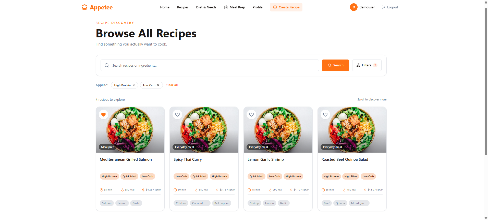
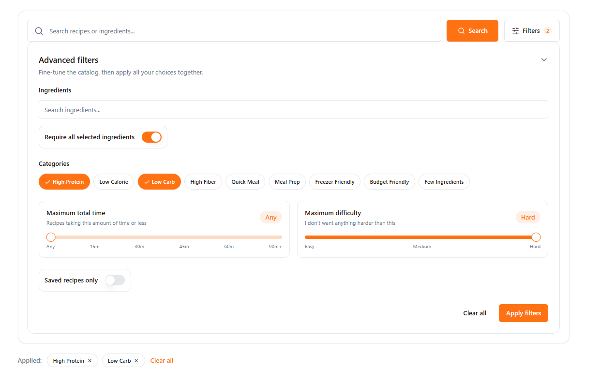
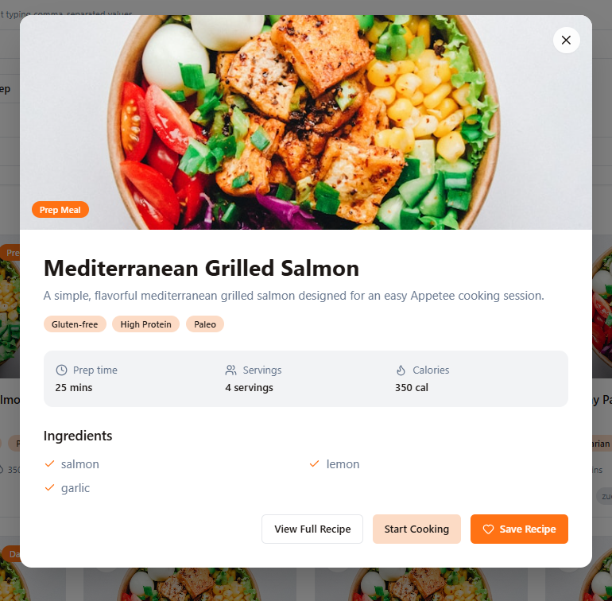

<!--
Purpose: Defines the shared phased contract and implementation status for F-008 Recipe Discovery.
Change reason: Record the completed frontend/backend implementation through Phase 13 and identify the intentionally deferred Phase 14 dependency.
Created: Existing file; original timestamp was not recorded.
Last updated: 2026-08-29T11:28:18-06:00
-->

# F-008 — Recipe Discovery, Recipe Card, and Quick Preview

**Status:** Active  
**Implementation status:** Frontend and backend Phases 1–13 are implemented and verified; Phase 14 is the only unimplemented feature phase and remains intentionally deferred to its recommendation-scoring dependency. Manual zoom, assistive-technology and non-Chromium browser sign-off remains tracked separately below.  
**Version:** 1.0  
**Owner:** Mathieu Galidie  
**Last updated:** 2026-08-29  
**Dependencies:** F-002 Authentication; F-003 Account Onboarding / Diet & Needs; F-007 Recipe and Ingredient Data Authoring  
**Related engineering initiatives:** E-008, E-010, E-013, E-017, E-019, E-020

## Goal

Give an authenticated Appetee user a fast, simple way to browse compatible recipes, search by recipe or ingredient, apply optional advanced filters, save recipes, and inspect a lightweight Quick Preview before entering Cooking Mode.

The same lightweight `RecipeCard` and `RecipeQuickPreview` behavior must be reusable from Recipes, Home, Favorites, Meal Planning, and future recipe-discovery surfaces.

## User Problem

Recipe discovery should be simple when the user already has an idea, useful when the user is trying to use ingredients already in the fridge, and lightweight when the user only wants to browse.

The user should not need to repeatedly configure their diet or ingredient restrictions. Appetee already knows those account-level requirements and must automatically exclude incompatible recipes from every discovery result.

The default Recipes page should never be blank. It should immediately provide a general compatible catalog and allow continuous browsing without requiring search or filter setup.

## Current Behavior

Originally reviewed against the frontend and backend `development` branches and the Builder.io reference prototype on 2026-08-24. Frontend and backend status through Phase 13 was audited and synchronized on 2026-08-29.

### Implemented frontend/backend delivery

- Authenticated `/recipes` frontend route exists under the private layout. The previously commented placeholder route was restored during the Phase 3 frontend correction.
- Shared `src/app/core/shared/ui/recipe-experience/` owns the canonical Recipe Card, Quick Preview and their UI-orchestration facade; the obsolete parallel Card location was removed.
- Shared recipe API/data-access area exists under `src/app/core/shared/data-access/recipes/`.
- Backend `RecipesController` is `[Authorize]`, and current-user identity is resolved through the shared authentication service rather than duplicated controller code or client input.
- Backend follows the existing `Controller -> RecipeService -> IRecipeQueries -> RecipeQueries/RecipeSql -> MySQL` structure.
- Backend uses Dapper and `MySqlConnector`.
- `GET /api/recipes` is an authenticated, bounded `RecipeDiscoveryPageDto` endpoint; the temporary whole-catalog consumer path has been removed.
- `GET /api/recipes/{id}` exists for complete recipe details used by existing authoring/edit flows.
- Discovery automatically enforces every authenticated-user diet and ingredient restriction, projects current-user `isSaved`, and hydrates only bounded card data.
- No-search discovery uses stable seeded keyset pagination with opaque cursors, a default page size of 20, `Take + 1` detection, and no total-count query.
- Search supports recipe and ingredient names, at most four effective terms, literal LIKE escaping, deterministic relevance ranking, and search-specific opaque cursors.
- Saved-only, canonical badge AND, maximum total-time, maximum-difficulty, and selected-ingredient ALL/ANY filters are implemented server-side and bound to cursor criteria.
- `PUT` and `DELETE /api/recipes/{id}/favorite` provide authenticated, current-user-scoped, idempotent favorite persistence.
- `GET /api/ingredients` preserves the legacy no-search catalogue and adds bounded lightweight autocomplete when `search` is supplied.
- Recipe persistence, canonical reset data, and authoring support the F-008 description, time, per-serving nutrition, display-order, featured-order, card-image, and nine-badge contracts.
- The canonical reset contains 1,699 F-008-ready recipes, and the Phase 2 reset/schema/generator validation is complete.
- The frontend consumes opaque cursor pages through the shared session-scoped `RecipesStore` and feature `RecipeDiscoveryFacade`, with append/de-duplication, continuation retry, query reuse and stale-generation rejection.
- `/recipes` provides initial and continuation states, IntersectionObserver loading, an equivalent Load More fallback, canonical empty/error states and the shared responsive fixed-height Recipe Card.
- Search submits dynamically through Angular routing without a document reload, survives refresh in canonical URL criteria and does not request while typing.
- Card favorite membership is optimistic, single-flight per recipe and reversible on failure; Saved-only participates in discovery criteria and URL state.
- Advanced categories, maximum time, maximum difficulty, ingredient autocomplete, up-to-three ingredient selection and ALL/ANY composition are implemented with local draft/Apply behavior.
- Desktop filters expand inside one search/filter container. Mobile uses the same logical panel as a full-screen focus-trapped dialog with Escape/close cancellation and scroll/focus restoration.
- Recipe image contracts are purpose-specific: cards use `cardImageUrl`; summary/detail consumers use `previewImageUrl`; unrelated ingredient/user `imageUrl` contracts remain unchanged.
- `GET /api/recipes/{id}/preview` now provides a dedicated authenticated lightweight Preview, rechecks compatibility, projects current-user saved state, and returns canonical badges plus ingredient identities in authored display order through one multi-result database command.
- `RecipePreviewDto`, `RecipesApi.getPreview`, the ID-keyed session-scoped `RecipePreviewStore`, and `RecipesFacade` Preview request state/coalescing/invalidation are implemented without reusing complete authoring details.
- Every normal shared Card surface enters the same `RecipeCard -> RecipeExperienceFacade -> RecipeQuickPreview` flow. Recipes and Home do not import/open Preview or coordinate favorite HTTP behavior themselves.
- Quick Preview renders Card-known image/name/time/calories/cost/badges/saved state immediately, lazily fills description/protein/ingredient names, supports error/retry, displays six ingredients plus noninteractive remainder text, synchronizes favorites, and keeps Start Cooking disabled.
- Desktop Preview uses Angular Material dialog focus trapping/restoration and internal scrolling; the same component becomes full screen on mobile and respects reduced-motion preferences.
- Invalid continuation-cursor `400` responses rebuild the active criteria from page one without exposing/retrying the rejected opaque token.

### Remaining behavior

- Phase 14 recommendation-aware general discovery remains intentionally deferred until its recommendation-score dependency exists.
- Manual 200%/400% zoom, assistive-technology and final non-Chromium visual sign-off remain open; automated desktop/mobile Chromium, keyboard/focus, responsive and reduced-motion checks pass.

## Scope

### Included

- Authenticated `/recipes` discovery page.
- General compatible catalog on initial load.
- Stable seeded pseudo-random discovery ordering for non-text-search queries.
- Opaque keyset cursor pagination.
- Default page size of 20 recipes and backend `Take + 1` detection.
- Infinite scrolling with an explicit accessible `Load more recipes` fallback.
- Shared reusable Recipe Card.
- Shared reusable Recipe Quick Preview.
- Simple search by recipe name and ingredient name only.
- Maximum four effective search terms.
- Search relevance ordering.
- Server-side advanced filters:
  - up to three selected ingredients;
  - `Require all selected ingredients` boolean;
  - canonical recipe badges/categories;
  - maximum total time;
  - maximum difficulty;
  - saved recipes only.
- Automatic authenticated-user diet compatibility.
- Automatic authenticated-user ingredient-restriction compatibility.
- Real saved-state projection.
- Save/unsave favorite mutation.
- Ingredient autocomplete for advanced filters.
- Applied search/filter criteria in the `/recipes` URL.
- Query/list state ownership and persistence within the authenticated SPA session.
- Per-recipe lazy Quick Preview cache.
- Required recipe/database/dataset readiness changes.
- Minimal recipe-authoring changes required so future recipes can persist the new canonical fields.
- Loading, empty, error, retry, responsive and accessibility behavior.
- Builder.io screenshots as noncanonical visual references.

### Excluded

- Separate full Recipe Detail page for consumers.
- Cooking Mode implementation.
- Active Start Cooking navigation before Cooking Mode exists.
- Diet filter on Recipe Discovery.
- Temporary ingredient-exclusion filter.
- Numeric calorie/protein/carbohydrate filters.
- Exact price filter.
- Meal-type filters such as `Day Meal` or top-level `Meal Prep`.
- Recommendation-score calculation.
- Meal-plan integration.
- Favorite collections.
- Full Favorites page.
- Full Admin Console redesign.
- AI/semantic/vector search.
- MySQL FULLTEXT search unless later measurements demonstrate a need.
- Server-side storage of cooking progress.
- Numbered pagination.

## Users and Permissions

| Actor | Allowed behavior |
|---|---|
| Guest | Cannot access Recipe Discovery, Quick Preview or favorite mutations. Backend returns `401`. |
| Authenticated user | Browse only recipes compatible with their current profile, search/filter, open Quick Preview, save/unsave recipes. |
| Administrator | Same consumer discovery behavior when using `/recipes`; admin authoring remains owned by F-007/admin endpoints. |

Frontend visibility is not authorization. Current-user identity is always derived from the authenticated cookie/session; the browser never supplies a trusted user ID for these operations.

## User Experience

### Page structure

```text
Recipe Discovery
Browse All Recipes
Find something you actually want to cook.

┌────────────────────────────────────────────────────────────┐
│ Search recipes or ingredients...   Search       Filters    │
│                                                            │
│ Advanced filter content appears here when expanded         │
└────────────────────────────────────────────────────────────┘

Applied: [High Protein ×] [Low Carb ×]  Clear all

[Recipe Card] [Recipe Card] [Recipe Card] [Recipe Card]
[Recipe Card] [Recipe Card] [Recipe Card] [Recipe Card]
...
```

The desktop search/filter area is one bordered visual block. Opening filters expands the same block. Do not create an outer search container containing a second outlined advanced-filter container.

### Initial catalog

- `/recipes` immediately requests the first discovery page.
- No text search or manual filter is required.
- The initial query automatically applies current-user compatibility.
- The initial non-search ordering is deterministic pseudo-random for the current cursor chain.
- A new cursor-less browse request may generate a different discovery order.
- No total result count is required or displayed.
- The production page requests 20 recipes per batch.

### Simple search

The primary field is:

```text
Search recipes or ingredients...
```

Search matches only:

```text
recipe name
OR
ingredient name
```

It does not text-search:

```text
diets
badges
difficulty
nutrition
cost
```

Typing does not send requests.

Search is committed when:

- the user presses Enter; or
- the user activates the standardized Search button.

A submitted search updates the URL, clears the old result/cursor chain and loads a new first page.

### Multi-word search

Normalize search by:

- trimming leading/trailing whitespace;
- collapsing repeated whitespace;
- using at most the first four non-empty terms for matching/ranking;
- matching case-insensitively according to the application/MySQL collation.

Every effective term is required.

For:

```text
chicken rice
```

the logical rule is:

```text
(chicken matches recipe name OR an ingredient name)
AND
(rice matches recipe name OR an ingredient name)
```

Substring matches are valid, so `chick` may match `Chicken`.

### Advanced filters

Desktop:

- Filters expand inside the same search/filter container.
- Filter edits are draft state.
- Changing draft controls does not request recipes.
- `Apply filters` commits all draft changes together.
- `Clear all` inside the open filter panel clears draft criteria.
- Applied-filter chips are visible when the panel is collapsed.
- Removing an already-applied chip immediately updates the URL and requests a new first page.
- Applied `Clear all` immediately clears applied filters and reloads the first page.

Mobile:

- Filters open as a full-screen filter experience.
- The same filter capabilities and semantics are available.
- `Clear` and `Apply filters` remain clearly reachable, preferably in a sticky bottom action area.
- Mobile must not use a permanently visible desktop-style sidebar.

### Ingredient filter

- Ingredient suggestions are server-backed.
- Up to three ingredients may be selected.
- Selected ingredients render as removable chips.
- `Require all selected ingredients` defaults to ON.

When ON:

```text
ingredient A AND ingredient B AND ingredient C
```

When OFF:

```text
ingredient A OR ingredient B OR ingredient C
```

There is no temporary ingredient-exclusion field. Avoided/restricted ingredients are account-level compatibility rules and are automatically enforced.

### Categories / badges

Canonical badge values are:

```text
High Protein
Low Calorie
Low Carb
High Fiber
Quick Meal
Meal Prep
Freezer Friendly
Budget Friendly
Few Ingredients
```

Selecting multiple badges uses AND semantics.

For example:

```text
High Protein
AND
Low Calorie
AND
Meal Prep
```

There is no ALL/ANY control for badges.

### Badge display priority

When ordered for API/UI presentation, use:

```text
1. High Protein
2. Low Calorie
3. Low Carb
4. High Fiber
5. Quick Meal
6. Meal Prep
7. Freezer Friendly
8. Budget Friendly
9. Few Ingredients
```

The backend owns this canonical order. The frontend does not invent a second sorting rule.

### Maximum total time

The filter represents:

```text
recipe total time <= selected maximum
```

It uses `total_time_minutes`, not prep time or cook time alone.

Suggested UI values remain lightweight:

```text
Any
15 min
30 min
45 min
60 min
90 min+
```

The exact slider control styling may evolve without changing the backend contract.

### Maximum difficulty

The user answers:

> I don't want anything harder than this.

Semantics:

```text
Easy   -> Easy only
Medium -> Easy + Medium
Hard   -> no difficulty restriction
```

### Saved recipes only

- `Saved recipes only` is fully functional in F-008.
- It narrows the discovery query to rows in `favorite_recipes` for the authenticated user.
- Default is OFF.

### Applied criteria and URL

Applied user intent is represented in `/recipes` query parameters.

Example:

```text
/recipes
?search=chicken%20rice
&ingredientIds=12
&ingredientIds=34
&requireAllIngredients=true
&badges=High%20Protein
&badges=Quick%20Meal
&maxTotalMinutes=45
&maxDifficulty=Medium
&savedOnly=true
```

List values use repeated query parameters, not comma-separated values.

Defaults should generally be omitted from the URL when they carry no extra information.

Do not serialize:

```text
cursor
browse seed
internal rank
loaded page count
scroll position
```

### Recipe Card

The existing shared Recipe Card is evolved rather than duplicated.

Each card shows:

- card image;
- favorite heart;
- recipe name;
- total time;
- calories per serving;
- estimated cost per serving;
- ordered recipe badges, with only the amount that fits the fixed badge row;
- up to three ordered featured ingredients.

The card does not show:

- diet labels;
- servings;
- difficulty;
- protein;
- full ingredients;
- description;
- meal type;
- ingredient-owned percentage.

#### Fixed layout rules

Cards have consistent height and internal regions at each breakpoint.

- Image region is fixed.
- Recipe title is limited to the approved fixed number of lines and then ellipsized.
- Badge region is one row only.
- Metadata region is fixed.
- Featured-ingredient region is one row only.
- Badges or featured ingredients that do not fit are omitted rather than wrapped.
- Overflow must never create a second row that changes card height.
- The card may change width/column count across breakpoints, but its internal vertical contract remains stable.

#### Card interaction

- Click/tap normal card surface -> open shared Quick Preview.
- Keyboard Enter/Space on the card -> open Quick Preview.
- Click/tap heart -> favorite mutation only.
- Heart interaction must stop propagation and must not open Quick Preview.
- Do not use double-tap as the primary save interaction.

### Quick Preview

Quick Preview is a shared lazy-loaded recipe component.

Desktop:

- Angular Material dialog/lightbox behavior.
- Darkened backdrop.
- Centered content.
- Accessible close control.
- Focus trapping/restoration.
- Internal scrolling when required.

Mobile:

- Same logical component and data contract.
- Full-screen presentation.
- Vertical scrolling.
- No separate mobile feature/component contract.

Preview shows:

- full recipe image;
- recipe name;
- required short description;
- all ordered badges that fit the preview layout;
- total time;
- calories per serving;
- protein per serving;
- estimated cost per serving;
- first six ingredient names in authored `display_order`;
- `+ N more ingredients` text when more than six exist;
- favorite control;
- Start Cooking button.

Preview does not show:

- serving selector;
- ingredient quantities;
- units;
- ingredient preparation notes;
- instructions;
- diets;
- difficulty;
- separate View Full Recipe action.

`+ N more ingredients` is informational and is not expandable.

`Start Cooking` is visible but disabled until the Cooking Mode feature supplies the final route/behavior.

### Progressive Preview loading

A card already contains part of the Preview information.

On first card click:

1. Open Quick Preview immediately using the available `RecipeCardDto`.
2. Render known card fields immediately:
   - image;
   - name;
   - total time;
   - calories;
   - cost;
   - badges;
   - saved state.
3. Show skeleton/loading treatment only for Preview-only fields:
   - description;
   - protein;
   - ingredient names.
4. Lazy request `GET /api/recipes/{id}/preview`.
5. Replace partial content with the complete `RecipePreviewDto`.
6. Cache the complete Preview by recipe ID.

On later opens in the same authenticated application session, a valid cached Preview can render immediately.

## User Flows

### Flow 1 — Browse recipes

1. Authenticated user opens `/recipes`.
2. Frontend has no cursor for the first request.
3. Backend derives current user ID from the cookie/session.
4. Backend applies diets and ingredient restrictions.
5. Backend creates a seeded deterministic discovery order.
6. Backend returns up to 20 `RecipeCardDto` items plus opaque continuation metadata.
7. Frontend renders the cards.
8. Near the bottom, frontend automatically loads the next page using only `nextCursor`.
9. Existing cards remain visible while more cards load.
10. `Load more recipes` can invoke the same pagination path manually.

### Flow 2 — Search

1. User types a query without triggering a request.
2. User presses Enter or Search.
3. Frontend commits the normalized search to the URL.
4. Existing discovery cursor/results are reset.
5. Backend applies user compatibility and search predicates.
6. Results use relevance ordering instead of shuffle ordering.
7. Infinite scrolling continues with a search-mode cursor.

### Flow 3 — Apply filters

1. User opens Filters.
2. Applied criteria are copied to draft controls.
3. User changes ingredients, badges, max time, max difficulty and/or saved-only.
4. No recipe request occurs yet.
5. User activates Apply filters.
6. Draft becomes applied criteria.
7. URL is updated.
8. Existing cursor/results reset.
9. First matching page loads.

### Flow 4 — Remove an applied filter

1. User activates `×` on an applied filter chip.
2. The criterion is removed immediately.
3. URL updates immediately.
4. Existing cursor/results reset.
5. A new first page loads without requiring Search or Apply again.

### Flow 5 — Save from a card

1. User activates the heart.
2. Frontend optimistically updates the heart state.
3. Repeated mutation for that recipe is blocked while the request is in flight.
4. Frontend calls PUT or DELETE as appropriate.
5. On success, state remains.
6. On failure, state is reverted and non-destructive error feedback is shown.
7. Cached Preview state for the same recipe is synchronized when present.

### Flow 6 — Open Quick Preview

1. User selects a Recipe Card.
2. Preview opens immediately using the loaded card projection.
3. Preview data is loaded only if no valid cached `RecipePreviewDto` exists.
4. Backend rechecks current compatibility before returning Preview.
5. First six ingredient names are displayed.
6. User may save/unsave or close Preview.
7. Start Cooking remains disabled until Cooking Mode is implemented.

## Business Rules

- Every Recipe Discovery read is user-specific.
- Current-user identity comes from authentication, not from browser-supplied user ID.
- Every discovery query automatically enforces all current user diets.
- Every discovery query automatically excludes any recipe containing a restricted ingredient.
- Diets are compatibility rules and are not Recipe Discovery filters.
- Ingredient restrictions are compatibility rules and are not temporary exclusion filters.
- Search matches recipe names and ingredient names only.
- Search uses at most four effective normalized terms.
- Every effective search term is required to match somewhere across recipe name/ingredients.
- Search title matches rank above ingredient-only matches.
- No text search -> seeded deterministic shuffled order.
- Filters without text search -> seeded deterministic shuffled order among matching recipes.
- Text search, with or without filters -> relevance order.
- Badge filter selections use AND semantics.
- Ingredient filter defaults to ALL semantics and may switch to ANY.
- Max time means `<= total_time_minutes`.
- Max difficulty is inclusive from Easy upward to the chosen maximum.
- Saved-only is false by default.
- Normal browse page size is 20.
- API supports bounded `limit` from 1 to 50.
- Backend requests `limit + 1` candidates to derive `hasMore`; no full count is required.
- Client never decodes or depends on cursor internals.
- Invalid/malformed/stale-for-criteria cursor returns `400`.
- Cursor is pagination state, not authorization.
- A stable eligible dataset must not repeat or skip rows while following one valid cursor chain.
- Changes to user diets/restrictions invalidate the current discovery query state on the frontend; every backend request always reapplies the latest compatibility rules.
- `favorite_recipes` is the persistence source of truth for favorite membership.
- `isSaved` is a user-specific read projection included in Card/Preview DTOs.
- PUT favorite requires an existing currently compatible recipe.
- DELETE favorite remains idempotent and may clean an existing membership even if the recipe became incompatible.
- Card returns all recipe badges in canonical priority order; UI may display only the amount that fits.
- Card returns only `featured_order` ingredients, at most three.
- Preview endpoint returns all lightweight ingredient identities in `display_order`; UI initially displays six.
- `description` is mandatory for every recipe.
- Every catalog-ready recipe must contain 1–3 featured ingredients.
- Browser does not author authoritative persisted nutrition totals.
- Future recipe create/update calculations remain server-authoritative.

## Shared Feature Ownership

| Capability | Ownership |
|---|---|
| Authentication/session cookie | F-002 / authentication engineering |
| User diets and ingredient restrictions | F-003 / Diet & Needs ownership |
| Recipe/ingredient authoring | F-007 |
| Development dataset/bootstrap/media pipeline | E-020 |
| Frontend data-access/state architecture | E-019 |
| Common API/ProblemDetails/OpenAPI rules | E-010 |
| Session/query reset and performance conventions | E-013 / E-019 |
| Shared Recipe Card | **F-008** |
| Shared Recipe Quick Preview | **F-008** |
| Recipe Discovery query/search/filter | **F-008** |
| Basic favorite membership mutation used by card/preview | **F-008** |
| Full Favorites page/collections | future Favorites feature |
| Cooking Mode | future Cooking feature |
| Recommendation scoring | future recommendation feature |
| Meal Planning | future Meal Planning feature |

F-006 Home must be updated to reference F-008 as the owner of Recipe Card and Quick Preview; its current legacy F-007 reference is no longer correct.

## Data Requirements

### Canonical badge type

```ts
type RecipeBadge =
  | 'High Protein'
  | 'Low Calorie'
  | 'Low Carb'
  | 'High Fiber'
  | 'Quick Meal'
  | 'Meal Prep'
  | 'Freezer Friendly'
  | 'Budget Friendly'
  | 'Few Ingredients';
```

These are canonical persisted/API values for new/reset data. Legacy development-only values such as `high-protein`, `freezer-friendly`, and `budget-focused` are not the target F-008 contract.

### Recipe Card DTO

```ts
interface RecipeCardDto {
  id: number;
  name: string;
  cardImageUrl: string | null;

  totalTimeMinutes: number;

  caloriesPerServing: number;
  estimatedCostPerServing: number;

  badges: RecipeBadge[];
  featuredIngredients: FeaturedIngredientDto[];

  isSaved: boolean;
}

interface FeaturedIngredientDto {
  id: number;
  name: string;
  featuredOrder: 1 | 2 | 3;
}
```

`estimatedCostPerServing` remains non-null for valid catalog recipes because F-007 requires calculable recipe cost.

### Recipe Discovery page DTO

```ts
interface RecipeDiscoveryPageDto {
  items: RecipeCardDto[];
  nextCursor: string | null;
  hasMore: boolean;
}
```

There is no total count requirement.

### Recipe Preview DTO

```ts
interface RecipePreviewDto {
  id: number;
  name: string;
  description: string;
  previewImageUrl: string | null;

  totalTimeMinutes: number;

  caloriesPerServing: number;
  proteinPerServing: number;
  estimatedCostPerServing: number;

  badges: RecipeBadge[];

  ingredients: Array<{
    id: number;
    name: string;
  }>;

  isSaved: boolean;
}
```

### Discovery criteria

```ts
interface RecipeDiscoveryCriteria {
  search: string;
  ingredientIds: readonly number[];
  requireAllIngredients: boolean;
  badges: readonly RecipeBadge[];
  maxTotalMinutes: number | null;
  maxDifficulty: 'Easy' | 'Medium' | 'Hard' | null;
  savedOnly: boolean;
}
```

`null` max difficulty is equivalent to unrestricted/Hard for URL/query canonicalization.

### Recipe authoring source additions

Existing F-007 recipe authoring must be extended minimally so future recipes can provide the source data required by F-008.

```ts
interface RecipeAuthoringRequest {
  name: string;
  description: string;

  prepTimeMinutes: number;
  cookTimeMinutes: number;
  totalTimeMinutes: number;

  // existing fields omitted

  ingredients: Array<{
    ingredientId: number;
    quantity: number;
    unit: string;

    // Ordered array position is persisted as display_order.
    // Exactly 1-3 recipe ingredients must be explicitly featured.
    featuredOrder: 1 | 2 | 3 | null;
  }>;
}
```

Persisted per-serving calories/protein are backend-derived for normal authoring and are not trusted browser write fields.

### Source dataset additions

Each source recipe already contains description/times/nutrition. Add explicit `featuredOrder` to the selected 1–3 ingredients.

`display_order` is generated from source ingredient array order and does not need a duplicated JSON property.

### Data ownership

| State | Ownership | Lifetime |
|---|---|---|
| Authenticated user/session identity | Application/session | Current authenticated identity |
| Recipe Preview entities | Complete entity cache | Current authenticated SPA session until invalidation/reset |
| Recipe Discovery cards/order/cursor/applied criteria | Query/list state | Current authenticated SPA session; reset when criteria/identity/compatibility changes |
| Open filter draft | Temporary feature/flow | While filter UI is open/editing |
| Search input before submit | Component-local | Current Recipes page/input instance |
| Preview dialog open/close state | Component/dialog-local | Current dialog |

### Cache and freshness

#### Discovery query state

First load:

- Load from URL-applied criteria.
- If matching cached query state exists in the current authenticated SPA session, reuse it.
- Otherwise request first page.

Reuse:

- `Recipes -> Home -> Recipes` may reuse loaded cards and `nextCursor` when applied URL criteria still match.
- Query order and cursor are preserved in memory only.

Invalidate/reset when:

- authenticated identity changes;
- logout/session reset occurs;
- applied search/filter criteria change;
- current user's diets change;
- current user's ingredient restrictions change;
- explicit discovery refresh is introduced and activated;
- a stale request belongs to an older query generation.

Browser refresh:

- URL-applied criteria survive.
- In-memory cursor/list state may be lost.
- The refreshed page starts a new first-page discovery chain for the same user intent.

#### Preview cache

- Cache complete `RecipePreviewDto` by recipe ID.
- No arbitrary TTL.
- Reuse across Recipes, Home and other shared card surfaces in the same authenticated SPA session.
- Invalidate on logout/identity change.
- Invalidate after an admin recipe update.
- Update cached `isSaved` after favorite mutation.
- Coalesce duplicate in-flight requests for the same recipe/generation.

## Database Impact

### Existing tables used

- `recipes`
- `recipe_ingredients`
- `ingredients`
- `recipe_badges`
- `favorite_recipes`
- `user_diets`
- `diet_recipes`
- `user_ingredient_restrictions`

Existing ingredient/nutrition tables remain part of F-007 authoring calculations.

### Schema changes

#### `recipes`

Add:

```text
description
  VARCHAR(500)
  NOT NULL

cook_time_minutes
  same canonical SQL integer type/range as prep_time_minutes
  NOT NULL

total_time_minutes
  same canonical SQL integer type/range as prep_time_minutes
  NOT NULL

calories_per_serving
  same canonical DECIMAL family/precision policy used for persisted recipe nutrition
  NOT NULL

protein_per_serving
  same canonical DECIMAL family/precision policy used for persisted recipe nutrition
  NOT NULL
```

Implementation must inspect the canonical schema and keep precision/type conventions consistent rather than introducing a second arbitrary numeric policy.

Time invariants:

```text
prep_time_minutes >= 0
cook_time_minutes >= 0
total_time_minutes > 0
total_time_minutes >= prep_time_minutes
total_time_minutes >= cook_time_minutes
```

Do not enforce:

```text
total_time_minutes = prep_time_minutes + cook_time_minutes
```

because future recipes may include rest/passive time.

#### `recipe_ingredients`

Add:

```text
display_order
  SMALLINT UNSIGNED
  NOT NULL

featured_order
  TINYINT UNSIGNED
  NULL
```

Required invariants:

```text
display_order >= 1
featured_order IS NULL OR featured_order BETWEEN 1 AND 3
1-3 featured ingredients per valid catalog recipe
no duplicate display_order within a recipe
no duplicate non-null featured_order within a recipe
```

Required uniqueness:

```sql
UNIQUE (recipe_id, display_order)
UNIQUE (recipe_id, featured_order)
```

MySQL allows multiple `NULL` values in the second unique index, so ordinary non-featured ingredients remain valid.

#### `recipe_badges`

The canonical allowed value set must be synchronized to the nine approved F-008 badge values.

If the current canonical rebuild schema contains a CHECK/validation list for old development badge slugs, update it to the approved values.

Backend/application validation and frontend types must be synchronized in the same phase.

### Index changes

Required/verified access paths:

```text
user_diets(user_id, diet_id)
diet_recipes(recipe_id, diet_id)

user_ingredient_restrictions(user_id, ingredient_id)
recipe_ingredients(recipe_id, ingredient_id)

recipe_badges(recipe_id, badge)

favorite_recipes(user_id, recipe_id)

UNIQUE recipe_ingredients(recipe_id, display_order)
UNIQUE recipe_ingredients(recipe_id, featured_order)
```

Do not automatically add speculative reverse-order indexes or individual indexes on:

```text
recipes(total_time_minutes)
recipes(difficulty)
recipes(name)
recipe_badges(badge, recipe_id)
recipe_ingredients(ingredient_id, recipe_id)
```

unless finalized discovery/search `EXPLAIN` plans show a concrete need.

The catalog is expected to remain approximately 3,000–5,000 recipes. Runtime seeded ranking/filesort is acceptable at that scale if measured query behavior remains within project performance targets.

### Query access patterns

Important access patterns are:

1. Authenticated compatible recipe page -> bounded `limit + 1` candidate query.
2. Bounded hydration of badges + featured ingredients for returned cards only.
3. Search by recipe name or ingredient name, maximum four effective terms.
4. Badge AND filter.
5. Ingredient ALL/ANY filter, maximum three selected IDs.
6. Max total time.
7. Max difficulty.
8. Saved-only.
9. Single-recipe Preview with badges and ordered lightweight ingredients.
10. Favorite membership insert/remove.
11. Ingredient autocomplete.

Important query/index behavior must be validated with `EXPLAIN`.

### Data migration / reset

Current approved development transition:

- Do not create a separate one-off data migration document for the disposable local dataset.
- Update the canonical generated schema/data pipeline owned by E-020.
- `npm run db:reset:local` must recreate the database from zero with all F-008 fields correctly populated.
- Update at least the canonical schema and generated recipe data files used by that reset, including `data/generated/sql/01-schema.sql` and `data/generated/sql/04-recipes.sql` where those are the current canonical paths.
- Source dataset validation must fail before SQL generation when F-008 invariants are not satisfied.

If a persistent environment containing non-disposable user/recipe data exists by implementation time, do not destructively reset that environment. Use E-008 migration mechanics for that persistent environment and keep the canonical rebuild schema synchronized.

### Dataset requirements

For every catalog recipe used by the reset:

- description is present/nonblank;
- prep/cook/total time is present and valid;
- calculated per-serving calories exist;
- calculated per-serving protein exists;
- ingredient array order is meaningful;
- 1–3 ingredients explicitly contain unique `featuredOrder` values;
- badge values use the canonical nine-value vocabulary;
- recipe relationships reference existing ingredients;
- all server-authoritative existing cost/nutrition invariants still pass.

## API Endpoints

| Method | Endpoint | Purpose | Owner | State |
|---|---|---|---|---|
| `GET` | `/api/recipes` | Authenticated discovery/search/filter page | F-008 | Phase 3 foundation implemented; authenticated compatibility and bounded card page active, cursor/search/filter criteria remain phased |
| `GET` | `/api/recipes/{id}/preview` | Lazy Quick Preview read model | F-008 | Planned |
| `PUT` | `/api/recipes/{id}/favorite` | Ensure recipe is saved for current user | F-008 | Planned |
| `DELETE` | `/api/recipes/{id}/favorite` | Ensure recipe is not saved for current user | F-008 | Planned |
| `GET` | `/api/ingredients?search=...&limit=...` | Bounded ingredient autocomplete | Ingredient catalogue, extended by F-008 integration | Planned extension |
| `GET` | `/api/recipes/{id}` | Existing complete recipe detail/edit data | Existing/F-007 | Existing; not used as Quick Preview |

The old `GET /api/recipes` whole-catalog implementation and corresponding `GetAll/GetAllAsync/getAll()` behavior are deleted rather than retained as a compatibility path.

## Request Contracts

### `GET /api/recipes`

No body.

Supported query parameters:

| Parameter | Type | Default | Rule |
|---|---|---:|---|
| `search` | string | empty | Trim/collapse whitespace; max 100 input chars; use first four effective terms |
| `ingredientIds` | repeated int | none | Positive, distinct, maximum 3 |
| `requireAllIngredients` | bool | `true` | Relevant only when ingredient IDs exist |
| `badges` | repeated canonical badge string | none | Distinct; every value must be canonical |
| `maxTotalMinutes` | int | none | Positive bounded value; filter uses `<=` |
| `maxDifficulty` | `Easy|Medium|Hard` | none | Hard/unset means unrestricted |
| `savedOnly` | bool | `false` | Current user only |
| `cursor` | opaque string | none | Backend-owned cursor |
| `limit` | int | `20` | Minimum 1, maximum 50 |

Current-user ID is never accepted as a query parameter.

Example:

```http
GET /api/recipes?search=chicken%20rice&ingredientIds=12&ingredientIds=34&requireAllIngredients=true&badges=High%20Protein&maxTotalMinutes=45&maxDifficulty=Medium&savedOnly=true&limit=20
```

### `GET /api/recipes/{id}/preview`

No body/query criteria.

Rules:

- positive recipe ID;
- authenticated current user;
- recipe must exist;
- recipe must currently pass user compatibility.

### `PUT /api/recipes/{id}/favorite`

No body.

Rules:

- positive recipe ID;
- authenticated current user;
- recipe must exist and currently pass user compatibility;
- operation is idempotent.

### `DELETE /api/recipes/{id}/favorite`

No body.

Rules:

- positive recipe ID;
- authenticated current user;
- remove current-user membership if present;
- operation is idempotent;
- deletion does not require current compatibility if an old membership exists.

### `GET /api/ingredients`

Existing no-search behavior may remain for current F-003/F-007 consumers.

Autocomplete form:

```http
GET /api/ingredients?search=chick&limit=10
```

Rules when `search` is supplied:

- trim search;
- frontend does not request suggestions before 2 characters;
- backend validates a reasonable bounded search length;
- default autocomplete limit `10`;
- autocomplete maximum remains bounded;
- result is lightweight ingredient ID/name data only.

## Response Contracts

### `GET /api/recipes` — `200`

```json
{
  "items": [
    {
      "id": 42,
      "name": "Chicken Quinoa Burrito Bowls",
      "cardImageUrl": "https://...",
      "totalTimeMinutes": 35,
      "caloriesPerServing": 451.12,
      "estimatedCostPerServing": 1.72,
      "badges": [
        "High Protein",
        "Meal Prep",
        "Budget Friendly"
      ],
      "featuredIngredients": [
        {
          "id": 12,
          "name": "Chicken breast",
          "featuredOrder": 1
        },
        {
          "id": 48,
          "name": "Quinoa",
          "featuredOrder": 2
        },
        {
          "id": 64,
          "name": "Black beans",
          "featuredOrder": 3
        }
      ],
      "isSaved": false
    }
  ],
  "nextCursor": "opaque-cursor-or-null",
  "hasMore": true
}
```

Rules:

- arrays are empty rather than `null`;
- no full ingredients;
- no diets;
- no servings;
- no difficulty;
- no description;
- no instructions;
- no total count;
- internal sort/relevance rank is never returned.

### `GET /api/recipes/{id}/preview` — `200`

```json
{
  "id": 42,
  "name": "Chicken Quinoa Burrito Bowls",
  "description": "Quinoa bowls with chicken, black beans, corn, and salsa for a sturdy make-ahead meal.",
  "previewImageUrl": "https://...",
  "totalTimeMinutes": 35,
  "caloriesPerServing": 451.12,
  "proteinPerServing": 40.84,
  "estimatedCostPerServing": 1.72,
  "badges": [
    "High Protein",
    "Meal Prep",
    "Budget Friendly"
  ],
  "ingredients": [
    {
      "id": 12,
      "name": "Chicken breast"
    },
    {
      "id": 48,
      "name": "Quinoa"
    }
  ],
  "isSaved": false
}
```

Backend returns the complete lightweight ingredient identity list in authored `display_order`. The frontend renders the first six and displays a noninteractive `+ N more ingredients` line when required.

### Favorite PUT/DELETE — success

```http
204 No Content
```

### Ingredient autocomplete — `200`

```json
[
  {
    "id": 12,
    "name": "Chicken breast"
  },
  {
    "id": 13,
    "name": "Chicken thigh"
  }
]
```

## Pagination and Cursor Contract

### First browse request

A first request has no cursor.

```http
GET /api/recipes?limit=20
```

Backend:

1. derives current user;
2. normalizes effective criteria;
3. generates a cryptographically strong random positive browse seed;
4. computes a deterministic rank for each eligible candidate, conceptually:

```sql
CRC32(CONCAT(@BrowseSeed, ':', r.id))
```

5. orders by:

```sql
browse_rank ASC,
id ASC
```

6. fetches `limit + 1`;
7. returns at most `limit`;
8. builds `nextCursor` from the last returned item if another row exists.

### Browse cursor internal shape

Conceptually:

```json
{
  "v": 1,
  "mode": "browse",
  "seed": 87326421,
  "rank": 18372561,
  "id": 142,
  "criteria": "criteria-fingerprint"
}
```

Continue with:

```sql
browse_rank > @CursorRank
OR (
  browse_rank = @CursorRank
  AND id > @CursorId
)
```

### Search cursor internal shape

Search requests do not use a browse seed.

Conceptually:

```json
{
  "v": 1,
  "mode": "search",
  "rank": 680,
  "id": 142,
  "criteria": "criteria-fingerprint"
}
```

Search orders by:

```sql
relevance_rank DESC,
id DESC
```

Continue with:

```sql
relevance_rank < @CursorRank
OR (
  relevance_rank = @CursorRank
  AND id < @CursorId
)
```

### Cursor encoding

- Serialize versioned internal cursor data.
- Encode using Base64URL.
- Do not expose a parsed cursor model to Angular.
- Cursor is not encrypted and is not an authorization token.
- Treat decoded values as untrusted input.
- Reject invalid Base64URL, invalid JSON, unsupported version/mode, invalid numeric values, excessive encoded length or criteria mismatch with `400`.

### Criteria fingerprint

Generate from a normalized canonical representation including at least:

```text
authenticated user ID
effective normalized search terms
sorted distinct ingredient IDs
requireAllIngredients
canonical sorted badges
maxTotalMinutes
maxDifficulty
savedOnly
```

Hash with SHA-256 and encode the fingerprint in a stable form.

The user ID is included in the fingerprint so a cursor chain is bound to the same authenticated account without exposing the ID as an API parameter.

Changing a user's profile diets/restrictions must reset the frontend discovery query. Backend always reapplies current compatibility on every request.

### Stability guarantee

For a stable eligible dataset/profile during one cursor chain:

- no duplicate recipe is returned across pages;
- no recipe in the ordered result stream is skipped;
- tied ranks are deterministically broken by recipe ID;
- the same browse seed produces the same ordering.

New/deleted/changed recipes during an active chain are not guaranteed to behave like a database snapshot. Appetee does not keep a long-lived database transaction/snapshot for infinite scrolling.

## Search Relevance Contract

F-008 uses deterministic integer relevance, not AI/semantic search.

Approved weighting:

```text
Exact normalized full recipe-name match       +1000
Recipe name starts with full search           +500

For each effective term:
  Recipe title exact term                     +120
  Recipe title starts with term                +90
  Recipe title contains term                   +60

  Ingredient name exact term                  +30
  Ingredient name starts with term             +20
  Ingredient name contains term                +10
```

All effective terms must already pass the search predicate. The score only orders valid matches.

Recipe-title matches intentionally outrank ingredient-only matches.

The score is internal pagination/query state and is not returned to the client.

LIKE patterns must escape literal `%`, `_` and the escape character before creating `%term%` patterns. Use the current case-insensitive application/database collation where appropriate rather than adding speculative search infrastructure.

At the expected maximum 3,000–5,000 recipes, this SQL strategy is acceptable subject to `EXPLAIN` and integration timing checks. Do not add FULLTEXT solely for portfolio sophistication when the measured catalog does not require it.

## Error Behavior

| Situation | Expected behavior |
|---|---|
| Missing/expired authentication | `401` |
| Invalid discovery query parameter | `400` |
| Malformed/unsupported/mismatched cursor | `400` |
| Discovery finds no matching recipes | `200` with empty `items`, `hasMore: false`, `nextCursor: null` |
| Preview recipe does not exist | `404` |
| Preview recipe exists but is incompatible with current user | `404` |
| Favorite PUT recipe does not exist or is currently incompatible | `404` |
| Favorite PUT for already-saved recipe | successful idempotent `204` |
| Favorite DELETE for already-unsaved recipe | successful idempotent `204` |
| Database/server failure | common E-010 `500` ProblemDetails behavior |
| Rate limited if common abuse protection applies | `429` |

Do not use `403` merely because a recipe is incompatible with a user's diet/restriction profile.

## Responsive Behavior

### Large desktop

- Four-card grid is the normal target at the current content width.
- Wider layouts may support more cards only if the shared card dimensions and content remain readable.
- Search + Search button + Filters button remain one row when space allows.
- Expanded filters appear in the same search/filter container.
- Time and difficulty controls may share a row.

### Desktop/laptop

- Approximately four cards per row at the primary design width.
- A 20-item page corresponds to approximately five rows.
- Fixed card height and one-row badge/featured-ingredient regions are preserved.

### Tablet

- Reduce grid columns according to available width.
- Do not shrink card content until unreadable.
- Expanded filter layout may stack internal groups while remaining one outer container.

### Mobile

- One-column vertical recipe list/grid.
- Normal vertical scrolling; no swipe-only carousel.
- Filter UI is full screen.
- Quick Preview is full screen.
- Card heart remains a visible explicit control.
- No double-tap-only favorite behavior.
- Fixed internal card structure remains consistent.

Exact CSS breakpoints are implementation choices based on the final existing Appetee layout system and should not be duplicated as product rules.

## Accessibility Requirements

- Recipe Card must be keyboard operable.
- Card activation and heart activation must be separate semantic controls.
- Heart has an accessible saved/unsaved name/state.
- Search is a labeled form and Enter submits.
- Search/Filter/Apply/Clear controls have visible focus.
- Ingredient autocomplete uses accessible combobox/listbox semantics.
- Filter switches/sliders expose labels, current values and selected state without color-only communication.
- Applied chips are keyboard removable.
- Infinite scrolling does not remove an explicit keyboard-accessible Load More path.
- Loading-more must not steal focus or remove existing cards.
- Initial and load-more errors are announced appropriately.
- Quick Preview dialog traps focus on desktop and restores focus to the originating card/control when closed.
- Escape closes desktop Quick Preview unless platform dialog conventions require equivalent accessible close behavior.
- Mobile full-screen Preview exposes a clear close/back control.
- UI supports zoom/reflow without requiring horizontal page scrolling for primary interaction.
- Reduced-motion preferences are respected for nonessential expand/dialog/scroll animation.

## Design References

Builder.io is a visual/interaction direction only. It is not a source of truth for Angular architecture, CSS technology, data shape, backend behavior or final product rules.

### Recipes page reference



Approved direction:

- heading;
- simple search;
- Search/Filters actions;
- applied chips;
- four-card desktop grid;
- fixed-height card concept.

Spec overrides:

- remove dark `Meal prep` / `Everyday meal` image overlays;
- no result total count requirement;
- use canonical Appetee badges only.

### Expanded filter reference



Approved direction:

- ingredient search;
- Require All switch;
- all nine categories;
- total-time/difficulty lightweight controls;
- saved-only;
- Clear/Apply actions.

Spec correction:

- use one outer search/filter block that expands/collapses;
- do not preserve the nested outlined advanced-filter block shown in the Builder screenshot.

### Quick Preview reference



Approved direction:

- desktop lightbox/modal;
- prominent image/title/description;
- lightweight metadata;
- ingredient-name preview;
- clear actions.

Spec overrides:

- no image-overlay meal type;
- no diet labels as discovery tags;
- no View Full Recipe button;
- no serving metadata/control in Preview;
- use total time, calories/serving, protein/serving and cost/serving;
- ingredient list shows first six plus informational `+ N more`;
- Start Cooking remains disabled until Cooking Mode exists.

## Delivery Phases

Phases are intentionally small enough to review independently. Codex/developers must work on one phase at a time and must not implement later phases unless explicitly requested.

### Phase 1 — Data contract and reset plan

**Status:** Complete on 2026-08-24

#### User value delivered

- Establishes the exact implementation baseline before changing schema/code so later phases do not create throwaway contracts.

#### Included work

Frontend:

- [x] Inspect current recipe authoring/read models that will need F-008 field additions.
- [x] Inspect current `_button.scss`, `_text.scss`, `_theme.scss`, CSS variables and shared Recipe Card before planning UI changes.
- [x] Confirm no F-008 styling plan copies Tailwind/shadcn Builder implementation.

Frontend assessment recorded the temporary whole-catalog/client-filter implementation, the three legacy badge slugs, the existing complete-detail cache, the F-007 authoring dependencies and the shared Recipe Card's temporary fields. Existing theme variables, typography roles and button primitives were confirmed as the required styling foundation; Builder assets remain composition references only and no Tailwind/shadcn implementation is planned.

Backend:

- [x] Inspect current recipe controller/service/query/row-data/SQL paths.
- [x] Identify the current canonical `RecipeBadgeValues` and all old badge representations that must be synchronized.
- [x] Confirm the current persisted SQL numeric types so new columns follow existing canonical precision/type policy.

Database/API:

- [x] Inspect E-020 reset/bootstrap generation path and exact generated SQL inputs/outputs.
- [x] Confirm `npm run db:reset:local` rebuild sequence.
- [x] Confirm all existing relevant indexes/primary keys before adding any F-008 index.
- [x] Record the exact schema files changed by Phase 2.
- [x] Do not create production code in this phase beyond documentation/tests needed to validate the plan.

Documentation/assets:

- [x] Update implementation notes if actual file paths differ from this specification without changing the approved contracts.
- [x] Keep Builder assets explicitly noncanonical.

#### Tests and validation

- [x] Baseline local reset command is run/verified before schema work.
- [x] Baseline backend tests pass before implementation starts.
- [x] Baseline frontend tests pass before implementation starts.
- [x] Integration tests for remembered and non-remembered cookie attributes.
- [x] Idle, sliding, and absolute-expiration tests.
- [x] Frontend expired-session redirect/message tests.
- [x] Multi-browser behavior validation.

#### Phase completion criteria

- [x] Current schema/types/indexes are documented for implementation.
- [x] Exact reset/bootstrap files are identified.
- [x] No unresolved blocking data-contract ambiguity remains.
- [x] No feature behavior has been silently redesigned.

### Phase 2 — Recipe data readiness and canonical reset

**Status:** In progress — frontend, backend and database/reset implementation complete; related documentation and cross-browser validation remain

#### User value delivered

- Makes every reset recipe capable of supporting the final Recipe Card, search/filter and Quick Preview without temporary fallback data.

#### Included work

Frontend:

- [x] Extend existing F-007 recipe create/edit source form only as needed for required `description`, cook/total times and 1–3 ordered featured ingredients.
- [x] Preserve existing authoring architecture; do not redesign the Admin UI.
- [x] Update `RecipeBadge` to the canonical nine values in shared data models.
- [x] Ensure authoring submits `featuredOrder` source values but not authoritative persisted calories/protein per serving.
- [x] Align existing frontend summary/detail read models with backend-derived `caloriesPerServing`, `proteinPerServing` and `estimatedCostPerServing` values without adding calculated fields to write requests.

#### Frontend implementation record — 2026-08-24

Phase 2 frontend work was implemented in `appetee_front` without backend or database changes.

Implemented shared contract changes:

- Replaced the three development-only badge slugs with the canonical nine-value `RecipeBadge` union.
- Added `RecipeFeaturedOrder = 1 | 2 | 3`.
- Added `description`, `cookTimeMinutes` and `totalTimeMinutes` to the existing complete recipe detail read model used by create/edit.
- Added nullable `featuredOrder` to recipe ingredient detail and authoring request models.
- Added `description`, `cookTimeMinutes` and `totalTimeMinutes` to the authoring request model.
- Added `RecipePerServingNutrition` with `caloriesPerServing` and `proteinPerServing` to the current recipe summary/detail response models so they match the existing backend response contract.
- Retained `estimatedCostPerServing` in the response model.
- Kept the existing authoring `RecipeSummaryDto`/complete-detail response separate from the canonical discovery `RecipeCardDto`; admin create/update responses do not masquerade as discovery cards.

Implemented create/edit behavior:

- Added a required, trimmed short-description field with a 500-character limit.
- Added cook-time and total-time controls alongside the existing prep-time control.
- Cook time accepts zero or greater; total time must be greater than zero and at least both prep time and cook time.
- Total time is not forced to equal prep time plus cook time, preserving support for rest/passive time.
- Added an in-place featured toggle to each existing ingredient row rather than redesigning the Admin Recipe page.
- Exactly one to three ingredients must be featured before submission.
- Featured ingredients receive unique sequential orders based on selection order.
- Removing or unselecting a featured ingredient compacts later orders so the submitted values remain sequential.
- Once three ingredients are featured, remaining unfeatured controls are disabled until a selection is removed.
- Ingredient array order remains unchanged so the backend can derive `display_order` from submitted ingredient order.
- Edit-mode hydration restores description, cook/total times and each ingredient's `featuredOrder`.
- Create-mode reset initializes blank description, 15-minute prep, 15-minute cook and 30-minute total values.
- The Admin summary calculates calories/protein per serving locally for immediate preview as servings or ingredients change.
- The Admin UI explicitly labels live nutrition/cost as estimates and states that saved values are recalculated by the server.
- Edit/detail hydration and successful create/update responses replace preview values with backend-authoritative calories, protein and cost per serving.
- The Admin success recap renders backend-returned calories and protein per serving rather than presenting whole-recipe totals as serving values.

Implemented request behavior:

- Admin create/update multipart requests now send `description`, `prepTimeMinutes`, `cookTimeMinutes` and `totalTimeMinutes`.
- Each ingredient sends `featuredOrder` only when it is non-null.
- Existing ingredient quantity/unit and ordered instruction serialization is preserved.
- Browser-calculated calories, protein, carbohydrates, calories/protein per serving and cost remain preview-only and are not submitted as authoritative write fields.
- The backend response remains the source of truth for persisted `caloriesPerServing`, `proteinPerServing` and `estimatedCostPerServing`.

Implemented compatibility updates:

- Admin badge options now expose all nine canonical values.
- Existing Recipe Card and Admin success rendering display canonical badge values directly.
- Existing admin summary/detail workflows now retain backend-returned per-serving nutrition instead of typing those response properties away.
- The temporary Recipes meal-type compatibility mapping now recognizes `Meal Prep` instead of the removed `freezer-friendly` slug.
- The temporary Home recipe fixture now uses `Budget Friendly` instead of the removed `budget-focused` slug.
- No legacy `freezer-friendly`, `budget-focused` or `high-protein` badge values remain in frontend source.

Frontend files changed:

```text
src/app/core/shared/data-access/recipes/recipe.model.ts
src/app/core/shared/data-access/recipes/admin/admin-recipe.facade.ts
src/app/core/shared/data-access/recipes/admin/admin-recipe.facade.spec.ts
src/app/core/shared/data-access/recipes/recipe.facade.spec.ts
src/app/core/shared/ui/recipe-experience/recipe-card/recipe-card.component.ts
src/app/features/admin-recipes/data/recipe-creation.ts
src/app/features/admin-recipes/admin-recipes.page.ts
src/app/features/admin-recipes/admin-recipes.page.html
src/app/features/admin-recipes/admin-recipes.page.scss
src/app/features/admin-recipes/admin-recipes.page.spec.ts
src/app/features/admin-recipes/admin-recipes-success.page.ts
src/app/features/home/home.page.ts
src/app/features/recipes/RecipesList/recipesList.page.ts
```

Frontend validation completed:

- `npm run build` passed. The existing Admin Recipe SCSS budget warning remains; the stylesheet is 7.45 kB against a 4.00 kB warning budget.
- `npm run test -- --watch=false` passed: 22 test files, 102 passing tests and one existing skipped test.
- `npx --no-install tsc --noEmit -p tsconfig.app.json` passed.
- `npx --no-install tsc --noEmit -p tsconfig.spec.json` passed.
- Chromium account/session E2E passed: four tests covering Remember Me submission, expired-session redirect/message behavior, startup expiration feedback and identity isolation.
- Playwright currently defines Chromium only, so Firefox/WebKit validation is still outstanding.

Frontend regression coverage added:

- Required/nonblank description and prep/cook/total-time validation.
- Trimmed source-field submission.
- Canonical badge submission.
- Sequential featured-order assignment and compaction.
- One-featured-ingredient minimum and three-featured-ingredient maximum.
- Multipart serialization of the new source fields.
- Read-model coverage for backend-derived calories/protein per serving.
- Local per-serving preview recalculation when servings change followed by replacement with authoritative saved-response values.
- Continued omission of browser-calculated totals, per-serving nutrition and cost fields from multipart writes.

Phase ownership remains intentionally split:

- Phase 2 owns persistence/read-contract readiness and the existing authoring workflow's handling of authoritative per-serving values.
- Phase 5 owns rendering `caloriesPerServing` and `estimatedCostPerServing` in the final shared Recipe Card.
- Phase 12 owns the dedicated `RecipePreviewDto`/Preview API cache, including all three per-serving values.
- Phase 13 owns final Quick Preview rendering, including `proteinPerServing`.

The backend authoring contract, canonical database/reset dataset, generated SQL and required backend/data validation are complete. Phase 2 remains open until the related F-007/E-020 documentation synchronization and remaining browser validation are completed.

Backend:

- [x] Extend recipe authoring request normalization/validation for mandatory description.
- [x] Extend time validation for prep/cook/total.
- [x] Extend recipe ingredient request handling for `featuredOrder`.
- [x] Derive/persist `display_order` from submitted ingredient order.
- [x] Require 1–3 unique featured ingredients.
- [x] Extend backend-authoritative recipe calculation to persist calories/protein per serving.
- [x] Expand canonical badge validation and priority helper to all nine approved values.
- [x] Update recipe create/update SQL and bulk ingredient insert logic.
- [x] Keep recipe write transaction/Blob rollback behavior intact.

#### Backend and data implementation record — 2026-08-24

Phase 2 backend and database/reset work was implemented in `Backend` without frontend changes.

Implemented authoring and read-contract changes:

- Added mandatory trimmed recipe description validation with a 500-character limit.
- Added prep, cook and total-time request, persistence and response fields. Prep and cook accept zero or greater; total must be positive and at least both prep and cook. Total is not forced to equal prep plus cook.
- Added nullable `featuredOrder` to recipe ingredient requests and responses.
- Derived one-based `display_order` from submitted ingredient array order and persisted both ingredient order fields in the existing recipe write transaction.
- Required one to three featured ingredients with unique orders in the range 1–3.
- Added server-authoritative rounded calories and protein per serving, derived from the calculated recipe totals and serving count. Browser-calculated nutrition remains non-authoritative.
- Expanded backend badge validation and deterministic priority ordering to the nine canonical F-008 values; legacy development slugs are no longer accepted as canonical values.
- Extended recipe summary/detail row data and DTO mappings with description, split times, per-serving nutrition and ingredient ordering.
- Preserved the existing transaction and uploaded-Blob compensation/rollback behavior.

Implemented schema and migration changes:

- Extended `recipes` with `description`, `cook_time_minutes`, `total_time_minutes`, `calories_per_serving` and `protein_per_serving`, including validation constraints.
- Extended `recipe_ingredients` with required `display_order` and nullable `featured_order`, including per-recipe uniqueness and range constraints.
- Replaced the legacy badge constraint with the canonical nine-value constraint.
- Added forward migration `migrations/20260824_006_f008_phase2_recipe_data_readiness.sql`. It safely adds nullable columns, backfills legacy rows, validates the result, then applies required constraints and indexes.
- Updated canonical root schema/seed files `scriptDatabase.sql` and `initObjectDatabase.sql`.
- Updated the E-020 generator and regenerated `data/generated/sql/01-schema.sql` and `data/generated/sql/04-recipes.sql`.
- `data/generated/sql/03-ingredients.sql` required no semantic change because Phase 2 did not change the ingredient catalogue insert contract.

Implemented canonical dataset and generator changes:

- Added explicit `featuredOrder` values to the canonical source JSON for all 1,699 recipes.
- Assigned the first three ingredients in each source recipe orders 1, 2 and 3. Remaining ingredients are unfeatured.
- Generated one-based `display_order` from ingredient array order for every recipe-ingredient SQL row.
- Generated recipe SQL now includes description, split times and backend-authoritative calories/protein per serving.
- Extended source validation so generation fails for missing/blank descriptions, invalid time relationships, missing featured ingredients, out-of-range featured orders or duplicate featured orders.
- Extended guarded local reset verification to check the new recipe fields, sequential unique display ordering, one to three unique featured ingredients and absence of legacy badge values.

Backend/data files changed:

```text
scriptDatabase.sql
initObjectDatabase.sql
migrations/20260824_006_f008_phase2_recipe_data_readiness.sql
src/Appetee.Application/Dtos/RecipeDto.cs
src/Appetee.Application/Models/Recipes/RecipeCalculation.cs
src/Appetee.Application/Models/Recipes/RecipeMetadata.cs
src/Appetee.Application/Requests/RecipeRequest.cs
src/Appetee.Application/RowData/RecipeRowData.cs
src/Appetee.Application/Services/Recipes/RecipeService.cs
src/Appetee.Infrastructure/Data/DapperSqlBuilder.cs
src/Appetee.Infrastructure/Recipes/RecipeQueries.cs
src/Appetee.Infrastructure/Recipes/RecipeSql.cs
data/recipes/*/recipe.json
data/tools/database/verify-local.mjs
data/tools/generation/generate.mjs
data/tools/validation/validate.mjs
data/generated/sql/01-schema.sql
data/generated/sql/04-recipes.sql
tests/Appetee.Api.Tests/Integration/F008Phase2DatabaseTests.cs
tests/Appetee.Api.Tests/Integration/AdminEndpointsTests.cs
tests/Appetee.Api.Tests/Integration/RecipesEndpointsTests.cs
tests/Appetee.Api.Tests/Infrastructure/MultipartContentBuilder.cs
tests/Appetee.Api.Tests/Unit/RecipeCalculatorTests.cs
tests/Appetee.Api.Tests/Unit/RecipeSqlTests.cs
data/tools/test/generate-sql.test.mjs
```

Backend/data validation completed:

- `dotnet test tests/Appetee.Api.Tests/Appetee.Api.Tests.csproj` passed: 167 tests.
- Focused backend validation passed: 66 tests.
- Release solution build passed with zero warnings and zero errors.
- `npm test` in `Backend/data` passed: 48 tests.
- `npm run validate` validated 121 ingredients and 1,699 recipes with zero errors. The existing dataset report still contains 2,787 non-blocking warnings.
- `npm run build` regenerated the canonical schema, recipe SQL, indexes and validation reports.
- `npm run db:reset:local` passed its localhost/database-name safety guard, rebuilt the database from the canonical generated SQL and completed read-only verification.
- Reset verification confirmed 121 ingredients, 1,699 recipes, 12,415 recipe-ingredient relationships, 4,523 recipe-diet relationships and 5,835 recipe-badge relationships.
- The migration integration test verified both the current canonical schema and upgrade from the legacy pre-Phase-2 shape.
- All 1,699 source recipes have exactly three valid unique featured orders, and no legacy badge values remain in the canonical source dataset.

Database/API:

- [x] Add `recipes.description`.
- [x] Add `recipes.cook_time_minutes`.
- [x] Add `recipes.total_time_minutes`.
- [x] Add `recipes.calories_per_serving`.
- [x] Add `recipes.protein_per_serving`.
- [x] Add `recipe_ingredients.display_order`.
- [x] Add `recipe_ingredients.featured_order`.
- [x] Add uniqueness/validation required by the canonical schema.
- [x] Update canonical badge value constraint/list if present.
- [x] Add explicit `featuredOrder` to source recipe JSON.
- [x] Generate `display_order` from ingredient array order.
- [x] Update generated schema/recipe SQL used by E-020 reset.
- [x] Run `npm run db:reset:local` and verify all generated rows.
- [ ] Update F-007 documentation/contracts for the source authoring fields introduced by F-008.
- [x] Do not create a one-off development-data migration document.

Documentation/assets:

- [ ] Record reset/data validation behavior in F-008/F-007/E-020 related docs where required.

#### Tests and validation

- [x] Reset builds an empty database successfully from the canonical scripts.
- [x] Every seeded recipe has nonblank description.
- [x] Every seeded recipe has valid prep/cook/total times.
- [x] Every seeded recipe has calories/protein per serving.
- [x] Every seeded recipe ingredient has unique sequential display order.
- [x] Every seeded recipe has 1–3 unique featured orders.
- [x] Invalid duplicate featured order fails validation/generation.
- [x] Future create/update persists the same fields as seeded recipes.
- [x] Backend calculation remains authoritative for authored recipe nutrition/cost.
- [x] Legacy badge slugs are absent from the canonical reset dataset.
- [x] Integration tests for remembered and non-remembered cookie attributes.
- [x] Idle, sliding, and absolute-expiration tests.
- [x] Frontend expired-session redirect/message tests.
- [ ] Multi-browser behavior validation.

#### Phase completion criteria

- [x] `npm run db:reset:local` produces a complete F-008-ready database.
- [x] F-007 create/update can create F-008-valid future recipes.
- [x] Canonical badge vocabulary is synchronized frontend/backend/data.
- [x] Required data tests pass.

### Phase 3 — Discovery SQL foundation and authenticated compatibility

**Status:** Frontend/backend discovery foundation complete; manual cross-browser validation remains

#### User value delivered

- Replaces the temporary whole-catalog read with a bounded, user-compatible Recipe Card query foundation.

#### Included work

Frontend:

- [x] Remove assumptions that `/api/recipes` returns a complete array.
- [x] Do not yet implement final infinite-scroll UI before cursor Phase 4.

#### Frontend implementation record — 2026-08-24

Phase 3 frontend work was implemented in `appetee_front` without backend or database changes.

Contract and ownership changes:

- Split the existing admin create/update `RecipeSummaryDto` from the canonical discovery `RecipeCardDto`.
- Kept `RecipeDetailDto` based on the complete authoring summary contract so existing create/edit/detail consumers retain descriptions, instructions, complete ingredients, totals and per-serving values.
- Added the canonical bounded `RecipeCardDto` fields: identity, image, total time, calories/cost per serving, canonical badges, featured ingredients and current-user `isSaved`.
- Added `FeaturedIngredientDto` with explicit `featuredOrder`.
- Added `RecipeDiscoveryPageDto` containing `items`, nullable `nextCursor` and `hasMore`; no total-count field was introduced.
- Discovery cards remain lightweight and do not contain complete details, diets, servings, difficulty, instructions or complete ingredient data.

API/facade/store changes:

- Deleted `RecipesApi.getAll()` and replaced it with `RecipesApi.discover()` on the existing authenticated `GET /api/recipes` route.
- `RecipesApi.discover()` now expects `RecipeDiscoveryPageDto`, never a top-level recipe array.
- Changed the temporary `RecipesStore` from `RecipeCardDto[]` whole-result state to one bounded `RecipeDiscoveryPageDto`.
- Changed `RecipesFacade` to load the discovery page, expose `page.items` to the current page and retain `hasMore` metadata without loading another page early.
- Preserved the existing complete by-ID recipe cache and admin invalidation behavior independently from discovery response shape.
- No alternate or hidden recipe GetAll consumer remains in frontend source.

Routing correction — 2026-08-25:

- Replaced the commented `recipes.routes.ts` placeholder, which referenced unrelated admin components, with a feature-root route for `RecipesListComponent`.
- Registered the `recipes` feature through lazy loading beneath `PrivateLayoutComponent` in `app.routes.ts`.
- The existing parent `authGuard` protects `/recipes`; no client-selected identity or alternate public route was introduced.
- This minimal correction makes the Phase 3 discovery page manually testable without implementing Phase 4 pagination or Phase 5 catalog behavior.

Temporary Recipes-page behavior:

- Removed client-side text, Saved and meal-type filtering because filtering one bounded result page would incorrectly present it as the full catalog.
- Removed copy claiming the page contains the full collection or a total number of matches.
- The results count now states how many compatible recipes are shown from the current bounded page.
- Empty-state copy reflects backend compatibility rather than suggesting client-side filter changes.
- Current cards use real discovery fields for total time, calories per serving, badges and `isSaved`.
- The existing shared card hides legacy-only serving/meal-type regions when those fields are unavailable; it does not invent fallback servings, difficulty, diets or nutrition.
- No IntersectionObserver, Load More action, cursor request or append behavior was added. Those remain owned by Phases 4–5.
- Final fixed card regions, featured-ingredient presentation and complete canonical styling remain Phase 5 work.

Frontend files added/changed for Phase 3:

```text
src/app/core/shared/data-access/recipes/recipe.model.ts
src/app/core/shared/data-access/recipes/recipe.api.ts
src/app/core/shared/data-access/recipes/recipe.api.spec.ts
src/app/core/shared/data-access/recipes/recipe.facade.ts
src/app/core/shared/data-access/recipes/recipe.facade.spec.ts
src/app/core/shared/data-access/recipes/recipes.store.ts
src/app/core/shared/data-access/recipes/admin/admin-recipe.api.ts
src/app/core/shared/data-access/recipes/admin/admin-recipe.facade.ts
src/app/core/shared/data-access/recipes/admin/admin-recipe.facade.spec.ts
src/app/core/shared/ui/recipe-experience/recipe-card/recipe-card.component.ts
src/app/core/shared/ui/recipe-experience/recipe-card/recipe-card.component.html
src/app/features/admin-recipes/admin-recipes.page.spec.ts
src/app/features/home/home.page.ts
src/app/features/recipes/RecipesList/recipesList.page.ts
src/app/features/recipes/RecipesList/recipesList.page.html
src/app/features/recipes/RecipesList/recipesList.page.spec.ts
src/app/features/recipes/recipes.routes.ts
src/app/features/recipes/recipes.routes.spec.ts
src/app/app.routes.ts
```

Frontend regression coverage added:

- `RecipesApi` requests `GET /api/recipes` using the page-object response contract.
- `RecipesFacade` retains page metadata, exposes only `items` to its temporary consumer and does not reload an already loaded page.
- The Recipes page renders canonical bounded discovery items without client-side full-catalog search/filter controls.
- Route coverage verifies that `/recipes` lazy-loads beneath the authenticated private layout and resolves to `RecipesListComponent`.
- Existing complete-detail caching and concurrent-request behavior remains covered.

Frontend validation completed:

- `npm run build` passed. The existing Admin Recipe SCSS budget warning remains at 7.45 kB against a 4.00 kB warning budget.
- `npm run test -- --watch=false` passed after the routing correction: 25 test files, 107 passing tests and one existing skipped test.
- Focused Phase 3 API/facade/page/routing tests passed: four files and eight tests.
- `npx --no-install tsc --noEmit -p tsconfig.app.json` passed.
- `npx --no-install tsc --noEmit -p tsconfig.spec.json` passed.

#### Frontend image-contract alignment — 2026-08-28

- `RecipeCardDto` now exposes only `cardImageUrl`; Recipe Card and shared Home consumers render that backend-resolved card image without reproducing blob fallback logic in Angular.
- `RecipeSummaryDto` and `RecipeDetailDto` now expose only `previewImageUrl`; Admin create/update success, complete-detail loading and edit hydration consume that preview-quality response property.
- The ambiguous recipe-level `imageUrl` response property was removed after its recipe consumers migrated. No DTO carries both card and preview image properties for compatibility.
- Null recipe images retain the existing chef-hat placeholder behavior. Ingredient catalogue/admin images and user profile images intentionally retain their unrelated `imageUrl` contracts.
- API fixtures and component/facade tests distinguish `cardImageUrl` from `previewImageUrl` and protect the unchanged ingredient/user image contracts.

The frontend and backend discovery foundation and frontend image-property alignment are complete. Manual cross-browser validation remains separately tracked.

Backend:

- [x] Replace `GetAll/GetAllAsync` with `Discover/DiscoverAsync`.
- [x] Derive current user ID from the authenticated cookie/session in `RecipesController`.
- [x] Add reusable canonical recipe-compatibility SQL fragment/helper.
- [x] Add canonical candidate/card row projection including `is_saved`.
- [x] Hydrate all badges and only featured ingredients for returned card IDs.
- [x] Return card image using `card_image_blob_name` with `image_blob_name` fallback.
- [x] Resolve Blob URL in existing infrastructure style.
- [x] Keep internal row models separate from public DTOs.

#### Backend implementation record — 2026-08-24

Phase 3 backend work was implemented in `Backend` without frontend or database-schema changes.

Implemented API and application changes:

- Replaced the temporary `RecipesController.GetAll`, `IRecipeService.GetAllAsync` and `IRecipeQueries.GetAllAsync` flow with `Discover`/`DiscoverAsync` while retaining the existing `GET /api/recipes` route.
- `RecipesController` now obtains the current user ID through centralized `IAuthService.GetRequiredUserId(HttpContext)` validation. `AuthController` uses the corresponding `GetRequiredSession(HttpContext)` helper and `UsersController` uses the required-user helper, so controllers no longer duplicate required-session parsing. No user ID is accepted from route, query or body.
- Changed the route response/OpenAPI contract from a top-level `RecipeSummaryDto[]` to `RecipeDiscoveryPageDto`.
- Added separate public `RecipeCardDto` and `FeaturedIngredientDto` contracts. Complete authoring/detail DTOs remain separate and unchanged in ownership.
- Added separate internal `RecipeDiscoveryRowData` and `RecipeFeaturedIngredientRowData` models so internal SQL projection details do not enter the public API.
- Made image purpose explicit: card contracts/row data use `cardImageUrl`/`CardImageBlobName`; complete authoring/detail and future Preview contracts use `previewImageUrl`/`PreviewImageBlobName`. Each response carries only the image URL it renders rather than both quality variants.
- Phase 3 returns a fixed bounded first page of at most 20 cards with `nextCursor: null` and `hasMore: false`. Limit/cursor lookahead and continuation remain Phase 4 work.
- A completed query may legitimately return zero candidates even when recipes exist because every current-user diet is mandatory and any restricted ingredient excludes a recipe. Empty compatible results are logged at debug level without weakening compatibility or adding an extra database call.
- Client-aborted `OperationCanceledException` is handled centrally by the API error boundary as HTTP 499/debug-level diagnostics rather than a server-error log. Cancellation not caused by `HttpContext.RequestAborted` remains a server failure.

Implemented persistence changes:

- Added reusable `RecipeCompatibilitySql.Predicate` containing the canonical every-user-diet and no-restricted-ingredient rules.
- Candidate SQL always applies compatibility using the server-derived current user ID and calculates `is_saved` with a current-user-scoped `EXISTS` predicate.
- Candidate SQL selects only card fields and is bounded with a server-owned `LIMIT @Take` parameter.
- Card images use `COALESCE(card_image_blob_name, image_blob_name)` and the existing Blob URL resolver/failure behavior.
- A second bounded `QueryMultipleAsync` command hydrates all badges and only non-null featured ingredients for the returned candidate IDs.
- Badge values are ordered through the canonical priority helper; featured ingredients are ordered by persisted `featured_order`; candidate ordering is preserved.
- The previous unbounded query and its complete diet/full-ingredient relationship hydration were deleted. No hidden compatibility `GetAll` path remains.
- No schema, migration, canonical dataset or generated SQL change was required for Phase 3.

Backend files added/changed for Phase 3:

```text
src/Appetee.Api/Controllers/RecipesController.cs
src/Appetee.Api/Controllers/UsersController.cs
src/Appetee.Api/Controllers/AuthController.cs
src/Appetee.Api/Controllers/ErrorsController.cs
src/Appetee.Application/Abstractions/Recipes/IRecipeQueries.cs
src/Appetee.Application/Dtos/RecipeDto.cs
src/Appetee.Application/RowData/RecipeRowData.cs
src/Appetee.Application/Services/Auth/IAuthService.cs
src/Appetee.Application/Services/Auth/AuthService.cs
src/Appetee.Application/Services/Recipes/IRecipeService.cs
src/Appetee.Application/Services/Recipes/RecipeService.cs
src/Appetee.Infrastructure/Recipes/RecipeCompatibilitySql.cs
src/Appetee.Infrastructure/Recipes/RecipeQueries.cs
src/Appetee.Infrastructure/Recipes/RecipeSql.cs
tests/Appetee.Api.Tests/Infrastructure/IntegrationTestBase.cs
tests/Appetee.Api.Tests/Integration/F008Phase3DiscoveryTests.cs
tests/Appetee.Api.Tests/Integration/RecipesEndpointsTests.cs
tests/Appetee.Api.Tests/Unit/AuthServiceTests.cs
tests/Appetee.Api.Tests/Unit/ErrorsControllerTests.cs
tests/Appetee.Api.Tests/Unit/RecipeSqlTests.cs
```

Backend validation completed:

- Focused discovery, endpoint and SQL tests passed: 20 tests.
- Focused review-correction tests passed: 74 tests.
- Full backend suite passed: 182 tests, zero failures.
- Release solution build succeeded with zero warnings and zero errors.
- OpenAPI integration coverage verifies that `GET /api/recipes` publishes `RecipeDiscoveryPageDto` instead of the legacy array contract.
- Integration coverage verifies authenticated-only access, every-required-diet compatibility, restricted-ingredient exclusion, per-user saved state, card image fallback, canonical badge/featured ordering and lightweight serialization.
- SQL regression coverage verifies the bounded candidate query, centralized compatibility clauses, one bounded two-result child-hydration command and absence of the temporary `RecipeSql.GetAll` field.
- Review-correction coverage verifies centralized required-user resolution, explicit card/preview image property names and client-abort cancellation versus non-client cancellation behavior.

Database/API:

- [x] Define `GET /api/recipes` as the `RecipeDiscoveryPageDto` endpoint.
- [x] Apply user-diet compatibility on every discovery query.
- [x] Apply user ingredient restrictions on every discovery query.
- [x] Do not accept user ID from query/body.
- [x] Use two bounded DB calls per discovery HTTP request: candidates, then card-child hydration.
- [x] Delete the old whole-catalog relationship load instead of retaining it as a compatibility method.

Documentation/assets:

- [x] Update OpenAPI/contract docs when the implementation route changes from whole-catalog to discovery semantics.

#### Tests and validation

- [x] Authenticated user receives only compatible recipes.
- [x] Every required user diet must be present on a returned recipe.
- [x] Any restricted ingredient excludes the recipe.
- [x] User A and User B receive independent compatibility/saved projections.
- [x] Card query does not load full ingredient details/diets/instructions.
- [x] Card hydration is bounded and does not create N+1 queries.
- [x] Temporary GetAll path is deleted.
- [x] Unauthorized request returns `401`.
- [x] Integration tests for remembered and non-remembered cookie attributes.
- [x] Idle, sliding, and absolute-expiration tests.
- [x] Frontend expired-session redirect/message tests.
- [ ] Multi-browser behavior validation.

#### Phase completion criteria

- [x] Discovery SQL foundation follows existing Controller/Service/Queries architecture.
- [x] Compatibility logic is centralized/reusable.
- [x] Card projection contract is correct.
- [x] No whole-catalog query remains on the consumer discovery route.

### Phase 4 — Seeded pagination and opaque cursor

**Status:** Frontend/backend implementation complete on 2026-08-28

#### User value delivered

- Makes discovery random-looking while preserving stable infinite-scroll pagination without duplicates/skips.

#### Included work

Frontend:

- [x] Treat `nextCursor` as opaque string only.
- [x] Do not add seed/rank/cursor-ID models to Angular.

Backend:

- [x] Add versioned browse/search cursor payloads.
- [x] Add Base64URL cursor codec.
- [x] Add normalized criteria fingerprint using SHA-256.
- [x] Bind fingerprint to authenticated user ID.
- [x] Generate browse seed server-side.
- [x] Add deterministic `CRC32(seed:id)` browse ranking.
- [x] Add recipe-ID deterministic tie breaker.
- [x] Add `limit + 1` logic.
- [x] Build next cursor from last returned item, never the lookahead row.
- [x] Validate cursor version/mode/numeric values/length/fingerprint.
- [x] Return `400` for malformed or criteria-mismatched cursor.

Database/API:

- [x] Default `limit` is 20; bounded range is 1–50.
- [x] No cursor on first request.
- [x] Browse cursor retains same seed across the cursor chain.
- [x] No `COUNT(*)` is required for infinite scrolling.
- [x] Query plan is checked with representative recipe volume.

Documentation/assets:

- [x] Document actual private cursor helper/file name if implementation differs from suggested naming.

#### Tests and validation

- [x] First browse request succeeds without cursor.
- [x] First browse request generates internal seed.
- [x] Page size 20 queries at most 21 candidate rows.
- [x] 21st row produces `hasMore = true`.
- [x] `nextCursor` is null when no next page exists.
- [x] Page 2 reuses the same browse seed.
- [x] Full stable cursor traversal returns no duplicate IDs.
- [x] Full stable cursor traversal skips no ordered eligible IDs.
- [x] Equal browse rank is resolved by recipe ID.
- [x] Fresh cursor-less request can produce a different browse order.
- [x] Malformed cursor returns `400`.
- [x] Unsupported cursor version/mode returns `400`.
- [x] Cursor/criteria mismatch returns `400`.
- [x] Cursor from another authenticated user fails fingerprint validation.
- [x] `EXPLAIN` is reviewed for the seeded candidate query at representative scale.
- [x] Integration tests for remembered and non-remembered cookie attributes.
- [x] Idle, sliding, and absolute-expiration tests.
- [x] Frontend expired-session redirect/message tests.
- [x] Multi-browser behavior validation.

#### Phase completion criteria

- [x] Cursor internals are fully implemented/tested in this phase.
- [x] Angular remains cursor-implementation agnostic.
- [x] Stable browse guarantees pass integration tests.
- [x] No OFFSET pagination or `ORDER BY RAND()` is introduced.

#### Backend implementation notes (2026-08-26)

- Private cursor encoding/validation is implemented in `src/Appetee.Application/Services/Recipes/RecipeDiscoveryCursorCodec.cs`; canonical authenticated-criteria hashing is implemented in adjacent `RecipeDiscoveryCriteriaFingerprint.cs`.
- `GET /api/recipes` exposes only opaque `cursor` and bounded `limit` query parameters. Seed, rank, continuation recipe ID and criteria hash remain private.
- Representative local `EXPLAIN` review used 1,699 recipes. The computed rank requires a catalog scan/filesort, while compatibility/favorite subqueries use existing primary/reverse indexes; the bounded 21-row candidate query completed in approximately 11 ms locally.
- No schema, migration, generated SQL or database reset change is required for Phase 4.

### Phase 5 — Basic Recipes catalog and shared Recipe Card

**Status:** Frontend/backend implementation complete on 2026-08-28; manual visual validation remains

#### User value delivered

- Provides the first complete real `/recipes` browsing experience with 20 compatible cards at a time.

#### Included work

Frontend:

- [x] Evolve the shared `RecipesStore` from whole-catalog state into the persistent discovery query/card cache; do not introduce a duplicate feature-local discovery store.
- [x] Add feature-owned `RecipeDiscoveryFacade` coordination over the shared store.
- [x] Keep HTTP in `RecipesApi`.
- [x] Evolve the existing shared Card without creating a Recipes-specific duplicate; Phase 13 later moved the canonical component under `core/shared/ui/recipe-experience/recipe-card/`.
- [x] Replace old card meal-type/diet/servings/difficulty/ingredient-match presentation with the canonical Card DTO.
- [x] Render fixed card regions and fixed-height behavior.
- [x] Render canonical badge order; omit overflow instead of wrapping.
- [x] Render up to three featured ingredients; omit overflow instead of wrapping.
- [x] Add initial skeleton grid.
- [x] Add automatic IntersectionObserver-based next-page loading.
- [x] Add explicit `Load more recipes` fallback calling the same `loadNextPage()` path.
- [x] Prevent concurrent duplicate next-page requests.
- [x] Append rather than replace successful next pages.
- [x] Defensively deduplicate appended cards by ID.
- [x] Preserve existing cards if load-more fails.
- [x] Add initial error/retry, load-more error/retry and end-of-results states.
- [x] Use card image lazy loading appropriately; do not lazily defer the critical initial visible/LCP image without reason.
- [x] Reuse existing Appetee `_button.scss`, `_text.scss`, `_theme.scss` and CSS variables.

Backend:

- [x] Supply the final `RecipeCardDto`/page contract from Phase 3/4.

Database/API:

- [x] Use normal page size 20 from `/recipes`.
- [x] Do not request a total count.

Documentation/assets:

- [x] Validate final Angular card against Builder visual direction and spec overrides.

#### Tests and validation

- [x] First page renders up to 20 cards.
- [x] Automatic scrolling appends next page.
- [x] Load More fallback uses the same next-page logic.
- [x] Multiple observer triggers cannot duplicate one cursor request.
- [x] Existing cards survive load-more errors.
- [x] Retry loads the same pending next page.
- [x] End-of-results prevents further requests.
- [x] Long titles do not change card height.
- [x] Long badges do not wrap into a second row.
- [x] Featured ingredients do not wrap into a second row.
- [x] Card Enter/Space activation is accessible.
- [x] Heart click does not open Preview even before mutation phase is complete.
- [x] Initial and load-more loading states are visually distinct.
- [x] Integration tests for remembered and non-remembered cookie attributes.
- [x] Idle, sliding, and absolute-expiration tests.
- [x] Frontend expired-session redirect/message tests.
- [x] Multi-browser behavior validation.

#### Phase completion criteria

- [x] `/recipes` is a usable real paginated catalog.
- [x] Old whole-catalog Angular store/loading path is removed.
- [x] Shared Recipe Card follows canonical DTO/styling rules.
- [x] Infinite-scroll/accessibility fallback works.

#### Backend verification record — 2026-08-26

- Phase 5 adds no new production backend behavior beyond the final card/page contract completed in Phases 3 and 4, so no duplicate endpoint, DTO, query or test implementation was introduced.
- `GET /api/recipes` returns `RecipeDiscoveryPageDto` with up to 20 lightweight `RecipeCardDto` items by default, nullable opaque `nextCursor` and `hasMore`.
- Card arrays serialize as arrays, internal rank/cursor fields remain absent from cards, and neither the DTO nor candidate SQL contains a total-count contract.
- Focused discovery contract/pagination verification passed 35 tests. The full backend suite passed 202 tests, and the Release solution build completed with zero warnings and zero errors.
- No schema, migration, generated SQL, seed-data or database-reset change is required for Phase 5.

### Phase 6 — Basic text search and relevance pagination

**Status:** Frontend/backend implementation complete on 2026-08-28

#### User value delivered

- Lets users find recipes by recipe name or ingredients without opening advanced filters.

#### Included work

Frontend:

- [x] Add simple search input with existing standardized Search button.
- [x] Do not request while typing.
- [x] Submit with Enter/Search.
- [x] Write applied search to URL.
- [x] Reset current cards/cursor when submitted search changes.
- [x] Restore applied search from URL on page initialization.

Backend:

- [x] Normalize search string and use at most first four effective terms.
- [x] Escape LIKE metacharacters safely.
- [x] Require every effective term to match recipe name or an ingredient.
- [x] Add approved deterministic integer relevance scoring.
- [x] Add search-mode cursor without browse seed.
- [x] Keep internal relevance rank out of public DTO.
- [x] Use relevance order for search + filter combinations.

Database/API:

- [x] Support case-insensitive substring matching under canonical collation.
- [x] Do not add FULLTEXT unless measured evidence contradicts the current scale assumption.

Documentation/assets:

- [x] Keep search scope explicitly limited to recipe/ingredient names.

#### Tests and validation

- [x] `chick` can match Chicken.
- [x] Matching is case-insensitive.
- [x] Two search terms both must match somewhere.
- [x] Search considers at most four effective terms.
- [x] Recipe-title match outranks ingredient-only match.
- [x] Exact recipe-name match ranks first under the approved scoring model.
- [x] Search cursor traverses tied relevance scores deterministically.
- [x] Search + compatibility rules remain cumulative.
- [x] Search URL survives browser refresh.
- [x] Empty submitted search returns to general discovery with a new first-page chain.
- [x] `%`, `_` and escape-character input cannot alter LIKE semantics.
- [x] Search `EXPLAIN`/representative timing is reviewed.
- [x] Integration tests for remembered and non-remembered cookie attributes.
- [x] Idle, sliding, and absolute-expiration tests.
- [x] Frontend expired-session redirect/message tests.
- [x] Multi-browser behavior validation.

#### Phase completion criteria

- [x] Simple search works end to end.
- [x] Relevance/search cursor behavior is deterministic.
- [x] Search remains URL-addressable.
- [x] No client-side catalog search remains.

#### Backend implementation notes (2026-08-26)

- `GET /api/recipes` now accepts optional `search` alongside opaque `cursor` and bounded `limit`; raw input is limited to 100 characters, whitespace is normalized, and only the first four effective terms participate.
- Dedicated SQL owners centralize the query text: `RecipeSql` owns browse, search, relevance, cursor, saved-only and favorite SQL, while `RecipeCompatibilitySql` owns the reusable compatibility predicate. `RecipeDiscoverySqlBuilder` contains no SQL text; it selects the mode and binds all request values through Dapper parameters. Search remains limited to recipe and ingredient names, requires every effective term, escapes `\\`, `%` and `_`, and relies on the existing case-insensitive canonical collation without `LOWER()` or `FULLTEXT`.
- Search uses the approved integer relevance weights and deterministic `SortRank DESC, recipe ID DESC` keyset order. Search cursors contain rank, ID and authenticated criteria fingerprint only; browse seeds remain browse-only, and internal rank stays outside the public DTO.
- Focused Phase 6 verification passed 13 tests, including literal metacharacters, relevance, cumulative compatibility, tied-score traversal, a valid `EXPLAIN`, and a bounded candidate query over 1,700 compatible recipes. The full backend suite passed 215 tests, and the Release solution build completed with zero warnings and zero errors.
- No schema, migration, generated SQL, seed-data or database-reset change is required for Phase 6.

### Phase 7 — Favorite membership and Saved-only discovery

**Status:** Frontend/backend complete on 2026-08-29, including shared Preview synchronization

#### User value delivered

- Makes the card heart real and lets users narrow Recipe Discovery to recipes they already saved.

#### Included work

Frontend:

- [x] Add PUT/DELETE favorite methods to shared `RecipesApi`.
- [x] Add favorite mutation orchestration to shared recipe/discovery state without duplicating membership truth.
- [x] Optimistically update card heart.
- [x] Block competing in-flight mutation for the same recipe.
- [x] Revert on failure with non-destructive feedback.
- [x] Synchronize cached Preview `isSaved` when present.
- [x] Add Saved-only filter criterion to applied criteria/URL contract.

Backend:

- [x] Add idempotent SaveFavoriteAsync behavior.
- [x] Add idempotent RemoveFavoriteAsync behavior.
- [x] Derive current user from session.
- [x] Require compatible existing recipe on PUT.
- [x] Allow DELETE cleanup even when compatibility changed.
- [x] Keep `isSaved` projection in discovery/preview reads.

Database/API:

- [x] Implement `PUT /api/recipes/{id}/favorite`.
- [x] Implement `DELETE /api/recipes/{id}/favorite`.
- [x] Implement `savedOnly` discovery predicate.
- [x] Return `204` on successful idempotent mutations.

Documentation/assets:

- [x] Keep full Favorites page/collections explicitly out of scope.

#### Tests and validation

- [x] PUT saves an unsaved compatible recipe.
- [x] PUT already-saved recipe remains `204`.
- [x] PUT incompatible/missing recipe returns `404`.
- [x] DELETE removes saved recipe.
- [x] DELETE already-unsaved recipe remains `204`.
- [x] DELETE can clean old favorite after compatibility changes.
- [x] Card optimistic state reverts on failed mutation.
- [x] Repeated click cannot create competing writes for one recipe.
- [x] Card and cached Preview stay synchronized.
- [x] Saved-only query returns only current-user memberships.
- [x] User A cannot read/mutate User B membership.
- [x] Integration tests for remembered and non-remembered cookie attributes.
- [x] Idle, sliding, and absolute-expiration tests.
- [x] Frontend expired-session redirect/message tests.
- [x] Multi-browser behavior validation.

#### Phase completion criteria

- [x] Heart behavior is backed by database membership.
- [x] `isSaved` remains correct across Card/Preview/discovery.
- [x] Saved-only filter backend contract is complete.
- [x] Favorite endpoints are idempotent and authorized.

#### Backend implementation notes (2026-08-26)

- `PUT /api/recipes/{id}/favorite` validates the positive route ID, derives the user from the authenticated session, requires the recipe to satisfy the same diet/restriction compatibility predicate as discovery, and uses a duplicate-key no-op upsert so repeated/concurrent saves return `204` with one membership.
- `DELETE /api/recipes/{id}/favorite` deletes only the authenticated user's `(user_id, recipe_id)` membership and returns `204` when it was already absent; compatibility is intentionally not rechecked so stale memberships can be cleaned up.
- `GET /api/recipes` accepts `savedOnly`; the current-user membership predicate composes with browse/search and is included in the cursor criteria fingerprint. The Card `isSaved` projection remains current-user scoped, and Phase 12 now applies the same ownership projection to the dedicated Preview endpoint.
- Recipe discovery/favorite SQL is owned by `RecipeSql.cs`, and reusable compatibility SQL is owned by `RecipeCompatibilitySql.cs`; `RecipeDiscoverySqlBuilder.cs` contains only validation, mode selection and Dapper parameter binding.
- Focused Phase 7 verification passed 16 tests, including anonymous access, ownership isolation, missing/diet-incompatible/restricted PUT behavior, post-compatibility DELETE cleanup, concurrent idempotency, saved-only search/cursor binding and OpenAPI. The full Release backend suite passed 231 tests, and the Release solution build completed with zero warnings and zero errors.
- The existing `favorite_recipes` composite primary key and reverse recipe index already support this phase. No schema, migration, generated SQL, seed-data or database-reset change is required; full Favorites pages and collections remain out of scope.

### Phase 8 — Badge, total-time and maximum-difficulty filters

**Status:** Frontend/backend implementation complete on 2026-08-28

#### User value delivered

- Adds the most useful lightweight advanced constraints without making the default page heavy.

#### Included work

Frontend:

- [x] Add draft/applied badge selections for all nine categories.
- [x] Add maximum-total-time control.
- [x] Add maximum-difficulty control.
- [x] Add applied chips.
- [x] Removing an applied chip triggers immediate query refresh.
- [x] Apply action commits draft criteria together.
- [x] Serialize applied values to URL using canonical values.

Backend:

- [x] Add badge AND predicate.
- [x] Add `total_time_minutes <= max` predicate.
- [x] Convert maximum difficulty to allowed values rather than relying on arbitrary string sort.
- [x] Keep no-search filtered queries in seeded browse mode.

Database/API:

- [x] Support repeated `badges`.
- [x] Validate canonical badge values.
- [x] Support `maxTotalMinutes`.
- [x] Support `maxDifficulty`.

Documentation/assets:

- [x] Ensure UI shows every canonical category and does not create special top-level Meal Prep buttons.

#### Tests and validation

- [x] Multiple badges require all selected badges.
- [x] Max time uses `<=`.
- [x] Medium returns Easy + Medium, not Hard.
- [x] Hard/unset creates no unnecessary difficulty restriction.
- [x] Filter-only results preserve seeded browse ordering.
- [x] Search + filters preserves relevance ordering.
- [x] Draft changes do not request before Apply.
- [x] Applied chip removal requests immediately.
- [x] URL round-trip restores the same criteria.
- [x] Invalid badge/difficulty query returns `400`.
- [x] Relevant finalized SQL is reviewed with `EXPLAIN`.
- [x] Integration tests for remembered and non-remembered cookie attributes.
- [x] Idle, sliding, and absolute-expiration tests.
- [x] Frontend expired-session redirect/message tests.
- [ ] Multi-browser behavior validation.

#### Phase completion criteria

- [x] Badge/time/difficulty filters work end to end.
- [x] Draft/applied state behavior is correct.
- [x] URL representation is canonical.
- [x] Default UI remains simple when Filters is closed.

#### Backend implementation notes (2026-08-27)

- `GET /api/recipes` now accepts repeated `badges`, `maxTotalMinutes`, and `maxDifficulty` query parameters. Badge inputs are validated against the nine canonical values, deduplicated, and ordered canonically before persistence and cursor fingerprinting.
- Multiple badges use AND semantics through a parameterized `COUNT(DISTINCT badge) = selected badge count` predicate. Maximum total time is inclusive (`<=`). Difficulty uses explicit allowed stored values: Easy permits Easy, Medium permits Easy + Medium, and Hard/unset adds no unnecessary predicate.
- Filter-only requests stay in seeded browse mode and preserve the opaque keyset cursor. Search plus filters keeps ranked search ordering. Badge/time/difficulty criteria are bound into the cursor fingerprint, so a cursor cannot be reused after changing a filter.
- SQL text remains in `RecipeSql.cs`; `RecipeDiscoverySqlBuilder.cs` only chooses the bounded query shape and binds Dapper parameters. The badge filter's composite-primary-key path was verified with MySQL `EXPLAIN`.
- Focused Phase 8 verification passed 12 tests. The full Release backend suite passed 243 tests, and the Release API build completed with zero warnings and zero errors.
- No schema, migration, generated SQL, recipe seed, or database-reset change is required for Phase 8. Frontend filter controls/state and URL serialization remain out of backend scope.

### Phase 9 — Ingredient autocomplete

**Status:** Frontend/backend implementation complete on 2026-08-28

#### User value delivered

- Lets users find exact fridge/leftover ingredients without downloading thousands of ingredient records into the Recipes page.

#### Included work

Frontend:

- [x] Extend shared ingredient API/data-access rather than putting ingredient HTTP logic into recipe UI.
- [x] Add autocomplete requests only after at least two characters.
- [x] Debounce approximately 250–300 ms.
- [x] Cancel/ignore stale autocomplete responses.
- [x] Render a bounded accessible suggestion list.
- [x] Keep selected ingredient IDs/names independently after query text changes.

Backend:

- [x] Extend `GET /api/ingredients` with optional bounded search behavior while preserving existing no-search consumers.
- [x] Correct `IngredientsController` response generic to the ingredient DTO contract.
- [x] Return only lightweight ID/name data for autocomplete.
- [x] Apply bounded result limit.

Database/API:

- [x] Validate `search`/`limit` input.
- [x] Confirm ingredient-name search plan at expected ~5,000 ingredient scale.
- [x] Do not create an unbounded autocomplete endpoint.

Documentation/assets:

- [x] Keep F-003/F-007 existing ingredient catalogue behavior compatible where still required.

#### Tests and validation

- [x] No autocomplete request before two characters.
- [x] Debounce prevents one request per keystroke.
- [x] Stale results cannot replace newer suggestions.
- [x] Result limit is enforced server-side.
- [x] Result DTO is ID/name only.
- [x] Existing no-search ingredient consumers still work.
- [x] Controller/OpenAPI response type is corrected.
- [x] Keyboard/screen-reader combobox interaction is validated at component-contract level.
- [x] Integration tests for remembered and non-remembered cookie attributes.
- [x] Idle, sliding, and absolute-expiration tests.
- [x] Frontend expired-session redirect/message tests.
- [x] Multi-browser behavior validation.

#### Phase completion criteria

- [x] Server-backed autocomplete works without full ingredient preload on Recipes.
- [x] Existing ingredient consumers are not broken.
- [x] Stale/debounce behavior is correct.
- [x] API contract is bounded and documented.

#### Backend implementation notes (2026-08-27)

- `GET /api/ingredients` preserves the existing full lightweight catalogue response when `search` is absent. When search is explicitly supplied, the backend trims it, requires 2–100 characters, defaults `limit` to 10, caps it at 50, and rejects a standalone `limit` so legacy no-search behavior cannot change silently.
- Autocomplete performs a case-insensitive parameterized substring match using the existing `utf8mb4_0900_ai_ci` ingredient-name collation. LIKE metacharacters are escaped as literal input, and exact/prefix matches are ordered ahead of other substring matches before the server-enforced limit.
- The response remains `IngredientDto[]` containing only `id` and `name`; OpenAPI now publishes `search`, `limit`, and the correct ingredient response schema. Existing anonymous no-search access is retained for F-003/F-007 consumers.
- All autocomplete SQL remains in `IngredientSql.cs`; Dapper parameters and cancellation are owned by `IngredientQueries`. MySQL `EXPLAIN` and bounded execution were verified with approximately 5,000 temporary integration-test ingredients.
- Focused Phase 9 verification passed 13 tests. The full Release backend suite passed 256 tests, and the Release solution build completed with zero warnings and zero errors.
- No schema, migration, generated SQL, seed-data, or database-reset change is required for Phase 9. Frontend debounce, stale-request handling, and accessible suggestions remain out of backend scope.

### Phase 10 — Advanced ingredient ALL/ANY filtering

**Status:** Frontend/backend implementation complete on 2026-08-28

#### User value delivered

- Supports the fridge/leftovers use case where the user wants recipes containing several specific ingredients.

#### Included work

Frontend:

- [x] Allow maximum three selected ingredient chips.
- [x] Default Require All switch to ON.
- [x] Persist applied IDs and boolean in URL.
- [x] Keep filter draft local until Apply.
- [x] Prevent duplicate selected ingredient IDs.

Backend:

- [x] Add ANY ingredient predicate.
- [x] Add ALL ingredient count/distinct predicate.
- [x] Validate distinct positive IDs, maximum three.
- [x] Keep user ingredient restrictions separately mandatory.

Database/API:

- [x] Support repeated `ingredientIds`.
- [x] Support `requireAllIngredients`.
- [x] Use current compatibility predicate in addition to selected-ingredient predicate.

Documentation/assets:

- [x] Keep temporary ingredient exclusion explicitly out of scope.

#### Tests and validation

- [x] Default requires all selected ingredients.
- [x] ALL with three selected IDs requires all three.
- [x] ANY with three selected IDs requires at least one.
- [x] Duplicate IDs are normalized/rejected safely.
- [x] More than three IDs returns validation failure.
- [x] Selected ingredient filter never bypasses permanent restrictions.
- [x] Search + ingredient filter combine with AND between search/filter criteria.
- [x] URL round-trip restores selected ingredients/mode.
- [x] Relevant SQL is reviewed with `EXPLAIN`.
- [x] Integration tests for remembered and non-remembered cookie attributes.
- [x] Idle, sliding, and absolute-expiration tests.
- [x] Frontend expired-session redirect/message tests.
- [ ] Multi-browser behavior validation.

#### Phase completion criteria

- [x] Ingredient ALL/ANY semantics match the approved product rules.
- [x] Permanent compatibility remains authoritative.
- [x] No client-side catalog filtering is introduced by the backend implementation.
- [x] URL/draft behavior is stable.

#### Backend implementation notes (2026-08-28)

- `GET /api/recipes` accepts up to three repeated positive `ingredientIds` values and a `requireAllIngredients` boolean that defaults to `true` in both model binding and OpenAPI.
- The application layer bounds raw input, rejects non-positive IDs, and canonicalizes accepted IDs by de-duplicating and sorting them. With no selected IDs, the mode is canonicalized to ALL so an irrelevant boolean cannot produce a different cursor identity.
- ALL mode uses a parameterized `COUNT(DISTINCT ...) = @IngredientCount` predicate. ANY mode uses a parameterized relationship `EXISTS` predicate. SQL text remains owned by `RecipeSql.cs`; the builder only chooses the approved shape and binds values.
- Permanent diet and ingredient-restriction compatibility remains a separate mandatory predicate. Selected ingredient criteria and text search compose with `AND`, so selection cannot weaken compatibility.
- Canonical selected IDs and the ALL/ANY mode participate in the opaque criteria fingerprint, preventing a cursor from being reused after those criteria change.
- Focused Phase 10 verification passed 10 tests, including OpenAPI and MySQL `EXPLAIN`. The full Release backend suite passed 266 tests, and the Release solution build completed with zero warnings and zero errors.
- Phase 10 does not change schema, migrations, reset scripts, generated recipe/ingredient SQL, or seed data. Temporary per-query ingredient exclusion remains outside this phase.

#### Frontend implementation record — Phases 4–10 (2026-08-28)

The following frontend work is implemented in `appetee_front`. It uses the existing shared data-access and design-system architecture and does not introduce backend, database or generated-SQL changes.

Shared discovery state and cursor lifecycle:

- The existing shared `RecipesStore` is the authenticated-session discovery cache. It owns normalized applied criteria, ID-indexed cards, backend order, opaque `nextCursor`, independent initial/load-more request states and a monotonically increasing request generation.
- The store replaces page one, appends continuation pages, defensively de-duplicates recipe IDs, preserves already loaded cards after continuation failure and rejects responses from stale generations.
- `RecipeDiscoveryFacade` remains feature-owned coordination over the shared store. It reuses a matching loaded query/cursor after SPA navigation, starts a new generation for different criteria, coalesces duplicate initial/continuation requests and forwards opaque cursors unchanged.
- `RecipesStore` is registered with the existing `SESSION_RESETTERS` mechanism because its data belongs to the authenticated identity. Recipe detail and Admin stores retain their separate ownership; no feature-local duplicate discovery store was added.
- Shared recipe invalidation resets discovery after recipe mutations. Explicit compatibility and identity reset paths advance the generation so an older HTTP response cannot restore stale cards.

Recipe API and canonical criteria:

- `RecipesApi.discover(criteria, cursor)` owns all discovery HTTP serialization. It sends only nondefault applied criteria and adds `cursor` only for a continuation request.
- `recipe-discovery-search.ts` centralizes search normalization, canonical badge/time/difficulty/ingredient parsing, deterministic query keys and URL serialization.
- Search is trimmed, whitespace-normalized and bounded to 100 characters. Badge values follow the documented nine-value API contract; unknown URL values are removed rather than offered to the user.
- Defaults are omitted from recipe URLs: blank search, ALL ingredient mode, no category/time/difficulty maximum and `savedOnly=false` are represented by absent parameters.
- Cursor and seed are never modeled as user criteria or stored in the URL. They remain opaque server/store continuation state.

Paginated catalog and shared Recipe Card:

- `/recipes` renders the real `RecipeDiscoveryPageDto` contract with initial skeletons, initial retry, compatible/search/filter/saved empty states, continuation loading, continuation retry and end-of-results feedback.
- IntersectionObserver and the explicit Load More button call the same `loadNextPage()` path. Concurrent continuation attempts are blocked and retries retain the same pending opaque cursor.
- The existing shared Recipe Card now renders only canonical card data: `cardImageUrl`, title, canonical badges, total minutes, calories per serving, estimated cost per serving, featured ingredients and `isSaved`.
- Card geometry is fixed and responsive. Mobile cards fill the available feed width with a taller image/portrait presentation while larger viewports retain container padding and multi-column grids; recipe information height remains stable.
- Time, calories and price are centered in their metadata row. Badges and featured ingredients remain left-aligned and single-line.
- Badge and featured-ingredient chips use measured available width. A ResizeObserver displays the largest ordered prefix that fits, so a narrow card can show two items while a wider card can show three without clipping or wrapping.
- Card activation supports click, Enter and Space. The independent favorite button stops card activation, exposes pending state and preserves the null-image chef-hat placeholder. Initial visible images are eager while later cards use lazy loading.

Dynamic text search:

- Typing remains local and does not request or reload the page. Enter or the standardized Search button performs one Angular router navigation, and only the recipe result state changes through the existing route subscription.
- Applied search is restored from the URL after refresh, preserved while advanced filters change and removed canonically when an empty search is submitted.
- A changed search replaces cards/cursor through a new query generation; an equivalent cached search can reuse the existing list and continuation cursor.

Favorite membership and Saved-only filtering:

- `RecipesApi` exposes idempotent PUT/DELETE favorite calls. `RecipesFacade` owns one optimistic mutation per recipe, immediately patches the loaded card, blocks a competing same-recipe request and reverts only the active generation on failure.
- Failure feedback is non-destructive and dismissible; loaded cards remain visible. Pending and feedback state cannot leak across an identity/store reset.
- Saved-only is part of canonical discovery criteria, API serialization, query identity and URL state. Its applied chip can remove the criterion immediately.
- Preview cache synchronization remains intentionally unchecked until the independent Phase 12 Preview data layer exists.

Badge, time and difficulty filters:

- Filters maintain a local draft cloned from applied criteria. Category, time, difficulty, ingredient mode and Saved-only changes make no discovery request until Apply.
- All nine canonical categories are available in documented order. Time uses Any/15/30/45/60/90 minute stops; difficulty uses Easy/Medium/Hard where Hard is the unrestricted default and therefore omitted from criteria.
- Apply commits the complete normalized draft with one router navigation. Close/Escape discards draft changes. Clear resets the draft; applied-chip removal and the applied Clear all action update criteria immediately.
- Per the approved final UI direction, the compact applied row displays ingredient, category and Saved-only chips. Time, difficulty and ALL/ANY mode still participate in filtering, the filter-count indicator and Clear all, but are edited inside the expanded panel rather than repeated as applied chips.
- Range styling uses shared primary/secondary theme variables and does not change track colors on hover/click. Typography uses shared compact text roles rather than page-specific hard-coded font sizes.

Ingredient autocomplete and ALL/ANY composition:

- Shared `IngredientsApi.search(search, limit)` owns the bounded `GET /api/ingredients` request. The Recipes component does not construct ingredient URLs or filter a downloaded catalogue for live suggestions.
- Autocomplete waits for two trimmed characters, debounces for 300 ms, requests at most 10 suggestions and uses `switchMap` so an older debounce/HTTP response cannot replace newer results.
- The combobox/listbox exposes loading, bounded success, empty, retryable error, Arrow Up/Down, Enter and Escape behavior while keeping input focus and selected ingredient identity separate from query text.
- Up to three unique positive ingredient IDs can be selected. Selected names remain visible as removable chips; URL-restored IDs are hydrated from the existing shared lightweight catalogue only when names must be reconstructed after refresh.
- Require All defaults ON. A nondefault ANY selection serializes `requireAllIngredients=false`; the irrelevant mode is canonicalized back to ALL when no ingredient IDs remain.
- Ingredient IDs are de-duplicated, sorted and limited to three for criteria/query identity. Draft ingredient selection remains local until Apply, and applied chips display actual ingredient names rather than positional placeholders.

Primary frontend files implementing Phases 4–10:

```text
src/app/app.config.ts
src/app/core/shared/data-access/ingredients/ingredient.api.ts
src/app/core/shared/data-access/ingredients/ingredient.api.spec.ts
src/app/core/shared/data-access/ingredients/ingredient.model.ts
src/app/core/shared/data-access/recipes/recipe.model.ts
src/app/core/shared/data-access/recipes/recipe.api.ts
src/app/core/shared/data-access/recipes/recipe.api.spec.ts
src/app/core/shared/data-access/recipes/recipe.facade.ts
src/app/core/shared/data-access/recipes/recipe.facade.spec.ts
src/app/core/shared/data-access/recipes/recipes.store.ts
src/app/core/shared/data-access/recipes/recipes.store.spec.ts
src/app/core/shared/ui/recipe-experience/recipe-card/recipe-card.component.ts
src/app/core/shared/ui/recipe-experience/recipe-card/recipe-card.component.html
src/app/core/shared/ui/recipe-experience/recipe-card/recipe-card.component.scss
src/app/core/shared/ui/recipe-experience/recipe-card/recipe-card.component.spec.ts
src/app/features/recipes/RecipesList/ingredient-autocomplete.component.ts
src/app/features/recipes/RecipesList/ingredient-autocomplete.component.html
src/app/features/recipes/RecipesList/ingredient-autocomplete.component.scss
src/app/features/recipes/RecipesList/ingredient-autocomplete.component.spec.ts
src/app/features/recipes/RecipesList/recipesList.page.ts
src/app/features/recipes/RecipesList/recipesList.page.html
src/app/features/recipes/RecipesList/recipesList.page.scss
src/app/features/recipes/RecipesList/recipesList.page.spec.ts
src/app/features/recipes/state/recipe-discovery.facade.ts
src/app/features/recipes/state/recipe-discovery.facade.spec.ts
src/app/features/recipes/state/recipe-discovery-search.ts
src/app/features/recipes/state/recipe-discovery-search.spec.ts
src/styles/_input.scss
src/styles/_text.scss
```

Frontend validation after Phases 4–11:

- `npm run build` passes. Existing warning-level component-style budgets remain for Admin Recipes and Recipe Discovery; neither reaches the configured build failure threshold.
- `npm run test -- --watch=false` passes 193 tests with one existing skipped test across 34 files.
- `npx --no-install tsc --noEmit -p tsconfig.app.json` passes.
- `npx --no-install tsc --noEmit -p tsconfig.spec.json` passes.
- Focused Recipe Discovery page/facade coverage passes 37 tests, including URL restoration, one-navigation Apply, draft cancellation, mobile dialog behavior, opaque continuation, query reuse and stale-generation rejection.
- Component coverage verifies card single-row fitting, keyboard activation, independent favorite behavior, image fallback, autocomplete threshold/debounce/stale cancellation, bounded suggestions and keyboard combobox interaction.

### Phase 11 — Final responsive filter experience and URL/query lifecycle

**Status:** Frontend implementation complete on 2026-08-28; manual browser/zoom validation remains

#### User value delivered

- Finishes the clean simple-by-default Recipes experience on desktop and mobile.

#### Included work

Frontend:

- [x] Implement one desktop search/filter container that expands/collapses.
- [x] Remove nested outlined filter-container behavior from Builder reference.
- [x] Implement mobile full-screen filter view.
- [x] Add standardized Clear/Apply actions.
- [x] Finalize applied chips and filter-count indicator.
- [x] Keep defaults out of URL where reasonable.
- [x] Reuse same cached discovery query when navigating away/back and URL criteria still match.
- [x] Reset query on identity/diet/restriction change.
- [x] Use query generation/token so stale earlier responses cannot replace newer criteria.
- [x] Use existing Appetee global button/text/theme variables and extend shared styles only when genuinely reusable.

Backend:

- [x] No new backend semantics beyond prior phases unless contract defects are found.

Database/API:

- [x] No new database behavior expected.

Documentation/assets:

- [x] Compare final desktop/mobile behavior to noncanonical Builder references.
- [x] Document any intentional visual deviation required by existing Appetee design system.

#### Tests and validation

- [x] Closed state remains visually simple.
- [x] Open desktop filter area uses one outer block.
- [x] Mobile filter UI is full screen and usable at narrow width.
- [x] Filter draft Cancel/close does not mutate applied query.
- [x] Apply commits once and requests once.
- [x] Applied chip removal requests immediately.
- [x] Clear all behaves consistently.
- [x] URL criteria survive refresh.
- [x] Cursor/seed are absent from URL.
- [x] Same-query SPA navigation can reuse loaded list/cursor.
- [x] Different URL criteria override cached state.
- [x] Stale request generation cannot overwrite current query.
- [ ] 200%/400% zoom and reduced motion are validated.
- [ ] Integration tests for remembered and non-remembered cookie attributes.
- [ ] Idle, sliding, and absolute-expiration tests.
- [x] Frontend expired-session redirect/message tests.
- [ ] Multi-browser behavior validation.

#### Phase completion criteria

- [x] Desktop/mobile filter UX matches the canonical product behavior.
- [x] URL and query lifetime rules are complete.
- [x] Existing shared styling is reused without duplicated theme/button primitives.
- [ ] No unresolved responsive/accessibility blocker remains.

#### Frontend implementation notes (2026-08-28)

- Recipes keeps one simple search/filter surface. Desktop expands the advanced controls inside that same outer block without adding another outlined container; mobile presents the same logical controls as a fixed full-screen dialog.
- The mobile dialog uses the Angular CDK focus trap, automatically captures focus, exposes an explicit close control, cancels drafts with Escape/close, locks background scrolling while open, restores the prior overflow value, and returns focus to the Filters trigger.
- Clear changes only the local draft until Apply. Apply performs one canonical router navigation, while applied ingredient/category/saved chips remove criteria immediately and Clear all removes every advanced criterion while retaining text search.
- Recipe URL updates now replace the feature-owned query string from canonical criteria instead of merging arbitrary parameters. Default values remain omitted, repeated criteria remain canonical, and transient `cursor`/`seed` values are removed during restoration; opaque cursor state remains store-only.
- `RecipesStore` remains session-scoped shared data access so matching SPA navigation reuses the loaded list and continuation cursor. Identity reset uses the registered session resetter; compatibility invalidation reloads the same criteria. Both paths advance the query generation so stale responses are rejected.
- The final layout intentionally uses Appetee global theme, typography, range, and button primitives rather than the Builder implementation's Tailwind/shadcn styling. Reduced-motion preferences disable filter-switch movement and skeleton animation.
- Verification passed: production Angular build; 193 frontend tests with one existing skipped test; `tsc --noEmit` for both application and spec configurations. Manual 200%/400% zoom and multi-browser sign-off remain open, so the final accessibility completion checkbox is intentionally not marked.
- No backend, database, generated SQL, backend documentation, or Phase 12+ implementation changed as part of this frontend phase.

### Phase 12 — Quick Preview backend and shared data layer

**Status:** Frontend/backend complete on 2026-08-29

#### User value delivered

- Provides a dedicated lightweight Preview read model without downloading full cooking/admin recipe details.

#### Included work

Frontend:

- [x] Add `RecipePreviewDto`.
- [x] Add `RecipePreviewStore` using the existing ID-keyed complete-entity cache pattern.
- [x] Add shared `RecipesApi.getPreview(id)`.
- [x] Add shared `RecipesFacade.getPreview(id)`/request-state/invalidation behavior.
- [x] Coalesce duplicate in-flight Preview requests.
- [x] Keep Preview cache independent from Recipe Discovery query resets.
- [x] Synchronize cached `isSaved` after favorite mutation.

Backend:

- [x] Add authenticated `GET /api/recipes/{id}/preview`.
- [x] Apply the canonical compatibility predicate.
- [x] Use one DB round trip with one `QueryMultipleAsync`.
- [x] Result set 1: Preview recipe row + `isSaved`.
- [x] Result set 2: all badges.
- [x] Result set 3: all lightweight ingredient ID/name rows ordered by `display_order`.
- [x] Use full `image_blob_name` for Preview image.
- [x] Map badges using canonical priority.
- [x] Return `404` for missing or incompatible recipe.

Database/API:

- [x] Preview does not use `GET /api/recipes/{id}` complete detail contract.
- [x] Preview arrays are empty rather than null.
- [x] No ingredient quantities/nutrition/instructions are returned.

Documentation/assets:

- [x] Keep Preview endpoint contract synchronized with README/OpenAPI.

#### Tests and validation

- [x] Preview uses one DB round trip.
- [x] Preview does not generate badge×ingredient Cartesian duplication.
- [x] Ingredient identities are in display order.
- [x] All badges are in canonical priority order.
- [x] `isSaved` is current-user specific.
- [x] Missing recipe returns `404`.
- [x] Incompatible recipe returns `404`.
- [x] Duplicate same-ID requests are coalesced.
- [x] Different Preview IDs can load concurrently.
- [x] Discovery query reset does not erase valid Preview cache.
- [x] Logout/identity reset clears Preview cache.
- [x] Integration tests for remembered and non-remembered cookie attributes.
- [x] Idle, sliding, and absolute-expiration tests.
- [x] Frontend expired-session redirect/message tests.
- [ ] Multi-browser behavior validation.

#### Phase completion criteria

- [x] Dedicated Preview read path works end to end.
- [x] Complete detail endpoint is not misused for Preview.
- [x] Shared Preview cache follows E-019.
- [x] Compatibility and favorite projection are correct.

#### Backend implementation notes (2026-08-28)

- Added the authenticated `GET /api/recipes/{id}/preview` route with server-derived current-user identity and positive route-ID validation.
- Added a dedicated `RecipePreviewDto` containing only Preview fields and lightweight ingredient identities; badges and ingredients always serialize as arrays.
- `RecipeQueries.GetPreviewAsync` uses one `QueryMultipleAsync` call with three independent result sets, avoiding badge-by-ingredient Cartesian multiplication. The recipe result applies `RecipeCompatibilitySql.Predicate` and projects current-user `isSaved`.
- Preview uses `image_blob_name` through the existing Blob URL resolver. It does not fall back to or expose `card_image_blob_name`.
- Missing, diet-incompatible, and ingredient-restricted recipes share the same `404` response and do not reveal which condition failed.
- Focused Phase 12 verification passed 12 tests covering validation, authentication, compatibility, projection boundaries, array behavior, ordering, saved ownership, SQL shape, and OpenAPI. The full Release backend suite passed 278 tests, and the Release solution build completed with zero warnings and zero errors.
- No schema, migration, generated SQL, seed-data, or database-reset change is required for Phase 12.

#### Frontend implementation notes (2026-08-29)

- Added the exact lightweight `RecipePreviewDto` contract with `previewImageUrl`, per-serving protein and ID/name-only ingredients; ambiguous recipe-level `imageUrl` remains removed while ingredient/profile contracts are unchanged.
- Added `RecipePreviewStore` on the existing complete-entity cache base and registered it with the identity/session reset workflow. Discovery query replacement does not clear this independent cache.
- `RecipesFacade.getPreview` returns cached entities without TTL refetch, coalesces same-generation/same-ID work, allows different IDs concurrently and rejects responses made stale by identity reset or explicit per-ID invalidation.
- Favorite mutation state synchronizes loaded discovery cards, cached Preview entities, open dialogs and shared Cards outside Discovery, with optimistic rollback and non-destructive feedback on failure.
- Successful admin recipe mutations invalidate complete detail, lightweight Preview and discovery-query caches without moving HTTP/cache ownership into shared UI.
- API/model/store/facade/session-reset unit coverage verifies the dedicated endpoint, contract boundaries, request coalescing, cache independence, invalidation and identity cleanup.

### Phase 13 — Shared Quick Preview UI and feature hardening

**Status:** Frontend/backend implementation complete on 2026-08-29; manual assistive-technology/zoom/non-Chromium sign-off remains

#### User value delivered

- Completes the reusable Card -> Quick Preview experience and hardens Recipe Discovery for normal use.

#### Included work

Frontend:

- [x] Create shared `core/shared/ui/recipe-experience/recipe-quick-preview/`.
- [x] Open Preview from the existing shared Recipe Card.
- [x] Render loaded Card fields immediately before Preview fetch completes.
- [x] Skeleton only missing description/protein/ingredients.
- [x] Desktop uses Angular Material dialog/lightbox behavior.
- [x] Mobile uses full-screen presentation from the same logical component.
- [x] Render first six ingredient names.
- [x] Render noninteractive `+ N more ingredients`.
- [x] Do not render View Full Recipe.
- [x] Do not render serving selector.
- [x] Keep favorite behavior synchronized.
- [x] Render Start Cooking but keep disabled until Cooking Mode implementation.
- [x] Implement loading/error/retry states.
- [x] Restore focus to originating card/control after close.
- [ ] Complete accessibility/responsive validation.
- [x] Run full integration/E2E regression for discovery/search/filter/favorite/preview.

Backend:

- [x] Review discovery/search/preview query logging and privacy-safe observability.
- [x] Review final `EXPLAIN` plans with representative 3,000–5,000 recipe data.
- [x] Remove any temporary feature instrumentation/code paths.

Database/API:

- [x] Confirm all OpenAPI contracts match approved README.
- [x] Confirm no speculative unused indexes were introduced.

Documentation/assets:

- [x] Update F-006 Home ownership references from legacy F-007 Card/Preview wording to F-008.
- [x] Review docs index/roadmap references; no roadmap move is appropriate while Phase 14 remains deferred.
- [x] Mark implemented phases only after code/tests are actually complete.

#### Tests and validation

- [x] Card opens Preview by click/tap and keyboard.
- [x] Heart never opens Preview.
- [x] Partial Card data renders immediately on uncached Preview.
- [x] Preview-only skeletons resolve correctly.
- [x] Cached Preview opens without unnecessary refetch.
- [x] Preview Retry works after failure.
- [x] Desktop focus trap/restore works.
- [x] Mobile full-screen Preview contains equivalent functionality.
- [x] First six ingredients and `+ N more` are correct.
- [x] `+ N more` is not interactive.
- [x] Start Cooking is visible but disabled.
- [x] Full discovery/search/filter/favorite/preview E2E passes.
- [x] Final important discovery/search queries are reviewed with `EXPLAIN`.
- [x] Representative 5,000-recipe browsing/search timing is acceptable for the project.
- [x] Integration tests for remembered and non-remembered cookie attributes.
- [x] Idle, sliding, and absolute-expiration tests.
- [x] Frontend expired-session redirect/message tests.
- [ ] Multi-browser behavior validation.

#### Phase completion criteria

- [x] F-008 product behavior through Phase 13 is implemented.
- [x] Shared card/preview are reusable outside Recipes.
- [x] Required automated tests pass.
- [ ] Accessibility/responsive validation passes.
- [x] API/OpenAPI/documentation agree for the completed backend surface.
- [x] No unresolved blocking implementation defect remains.

#### Backend implementation notes (2026-08-28)

- Discovery now emits structured candidate-query and card-hydration durations with mode, bounded row counts, and page metadata. Preview emits structured duration and a coarse returned/not-found-or-incompatible outcome.
- Recipe logging no longer includes current-user IDs. It does not record raw search text, cursor payloads, criteria fingerprints, diets, restrictions, or selected-ingredient payloads.
- Favorite mutation diagnostics retain only coarse idempotent outcomes; request correlation remains available through the common HTTP logging boundary without duplicating ownership identifiers in recipe logs.
- Final MySQL `EXPLAIN` and execution review covers first-page browse, second-page keyset browse, one-term search, and four-term search with 5,000 recipes. Every bounded candidate command returned the expected 21-row `Take + 1` result within the five-second test budget.
- Final OpenAPI coverage verifies discovery, Preview, favorite PUT/DELETE, ingredient autocomplete, and the exact lightweight Preview schema.
- Existing canonical relationship keys support the reviewed access paths. No speculative index, schema, migration, generated SQL, seed-data, or reset change was introduced.
- The backend audit found no temporary F-008 instrumentation or compatibility endpoint to remove; the new aggregate duration logs are permanent privacy-safe observability.
- Focused Phase 13 backend verification passed 3 tests. The full Release backend suite passed 281 tests, and the Release solution build completed with zero warnings and zero errors.

#### Frontend implementation notes (2026-08-29)

- Refactored the one canonical Card and Preview into `core/shared/ui/recipe-experience/`, with `RecipeExperienceFacade` as the small Material-dialog/favorite UI orchestration boundary. DTOs, raw HTTP, authoritative mutation state and caches remain under shared recipe data access.
- Recipes and Home render only `<app-recipe-card [recipe]="recipe" />`; neither imports Quick Preview, injects `MatDialog`, calls Preview HTTP or coordinates favorite mutations.
- The Card supports click, Enter and Space activation, keeps the heart independent, uses responsive single-row fitting for badges/featured ingredients, preserves null-image fallback and opens Preview with synchronized Card-known saved state.
- Quick Preview uses the Card immediately, then the complete cached/lazy DTO; it provides desktop and mobile layouts, focus restore, close/Escape behavior, internal scroll, loading/error/retry, six ingredient names, noninteractive remainder text and a disabled accessible Start Cooking action.
- Audit fixes allow a Preview opened from a Home/non-Discovery Card to favorite before lazy data finishes, label the `totalTimeMinutes` metric as Total time, and restart active criteria from page one after a rejected opaque continuation cursor.
- Added mocked-HTTP Playwright coverage for dynamic search, URL filters and actual ingredient names, favorite synchronization, progressive/cached Preview behavior, focus restoration, explicit cursor continuation, mobile full-screen equivalence and reduced-motion presentation.
- Verification passed: production build; 220 frontend unit tests with one existing skipped test across 39 files; application/spec TypeScript checks; all nine Chromium browser tests, including three focused F-008 flows. Existing warning-level component-style budgets remain for Admin Recipes and Recipe Discovery.

#### Backend completion audit (2026-08-29)

- Backend Phases 1–13 are implemented. The audit confirmed authenticated compatibility filtering, deterministic cursor pagination, search, favorites, badge/time/difficulty filters, ingredient autocomplete and ALL/ANY filtering, Quick Preview, privacy-safe diagnostics, OpenAPI coverage, and representative query-plan/performance coverage.
- The full Release backend suite passed all 281 tests. The Release backend build completed with zero warnings and zero errors.
- No missing backend schema, generated SQL, seed-data, migration, or reset change was found, so this audit does not require a local database reset.
- Phase 14 is the only remaining backend implementation phase and must remain deferred until the recommendation feature provides its stable scoring contract.
- The Phase 2 cross-feature task to synchronize the F-007 authoring documentation remains explicitly unchecked; it is documentation follow-up, not missing F-008 backend behavior.
- No frontend source was inspected or changed during this backend-only audit. Existing frontend and manual-validation checkboxes remain unchanged.

### Phase 14 — Recommendation-aware general discovery

**Status:** Not started

#### User value delivered

- Keeps the Recipes page feeling like a general catalog while slightly favoring recipes the user is likely to enjoy once recommendation scoring exists.

#### Dependency

Do not implement this phase until the future recommendation feature provides a stable per-user recipe score/eligibility contract.

#### Included work

Frontend:

- [ ] Preserve the existing Recipe Discovery UI/URL/Card/Preview contract.

Backend:

- [ ] Replace the unrestricted compatible no-search candidate pool with recipes meeting the approved future recommendation-score threshold.
- [ ] Keep deterministic seeded shuffle within that qualified pool so Recipes does not become a duplicate ranked Home recommendation list.
- [ ] Do not change text-search relevance behavior.
- [ ] Define fallback to ordinary compatible discovery if too few recipes meet the threshold.

Database/API:

- [ ] Reuse the existing discovery endpoint and cursor contract unless the recommendation feature proves an unavoidable contract change.
- [ ] Do not expose recommendation score in `RecipeCardDto` unless a later approved product requirement needs it.

Documentation/assets:

- [ ] Document the recommendation-feature dependency/threshold/fallback when that feature is specified.

#### Tests and validation

- [ ] No-search discovery favors only the approved scored candidate pool when sufficient candidates exist.
- [ ] Candidate pool still uses stable seeded pagination.
- [ ] Search remains relevance-ordered.
- [ ] Fallback prevents empty general discovery when score data is sparse.
- [ ] Existing URL/Card/Preview contracts remain unchanged.
- [ ] Integration tests for remembered and non-remembered cookie attributes.
- [ ] Idle, sliding, and absolute-expiration tests.
- [ ] Frontend expired-session redirect/message tests.
- [ ] Multi-browser behavior validation.

#### Phase completion criteria

- [ ] Future recommendation integration does not redesign Recipe Discovery.
- [ ] General-catalog feel is preserved.
- [ ] Existing cursor/UI contracts remain stable.

## Work Status

### Backend completion audit

- [x] Backend Phases 1–13 implemented and verified on 2026-08-29.
- [ ] Phase 14 backend intentionally deferred until the recommendation-score dependency exists.

### Implemented

- [x] Phase 1 — Data contract and reset plan
- [x] Phase 2 — Recipe data readiness and canonical reset (frontend/backend/data implemented; related documentation and browser validation remain)
- [x] Phase 3 — Discovery SQL foundation and authenticated compatibility (frontend/backend implemented; manual cross-browser validation remains)
- [x] Phase 4 — Seeded pagination and opaque cursor
- [x] Phase 5 — Basic Recipes catalog and shared Recipe Card (manual final visual validation remains)
- [x] Phase 6 — Basic text search and relevance pagination
- [x] Phase 7 — Favorite membership and Saved-only discovery (including Phase 12 Preview synchronization)
- [x] Phase 8 — Badge, total-time and maximum-difficulty filters
- [x] Phase 9 — Ingredient autocomplete
- [x] Phase 10 — Advanced ingredient ALL/ANY filtering
- [x] Phase 11 — Final responsive filter experience and URL/query lifecycle (manual zoom/browser validation remains)
- [x] Phase 12 — Quick Preview backend and shared data layer
- [x] Phase 13 — Shared Quick Preview UI and feature hardening (manual assistive-technology/zoom/non-Chromium sign-off remains)

### Remaining

- [ ] Phase 14 — Recommendation-aware general discovery (future dependency)

Documentation creation alone does not count as implementation completion.

## Acceptance Criteria

- [x] `/recipes` requires an authenticated session.
- [x] First page is a non-empty compatible general catalog when compatible recipes exist.
- [x] User diet and ingredient restrictions are automatically enforced on every discovery read.
- [x] Initial/no-search catalog uses stable seeded pseudo-random cursor order.
- [x] Search uses recipe name + ingredient names only.
- [x] Search waits for Enter/Search.
- [x] Search uses at most four effective terms and requires each effective term.
- [x] Search title matches outrank ingredient-only matches.
- [x] Applied criteria are represented in the URL; cursor/seed are not.
- [x] Infinite scroll loads 20 at a time using opaque cursor continuation.
- [x] Load More provides an explicit equivalent fallback.
- [x] No total-count query is required.
- [x] Recipe Card is shared and fixed-height.
- [x] Card shows image, heart, name, total time, calories/serving, cost/serving, ordered badges and up to three featured ingredients.
- [x] Card does not show diets, servings, difficulty, meal type, full ingredients or description.
- [x] Badge overflow and featured-ingredient overflow do not change card height.
- [x] All nine canonical categories are available in advanced filters.
- [x] Multiple badges use AND semantics.
- [x] Maximum time means total time `<=` selected value.
- [x] Maximum difficulty is inclusive to the selected maximum.
- [x] Advanced ingredient filter supports up to three selected ingredients.
- [x] Require All defaults ON and can switch to ANY.
- [x] No temporary ingredient-exclusion control exists.
- [x] Saved-only is functional.
- [x] Heart uses real `favorite_recipes` persistence.
- [x] Favorite PUT/DELETE are idempotent and current-user scoped.
- [x] Ingredient autocomplete is bounded/server-backed.
- [x] Desktop Filters expand in the same search/filter container.
- [x] Mobile Filters are full screen.
- [x] Quick Preview is shared across card consumers.
- [x] Quick Preview lazy loads a dedicated lightweight Preview DTO.
- [x] Quick Preview opens immediately with already-loaded card data.
- [x] Quick Preview shows description, total time, calories/serving, protein/serving, cost/serving and first six ingredient names.
- [x] `+ N more ingredients` is informational only.
- [x] No View Full Recipe exists.
- [x] Start Cooking is disabled until Cooking Mode exists.
- [x] Preview cache is ID-keyed, session-scoped and has no arbitrary TTL.
- [x] `npm run db:reset:local` creates all required F-008 recipe fields/featured ordering.
- [x] Future F-007 recipe authoring can create F-008-valid recipes.
- [x] Important implemented discovery/search/filter SQL plans are validated with `EXPLAIN`.
- [x] Frontend styling reuses existing Appetee theme/text/button/shared-component patterns.
- [x] No current Builder Tailwind/shadcn implementation is copied as architecture.
- [x] OpenAPI and approved F-008 backend documentation agree for the implemented backend surface.

## Risks and Open Questions

No unresolved product or architecture question blocks implementation.

Implementation-time local choices that Codex/developers may make without changing this specification include:

- private helper/class/file names;
- exact internal row-data record placement;
- tuple vs small private record return type for SQL-builder helpers;
- minor component decomposition inside the approved ownership boundaries;
- exact visual breakpoint values based on the existing Appetee layout system;
- exact skeleton CSS;
- exact toast/inline non-destructive favorite error presentation.

If implementation reveals a required change to the shared API/data/database/product contracts above, update/review this specification rather than silently changing the contract in code.

## Future Evolution

- Cooking Mode enables the existing Start Cooking action without adding a consumer Full Recipe page.
- Home/Favorites/Meal Planning reuse F-008 Recipe Card + Quick Preview.
- Meal Prep may later add more persisted/queryable per-serving nutrition such as carbs/fat/fiber and exact nutrition/budget filters.
- Favorite collections can build on the basic F-008 favorite membership without changing Card `isSaved`.
- Recommendation scoring can later feed Phase 14 without changing Recipe Card/Preview contracts.
- Search may later move to FULLTEXT or another search service only if catalog scale/measurement justifies it.

## Decisions

- F-008 owns Recipe Discovery, shared Recipe Card and shared Quick Preview.
- F-008 also owns the basic save/unsave mutation needed by the shared heart; full Favorites remains separate.
- `/recipes` default experience is a general compatible catalog, not a recommendation list.
- Initial/filer-only catalog uses seeded deterministic shuffle; text search uses relevance.
- Opaque cursor internals never leak into Angular.
- Cursor implementation is isolated in Phase 4.
- Search/filter criteria live in URL; cursor/seed do not.
- Search uses recipe name + ingredient names only.
- Search uses at most four effective terms.
- Advanced filters are optional and simple by default.
- User diets/restrictions are automatic compatibility, not filter controls.
- Badge filters use AND.
- Ingredient filter defaults ALL and supports ANY.
- No numeric nutrition/price filters in Recipe Discovery.
- Total time and maximum difficulty use inclusive maximum semantics.
- Recipe Card returns all badges ordered by canonical backend priority while UI renders only what fits.
- Recipe Card uses 1–3 explicitly featured ingredients.
- `display_order` preserves complete authored ingredient order.
- Dataset source stores explicit `featuredOrder`; generated SQL derives `display_order` from source array order.
- Description is mandatory.
- Persist calories/protein per serving now; defer additional per-serving nutrition until a consuming feature needs it.
- Development transition uses canonical reset/bootstrap rather than a new one-off data migration document.
- Preview uses one DB round trip with multiple result sets, not one Cartesian JOIN.
- Discovery page hydration may use two bounded DB round trips to keep SQL maintainable.
- Old `GetAll` consumer recipe path is deleted.
- Existing complete `GET /api/recipes/{id}` is not the Quick Preview endpoint.
- Recipe Discovery query/list state is separate from shared by-ID Preview/detail caches.
- Preview uses already-loaded card data for immediate partial rendering.
- Preview ingredient list is not expandable.
- No consumer View Full Recipe page.
- Start Cooking stays disabled until Cooking Mode.
- Builder.io is a noncanonical visual reference only.
- Existing `_button.scss`, `_text.scss`, `_theme.scss`, CSS variables and reusable Angular components must be inspected/reused before new styling primitives are added.

## Related Documents

- [Frontend implementation](frontend.md)
- [Backend implementation](backend.md)
- [F-006 — Home Page](../F-006-home-page/README.md)
- [F-007 — Recipe and Ingredient Data Authoring](../F-007-recipe-and-ingredient-data-authoring/README.md)
- [E-019 — Frontend Data-Access Architecture](../../engineering/initiatives/E-019-frontend-data-access-architecture/README.md)
- [E-020 — Development Data Bootstrap and Azure Dataset Media](../../engineering/initiatives/E-020-development-data-bootstrap-and-azure-dataset-media/README.md)
