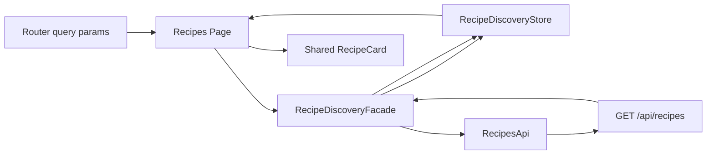
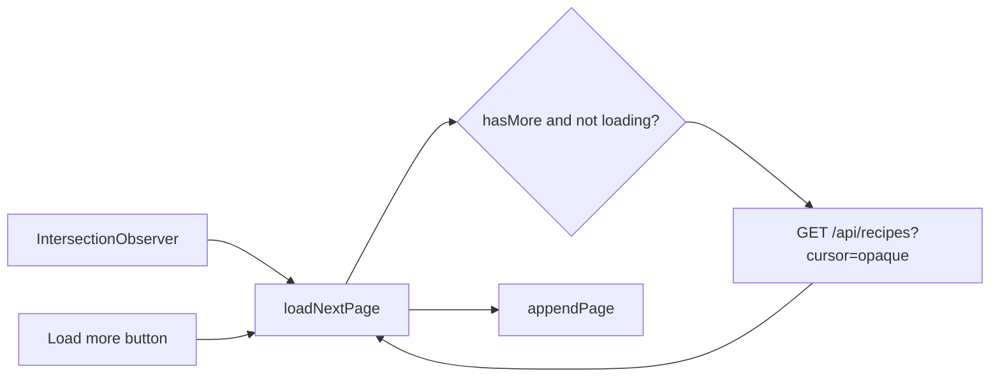
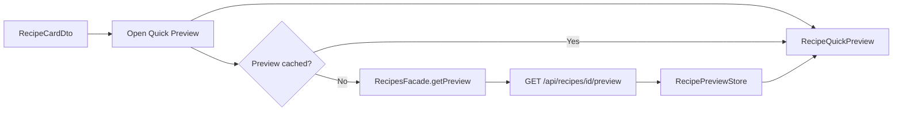
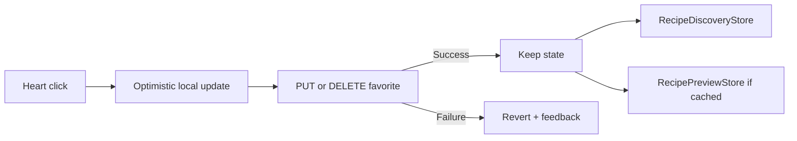

# F-008 — Recipe Discovery, Recipe Card, and Quick Preview — Frontend

## Canonical Contract

The feature [`README.md`](README.md) owns product behavior, shared data requirements, database-impact requirements, API endpoint definitions, request/response contracts, cursor semantics and product error behavior.

This document describes how the Angular frontend implements that approved contract.

Do not redefine an incompatible API or data model here.

## Frontend Goal

Replace the temporary whole-catalog/client-filter Recipes implementation with a server-backed discovery workflow that:

- keeps `/recipes` simple by default;
- owns its search/filter/pagination state under the Recipes feature;
- reuses shared recipe data-access;
- evolves the existing shared Recipe Card instead of duplicating it;
- adds one reusable shared Quick Preview component/cache;
- preserves already-loaded query/Preview state within the authenticated SPA session;
- uses the existing Appetee design system rather than Builder.io implementation technology.

## Current Frontend Baseline

Current `development` behavior includes:

```text
core/shared/data-access/recipes/
├── recipe.api.ts
├── recipe.facade.ts
├── recipe.model.ts
├── recipe-details.store.ts
└── recipes.store.ts

core/shared/ui/
└── recipe-card/

features/recipes/
└── RecipesList/
```

Important temporary behavior to replace:

- `RecipesApi.getAll()` requests the complete `/api/recipes` array.
- `RecipesFacade` extends `AbstractLoadFacade<RecipeCardDto[], RecipesStore>`.
- `RecipesStore` stores one complete catalogue array.
- `RecipesListComponent` performs recipe filtering in computed frontend state.
- Current text search includes diets/badges in addition to recipe/ingredient names.
- Current page keeps saved recipe IDs in local temporary state.
- Current card contains temporary `mealType`, diet, servings, difficulty and ingredient-match presentation.
- Current `RecipeBadge` type contains only old development values.
- No shared Recipe Preview cache/component exists.

F-008 intentionally removes those temporary catalogue responsibilities while preserving the useful existing by-ID detail cache pattern.

## Routes

| Route | Access | Purpose |
|---|---|---|
| `/recipes` | Authenticated | Recipe Discovery/search/filter/infinite-scroll page |
| `/recipes?...` | Authenticated | Same page restored from applied search/filter URL criteria |
| No `/recipes/:id/preview` route | — | Quick Preview is shared transient dialog/full-screen UI |
| Cooking route | Future | Start Cooking remains disabled until Cooking Mode owns it |

Frontend guards provide navigation/user-experience behavior only. Backend authorization remains authoritative.

## Target Page and Component Structure

Recommended target:

```text
src/app/

core/shared/
├── data-access/
│   ├── ingredients/
│   │   ├── ingredient.api.ts
│   │   ├── ingredient.model.ts
│   │   └── existing shared ingredient facade/store as applicable
│   │
│   └── recipes/
│       ├── recipe.api.ts
│       ├── recipe.facade.ts
│       ├── recipe.model.ts
│       ├── recipe-details.store.ts
│       └── recipe-preview.store.ts
│
└── ui/
    ├── recipe-card/
    │   ├── recipe-card.component.ts
    │   ├── recipe-card.component.html
    │   └── recipe-card.component.scss
    │
    └── recipe-quick-preview/
        ├── recipe-quick-preview.component.ts
        ├── recipe-quick-preview.component.html
        └── recipe-quick-preview.component.scss

features/
└── recipes/
    ├── recipes.page.ts
    ├── recipes.page.html
    ├── recipes.page.scss
    │
    ├── components/
    │   └── recipe-discovery-controls/
    │       ├── recipe-discovery-controls.component.ts
    │       ├── recipe-discovery-controls.component.html
    │       └── recipe-discovery-controls.component.scss
    │
    └── state/
        ├── recipe-discovery.store.ts
        └── recipe-discovery.facade.ts
```

Exact existing folder/file casing may be retained if changing it would create unnecessary churn. The important ownership boundaries are mandatory.

Do not create one component per trivial filter control. Split a child component only when it has meaningful independent logic/reuse, such as an ingredient autocomplete if the implementation warrants it.

## Shared vs Feature Ownership

### `RecipesApi` — shared HTTP owner

Location:

```text
core/shared/data-access/recipes/recipe.api.ts
```

Owns the recipe HTTP calls:

```text
discover(...)
getPreview(id)
getRecipeWithDetails(id)   // existing, retained for current complete-detail consumers
saveFavorite(id)
removeFavorite(id)
```

Keep these methods together while the file remains readable. Do not create one API service per single endpoint.

### `RecipesFacade` — shared by-ID recipe operations

Location:

```text
core/shared/data-access/recipes/recipe.facade.ts
```

After F-008 it must no longer own whole-catalog loading.

It owns reusable recipe-by-ID/cache/mutation behavior:

```text
getPreview(id)
getRecipeWithDetails(id)

previewRequestState(id)
detailRequestState(id)

invalidatePreview(id)
invalidateDetail(id)

saveFavorite / removeFavorite orchestration hooks as appropriate
```

It may also centralize favorite mutation request coalescing/shared cache synchronization when doing so avoids duplication across Home/Recipes/Preview.

It must not own:

```text
current /recipes search
current applied filters
current ordered discovery cards
current discovery cursor
infinite-scroll state
```

### `RecipeDiscoveryFacade` — Recipes query coordinator

Location:

```text
features/recipes/state/recipe-discovery.facade.ts
```

Owns the `/recipes` query lifecycle:

```text
initializeFromUrl(...)
loadFirstPage(...)
loadNextPage()
retryInitial()
retryLoadMore()

applyCriteria(...)
removeAppliedCriterion(...)
clearAppliedCriteria()

coordinate optimistic saved state for currently loaded cards

invalidateForCompatibilityChange()
resetForIdentityChange()
```

It calls shared APIs; the page does not construct HTTP calls directly.

### `RecipeDiscoveryStore` — Recipes query/list state

Location:

```text
features/recipes/state/recipe-discovery.store.ts
```

Signal-backed state.

Recommended shape:

```ts
interface RecipeDiscoveryState {
  readonly criteria: RecipeDiscoveryCriteria;

  readonly cardsById: Readonly<Record<number, RecipeCardDto>>;
  readonly orderedIds: readonly number[];

  readonly nextCursor: string | null;
  readonly hasMore: boolean;

  readonly initialRequest: EntityRequestState;
  readonly loadMoreRequest: EntityRequestState;

  readonly queryKey: string | null;
  readonly generation: number;
}
```

The implementation may use equivalent existing request-state types/helpers from E-019.

Computed/read signals should expose at least:

```text
cards
criteria
hasMore

isInitialLoading
initialError

isLoadingMore
loadMoreError
```

Recommended store mutations:

```text
beginQuery(criteria, queryKey)
replacePage(items, nextCursor, hasMore)
appendPage(items, nextCursor, hasMore)
setInitialLoading/error
setLoadMoreLoading/error
updateSaved(recipeId, isSaved)
reset()
```

Use normalized `cardsById + orderedIds` rather than only one append-only array so:

- append is deterministic;
- defensive ID de-duplication is straightforward;
- favorite state can update one card;
- exact backend ordering is retained.

### `RecipePreviewStore` — shared complete entity cache

Location:

```text
core/shared/data-access/recipes/recipe-preview.store.ts
```

Use the existing `EntityCacheStore<TEntity extends { id: number }>` pattern unless implementation evidence requires a compatible equivalent.

It caches complete `RecipePreviewDto` entities by recipe ID.

It is not cleared when Recipe Discovery criteria change.

### Open filter draft — temporary UI state

Draft fields should remain local to the discovery controls/page flow.

Do not persist draft filter changes in the discovery store before Apply.

### Search text before submission — component-local state

Typing in the search input must not mutate applied search/query state until Search/Enter commits it.

## State Ownership

### Application/session state

Consumed:

- authenticated identity;
- current user diets/restrictions;
- session reset/identity generation hooks.

F-008 does not redefine authentication/session state.

### Complete entity cache

Owned by shared recipes data access:

- `RecipePreviewStore`;
- existing `RecipeDetailsStore`.

These are independently keyed by recipe ID.

### Query/list state

Owned by F-008:

- `RecipeDiscoveryStore`;
- ordered Recipe Card projections;
- applied criteria;
- opaque next cursor;
- `hasMore`;
- initial/load-more request state.

### Temporary feature/flow state

Owned by Recipes filter/search controls:

- expanded/collapsed filters;
- draft badge selections;
- draft ingredient selections;
- draft Require All;
- draft max total time;
- draft max difficulty;
- draft saved-only state.

### Component-local state

Examples:

- unsubmitted search input value;
- hovered/focused suggestion state;
- dialog-local render/focus state;
- currently visible autocomplete list.

## State Lifetime

### Recipe Discovery Store

Created when:

- authenticated app/session infrastructure is available.

Survives:

- `/recipes -> /home -> /recipes` within the same authenticated SPA session;
- Quick Preview open/close;
- filter panel open/close.

Destroyed/reset when:

- logout;
- authenticated identity changes;
- session reset generation changes.

Query invalidated when:

- applied URL criteria differ from cached `queryKey`;
- user diets change;
- user ingredient restrictions change;
- explicit future refresh action is used.

Browser refresh:

- in-memory list/cursor may be lost;
- applied URL criteria survive and rebuild a new first-page query.

### Recipe Preview Store

Created when:

- shared recipes data access is created for authenticated app lifetime.

Survives:

- navigation among Recipes/Home/other shared card surfaces in the same SPA session.

Invalidated when:

- logout/identity change;
- admin recipe mutation succeeds;
- explicit per-ID invalidation occurs.

No arbitrary TTL.

## Query Key

Create a stable frontend `queryKey` from the applied user-visible criteria only.

It is not the backend cursor fingerprint and does not need backend hashing semantics.

Normalize:

```text
search
sorted ingredient IDs
requireAllIngredients when ingredients exist
canonical badge order/sorted badge values
maxTotalMinutes
maxDifficulty
savedOnly
```

Use it to determine whether an existing in-memory discovery result corresponds to the URL criteria being activated.

Do not include:

```text
cursor
browse seed
server rank
loaded count
scroll position
```

## URL Integration

The Router is the canonical source for applied user-visible criteria when `/recipes` is initialized.

Use repeated query params for multi-value values.

Canonical examples:

```text
search=chicken rice
ingredientIds=12
ingredientIds=34
requireAllIngredients=false
badges=High Protein
badges=Quick Meal
maxTotalMinutes=45
maxDifficulty=Medium
savedOnly=true
```

Omit defaults when possible:

- no empty `search`;
- no empty list params;
- omit `requireAllIngredients=true` unless needed to preserve explicit nondefault composition rules;
- omit `savedOnly=false`;
- omit unrestricted max difficulty.

Never write the opaque cursor to the URL.

### URL -> store initialization

1. Parse/validate known criteria conservatively.
2. Normalize to `RecipeDiscoveryCriteria`.
3. Build `queryKey`.
4. If store already contains matching query state, reuse it.
5. Otherwise begin a new query and request page 1.

Malformed unsupported client-side URL values should be normalized/removed when safe; the backend remains authoritative and returns `400` for invalid API input.

## Data Flow

### Initial discovery



### Next page



Both automatic and explicit continuation call the same facade method.

### Card -> Preview



### Favorite



## API Integration

| Endpoint | Frontend responsibility |
|---|---|
| `GET /api/recipes` | Build query params from applied criteria + opaque cursor; never decode cursor |
| `GET /api/recipes/{id}/preview` | Lazy fetch/cached shared Preview |
| `PUT /api/recipes/{id}/favorite` | Optimistic save mutation |
| `DELETE /api/recipes/{id}/favorite` | Optimistic unsave mutation |
| `GET /api/ingredients?search=...&limit=10` | Debounced ingredient suggestions |
| `GET /api/recipes/{id}` | Existing complete detail consumer only; not Quick Preview |

Canonical payloads remain in `README.md`.

## Recipe Model Changes

### Canonical badge values

Replace temporary old shared type with:

```ts
export type RecipeBadge =
  | 'High Protein'
  | 'Low Calorie'
  | 'Low Carb'
  | 'High Fiber'
  | 'Quick Meal'
  | 'Meal Prep'
  | 'Freezer Friendly'
  | 'Budget Friendly'
  | 'Few Ingredients';
```

Do not keep parallel legacy card-badge types.

### Card model

Use the canonical `RecipeCardDto` from README.

Do not extend it with page-specific fields.

### Preview model

Use the canonical `RecipePreviewDto` from README.

Do not implement Preview as `RecipeDetailDto` or `RecipeDetailDto extends RecipeCardDto` if that forces full cooking/admin data into the modal.

### Existing complete detail model

Retain it for existing consumers. It may be evolved later by Cooking Mode/F-007 but is not the F-008 Preview contract.

## Recipe Card Implementation

Evolve:

```text
src/app/core/shared/ui/recipe-card/
```

Do not create:

```text
features/recipes/recipe-card/
home/recipe-card/
favorite-recipe-card/
```

unless a future feature has a genuinely different component.

### Input/output contract

Conceptually:

```ts
recipe = input.required<RecipeCardDto>();

recipeSelected = output<number>();
favoriteSelected = output<number>();
```

The implementation may output the DTO instead of ID if consistent with current Angular conventions, but it must not move HTTP/state ownership inside the presentational card.

### Whole-card semantics

The card must be selectable without nesting an interactive button around the heart in invalid HTML.

Use an accessible structure that provides:

- card activation by click/tap;
- keyboard activation by Enter/Space;
- visible focus;
- independent heart button.

Heart:

```ts
onFavoriteClick(event: MouseEvent) {
  event.stopPropagation();
  favoriteSelected.emit(recipe.id);
}
```

Equivalent keyboard propagation behavior must also be safe.

### Visual fields

Top/image region:

- card image;
- heart only.

Remove current meal-type label/overlay.

Content:

- name;
- badges;
- total time;
- calories per serving;
- estimated cost per serving;
- featured ingredients.

Do not render:

- diets;
- servings;
- difficulty;
- full ingredient count;
- ingredient match percentage.

### Fixed sizing

Use existing Appetee layout variables/classes where available.

The feature may define card-specific dimensions in its shared component SCSS, but:

- do not hard-code theme colors already present in `_theme.scss`;
- do not duplicate typography values already represented by `_text.scss`;
- do not create duplicate button primitives already present in `_button.scss`.

Card regions must reserve consistent vertical space.

Use CSS line clamp/overflow rules appropriate to the supported browsers.

Badge and featured-ingredient rows do not wrap.

## Recipe Discovery Controls

The Builder prototype is not the component architecture source of truth.

Recommended one component:

```text
RecipeDiscoveryControls
├── search row
├── expanded advanced filters
├── applied filter chips
└── mobile filter presentation trigger
```

Internal decomposition is allowed only when it reduces real complexity.

### One outer desktop block

Closed:

```text
┌───────────────────────────────────────────────┐
│ Search...             Search       Filters   │
└───────────────────────────────────────────────┘
```

Open:

```text
┌───────────────────────────────────────────────┐
│ Search...             Search       Filters   │
│───────────────────────────────────────────────│
│ Advanced filters                              │
│ ...                                           │
│                            Clear   Apply       │
└───────────────────────────────────────────────┘
```

Do not preserve the Builder nested border around the advanced panel.

### Draft/apply

Open:

```text
draft = clone(applied)
```

Control changes:

```text
update draft only
```

Apply:

```text
commit draft -> router query params -> discovery query reset/load
```

Closing/canceling without Apply:

```text
discard draft
```

### Applied chip behavior

Removing an applied chip is itself an explicit committed action.

It must:

```text
remove criterion
update URL
reset discovery cursor/items
load page 1
```

without a second Apply/Search click.

## Search Input

Use a normal form.

Typing:

- updates component-local text only.

Submit:

- trims/collapses UI value;
- updates router applied search;
- triggers first-page reload.

Do not debounce recipe discovery search while typing.

## Ingredient Autocomplete

Use shared `IngredientsApi`.

Recommended flow:

```text
input changes
-> trim
-> if length < 2: clear suggestions/no request
-> debounce ~300 ms
-> switch/cancel stale request
-> GET /api/ingredients?search=...&limit=10
```

Keep selected ingredient identity separate from suggestion input text.

Maximum three selections.

Use semantic combobox/listbox behavior or Angular Material autocomplete if it fits the existing frontend dependency/style without duplicating unrelated visual systems.

## Infinite Scrolling

Use `IntersectionObserver`, not scroll-event polling.

Recommended bottom structure:

```text
existing cards

[load-more status/sentinel]

[Load more recipes]
```

Automatic load threshold may use a reasonable root margin so the next page begins loading before the user reaches the exact end.

Rules:

- only when `hasMore`;
- only when no next-page request is in flight;
- existing cards stay rendered;
- `loadNextPage()` reads current `nextCursor`;
- stale response must be ignored if query generation changed;
- append uses returned backend order;
- dedupe by recipe ID defensively.

The Load More button may be visually subtle but must remain keyboard accessible.

## Request Concurrency and Stale Responses

### Discovery generations

Increment query generation whenever applied criteria create a new result stream.

A response must only mutate the store if it belongs to the active generation/query key.

This protects:

```text
old search response
arriving after
new filter response
```

from replacing current results.

### Next-page requests

At most one next-page request per active query.

### Preview requests

Coalesce by:

```text
identity/cache generation + recipe ID
```

following the existing `RecipeDetailsStore` approach.

Different recipe IDs may load concurrently.

### Favorite requests

At most one favorite mutation in flight per recipe.

The implementation may queue the final desired state or temporarily disable the heart during one mutation; do not fire uncontrolled competing PUT/DELETE requests.

## Loading Behavior

### Initial catalog

Show a Recipe Card skeleton grid.

The search/filter shell remains usable where safe.

Do not show fake recipe data.

### Search/filter replacement

When applied criteria change:

- old results may be cleared and replaced by skeleton results;
- do not append new criteria to old results;
- filter/search controls remain visible.

### Loading more

- existing cards remain;
- bottom status indicates loading;
- do not replace grid with global spinner.

### Quick Preview first uncached open

Render immediately from `RecipeCardDto`.

Skeleton only missing fields:

- description;
- protein;
- ingredient names.

### Quick Preview cached open

Render complete cached DTO immediately; do not refetch solely because time elapsed.

## Empty States

| State | UI behavior |
|---|---|
| Initial compatible catalog empty | Explain no compatible recipes are currently available; do not fabricate results |
| Search returns none | `No recipes found for "{search}".` and suggest changing search/filters |
| Filters return none | `No recipes match your filters.` with Clear filters action |
| Saved-only returns none | Explain that no saved recipes match current criteria and allow clearing Saved-only |
| Ingredient autocomplete returns none | Small `No ingredients found` suggestion state |
| End of cursor chain | Subtle end-of-results message; no additional requests |

Do not replace a failed/empty search with unrelated shuffled recipes.

## Error Behavior

### `401`

Use the application's existing expired-session/auth handling.

Expected user behavior:

- redirect according to F-002/E-019;
- show the approved expired-session message;
- clear identity-scoped F-008 state.

### Initial discovery failure

Show:

```text
Unable to load recipes.
[Try again]
```

Retry the active first-page criteria.

### Load-more failure

Keep existing cards.

Show bottom:

```text
Couldn't load more recipes.
[Try again]
```

Retry with the same `nextCursor`.

### Invalid cursor `400`

For normal app behavior this indicates stale/corrupt internal pagination state.

Frontend should:

- not append;
- clear the invalid in-memory cursor chain;
- restart the active user-visible criteria from page 1;
- avoid an infinite retry loop;
- optionally log diagnostic context without cursor contents if observability standards require it.

Do not expose internal cursor parsing details to users.

### Preview `404`

Show an unavailable Preview state and allow Close.

The recipe may have been removed or become incompatible after the card was loaded.

### Favorite failure

Revert optimistic state and show a small non-destructive error.

Do not discard the entire discovery result set.

## Caching and Invalidation

### Discovery

What is cached?

- current ordered card projections;
- current applied criteria;
- next cursor/hasMore;
- request state.

Who owns it?

- `RecipeDiscoveryStore`.

When reused?

- same authenticated SPA session;
- same URL-applied criteria/query key.

What invalidates it?

- criteria change;
- diets/restrictions change;
- identity/session reset.

How does a mutation update it?

- favorite mutation updates `isSaved` for card ID without refetching the whole page.

What happens on logout?

- reset entirely.

### Preview

What is cached?

- complete `RecipePreviewDto` by ID.

Owner:

- `RecipePreviewStore`.

Reuse:

- any shared card surface in same authenticated session.

Invalidation:

- identity reset;
- admin recipe update;
- explicit per-ID invalidation.

Mutation synchronization:

- favorite mutation patches `isSaved`.

No TTL.

## Favorite UI Synchronization

Use one shared helper/facade path to patch known recipe projections after mutation.

At minimum update:

```text
RecipeDiscoveryStore card if loaded
RecipePreviewStore entity if cached
```

If future Home/Favorites states also expose `isSaved`, their owning features should consume the same shared membership synchronization rather than create independent truth.

## Quick Preview Component

Location:

```text
core/shared/ui/recipe-quick-preview/
```

The component must remain reusable.

### Opening contract

Prefer a service/dialog entry point that can receive:

```text
recipe ID
+
optional already-loaded RecipeCardDto
```

so initial rendering can use the card immediately.

The dialog itself should not fetch by reaching into page state directly.

### Desktop

Use Angular Material dialog because Material dialog is already an allowed project dependency.

Required:

- backdrop;
- focus trap;
- Escape support;
- accessible close button;
- restore focus to originating trigger;
- max size that remains usable at zoom;
- internal scroll if content height requires it.

### Mobile

Use responsive dialog configuration/layout to become full-screen.

Do not create a separate `MobileRecipePreviewComponent` unless a later technical limitation proves unavoidable.

### Preview fields

Immediate from card where available:

```text
image
name
totalTimeMinutes
caloriesPerServing
estimatedCostPerServing
badges
isSaved
```

Lazy fields:

```text
description
proteinPerServing
ingredients
```

After DTO arrives, the complete DTO is canonical for that Preview render.

### Ingredients

```ts
const visible = preview.ingredients.slice(0, 6);
const remaining = Math.max(preview.ingredients.length - 6, 0);
```

Render:

```text
+ {remaining} more ingredients
```

only when `remaining > 0`.

No click handler/expansion.

### Actions

Favorite:

- functional in Phase 7+;
- shared optimistic mutation.

Start Cooking:

- visible;
- disabled until Cooking Mode is implemented;
- should expose disabled semantics/reason accessibly rather than a dead clickable element.

No View Full Recipe.

## Styling and Design-System Rules

Before writing feature CSS, inspect and reuse:

```text
src/styles/_button.scss
src/styles/_text.scss
src/styles/_theme.scss
existing CSS variables
existing shared components
```

Mandatory rules:

- no Tailwind copied from Builder;
- no shadcn component port;
- no duplicated hard-coded `#FF7214` when theme variable exists;
- no local redefinition of typography roles already in `_text.scss`;
- no duplicate primary/secondary button implementation when shared classes cover it;
- if a reusable new primitive is genuinely needed, add it once in the correct shared/style ownership location.

Builder screenshot/code only guides composition/spacing/content direction.

## Responsive Behavior

### Large desktop

- target four-card main grid at current normal page content width;
- search row inline;
- expanded filters in same outer block;
- card width/height stable.

### Desktop/laptop

- four columns where available;
- grid can reduce before cards become too narrow;
- approximate five rows per 20-item page at primary design width.

### Tablet

- reduce column count;
- stack filter groups as needed inside the same outer expanded block;
- no permanent sidebar.

### Mobile

- one-column recipe feed;
- full-width search controls as necessary;
- full-screen filters;
- full-screen Quick Preview;
- explicit heart;
- normal vertical scrolling.

## Accessibility

Validate:

- semantic Recipe Card activation structure;
- independent favorite button;
- visible focus;
- Search form label and Enter submission;
- Filters expanded state (`aria-expanded` or equivalent);
- filter labels;
- switch state;
- slider accessible names/values;
- autocomplete combobox/listbox semantics;
- applied removable-chip labels;
- loading/error live-region behavior where useful;
- Load More keyboard path;
- dialog focus trap/restore;
- mobile close control;
- 200%/400% zoom;
- reduced motion;
- no information conveyed by orange/selected color alone.

## Testing

### Unit/store

- [ ] Query normalization/queryKey is deterministic.
- [ ] `replacePage` replaces old query results.
- [ ] `appendPage` preserves order and de-duplicates IDs.
- [ ] Favorite update patches one loaded card.
- [ ] Initial and load-more request states are independent.
- [ ] Query generation rejects stale responses.
- [ ] URL parser/serializer round-trips canonical criteria.
- [ ] Defaults are omitted from URL as intended.
- [ ] Preview cache lookup/upsert/invalidation follows E-019.
- [ ] Preview duplicate in-flight requests coalesce.
- [ ] Favorite mutation failure restores prior state.

### Component

- [ ] Recipe Card renders canonical fields only.
- [ ] Card height is stable for long title/badge/ingredient content.
- [ ] Badge/featured rows do not wrap.
- [ ] Card click/Enter/Space emits selection.
- [ ] Favorite button stops card activation.
- [ ] Discovery filters preserve draft until Apply.
- [ ] Applied chip removal commits immediately.
- [ ] Ingredient autocomplete keyboard behavior works.
- [ ] Quick Preview renders card-known fields before lazy payload.
- [ ] Quick Preview displays first six ingredients and noninteractive remainder text.
- [ ] No View Full Recipe is rendered.
- [ ] Start Cooking is disabled before Cooking Mode.

### Routing

- [ ] `/recipes?search=...` initializes applied search.
- [ ] Repeated ingredient/badge params parse correctly.
- [ ] Browser refresh preserves applied criteria.
- [ ] Cursor/seed are never placed in URL.
- [ ] Same-query SPA return can reuse query store.
- [ ] Different URL criteria reset query.

### E2E

- [ ] Browse -> infinite next page.
- [ ] Browse -> Load More fallback.
- [ ] Search -> results -> next page.
- [ ] Apply multiple filters.
- [ ] Remove applied chip.
- [ ] Save/unsave from card.
- [ ] Saved-only filter.
- [ ] Card -> uncached Preview.
- [ ] Card -> cached Preview.
- [ ] Favorite sync between Card and Preview.
- [ ] Preview retry after failure.
- [ ] Expired-session route/message handling.

### Accessibility/manual

- [ ] Keyboard-only complete discovery/search/filter/Preview path.
- [ ] Screen-reader control labels/states reviewed.
- [ ] Dialog focus trap and focus restoration reviewed.
- [ ] Load More fallback usable without pointer.
- [ ] 200% and 400% zoom/reflow reviewed.
- [ ] Mobile narrow-width layout reviewed.
- [ ] Reduced-motion behavior reviewed.
- [ ] Multi-browser behavior validation.
- [ ] Integration tests for remembered and non-remembered cookie attributes.
- [ ] Idle, sliding, and absolute-expiration tests.
- [ ] Frontend expired-session redirect/message tests.

## Implementation Notes

- Prefer Signals for new query/list UI state in accordance with E-019.
- Keep `HttpClient` operations as Observables; facade may bridge to Signals/store state.
- Do not convert the existing complete-detail cache into discovery list state.
- Delete `RecipesStore` once its temporary whole-catalog responsibilities are no longer used.
- `RecipesFacade` should no longer extend the whole-list `AbstractLoadFacade` solely to preserve old behavior.
- Retain compatibility aliases only when a currently implemented screen still needs them; do not retain old GetAll catalogue semantics.
- Do not load all ingredient objects into the Recipes feature for autocomplete.
- Do not use a global single loading boolean for initial/load-more/Preview/favorite/autocomplete requests.
- Do not store complete `RecipePreviewDto` copies inside `RecipeDiscoveryStore`.
- Do not decode/inspect opaque backend cursors.

## Dependencies

- F-002 authentication/session UX
- F-003 diets/restrictions state and invalidation signals
- F-007 recipe authoring field updates
- E-019 Frontend Data-Access Architecture
- E-010 API/OpenAPI error contract
- existing Angular Material dialog/icon dependencies
- existing Appetee theme/text/button SCSS
