# F-011 — Meal Plan

**Status:** Specification ready
**Implementation status:** Frontend F01–F14 implemented locally; F15 automated frontend verification implemented, with live backend/security and manual release acceptance still pending. F08's B08 integration remains unverified. F09/F10 use the documented backend contract; automated test fixtures are not live integration evidence. Backend implementation status remains owned by its phase documents.
**Owner:** Mathieu Galidie
**Last updated:** 2026-10-15
**Dependencies:** Existing auth/session, recipe discovery/experience and Core state architecture
**Related engineering initiatives:** E-002, E-005, E-008, E-010

**Backend verification (2026-10-15):** B12–B14 implemented and the full backend
suite passed 992/992 (49 new B12–B15 tests), zero failures/skips. B15 automated
verification passed; deployed migration/identity/smoke and cross-stack release
gates remain open. This backend slice changed no frontend code and performed no deployment.

**UI redesign:** The Nutrition Plans dashboard, five Intermediate creation steps and plan editor were recomposed from reference screenshots 04–10 using Appetee tokens and a white page background. Frontend/browser evidence and intentional contract-preserving differences are recorded in [UI reference redesign verification](frontend/UI_reference_redesign_verification.md). This does not complete live backend integration or F15 release acceptance.

**Approved entry update (2026-10-13):** Meal Planner and Nutrition Plans share one unchanged shell header with both section tabs and a single Create Nutrition Plan button. The button opens an Easy/Intermediate choice dialog, then navigates to the existing separate creation routes; it does not create plans automatically. The earlier pair of dashboard/empty-state creation links is superseded. Large visible page titles are removed; accessible page labels remain.

Read the shared contract here, then select one [backend phase](#backend-phase-index) or [frontend phase](#frontend-phase-index). Start frontend work with [F01’s Core ownership map](frontend/Phase_F01_core_contracts_and_shell.md#shared-frontend-architecture). All [images and diagrams](#images-and-diagrams) are bundled in assets/.

## Goal

Enable authenticated users to maintain reusable nutrition plans and plan all food—recipes and manual entries—on sparse calendar dates. Keep reusable application/API state in Core and temporary feature flow state separate from UI and page.ts.

## User Problem

Users need a single place to plan complete meals, compare planned intake with their current nutrition goals, and copy dated plans without repeatedly entering food. Changing reusable nutrition settings must remain separate from editing saved calendar meals.

## Current Behavior

### Implemented

Existing authentication, recipe discovery/favorites/experience, profile basics and the shared Angular Core state patterns remain the audited baseline.

### Missing or incomplete

The original specification audit below is historical. Frontend implementation now includes F01–F14 Core foundations, nutrition profile, nutrition plan dashboard/create/edit flows, planner reads, meal editing/autosave, independent recipe picking, manual food editing, accessible ordering and Copy Day/Week review. F15 automated checks are recorded separately; live/manual release acceptance is incomplete. Backend/deployment readiness is not inferred from frontend tests; live integration remains pending until available and verified.

### Preserved repository audit

Audit performed for the approved proposal on 2026-10-04. Checked-in code/schema were inspected; deployed database/configuration was not. Repository status remains unchanged by this specification task.

| Repository | Audited HEAD |
|---|---|
| https://github.com/GalidieMathieu/Appetee | c5898f1a8bdd8c258ff592ecbd367d37d2b51906 |
| https://github.com/GalidieMathieu/Appetee_v2_BackEnd | 1fbdafae2c0739fd71af478a9d1791c6e1f4574e |
| https://github.com/GalidieMathieu/Appetee_v2_frontEnd | 569d5ec835b606b76bc210614d13b030beecb36b |

#### Backend evidence

Three net10.0 projects; MVC controllers; services/DTOs/Requests/RowData/Models in Application; Dapper2.1.66/MySqlConnector2.5.0 Infrastructure. No Domain, EF, mediator, generic UoW. Users/Auth use query/repository separation; RecipeQueries contains read/write methods, not a reason to copy a god-class pattern. Connection factory returns an opened IDbConnection per operation; registration lifetime does not create a request-shared transaction. AuthRepository and password recovery show transaction/locking patterns; every new command must explicitly pass transaction to Dapper.

UsersController derives signed INT currentUserId with IAuthService; legacy user-ID CRUD routes are deliberate404 tombstones. CurrentUserProfileDto is username/image only. UpdateCurrentUserProfileRequest rejects unknown JSON and preserves existing null/no-change semantics. New nutrition-profile contract must not reinterpret these fields.

Cookie `__Host-appetee` is Secure/HttpOnly/SameSite=None; credentials+CORS are configured, but antiforgery implementation was not found. AdminController's role requirement was commented out. ErrorsController maps ApiException to ProblemDetails with traceId/code and production-safe errors. Current validation subclasses need small backward-compatible code/field additions. Logging is structured; avoid health/body/request payload logging.

RecipeCalculator currently calculates kcal/protein/carbs/cost, no fat. Ingredient nutrition already has nullable fat_g. Canonical checked-in ingredients have fat values; production data may differ. Ordinary RecipeCardDto remains the lightweight discovery/favorites contract. The Meal Plan picker instead requires RecipeCardAdvance, which extends RecipeCardDto with description and per-serving protein/carbs/nullable fat. Discovery uses criteria-bound seeded/ranked cursor ordering, not created_at pagination. Compatibility requires all selected diets and excludes restricted ingredients. Preview/cooking use compatibility; legacy detail read is not an authorization shortcut. Favorites exist and are reusable. Old meal-prep endpoints are unimplemented placeholders and are not reused for planner storage.

scriptDatabase.sql is a destructive rebuild; initObjectDatabase.sql contains seed work; six migration files exist, but no operational runner/history was found. MySQL8-family features in schema do not prove deployed version. E-008 is specified but not complete. Real DB integration fixture resets appetee_backend_tests and needs host/environment guards before broader use. No production DB was queried or reset.

#### Frontend evidence

Locked dependencies: Angular21.2.4, Material/CDK21.2.2, TypeScript5.9.3, Vitest4.0.17, Playwright1.62.1. Standalone/lazy routes, auth/private layout, signals/computed and Observable HTTP. Typed Reactive Forms exist. Root identity stores are registered through SESSION_RESETTERS; EntityCacheStore supplies per-ID complete-entity generation/invalidation behavior.

STATE_ARCHITECTURE.md requires owners/lifetimes/invalidation for meaningful state and distinguishes complete entities, query projections and temporary flow data. Existing feature folders contain some root query stores; the user's latest explicit direction intentionally puts NEW Meal Plan reusable server-backed state in core. This is a bounded improvement, not a request to relocate every existing feature.

RecipesApi is in core/shared/data-access/recipes/recipe.api.ts. Main RecipeDiscoveryFacade/RecipesStore are root and cannot be shared as mutable picker state. Shared recipe-search-bar is controlled/no HTTP. RecipeExperienceFacade centralizes preview/cooking navigation and focus. Existing private header gets one Meal Plan entry; Home's mealPlanRoute flag is false and its placeholder does not implement an upcoming-meal query. Do not invent that dashboard feature.

Existing theme orange #FF7214 with white yields about2.74:1; improve relevant foreground/button variant rather than replace the design system. Tests are Vitest+Playwright; package has no lint script. Existing Playwright project is desktop Chromium only; add targeted mobile/reflow coverage for this feature.

#### Documentation/handoff evidence

Read original feature, UX, data/persistence, full conversation, locked decisions, next-to-define, research rationale and builder guidance, database readmes/ERDs, and all supplied mockup images. The source hierarchy prioritizes locked text over images. General ERD includes stale/future template/snapshot/bigint ideas; old images contain incompatible controls. They are archived as annotated references, never copied as schema truth.

Existing docs/features/F-001…F-010 and documentation templates establish feature README shared contract, side-specific implementation and E-series engineering initiatives. Final F-011 keeps shared contracts in README and side-specific implementation in backend/frontend phase files. Some README/status text lags actual implementation; evidence from source wins. Do not mark application Complete because these docs exist.

#### Deviations from current code

| Change | Why | Cost/necessity |
|---|---|---|
| New queries/repositories split | Existing Users/Auth precedent is clearer than RecipeQueries mixed responsibility | Local, required for bounded use cases; no recipe subsystem refactor |
| New DATETIME(6) UTC audit columns | Explicit UTC semantics and one operation timestamp | Small, new tables only; leave existing timestamps intact |
| New core domain stores/facades | Latest user instruction and reusable cross-feature data boundary | Required; no relocation of unrelated existing stores |
| Explicit revision protocol | Autosave/copy need protection from stale tabs and lost updates | Required, one per-user version avoids per-entity framework |
| Nullable recipe fat/projection fields | Planner cannot report complete fat otherwise | Required data readiness; additive API/schema change |
| Small error-code/field extension | Existing errors lack needed conflict/field distinctions | Backward-compatible, required for honest autosave UX |

#### Re-audit at implementation

Compare HEADs before starting; if source changed, inspect only affected files/contracts, update exact map, and keep approved product rules. Do not silently translate this spec into a new architecture or skip prerequisite security/migration work.


## Scope

### Included

Meal Planner and Nutrition Plans; Easy and Intermediate setup; separate reusable nutrition profile; sparse dated meals; recipes in whole servings; complete manual entries; Current selection; explicit plan create/edit/duplicate/delete; autosave for supported scalar edits; accessible ordering; atomic Copy Day/Week.

### Excluded

Templates, persisted weeks, historical target/recipe snapshots, fractional servings, flexible ingredients, recommendations, Advanced/Expert, recovery/training-day models, shopping lists, meal-prep batches and reusable My Foods/My Meals.

## Users and Permissions

| Actor | Allowed behavior |
|---|---|
| Guest | No planner/profile/plan data access; existing sign-in UX |
| Authenticated user | Own nutrition profile, plans, settings and dated planner data; canonical recipes subject to existing compatibility |
| Administrator | No implicit access to another user’s private plans; recipe authoring stays under its own administrative policy |

Server derives identity from session. Frontend guards and visibility do not authorize access.

## User Experience

### UX and accessibility contract

The supplied images show visual intent. Written approved behavior, endpoint contracts and core ownership take precedence. Do not implement controls, sample calculations or database relationships merely because an old reference includes them.

#### Screen responsibilities

| Surface | Presentation | Temporary state owner | Confirmed data owner |
|---|---|---|---|
| Planner page | Header, week strip, focused-day context, task outlet | MealPlanWorkspaceState / WorkspaceFacade | Core MealPlannerStore / Facade |
| Day overview | Saved or virtual meal cards, totals and Current comparison | Selected date/task only | Core normalized date projection |
| Meal Editor | Name field, item rows, confirmed totals, add/remove actions | MealEditorDraftState | Core selected meal projection |
| Recipe Picker | Search input, tabs, cards, pagination, In meal | Feature RecipePickerState for unsent search; core locally provided picker for applied query | Core RecipePickerStore; selected meal from core planner |
| Manual editor | Name and total nutrition form, Add/Update/Cancel | ManualItemDraftState plus form factory | Core planner only after acknowledgement |
| Nutrition Plans list | Text-first cards, Current marker and menus | NutritionPlansPageFacade for dialog/task flow | Core summary store and settings |
| Easy create | Name and meal-count form | NutritionPlanDraftState / FlowFacade | Core only after Create |
| Intermediate create | Profile, Goal, Activity, Meal Structure, Review | Same draft state, ephemeral preview and guarded step | Core profile seed; saved plan only after Create |
| Plan edit | All-fields form, explicit Update action | Separate instance of plan draft state | Core complete detail cache |
| Profile edit | Reusable controlled form and explicit Save | Profile feature editor state/facade | Core NutritionProfileStore |
| Copy Day/Week | Source/destination selection, replacement review | CopyFlowState | Core loaded source/destination ranges |

These names refer to the exact paths in [Frontend Data Flow](frontend/Phase_F01_core_contracts_and_shell.md#shared-frontend-architecture) and [File Manifest](README.md#implementation-file-manifest). A table entry does not authorize a duplicate class or a second store. Components bind a readonly view model and emit intent. No page owns an API subscription, server DTO array, mutation queue or calculation algorithm.

#### Navigation and task lifecycle

**Approved F11 routes (2026-10-15):** Add manual food at `/meal-plan/planner?date=YYYY-MM-DD&task=manual&mealId=123`, or `defaultSlot=2` instead of `mealId`. Edit at `/meal-plan/planner?date=YYYY-MM-DD&task=manual&mealId=123&itemId=456`; Edit rejects `defaultSlot`. Validate that the item is manual and belongs to that loaded meal/date. Current tasks are `day`, `meal`, `recipe-picker`, and `manual`. Opening persists nothing; explicit Add/Update goes through Core. Back/Cancel protects dirty drafts and returns to the same meal; virtual Add uses synchronized `createdMealId`. Copy Day/Week remain dialogs, not routes or API changes. [Exact manual routes](frontend/Phase_F11_manual_food_editor.md#routes) · [F11–F15 verification](frontend/F11_F15_implementation_verification.md).

Use the planner route and task selectors defined in the frontend phase files. Date is an ISO local calendar date; real meal and virtual slot are mutually exclusive selection types. Validate query values through feature flow state before resolving against core data. Do not treat URL IDs as authorization or proof that an entity exists. An invalid date falls back to today with a corrected URL; unknown task/selection falls back to the nearest valid day or meal context. Direct entry must load the needed core range before selecting a saved meal.

Selecting a task adds meaningful navigation history; incidental input edits do not. A Back action returns to the known parent task and restores its trigger focus. If no valid same-workspace parent history exists, replace the route with that parent. Browser Back follows the same pending-change rules as in-app Back. Avoid a loop that pushes the same invalid selection repeatedly.

Approved F09/F10 planner route: `/meal-plan/planner?date=YYYY-MM-DD&task=recipe-picker&mealId=123`, alternatively `defaultSlot=2` instead of `mealId`. Allowed tasks are `day` (default, neither selector), `meal` (editor), and `recipe-picker`. The latter two require exactly one selector, resolved against the accepted loaded day. Saved IDs are positive signed INTs; slots are integers 1–8. Picker Back/cancel returns to `task=meal` for the same date and selection and does not persist a virtual meal. After successful Add, Core synchronizes the receipt before returning with its confirmed `createdMealId`. The shared shell header remains unchanged. [Exact routes](frontend/Phase_F10_recipe_picker_and_quantity.md#routes) and [verification evidence](frontend/F09_F10_implementation_verification.md) record navigation, ownership and remaining integration checks.

Opening a virtual slot causes no persistence. On successful materialization, use createdMealId from the confirmed receipt and replace the current virtual URL. A temporary feature navigation alias may map the reviewed date/slot to that returned ID while this workspace remains alive so an earlier Back entry can resolve correctly. It contains identity/navigation data only, never a meal DTO. Clear aliases on workspace destruction, identity reset, or incompatible range refresh. After a hard reload, an obsolete virtual URL on a saved day falls back to the day overview; never guess which saved meal replaced the slot.

Pending autosaves block dependent structural actions until the coordinator settles them. On navigation with unsent valid changes, offer Save and leave, Stay, or Discard unsent changes. Discard cannot cancel a write already sent: wait/reconcile its result before leaving through the application. Invalid fields offer Stay or Discard; do not submit invalid values. Explicit create/edit/manual drafts use leave confirmation when dirty. Hard-refresh warnings are advisory; there are no unload writes or browser-persisted queues.

#### Desktop and narrow layouts

Desktop planner preserves focused-day context on the left and the active task on the right. Switching Meal Editor → Recipe Picker must not replace the left pane with a second task. Nutrition summary belongs to its day/meal context, not a second independently loaded aggregate. Header and primary navigation match the supplied Appetee header reference.

At narrow widths render one active task with a named Back button. Use one instance of the form/controller across layouts; hide/reflow presentation rather than instantiate competing stores/forms. Choose the exact breakpoint during implementation from content fit. Verify at 360, 390, 768, 1024 and 1440 CSS pixels, at 200% zoom, and with long names and maximum items. At 320 CSS pixels, content must reflow without page-wide horizontal scrolling; the compact week strip may scroll within a clearly bounded region if all days remain keyboard accessible. Do not require hover to expose actions.

#### Planner states and labels

| State | Required behavior |
|---|---|
| Initial load | Bounded skeleton or labelled progress; no empty-state claim before a successful read |
| Untouched date with Current | Render backend virtual meals; selecting/opening does not save |
| Untouched date without Current | No virtual defaults; show create/select-plan guidance and explicit New Meal |
| Saved empty date | Show intentional empty state and New Meal; never repopulate defaults |
| Saved empty meal | Keep the meal and zero known totals; offer add actions |
| Easy Current | Planned totals available; targets/progress/remaining omitted |
| Intermediate Current | Current target comparison applies to the viewed date, with no historical target snapshot |
| Unavailable recipe | Generic unavailable label, unknown nutrition, Remove available; no misleading zero |
| Missing recipe fat only | Recipe remains available; fat/affected aggregate displayed as unknown |
| Refresh failure | Keep old data visibly stale if available; disable writes/copy review until current context reloads |
| Autosave | Show Saving, Saved, Failed, Conflict or Outcome unknown, based on core state and latest draft |
| Empty picker | Clear no-results message and criteria recovery; do not imply a server failure |
| Pending structural command | Disable repeated/dependent action without blocking unrelated reading |

Unknown nutrition is shown as an em dash with accessible text “Unknown”; no progress ring suggests a valid percentage. Negative remaining values mean above target and are labelled in text. Never use unknown-to-zero coercion or calculate nutrients in a component. If any constituent is unknown, follow the per-nutrient aggregation rules in the canonical contract.

#### Forms and deliberate actions

Use visible labels and unit suffixes: centimetres, kilograms, kcal, grams and whole servings. Client validators assist entry; server validation remains authoritative. Manual entry numbers are totals for the entry, not per-serving values. Quantity controls apply only to recipe items. Removing an item is explicit; quantity zero does not remove it.

Easy presents only name and default meal count. Intermediate presents the five approved steps. Review displays the exact server preview, calculation assumptions and warning text before Create. Calculation changes invalidate the old preview immediately. A profile change never silently overwrites an open plan draft; Use current profile is explicit. Easy and Intermediate modes cannot be switched during edit.

Errors appear beside controls and in a summary below the task heading. Focus the summary after an invalid explicit submit; links lead to the affected controls. Preserve typed values and selected context on errors. A successful submit updates core state before closing or navigating. No toast alone carries a validation, conflict or unknown-outcome recovery decision.

#### Copy review and conflict recovery

Copy Day/Week names source and destination with actual calendar dates. Review shows which saved destination days/meals/items will be replaced, including intentional empty source days and absent source dates. The same source/destination snapshots and revision used for review must authorize the command. If context changes, return to review after refresh; confirmation is not a timeless permission to replace future content.

Copy Week is one seven-day command. Do not show seven independent completion messages or partially replace local days as requests finish. A confirmed receipt refreshes affected core projections; failure preserves all previously confirmed destination data. Source absent means clear the corresponding destination row; source saved-empty means preserve that intent as a saved-empty destination. Unavailable source recipes block the complete operation with a specific explanation.

A revision conflict pauses dependent actions and preserves drafts. Offer refresh and review; compare refreshed data before allowing another explicit submit. An unknown write outcome must be reconciled with a GET before any user-authorized repeat. Never present a blind Retry button that sends the same POST with a fresh revision.

#### Keyboard and assistive technology

All icon-only actions have accessible names including their subject where needed. Current/selected/disabled/progress states have text or semantics in addition to color. Day selection uses a coherent keyboard pattern with one clearly selected date; do not mix ARIA tab/grid semantics without implementing that pattern. Standard buttons and labelled native controls are preferred.

Move up and Move down are available alongside drag handles for both meals and items. Announce the confirmed new position after success. During a drag, the temporary order is a feature overlay; failed persistence restores the core order and announces the failure. Opening tasks moves focus to their heading; closing restores the initiating control where still present. After deleting the focused row, move to the next sensible row or list heading.

Only true dialogs trap focus. Escape closes a dismissible dialog subject to pending-change rules, not the entire planner workspace. Save announcements use a polite live region and settle after the latest acknowledged value; do not announce every keypress or intermediate debounce. Error summaries and blocking conflicts receive deliberate focus rather than competing assertive live regions.

#### UX acceptance evidence

Record keyboard-only create/edit/picker/manual/reorder/copy journeys; focus before and after Back; narrow and desktop captures; long/translated-like labels; contrast and visible focus; screen-reader save/conflict announcements; 200% zoom and 320px reflow. Images demonstrate intended composition but do not substitute for actual implemented accessibility verification.


### Approved feature details

#### Product purpose and scope

One global **Meal Plan** navigation entry contains **Meal Planner | Nutrition Plans**. A Nutrition Plan is reusable configuration; a planner day is dated eating intent. They are different objects. A week is a Monday–Sunday date range, never a database entity.

Meal Planner includes a compact week strip, one focused day, saved and virtual meals, recipes in whole servings, manual foods, planned nutrition, Current-plan comparison, and exact Copy Day/Week. Nutrition Plans includes Easy/Intermediate create, edit, duplicate, delete, and Current selection.

Excluded: functional Templates, standalone Day Templates, recommendations/optimization, fractional servings, ingredient sliders, historical recipe snapshots, meal-prep batches, shopping lists, reusable My Foods/My Meals, Advanced/Expert plans, recovery modifiers, training-week configuration and daily training intensity. A disabled Templates (coming soon) control is permitted. Do not store speculative future fields or tables.

#### User flows

- **Easy:** name + default meal count → Create. No sex, birth year, weight, height, goal, activity, or nutrition targets.
- **Intermediate:** Profile → Goal → Activity → Meal Structure → Review → Create. Draft-only until final successful command. Server preview never writes.
- **Edit plan:** all-fields page with Update Nutrition Plan. Mode cannot change. A name/count change does not recalculate targets; a calculation change does.
- **Planner:** load week → select date → select virtual/saved meal → edit meal or choose recipe/manual task. Desktop left pane always remains day context. Mobile shows one active task screen with Back.
- **Recipes:** picker search or Saved → Add → successful receipt returns to Meal Editor. Already-added recipes show In meal; quantity is edited on their one existing item.
- **Manual:** complete name/kcal/protein/carbs/fat → Add/Update. All numeric values strictly greater than zero and represent the whole entry. Invalid action keeps the form open and shows a red error summary below its title.
- **Copy:** inspect source and destination at a matching revision → confirm replacement → one atomic command → confirmed destination days. Never pretend a partially copied week succeeded.

#### Locked persistence behavior

GETs, navigation, selecting dates, and opening/cancelling an editor never create rows. Current plan defines virtual defaults only for absent dates. First meaningful action saves only the selected meal, not every placeholder. After that, only saved meals appear. A saved empty meal remains after its last item is removed. A saved empty day remains after its last meal is removed, preventing virtual defaults from reappearing.

Current switching keeps saved food/structure and changes all displayed targets, including past dates. Untouched dates receive the new virtual default count. No daily target snapshots. Canonical recipe changes affect later reads of old dates. These are deliberate feature limits, not bugs to fix with snapshots.

#### Core user-visible rules

| Rule | Contract |
|---|---|
| First plan | Becomes Current when no Current exists; otherwise leave Current unchanged. |
| Duplicate | Inactive, including duplication of Current; preserve targets/inputs/policy. |
| Current deletion | Confirm; clear pointer then delete atomically; do not select another plan. |
| No Current | Allow planning; no virtual defaults or targets; offer Nutrition Plans link. |
| Easy Current | Show planned calories/macros; hide target/remaining/progress. |
| New manually added meal | Name is `New Meal`; never guess a meal type. |
| Meal overview | First two item names plus +N more; full list only in editor. |
| Autosave | Planner completed actions, not every keystroke; no page Save. |
| Unsupported calculation | Explain and allow Easy; do not clamp targets or present clinical advice. |
| Recipe unavailable | Preserve removable placeholder; incomplete totals are unknown, not zero. |

#### Shared data and API overview

Frontend wire/domain models, HTTP clients, confirmed stores, query state, revision synchronization, and reusable domain facades reside in `src/app/core/shared/data-access/meal-plan/`, `.../user/`, or `.../recipes/picker/`. Temporary forms/routes/tasks reside under feature `state/` and `models/`, never as server caches or mutable DTO arrays inside page/component classes.

The backend derives identity from the session. Main resources: `/api/nutrition-plans`, `/api/users/me/nutrition-profile`, `/api/meal-plan/days`, `/api/meal-plan/meals`, recipe/manual items, Current selection, and copy commands. All state writes carry CSRF and `X-Meal-Plan-Revision`; exact endpoints/DTOs are in the normative [API appendix](README.md#canonical-api-contracts).

The normalized range response includes all requested dates, current context, virtual/saved meals, items, totals, remaining, and warning codes. Application owns defaults and arithmetic. Frontend owns selection, drafts, formatting, and visual percentages only. Successful writes return confirmed affected data; use it instead of a second read after every scalar edit.

#### Database Impact

### Existing tables used

`users`, `recipes`, `ingredient_nutrition`, `recipe_ingredients`, diet/restriction tables, and `favorite_recipes`. User and recipe foreign keys are signed INT, matching the real schema.

### Schema changes

Add six tables: `nutrition_plans`, `meal_plan_user_settings`, `meal_plan_days`, `meal_plan_day_meals`, `meal_plan_meal_items`, `meal_plan_manual_items`. Add four nullable nutrition-profile fields to users and nullable `fat_total` to recipes. No week/template/snapshot table. Complete columns, constraints, defaults, lifecycle and deletion are in [Data Model](README.md#canonical-database-model).

### Index changes

User/date uniqueness supports ranges; user/name uniqueness supports plan names; composite user/plan ownership protects Current; parent/order indexes support meals/items; meal/recipe uniqueness prevents duplicate recipe items. Each index has a documented query purpose. EXPLAIN is required for range and copy source reads.

### Data migration

Use E-008 versioned migrations with history. Bootstrap/seed scripts are local/test-only. Backfill recipe fat only from valid known ingredient fat with matching units. Unknown is NULL. Update the canonical generator and regenerate outputs; never hand-edit generated SQL. Do not reset production data.

#### Acceptance and definition of done

- [ ] An authenticated user completes both plan flows and full lifecycle without affecting another user.
- [ ] Browsing arbitrary supported calendar dates writes nothing.
- [ ] Virtual materialization, empty meals, and intentionally empty days follow the exact contract.
- [ ] Each completed planner action persists once and reports Saving/Saved/Error truthfully.
- [ ] Concurrent tabs cannot overwrite unreviewed data by adopting a newer unrelated GET revision.
- [ ] Whole-serving recipes and strict-positive manual totals work with complete/unknown nutrition.
- [ ] Copy Day/Week preserves exact source intent and rolls back all destination writes on failure.
- [ ] Shared server state is in core; feature temporary state is separate from UI/pages; architecture tests/review verify this.
- [ ] Desktop context remains stable and mobile Back works without duplicate forms/state.
- [ ] Accessibility, authorization, CSRF, migration safety, real-MySQL integrity, and maximum-size copy tests pass.
- [ ] Original mockups are treated as references, with written decisions taking precedence.

#### Visual orientation

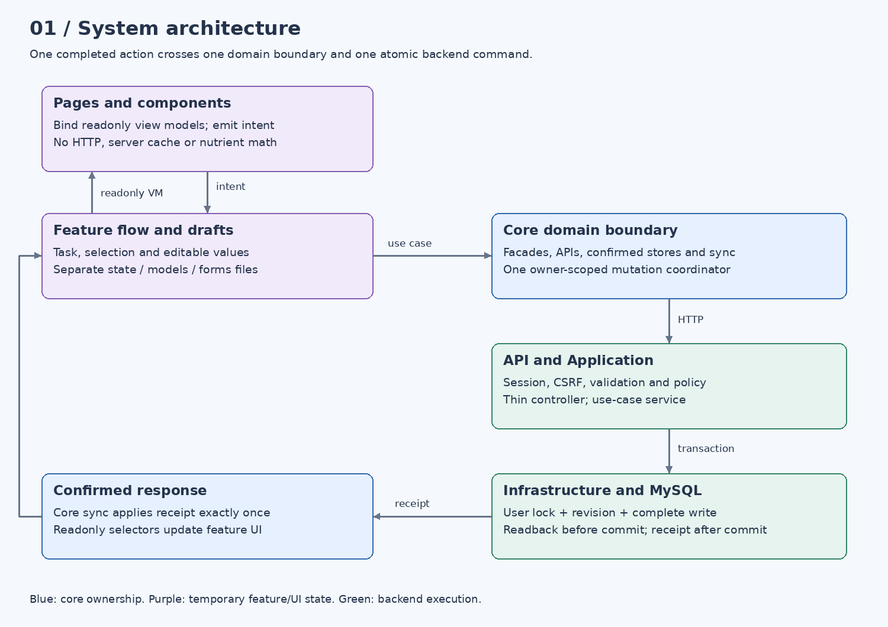

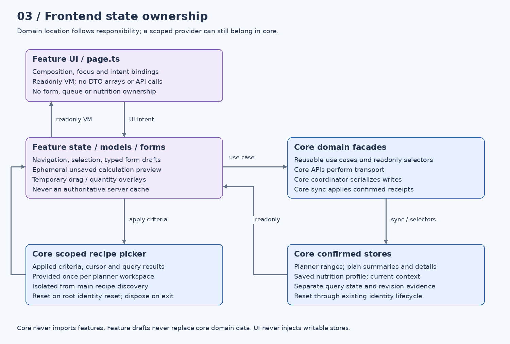

See the [complete image and diagram gallery](README.md#images-and-diagrams). Legacy ERDs are clearly marked noncanonical.

## User Flows

### Flow 1 — Easy

1. Enter name and default meal count.
2. Submit Create explicitly.
3. Adopt the confirmed plan/settings in Core before navigating.

### Flow 2 — Intermediate

1. Complete Profile → Goal → Activity → Meal Structure.
2. Review server-calculated targets/warnings with policy/year evidence.
3. Create atomically; Core adopts plan/profile/settings before the draft clears.

### Flow 3 — Dated planning

1. Load the week through Core and select a focused date.
2. Open a saved/virtual meal without writing.
3. Complete an action; one command persists only the intended structure.
4. Core synchronizes the receipt, then feature state updates the task and UI.

### Flow 4 — Copy

1. Load source and destination through Core.
2. Review replacement impact against their revision.
3. Submit one atomic Copy Day or Copy Week command.
4. Update the application from the confirmed receipt, or preserve data and require conflict review.

## Business Rules

### Nutrition calculation policy

#### Audience, evidence, and product policy

Intermediate is an estimated daily starting plan for adult recreational athletes. Easy does not calculate targets. Evidence supports ranges and population-specific prediction; exact activity factors, energy adjustments, gram targets and rounding below are approved Appetee business policy. Do not label them as uniquely optimal, safe for everyone, or clinically validated. Research/source limits are recorded in [Research](README.md#research-and-rationale).

#### Required inputs and validation

`calculationSex`: male/female coefficient for this equation, not a gender-identity inference. `birthYear`: integer, UI age-this-year = current UTC calculation year minus birth year. `heightCm`: decimal with at most two decimals, 120–230 inclusive. `weightKg`: decimal with at most two decimals, 35–250 inclusive. Age-this-year 18–65 inclusive. Reject missing/unknown/nonfinite/out-of-range values with field errors. When age-this-year is 18, `adultConfirmed` must be true because the birthday may not have occurred. This is a request eligibility declaration, not a medical profile field.

Persist complete profile values or no profile; do not save wizard steps separately. Sex, birth year, height and weight are all optional on an untouched user, all required for Intermediate. UI explains that these values can later be changed in Profile. No exact birth date is collected.

Store the calculation's input sex, birth year, age_years, height and weight on its plan with policy version and calculated_at. Derive age from the server TimeProvider at calculation time; never trust a client age field. Date boundaries use UTC for calculation provenance consistently; calendar planner dates remain local-date intent.

#### Resting expenditure

RMR kcal/day = 11.936×weightKg + 587.728×(heightCm/100) − 8.129×ageYears + 191.027×sexCoefficient + 29.279. Male coefficient 1, female 0. Use decimal constants, no binary floating-point intermediate rounding. Height is **metres** inside the formula. Do not substitute centimetres or a different equation under the same policy version.

Ten Haaf's development sample was recreational athletes aged 18–35. Use outside that age/activity profile within the product bounds is extrapolation, not separately established accuracy. Return `equation_population_extrapolation` for age >35 or Inactive and explain estimates vary. The adult 18–65 and numeric bounds are product operating limits, not evidence that the formula has been validated across that entire space.

#### Activity

| Code / label | Factor | Helper description |
|---|---:|---|
| inactive / Inactive | 1.40 | Mostly seated daily routine, little structured exercise. |
| lowActive / Low active | 1.60 | Some daily movement and light or occasional training. |
| active / Active | 1.75 | Regular training combined with a moderately active routine. |
| veryActive / Very active | 2.05 | High training volume and/or a physically demanding daily routine. |

Descriptions consider work and training together; do not map solely from session count or infer per-day training. Maintenance M = RMR×factor. No separate exercise-calorie addition. PAL literature provides context, not validation of this exact RMR multiplier system.

#### Goals and protein

| Goal code | UI label | Energy before rounding | Protein |
|---|---|---|---:|
| performance | Fuel training / perform better | M | 1.6 g/kg |
| maintain | Maintain current weight | M | 1.6 g/kg |
| fatLoss | Lose body fat while keeping muscle | M − min(0.15M, 500) | 2.0 g/kg |
| muscleGain | Gain muscle while limiting fat gain | 1.05M | 1.6 g/kg |
| weightGain | Gain body weight | M + min(0.10M, 500) | 1.6 g/kg |
| recomposition | Improve body composition | M | 1.6 g/kg |

Protein = ceiling(factor×weightKg), whole grams. No recovery modifier. No body-fat percentage/lean-mass input. Do not convert a study's g/kg fat-free-mass recommendation directly into g/kg total weight.

#### Exact macro feasibility algorithm

1. Round energy E to nearest 25 kcal with midpoint AwayFromZero.
2. Reject E outside 1,500–6,000 inclusive with `calculation_outside_supported_range`; never clamp it. These are operational guardrails, not guarantees of safety.
3. P = ceiling(proteinFactor×weightKg).
4. Preferred carbohydrate Cp = weightKg×{3,4,5,6}, respectively for the four activity levels.
5. Fmin = .20E/9; Fcentre = .275E/9; Fmax = .35E/9.
6. If 4P+9Fmin >= E, return `macro_feasibility_conflict` (no plan persisted).
7. Fideal = max(Fmin, min(Fcentre, (E−4P−4Cp)/9)).
8. F = clamp(roundWholeAwayFromZero(Fideal), ceiling(Fmin), floor(Fmax)).
9. C = roundWholeAwayFromZero((E−4P−9F)/4). Reject C<=0 or any nonpositive target; recheck fat and energy invariants after rounding.
10. If C < Cp−1 gram, return nonblocking `carbohydrate_below_preferred` with contextual explanation. Protein remains protected. Do not raise E or represent the carb anchor as achieved when it was not.

Postconditions: E multiple of 25; P/C/F positive whole grams; fat 20–35% of E; absolute difference between (4P+4C+9F) and E <=2 kcal. No independent premature rounding of RMR or maintenance before choosing E. Persist RMR/maintenance at two decimals only after the calculation. The preferred carb anchor is guidance, not an additional independent energy source or hidden per-day training model.

#### Example and UI precision

80 kg, 180 cm, age 28, male, Active: full-precision RMR 2005.4844; M 3509.5977 (response estimates 2005.48 and 3509.60). Maintenance E=3500, P=128, F=107, C=506 (macro energy 3499). Fat loss E=3000, P=160, F=84, C=401 (macro energy 3000).

Response includes policy version, inputs used, RMR/maintenance, targets and warning codes. UI presents whole kcal and grams, plain Estimated daily targets copy, and readable warnings; do not show formula coefficients as part of onboarding. Preview contains no persistent IDs/timestamps from a write. The actual create/update recomputes on the server and may differ at a year/policy boundary; if policy changed since preview return 409 `calculation_preview_stale` using a preview policy token supplied by the create/update request, requiring a fresh review.

#### Preview policy token

Initial implemented policy version: `mp-v1.0.0-2026-10`. RMR and maintenance
estimates are rounded to two decimals with midpoint AwayFromZero only after
target calculation; full decimal intermediates determine targets. Both choices
were explicitly confirmed by the user during B05 implementation.

Calculation preview returns `policyVersion`. Intermediate create/update includes `reviewedPolicyVersion` beside explicit calculation inputs. It must equal the current server policy version or return the above conflict. Client targets are never accepted. A year boundary also invalidates preview: return `calculationYear` and require `reviewedCalculationYear`. These two review fields are concurrency/UX evidence, not authoritative calculation inputs and are not used as formula constants. Server still derives year independently.

#### Recalculation

- Create/recalculate atomically saves current user profile + plan calculation. Cancelling saves neither.
- Updating Profile alone never recalculates plans or increments their updated_at.
- Metadata-only plan update preserves goal/activity/profile/targets/policy/calculated_at exactly.
- Explicit recalculation uses submitted profile + goal + activity and current policy, even if numbers match older inputs.
- Switching Current or duplicating never recalculates.
- Profile mismatch and newer policy are notices, not automatic changes. Show the plan's last-used values; an explicit Use current profile action copies fields into the edit draft.
- No annual background recalculation; age_years records the age actually used.

#### Safeguards and exclusions

Automatic guidance is not for minors, pregnancy/breastfeeding, medically prescribed diets or eating-disorder recovery. Explain outside-scope use without collecting new health-condition columns. No RED-S diagnosis, energy-availability estimator, calorie-floor claim, or supplement/recovery prescription. Unsupported calculation does not prohibit Easy or manual planning. Manual-food all-positive validation remains an independent product rule; do not force food-label calories to equal 4/4/9 macro energy.

#### Tests

Golden vectors above; all 24 goal/activity combinations for representative male/female profiles; cm-to-m conversion; zero/missing/unknown enum rejection; birth-year boundary and adult confirmation; exact .5 rounding; feasible/infeasible extremes; warning threshold Cp−1; policy/year preview drift; metadata preservation; no persistence on preview; no client-calculated target overposting. A prior design-only grid checked 61,368 feasible combinations, but implementation must run its own calculator tests.


## Shared Feature Ownership

Reuse existing auth/session, UserApi, recipe discovery/compatibility, favorite membership, recipe cards/experience and shared UI. This feature does not own canonical recipe authoring or a second profile HTTP client. E-005 owns CSRF, E-008 migration mechanics, E-002 administrative authorization and E-010 common errors. Core data-access must never import Meal Plan feature state, Router, MatDialog or UI forms.

## Data Requirements

### Data model

Separate lightweight plan summaries, complete plan details, normalized dated planner projections, saved nutrition profile, operation receipts, feature view models and temporary drafts. Wire/domain types and API state reside in Core. Complete entity caches receive only complete details. Exact wire fields are defined under API Endpoints.

### Data ownership

| State | Ownership | Lifetime |
|---|---|---|
| Settings, revision and saved profile | Core application/session | Identity; reset on termination/change |
| Complete plan detail | Core entity cache | Identity; explicit invalidation |
| Plan summaries / planner ranges | Core query stores | Bounded cache, revalidation on entry/focus |
| Picker applied criteria/cursor/results | Core scoped query state | Planner workspace; root-reset subscription |
| Form drafts, tasks, selection, pending display overlay | Feature state/models/forms | Owning route/flow; cleared on exit/reset |
| Focus and rendering references | UI component | Component instance |

### Cache and freshness

Core facades coalesce same-key loads and validate identity/sequence/epoch before store adoption. Core sync applies receipts once before feature navigation. Unknown revision jumps invalidate older projections; they never grant old screens new write authority. Current changes invalidate planner targets/defaults. Hard refresh reconstructs from URL and GETs; no browser-persisted queues. The complete frontend map and all read/write flows are in [F01](frontend/Phase_F01_core_contracts_and_shell.md#shared-frontend-architecture).

### Shared system architecture

#### Boundaries

The feature extends existing MVC controllers → Application services → Infrastructure Dapper operations. Domain rules are pure Application helpers; SQL and connection/transaction management remain Infrastructure. No separate Domain project, generic unit of work, event sourcing, Redis, scheduler, or generic CRUD framework.

Services: NutritionCalculationService (pure math), NutritionPlanService (plan lifecycle), MealPlannerService (normalized reads), MealService (meal actions), MealItemService (recipe/manual actions), PlannerCopyService (replacement). Existing UserService owns a separate nutrition-profile contract. Controllers derive current user and bind strict DTOs; they do not calculate or perform SQL. Infrastructure may call pure Application rules while holding its transaction, following the existing RecipeCalculator precedent.

Queries return RowData, not partly constructed Angular view models. Application builds transport DTOs. Repository command interfaces represent full atomic operations, not per-table primitives that require the controller to coordinate commits.


#### Read path

GET range validates a 1–7-date inclusive interval and uses one connection/consistent read transaction. QueryMultiple returns four bounded result sets: settings/current plan; saved days; meals; items joined to canonical recipes/manual details and availability. No per-item preview or recipe query. Reader retains unavailable items instead of filtering them out. Application inserts virtual dates/default meals for absent days and calculates totals/remaining. Query reads never insert settings or days.

Fresh plan list/detail/profile reads each return the observed feature revision. A revision is structural concurrency metadata, not a nutrition snapshot: canonical recipe authoring can change displayed nutrition without incrementing every user's feature revision. Return no-store; do not use this number as a strong ETag.

#### Write protocol

1. Bind auth, CSRF, strict request, expected revision; validate syntactic and pure rules before opening a transaction.
2. Open connection; begin READ COMMITTED. SELECT owning users row FOR UPDATE. Missing session user returns 401. This is the common first lock for every feature and nutrition-profile write.
3. Resolve route ownership under that lock using joins to days/user. Foreign and missing target use the same 404. Read settings; lazily insert if absent only inside the transaction. Compare expected revision.
4. Validate current state, caps, mode/subtype, reference compatibility, default-slot validity, and complete reorder membership. Use parameterized SQL. Use a set-based locking read for referenced recipes where a command depends on their current availability; lock recipe IDs ascending to reduce deadlocks.
5. Apply the entire operation. Keep sort orders dense; touch item/meal/day ancestors affected by descendants with the same captured UTC timestamp.
6. Increment revision exactly once if authoritative state changed. A valid same-value update is a no-op with unchanged revision. New IDs are server-generated. Duplicate POST recipe is a conflict rather than an implicit increment.
7. Read confirmed affected context/rows inside this transaction. Commit, then map/return the captured result. Never commit then perform a new unlocked read whose revision may no longer match this command.
8. On any failure, roll back everything, including first settings/day creation. Cleanup rollback must not rely on an already-cancelled request token.

Every Dapper CommandDefinition must carry the active transaction and cancellation token. No `IgnoreCommandTransaction` bypass. No calls to services that open another connection mid-command. Pure plan calculations can occur before the lock from explicit submitted inputs; the revision and ownership must still be checked before persistence.

#### Isolation, timeout, retry

Reads: REPEATABLE READ coherent snapshot, first context SELECT establishes it. Writes: READ COMMITTED plus common user-row serialization. All command paths follow the same lock order. Per-command timeout 15 seconds; copy operation overall timeout 30 seconds. Measure these on real MySQL; changing them is an operational detail, not permission to weaken atomicity.

At most one internal retry for a deadlock only when rollback is positively known; retry the entire transaction with the same expected revision and bounded jitter. No partial-command retry. Never retry an ambiguous commit, timeout after possible commit, or network disconnect as a fresh intent. Frontend reconciles through GETs; it does not replay with a newly obtained version. Reads may have one bounded retry for a transient failure, excluding auth/validation errors.

#### Security

All owned lookups join through user_id. A user-supplied meal ID must also match the route date on add-item commands. Current pointer is enforced twice: scoped lookup and composite FK. Canonical recipes are not user-owned; apply the existing compatibility predicate. No request accepts owner, sort_order, calculated targets, timestamps, a client-selected calculation policy, or arbitrary item type changes. Reviewed policy/year are comparison evidence only; they cannot choose server calculation behavior. Enforce JSON named enums only; reject unknown members and unsupported content type. Existing auth, rate-limit, CORS and errors remain central.

E-005 supplies antiforgery validation for unsafe methods and credentialed browser calls. Exact API-origin/path matching replaces unsafe URL prefix assumptions. E-002 restricts canonical authoring to authorized administrators. This package does not manufacture an admin role policy. E-008 supplies migration history, separate migration identity, and guarded reset scripts. These prerequisites must be implemented/verified before release; no need to finish unrelated work in those initiatives.

#### Performance and observability

Maximum displayed week: 7×12×20 = 1,680 items. Query count is independent of item count. Range lookup is owner/date indexed; sorted children use parent/order indexes. Copy snapshots source once, then batches target rows and maps generated IDs via date/parent/order queries; do not depend on contiguous auto-increment IDs or INSERT RETURNING support.

Record operation type, outcome/status, elapsed time, row counts, retry count and trace ID. Do not log body measurements, manual item names/values, raw search text, session/CSRF tokens or request bodies. No speculative cache. Canonical update invalidation is event-based within the current SPA and revalidated on route entry/window focus; cross-device real-time updates are not promised.

#### Extension boundary

Future templates could consume copy primitives, but no template table or abstraction is prebuilt. Future per-day targets, recipe versioning, advanced training and fractional quantities require explicit new decisions. Do not reserve nullable columns for them.


## Database Impact

### Existing tables used

Users, recipes and the audited recipe ingredient/nutrition, diet/restriction and favorite dependencies.

### Schema changes

Six new tables plus nullable complete profile fields on users and nullable fat_total on recipes. Exact columns, checks and FKs follow below.

### Index changes

Use only the documented owner/date/parent/order/uniqueness access paths. Validate significant plans with EXPLAIN during implementation.

### Data migration

E-008 owns migration mechanics/history. Preserve existing data and identifiers, backfill only known fat, verify deployed MySQL and constraints, and use explicit isolated database test guards.

### Canonical database model

#### SQL conventions and migration contract

MySQL/InnoDB, utf8mb4_0900_ai_ci for human text. Referenced users.id and recipes.id are signed INT; every associated FK is signed INT. New entity PKs are INT AUTO_INCREMENT. New audit times are DATETIME(6), non-null, explicit UTC values supplied once per operation from TimeProvider; no implicit SQL timestamp defaults. JSON timestamps carry Z. Existing users/recipes TIMESTAMP columns keep their current definitions.

All columns below are NOT NULL unless `NULL` is explicit. No default exists unless written. Code columns use ASCII binary collation for exact case matching. DB mode/item codes use Easy/Intermediate and Recipe/Manual; goal/activity/sex use the exact lower-camel wire codes in the policy. JSON enums use lower camel case, never numeric values. C# named enums and explicit code mapping avoid ordinal persistence.

All FK updates restrict; ON DELETE behavior is specified below. Do not disable foreign_key_checks during a production migration. CHECK enforcement requires supported actual MySQL version; verify deployed version (at least 8.0.16 for enforced CHECKs), SQL mode and real schema before applying anything. Scripts live in the existing migrations folder under E-008; proposed 007/008 numbering must be reconciled with then-current history. Bootstrap script is a local/test representation only.

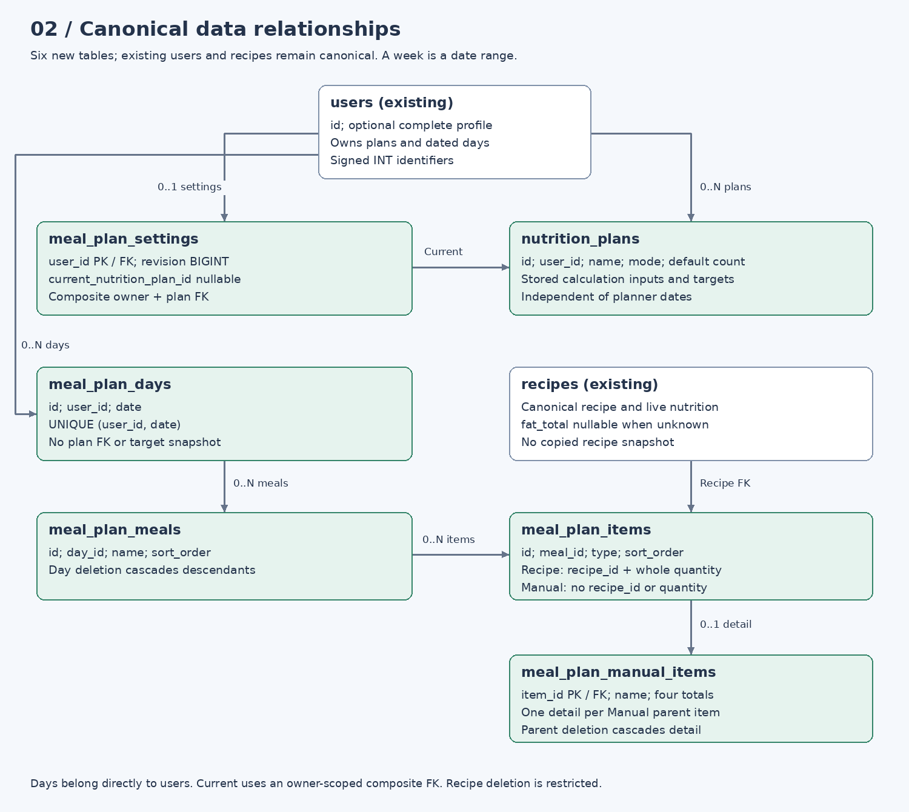

#### Existing tables

##### users

Keep all existing columns/constraints. Add these columns, all default NULL:

| Column | Type | Validation |
|---|---|---|
| calculation_sex | VARCHAR(6) ASCII binary NULL | NULL or male/female |
| birth_year | SMALLINT NULL | Static SQL range 1900–9999; current-year/age rules in service |
| height_cm | DECIMAL(5,2) NULL | 120–230 when present |
| weight_kg | DECIMAL(5,2) NULL | 35–250 when present |

Enforce complete-profile-or-absent with explicit IS NULL / IS NOT NULL branches. No automatic defaults based on other account data. No age, DOB, goal, activity, Current pointer or calculated target stored here. Existing updated_at records profile changes. Existing account profile GET/PUT username/image semantics remain unchanged; new nutrition-profile endpoints are separate. Adult confirmation is request-only, not a clinical/identity field.

##### recipes

Add `fat_total DECIMAL(10,2) NULL DEFAULT NULL`, CHECK `(fat_total IS NULL OR fat_total >= 0)`. No fat_per_serving column: derive round2(fat_total/servings) consistently; NULL remains NULL. Keep existing calories/protein/carbs totals and per-serving fields. Do not change recipe ownership/visibility model or introduce soft-delete columns. Existing recipe deletion has no supported workflow; the new FK prevents deleting a recipe used by the planner.

Backfill fat from existing recipe_ingredients × ingredient_nutrition fat_g/basis only with valid matching units and known nonnegative fat on every ingredient. Canonical JSON has fat for checked-in ingredients; production completeness remains a migration precheck, not an assumption. Zero fat is valid for recipes even though manual entry values must be positive. Report unknown backfill rows, do not COALESCE to zero or derive fat from kcal. Recipe create/update calculator, SQL, generator, and projections must all agree.

##### Existing read-only dependencies

`recipe_ingredients`, `ingredient_nutrition`, `user_diets`, `diet_recipes`, `user_ingredient_restrictions`, `favorite_recipes`. Preserve their existing columns and FKs. Use the existing compatibility predicate, not a duplicated weaker dietary test. No migration to these relationships is required by this feature.

#### nutrition_plans

Purpose: reusable owner configuration and calculation provenance, independent of any calendar date.

| Column | Type/default | Purpose |
|---|---|---|
| id | INT AUTO_INCREMENT PRIMARY KEY | Plan identity |
| user_id | INT | Owner |
| name | VARCHAR(80) | Trimmed user-visible name |
| mode | VARCHAR(12) ASCII binary | Easy / Intermediate |
| default_meals_per_day | TINYINT UNSIGNED | Virtual count, not persisted named meals |
| goal | VARCHAR(24) ASCII binary NULL | Policy goal code |
| activity_level | VARCHAR(16) ASCII binary NULL | Activity code |
| calculation_sex | VARCHAR(6) ASCII binary NULL | Input used |
| birth_year | SMALLINT NULL | Input used |
| age_years | TINYINT UNSIGNED NULL | Server-derived age used |
| height_cm | DECIMAL(5,2) NULL | Input used |
| weight_kg | DECIMAL(5,2) NULL | Input used |
| calculation_policy_version | VARCHAR(40) ASCII binary NULL | e.g. mp-v1.0.0-2026-10 |
| rmr_kcal | DECIMAL(10,2) NULL | Rounded provenance estimate |
| maintenance_kcal | DECIMAL(10,2) NULL | Rounded maintenance estimate |
| target_calories_kcal | DECIMAL(10,2) NULL | Whole-kcal target |
| target_protein_g | DECIMAL(10,2) NULL | Whole-gram target |
| target_carbs_g | DECIMAL(10,2) NULL | Whole-gram target |
| target_fat_g | DECIMAL(10,2) NULL | Whole-gram target |
| calculated_at | DATETIME(6) NULL | Last explicit calculation |
| created_at | DATETIME(6) | Creation instant |
| updated_at | DATETIME(6) | Last saved plan change |

Nullable calculation fields default NULL. FK user_id→users.id restricts deletion. Unique `(user_id,name)` follows the existing case/accent-insensitive text collation, after service trim/NFC normalization. Unique `(user_id,id)` exists specifically as the referenced key for Current ownership. The user-leading indexes support bounded list reads; no speculative goal/activity index. Maximum 50 plans per user is enforced under the user lock.

CHECKs: mode in its two codes; count 1–8; trimmed name not empty. Easy requires all 15 calculation columns (goal through calculated_at) NULL. Intermediate requires each explicitly IS NOT NULL; valid goal/activity/sex enums; age 18–65; static birth-year range; height/weight bounds; positive estimates; target calories 1500–6000; all macro targets >0; stored targets have no fractional units and energy multiple of 25. Policy versions are nonempty and <=40 chars. Formula consistency/macro feasibility is server-calculated and unit-tested, not reproduced as complex SQL expressions.

Plan names need not be globally unique. Default naming is not automatic for normal create; Review requests a name. Duplicate naming uses ` - Copy`, ` - Copy 2`, etc., trimming the base to stay within 80 Unicode scalar values; uniqueness is checked by the database under the owner lock. Do not reuse source ID/created_at or make duplicate Current.

#### meal_plan_user_settings

| Column | Type/default |
|---|---|
| user_id | INT PRIMARY KEY |
| current_nutrition_plan_id | INT NULL DEFAULT NULL |
| revision | BIGINT DEFAULT 0 |
| created_at | DATETIME(6) |
| updated_at | DATETIME(6) |

FK user_id→users.id RESTRICT. Composite FK `(user_id,current_nutrition_plan_id)`→nutrition_plans(user_id,id) RESTRICT; supporting index on those columns. This prevents a cross-user Current pointer even if application validation is bypassed. CHECK revision>=0. Settings has no surrogate id.

Absence is valid and GET exposes effective revision "0" and Current null. Lazy creation occurs only inside a successful mutation transaction. Serialize revision as a decimal string to Angular; parse with BigInt only in core comparison helpers, not JSON numbers. Do not overflow signed BIGINT; an impossible operational exhaustion must fail explicitly, never wrap. No ETag claim for live recipe representations.

Current deletion: update pointer NULL then delete plan in the same transaction. User deletion order when an account-deletion feature exists: settings, days (cascades), plans, user, plus that feature's other existing dependencies. Do not add account deletion to V1 or rely on a cyclic cascade through plans/settings.

#### meal_plan_days

| Column | Type/default |
|---|---|
| id | INT AUTO_INCREMENT PRIMARY KEY |
| user_id | INT |
| plan_date | DATE |
| created_at | DATETIME(6) |
| updated_at | DATETIME(6) |

FK user_id→users.id RESTRICT. UNIQUE `(user_id,plan_date)` serves identity and inclusive range query. No independent date-only index. Application accepts ISO dates in MySQL DATE's supported 1000–9999 range and rejects copy arithmetic overflow. Calendar navigation is not restricted to a season/month, but each GET is 1–7 dates.

Do not store plan_id, week index, day-of-week, targets, totals, consumption status, training intensity, timezone, or snapshot fields. A row can intentionally have zero meals. Keep it when the last meal is deleted. updated_at touches on descendant mutations; reading never touches it.

#### meal_plan_day_meals

| Column | Type/default |
|---|---|
| id | INT AUTO_INCREMENT PRIMARY KEY |
| meal_plan_day_id | INT |
| name | VARCHAR(80) |
| sort_order | SMALLINT UNSIGNED |
| created_at | DATETIME(6) |
| updated_at | DATETIME(6) |

FK day→meal_plan_days.id ON DELETE CASCADE. Index `(meal_plan_day_id,sort_order,id)` supports ordered day reads. CHECK sort_order BETWEEN 1 AND 12; CHECK name trimmed nonempty. Service max 12 meals/day and dense 1..N order under user lock. Order index is deliberately nonunique to permit safe swaps; density/membership is a transaction invariant. Duplicate meal names are allowed. No meal_type, time, default-slot marker or template reference. Once materialized, a default's name is ordinary saved text. Empty meals are valid.

#### meal_plan_meal_items

| Column | Type/default |
|---|---|
| id | INT AUTO_INCREMENT PRIMARY KEY |
| meal_plan_day_meal_id | INT |
| item_type | VARCHAR(8) ASCII binary |
| recipe_id | INT NULL DEFAULT NULL |
| quantity | INT NULL DEFAULT NULL |
| sort_order | SMALLINT UNSIGNED |
| created_at | DATETIME(6) |
| updated_at | DATETIME(6) |

FK meal→meal_plan_day_meals.id ON DELETE CASCADE. FK recipe_id→recipes.id uses default restrictive referential behavior; do not add CASCADE or SET NULL. Because recipe_id participates in a CHECK, do not add conflicting explicit referential actions. Index `(meal_plan_day_meal_id,sort_order,id)` for ordering; UNIQUE `(meal_plan_day_meal_id,recipe_id)` for single recipe occurrence (multiple NULLs permit multiple manual rows); index `(recipe_id)` for reverse reference/FK restriction.

CHECKs must explicitly express:

```sql
-- Specification sketch, not an executable migration.
(item_type = 'Recipe' AND recipe_id IS NOT NULL
 AND quantity IS NOT NULL AND quantity BETWEEN 1 AND 20)
OR
(item_type = 'Manual' AND recipe_id IS NULL AND quantity IS NULL)
```

Additionally sort_order 1–20. Max 20 items/meal and dense order in Application/transaction. Type cannot be changed by update; remove/add instead. Quantity 0 is invalid, never an implicit delete. User ownership is inherited via meal→day→user. Every scoped mutation must follow that chain, even if the UI previously loaded the item.

#### meal_plan_manual_items

| Column | Type/default |
|---|---|
| meal_plan_meal_item_id | INT PRIMARY KEY |
| name | VARCHAR(120) |
| calories_kcal | DECIMAL(10,2) |
| protein_g | DECIMAL(10,2) |
| carbs_g | DECIMAL(10,2) |
| fat_g | DECIMAL(10,2) |

PK is FK to meal_plan_meal_items.id ON DELETE CASCADE, enforcing at most one detail. No independent ID, owner, quantity, serving size or audit columns; parent item owns timestamps. CHECK trimmed name nonempty. Calories .01–20000 inclusive; each macro .01–5000 inclusive; at most 2 decimals accepted at API boundary before MySQL could round. Parent+detail inserted/updated/deleted in one transaction.

Cross-row invariant: every Manual parent has exactly one manual child; Recipe has none. Ordinary CHECK cannot query another table and the FK alone does not require a child. Repository transaction validation plus real-DB negative/invariant tests enforce this. No trigger system. If a read discovers corruption, fail with a logged internal integrity error rather than present a fake zero manual food.

#### Cardinality, ownership, deletion

User 1→many plans/days, 1→0..1 settings. Day→0..12 meals. Meal→0..20 items. Recipe item→one recipe. Manual item→exactly one detail. Only owner roots repeat user_id; child ownership is verified through joins. Plan Current's same-owner rule also has a composite database FK.

Delete last item keeps meal; delete last meal keeps day. Delete day is not a public CRUD action; copy replacement may remove it with cascades. Deleting referenced recipe fails until a future explicitly designed workflow handles it. Current deletion clears pointer before deleting. No orphaning with SET NULL recipes. No implicit copying of targets/profile/settings.

#### Derived values and lifecycle

Only saved content is persisted. Untouched virtual slots use current count and default names from Application: 1 Lunch; 2 Lunch/Dinner; 3 Breakfast/Lunch/Dinner; 4 adds Afternoon Snack before Dinner; 5 adds Morning Snack before Lunch; 6 adds Evening Snack after Dinner; 7 adds Late Snack; 8 adds Extra Meal at end. Client keys `virtual:YYYY-MM-DD:slot` are not DB IDs. Opening/cancelling writes nothing. Virtual slots cannot individually delete/reorder; saved meals can.

Per-serving nutrition = Round2(total/base servings, AwayFromZero), agreeing with existing stored kcal/protein per-serving calculation. Multiply by whole quantity, then sum returned item values. Missing fat propagates NULL only for fat. Unavailable recipe contributes unknown to each total nutrient, preserving its item ID/order/quantity; it is not filtered out. Manual entries contribute their exact stored totals. Sum empty set = 0. Remaining=target−planned, including negative values; if either missing use NULL. Intermediate targets apply to all dates; Easy/no Current target and remaining are null.

Copy: source absent means delete destination persistence; source saved empty means create/retain saved empty destination; source meals means fresh IDs/timestamps with exact names/order/recipe quantities/manual deep copies. Copy source snapshot is captured before target deletes. No copying virtual placeholder rows. Refer to API and copy phase specs for confirmation/version rules.


## API Endpoints

### Canonical API contracts

#### Common boundary

Base `/api`. Every feature endpoint requires the existing authenticated session and derives user identity through IAuthService.GetRequiredUserId. Never accept userId/ownerId. Route IDs are positive signed INT. Unknown/foreign owned objects both return 404. Add-item mealId must belong to the route date. Recipe IDs are canonical references checked with RecipeCompatibilitySql, not owner-owned records.

Accept JSON with strict unmapped-member rejection. No client targets, timestamps, revision in body, sort_order, persistence state, policy constants or item-type replacement. Named enum values only, exact documented wire spelling; reject numeric enum values. DateOnly wire representation is YYYY-MM-DD. Reject malformed/invalid dates, not silent UTC conversions.

All responses are no-store. GETs do not write even settings. Date ranges are inclusive, from<=through, 1–7 dates, valid 1000–9999 calendar years. A one-day GET uses from=through. Week navigation uses Monday; generic GET need not begin Monday. Copy Week does.

All state-changing calls require `X-Meal-Plan-Revision: <nonnegative signed-BIGINT decimal string>` plus the E-005 CSRF header. No quotes around the actual header number; JSON revisions are strings. Calculation-preview POST requires CSRF but no revision because it is read-only computation. Missing/malformed revision =400, code revision_required/revision_invalid. Stale=409 meal_plan_revision_conflict. Controllers parse headers; Infrastructure compares under the transaction lock. No GET of a newer unrelated context silently authorizes an older view's write.

Success: GET/preview 200; creates/duplicates/adds 201; updates/deletes/reorders/Current/copy 200 with readback. No 204 because the client needs confirmed context/totals. Plan creation Location is `/api/nutrition-plans/{id}`. Meal/item creation Location is the owning one-date GET URI; the receipt also identifies createdMealId/createdItemId. No invented GET-meal/item route.

##### Errors

Existing ProblemDetails is retained: type/title/status/detail/instance, traceId, stable code, optional errors dictionary keyed by camelCase field path. Automatic binding errors and business errors should be consumable by the same frontend error mapper; do not require consumers to parse English detail strings.

| Status | Codes/meaning | Client behavior |
|---|---|---|
| 400 | validation_failed, revision_required, revision_invalid, calculation_outside_supported_range, macro_feasibility_conflict, csrf_invalid | Keep draft; field/summary error. CSRF refresh only when server confirms rejection before mutation, not unknown outcome. |
| 401 | existing session codes | Existing session-expiration pipeline; reset feature state/queue. |
| 403 | disallowed origin / existing authorization policy | Explain unavailable action; no replay. |
| 404 | resource_not_found / recipe_unavailable | Uniform missing/foreign response; remove stale selection or show unavailable, do not reveal another owner. |
| 409 | meal_plan_revision_conflict, plan_name_conflict, plan_limit_reached, meal_limit_reached, item_limit_reached, recipe_already_in_meal, destination_not_empty, source_recipe_unavailable, calculation_preview_stale | Specific handling; stale version requires refresh/review, not version substitution. |
| 415 | unsupported media type | Caller defect; reject before business execution. |
| 500 | generic internal error + traceId | Preserve draft; ambiguous write outcome must be reconciled. |

Do not expose SQL, exception stacks, user IDs or profile values in errors. Existing rate-limit policy may also produce 429; do not invent a feature-specific distributed limiter.

#### Scalar/value types

`NutrientsDto`: `{caloriesKcal:number|null, proteinG:number|null, carbsG:number|null, fatG:number|null}`. Calories/macros are decimal JSON numbers, not locale strings. In targets all four values are known positive; elsewhere NULL means incomplete/unknown. Empty known set=0. `targets:null` means no targets, different from an object of zero targets.

`NutritionProfileValue`: `{calculationSex:"male"|"female", birthYear:integer, heightCm:decimal, weightKg:decimal}`. Profile response `{revision:string,profile:NutritionProfileValue|null}`. Request has those fields plus optional `adultConfirmed:boolean` required true when age-this-year is18. It is not persisted; body absent-profile/partial clear is not supported by PUT.

`CalculationInputsDto`: profile values plus `ageYears`, `goal`, `activityLevel`. Goal codes performance/maintain/fatLoss/muscleGain/weightGain/recomposition; activity inactive/lowActive/active/veryActive. `CalculationRequest`: `{profile:NutritionProfileRequest,goal,activityLevel}`.

`NutritionCalculationDto`: `{policyVersion,calculationYear,inputs,rmrKcal,maintenanceKcal,targets,warnings:string[]}`. Estimates at two decimals; targets whole units. Warnings include equation_population_extrapolation and carbohydrate_below_preferred. Policy/year returned by preview must be included as review evidence at plan creation/recalculation, never as authoritative math inputs.

`CurrentNutritionPlanDto`: `{id,name,mode,defaultMealsPerDay,targets:NutrientsDto|null,calculationPolicyVersion:string|null}`.
`MealPlanSettingsDto`: `{currentNutritionPlanId:number|null,currentPlan:CurrentNutritionPlanDto|null}`. Both null or matching IDs; no orphan pointer.

`NutritionPlanSummaryDto`: `{id,name,mode,defaultMealsPerDay,goal:null|Goal,activityLevel:null|Activity,targets:null|NutrientsDto,calculationPolicyVersion:null|string,calculatedAt:null|UTCString,createdAt:UTCString,updatedAt:UTCString}`. Summary is not a complete plan cache record.

`NutritionPlanDto`: all summary fields plus `{calculationInputs:CalculationInputsDto|null,rmrKcal:number|null,maintenanceKcal:number|null,warnings:string[]}`. Current membership is derived from settings, not independently mutable isCurrent booleans on entities. A plan does not embed dated meals or a current user profile.

#### Response envelopes

| DTO | Exact top-level fields |
|---|---|
| NutritionPlanListDto | revision, settings, plans: NutritionPlanSummaryDto[] |
| NutritionPlanDetailDto | revision, settings, plan: NutritionPlanDto, profileDiffers:boolean |
| NutritionPlanMutationDto | revision, settings, plan: NutritionPlanDto|null, deletedPlanId:number|null, profile:NutritionProfileValue|null, plannerInvalidated:boolean |
| NutritionProfileDto | revision, profile:NutritionProfileValue|null |
| MealPlannerRangeDto | revision, settings, from, through, days:PlannerDayDto[] |
| PlannerMutationDto | revision, settings, days:PlannerDayDto[], createdMealId:number|null, createdItemId:number|null |

In a plan mutation `profile:null` means no profile change in that operation, not erase the saved profile. Delete returns plan:null plus deletedPlanId; other plan commands return a complete plan and deletedPlanId:null. Current PUT returns the selected plan. plannerInvalidated is true when Current/defaults/active targets changed; noncurrent metadata edits do not invalidate planner contents, although version context still advances. All mutation handlers participate in core synchronization. Profile PUT changes revision/profile but not plan targets.

`PlannerDayDto`: `{date,id:number|null,persistence:"untouched"|"saved",savedMealCount:number,meals:PlannerMealDto[],totals:NutrientsDto,targets:NutrientsDto|null,remaining:NutrientsDto|null,warnings:string[]}`.

`PlannerMealDto`: `{id:number|null,key:string,isVirtual:boolean,defaultSlot:number|null,name,sortOrder:number,items:PlannerItemDto[],totals:NutrientsDto,warnings:string[]}`. Persisted key `meal:<id>`; virtual key `virtual:<date>:<1-based-slot>`. Saved defaultSlot=null; virtual IDs null, items empty, totals zero, sortOrder=slot. A real saved day has no virtual filler meals.

`PlannerItemDto` is a discriminated union:
- Recipe: `{id,type:"recipe",sortOrder,recipeId,quantity,availability:"available"|"unavailable",name:string|null,perServing:NutrientsDto|null,nutrition:NutrientsDto,warnings:string[]}`.
- Manual: `{id,type:"manual",sortOrder,name,nutrition:NutrientsDto}`. No recipeId, quantity, serving size or availability fields.
Unavailable recipe's ID/quantity/order remain; name/perServing=null; all four nutrition values=null; UI uses a generic unavailable label and permits remove. Missing fat alone is an available recipe with fatG:null. Do not filter the parent item out through an INNER JOIN compatibility predicate.

Planner warning codes (approved 2026-10-12): an available recipe with unknown fat
returns `recipe_fat_unknown`; fat remains null, never zero. An unavailable
recipe returns only `recipe_unavailable`, not an additional missing-fat warning,
and remains removable. Meal/day warnings are deduplicated unions of constituent
warnings in stable first-occurrence order. Empty/complete content has no such
warnings. These codes are distinct from nutrition-calculation warnings.

#### Request DTOs and invariant rules

| Request | Fields and exact rules |
|---|---|
| CreateNutritionPlanRequest | name (trim/NFC, 1–80 Unicode scalars), mode easy/intermediate, defaultMealsPerDay integer1–8; Easy omits calculation/review fields; Intermediate requires calculation, reviewedPolicyVersion, reviewedCalculationYear. |
| UpdateNutritionPlanRequest | name, defaultMealsPerDay; optional calculation + both review fields supplied together for Intermediate recalculation. Omit all three for metadata-only change. Mode is not accepted. Easy rejects calculation fields. |
| SetCurrentNutritionPlanRequest | nutritionPlanId positive int; NULL/clear action not exposed. Current deletion handles clearing. |
| CreateMealRequest | name (1–80), optional defaultSlot integer1–8. No slot=explicit new meal; UI sends New Meal. Slot=rename/materialize only that current placeholder on an absent day. |
| RenameMealRequest | name only, same constraints. |
| MealTargetRequest | Exactly `{mealId}` or `{defaultSlot}`. A saved meal must belong to route date; a slot requires absent day and actual current count containing it. |
| AddRecipeItemRequest | meal:MealTargetRequest, recipeId, quantity integer1–20. Duplicate in same meal=409, not increment/upsert. |
| SetRecipeQuantityRequest | quantity integer1–20 only; zero is not remove. |
| ManualItemRequest | name trimmed1–120; caloriesKcal .01–20000; proteinG/carbsG/fatG .01–5000; every field required, max2 decimals, finite numeric. |
| AddManualItemRequest | meal:MealTargetRequest, manualItem:ManualItemRequest. |
| ReorderRequest | orderedIds positive unique integers, complete exact membership of the target saved parent; empty list valid only for an already-empty parent. |
| CopyDayRequest | sourceDate, destinationDate distinct valid dates; replaceExisting boolean required. |
| CopyWeekRequest | sourceMonday, destinationMonday distinct Mondays; both seven-date ranges valid; replaceExisting boolean required. |

Names are plain text, not HTML. Reject line/control characters; use Angular escaped text binding. Case/accent name collisions follow MySQL collation and map to plan_name_conflict. Request limits mirror database/storage bounds but server is authoritative. A blank optional string is not permission to clear an unrelated field.

#### Transaction and UI shorthand for endpoint cards

**R:** read only, coherent owner-scoped snapshot, no revision precondition or write; auth required.
**P:** pure calculation, no DB write/transaction/revision; auth+CSRF required.
**W:** complete write protocol from Architecture: auth+CSRF+revision; one user-locked transaction; ownership, invariant validation, changes, revision and readback atomic.
**Confirmed UI:** render authoritative result only after success. A temporary field/drag preview may be immediate, but no early totals or Saved. No automatic replay with refreshed revision. Every card below inherits the common status/security/date/DTO rules; the card adds operation-specific behavior. No undocumented query parameters.

#### Endpoints

##### NP01 — GET /api/users/me/nutrition-profile

- **Purpose:** Read current saved profile.
- **Authentication/ownership:** required session; common owner-scoped rules above; no client user ID.
- **Route/query parameters:** none. No other parameters.
- **Request DTO:** none.
- **Response DTO / success:** NutritionProfileDto; 200.
- **Errors:** common statuses above; operation-specific validation/conflicts described below.
- **Validation:** Session owner only; absent profile is 200 with profile:null. No request user ID.
- **Transaction:** R, as defined above.
- **Concurrency/idempotency:** read-only; never creates rows; independent keyed request generations.
- **Application method:** `UserService.GetNutritionProfileAsync(currentUserId, request/route values, expectedRevision when W, cancellationToken)`; pure calculator takes validated input/calculation date without currentUserId.
- **Infrastructure operation:** `UserQueries.GetNutritionProfileAsync`; SQL/atomic mechanics remain Infrastructure.
- **Frontend caller:** `NutritionProfileFacade.load` in core; feature flow delegates to it.
- **Optimistic UI:** Profile query state; no optimistic behavior.
- **Implementation slices:** B04; F03.

##### NP02 — PUT /api/users/me/nutrition-profile

- **Purpose:** Save complete profile without recalculating plans.
- **Authentication/ownership:** required session; common owner-scoped rules above; no client user ID.
- **Route/query parameters:** none. No other parameters.
- **Request DTO:** NutritionProfileRequest.
- **Response DTO / success:** NutritionProfileDto; 200.
- **Errors:** common statuses above; operation-specific validation/conflicts described below.
- **Validation:** Validate complete values/adult declaration; compare revision; same values no-op. Plan rows/targets remain untouched.
- **Transaction:** W, as defined above.
- **Concurrency/idempotency:** expected revision required; commit once; same-value PUT/PATCH/reorder may be no-op; do not retry POST or ambiguous results with a new version.
- **Application method:** `UserService.UpdateNutritionProfileAsync(currentUserId, request/route values, expectedRevision when W, cancellationToken)`; pure calculator takes validated input/calculation date without currentUserId.
- **Infrastructure operation:** `UserRepository.UpdateNutritionProfileAsync`; SQL/atomic mechanics remain Infrastructure.
- **Frontend caller:** `NutritionProfileFacade.update` in core; feature flow delegates to it.
- **Optimistic UI:** Confirmed UI; preserve feature draft on error; core profile source replaced only on success.
- **Implementation slices:** B04; F03.

##### NP03 — POST /api/nutrition-plans/calculation-preview

- **Purpose:** Calculate unsaved Intermediate preview.
- **Authentication/ownership:** required session; common owner-scoped rules above; no client user ID.
- **Route/query parameters:** none. No other parameters.
- **Request DTO:** NutritionCalculationRequest.
- **Response DTO / success:** NutritionCalculationDto; 200.
- **Errors:** common statuses above; operation-specific validation/conflicts described below.
- **Validation:** Validate current server year, eligibility, math; 400 field/feasibility errors. Returns policy/year review evidence. No settings insertion.
- **Transaction:** P, as defined above.
- **Concurrency/idempotency:** read-only; never creates rows; independent keyed request generations.
- **Application method:** `NutritionCalculationService.Calculate(currentUserId, request/route values, expectedRevision when W, cancellationToken)`; pure calculator takes validated input/calculation date without currentUserId.
- **Infrastructure operation:** `None (pure Application)`; SQL/atomic mechanics remain Infrastructure.
- **Frontend caller:** `NutritionPlanFacade.preview` in core; feature flow delegates to it.
- **Optimistic UI:** Preview state belongs to temporary draft controller; switchMap may cancel obsolete READ-ONLY previews, never writes.
- **Implementation slices:** B05; F06.

##### NP04 — GET /api/nutrition-plans

- **Purpose:** List owned plans and Current context.
- **Authentication/ownership:** required session; common owner-scoped rules above; no client user ID.
- **Route/query parameters:** none. No other parameters.
- **Request DTO:** none.
- **Response DTO / success:** NutritionPlanListDto; 200.
- **Errors:** common statuses above; operation-specific validation/conflicts described below.
- **Validation:** Own max50 plans, Current first then updated_at DESC,id DESC. No pagination needed at this cap.
- **Transaction:** R, as defined above.
- **Concurrency/idempotency:** read-only; never creates rows; independent keyed request generations.
- **Application method:** `NutritionPlanService.ListAsync(currentUserId, request/route values, expectedRevision when W, cancellationToken)`; pure calculator takes validated input/calculation date without currentUserId.
- **Infrastructure operation:** `NutritionPlanQueries.ListAsync`; SQL/atomic mechanics remain Infrastructure.
- **Frontend caller:** `NutritionPlanFacade.loadList` in core; feature flow delegates to it.
- **Optimistic UI:** Core list projection, separate from detail cache; loading/error owned by list query.
- **Implementation slices:** B06; F04.

##### NP05 — GET /api/nutrition-plans/{planId}

- **Purpose:** Load complete plan for edit.
- **Authentication/ownership:** required session; common owner-scoped rules above; no client user ID.
- **Route/query parameters:** planId route int. No other parameters.
- **Request DTO:** none.
- **Response DTO / success:** NutritionPlanDetailDto; 200.
- **Errors:** common statuses above; operation-specific validation/conflicts described below.
- **Validation:** Scoped ID; missing/foreign404. profileDiffers compares current profile to stored inputs, not a forced recalculation.
- **Transaction:** R, as defined above.
- **Concurrency/idempotency:** read-only; never creates rows; independent keyed request generations.
- **Application method:** `NutritionPlanService.GetAsync(currentUserId, request/route values, expectedRevision when W, cancellationToken)`; pure calculator takes validated input/calculation date without currentUserId.
- **Infrastructure operation:** `NutritionPlanQueries.GetAsync`; SQL/atomic mechanics remain Infrastructure.
- **Frontend caller:** `NutritionPlanFacade.loadDetail` in core; feature flow delegates to it.
- **Optimistic UI:** Core complete detail cache record with observed revision; initialize draft once, never continuously patch it from cache.
- **Implementation slices:** B06; F07.

##### NP06 — POST /api/nutrition-plans

- **Purpose:** Create Easy/Intermediate plan.
- **Authentication/ownership:** required session; common owner-scoped rules above; no client user ID.
- **Route/query parameters:** none. No other parameters.
- **Request DTO:** CreateNutritionPlanRequest.
- **Response DTO / success:** NutritionPlanMutationDto; 201 + plan Location.
- **Errors:** common statuses above; operation-specific validation/conflicts described below.
- **Validation:** Mode shape/name/count/cap; server recomputation and reviewed policy/year. Profile+plan+first Current one commit. Name/cap/preview conflict409.
- **Transaction:** W, as defined above.
- **Concurrency/idempotency:** expected revision required; commit once; same-value PUT/PATCH/reorder may be no-op; do not retry POST or ambiguous results with a new version.
- **Application method:** `NutritionPlanService.CreateAsync(currentUserId, request/route values, expectedRevision when W, cancellationToken)`; pure calculator takes validated input/calculation date without currentUserId.
- **Infrastructure operation:** `NutritionPlanRepository.CreateAsync`; SQL/atomic mechanics remain Infrastructure.
- **Frontend caller:** `NutritionPlanFacade.create` in core; feature flow delegates to it.
- **Optimistic UI:** Explicit Create; disable duplicate submit. Core sync before route navigation; wizard reset only after receipt.
- **Implementation slices:** B06; F05/F06.

##### NP07 — PUT /api/nutrition-plans/{planId}

- **Purpose:** Update metadata or explicitly recalculate.
- **Authentication/ownership:** required session; common owner-scoped rules above; no client user ID.
- **Route/query parameters:** planId route int. No other parameters.
- **Request DTO:** UpdateNutritionPlanRequest.
- **Response DTO / success:** NutritionPlanMutationDto; 200.
- **Errors:** common statuses above; operation-specific validation/conflicts described below.
- **Validation:** Mode immutable. Omitted calculation preserves calculation block byte-for-value. Supplied block recomputes and updates profile atomically. Current target/count change invalidates planner.
- **Transaction:** W, as defined above.
- **Concurrency/idempotency:** expected revision required; commit once; same-value PUT/PATCH/reorder may be no-op; do not retry POST or ambiguous results with a new version.
- **Application method:** `NutritionPlanService.UpdateAsync(currentUserId, request/route values, expectedRevision when W, cancellationToken)`; pure calculator takes validated input/calculation date without currentUserId.
- **Infrastructure operation:** `NutritionPlanRepository.UpdateAsync`; SQL/atomic mechanics remain Infrastructure.
- **Frontend caller:** `NutritionPlanFacade.update` in core; feature flow delegates to it.
- **Optimistic UI:** Explicit Update; keep draft and old confirmed data on error; no optimistic target math.
- **Implementation slices:** B07; F07.

##### NP08 — POST /api/nutrition-plans/{planId}/duplicate

- **Purpose:** Duplicate one plan as inactive.
- **Authentication/ownership:** required session; common owner-scoped rules above; no client user ID.
- **Route/query parameters:** planId route int. No other parameters.
- **Request DTO:** none.
- **Response DTO / success:** NutritionPlanMutationDto; 201 + plan Location.
- **Errors:** common statuses above; operation-specific validation/conflicts described below.
- **Validation:** Owner/cap; generate unique suffix under lock. Copy targets/provenance, fresh id/audit timestamps; calculated_at remains original calculation time. Current unchanged.
- **Transaction:** W, as defined above.
- **Concurrency/idempotency:** expected revision required; commit once; same-value PUT/PATCH/reorder may be no-op; do not retry POST or ambiguous results with a new version.
- **Application method:** `NutritionPlanService.DuplicateAsync(currentUserId, request/route values, expectedRevision when W, cancellationToken)`; pure calculator takes validated input/calculation date without currentUserId.
- **Infrastructure operation:** `NutritionPlanRepository.DuplicateAsync`; SQL/atomic mechanics remain Infrastructure.
- **Frontend caller:** `NutritionPlanFacade.duplicate` in core; feature flow delegates to it.
- **Optimistic UI:** Confirmed UI; disable repeated action while pending; POST not safely replayed with a fresh version.
- **Implementation slices:** B07; F04.

##### NP09 — DELETE /api/nutrition-plans/{planId}

- **Purpose:** Delete plan and clear Current if necessary.
- **Authentication/ownership:** required session; common owner-scoped rules above; no client user ID.
- **Route/query parameters:** planId route int. No other parameters.
- **Request DTO:** none.
- **Response DTO / success:** NutritionPlanMutationDto; 200.
- **Errors:** common statuses above; operation-specific validation/conflicts described below.
- **Validation:** Owner; pointer NULL before DELETE. No alternative Current, no food deletion. Missing/foreign404 even for repeated delete; stale version409.
- **Transaction:** W, as defined above.
- **Concurrency/idempotency:** expected revision required; commit once; same-value PUT/PATCH/reorder may be no-op; do not retry POST or ambiguous results with a new version.
- **Application method:** `NutritionPlanService.DeleteAsync(currentUserId, request/route values, expectedRevision when W, cancellationToken)`; pure calculator takes validated input/calculation date without currentUserId.
- **Infrastructure operation:** `NutritionPlanRepository.DeleteAsync`; SQL/atomic mechanics remain Infrastructure.
- **Frontend caller:** `NutritionPlanFacade.delete` in core; feature flow delegates to it.
- **Optimistic UI:** Confirmation before command; keep card until acknowledgement; clear stale details after receipt.
- **Implementation slices:** B07; F04.

##### NP10 — PUT /api/meal-plan/current-nutrition-plan

- **Purpose:** Select owned Current plan.
- **Authentication/ownership:** required session; common owner-scoped rules above; no client user ID.
- **Route/query parameters:** none. No other parameters.
- **Request DTO:** SetCurrentNutritionPlanRequest.
- **Response DTO / success:** NutritionPlanMutationDto; 200.
- **Errors:** common statuses above; operation-specific validation/conflicts described below.
- **Validation:** Owner and composite FK; same Current no-op. Do not recalculate targets or rewrite days.
- **Transaction:** W, as defined above.
- **Concurrency/idempotency:** expected revision required; commit once; same-value PUT/PATCH/reorder may be no-op; do not retry POST or ambiguous results with a new version.
- **Application method:** `NutritionPlanService.SetCurrentAsync(currentUserId, request/route values, expectedRevision when W, cancellationToken)`; pure calculator takes validated input/calculation date without currentUserId.
- **Infrastructure operation:** `NutritionPlanRepository.SetCurrentAsync`; SQL/atomic mechanics remain Infrastructure.
- **Frontend caller:** `NutritionPlanFacade.setCurrent` in core; feature flow delegates to it.
- **Optimistic UI:** Confirmed Current badge; invalidate range then refresh on active view/next entry; no planner dropdown.
- **Implementation slices:** B07; F04.

##### MP01 — GET /api/meal-plan/days

- **Purpose:** Load normalized planner range.
- **Authentication/ownership:** required session; common owner-scoped rules above; no client user ID.
- **Route/query parameters:** from, through required inclusive ISO dates. No other parameters.
- **Request DTO:** none.
- **Response DTO / success:** MealPlannerRangeDto; 200.
- **Errors:** common statuses above; operation-specific validation/conflicts described below.
- **Validation:** 1–7 dates; absent settings revision0; absent days virtual, saved-empty distinct. Four bounded result sets, no writes.
- **Transaction:** R, as defined above.
- **Concurrency/idempotency:** read-only; never creates rows; independent keyed request generations.
- **Application method:** `MealPlannerService.GetRangeAsync(currentUserId, request/route values, expectedRevision when W, cancellationToken)`; pure calculator takes validated input/calculation date without currentUserId.
- **Infrastructure operation:** `MealPlannerQueries.GetRangeAsync`; SQL/atomic mechanics remain Infrastructure.
- **Frontend caller:** `MealPlannerFacade.loadRange` in core; feature flow delegates to it.
- **Optimistic UI:** Core keyed range query; stale generations discarded; route entry/focus revalidate.
- **Implementation slices:** B08; F08.

##### MP02 — POST /api/meal-plan/days/{date}/meals

- **Purpose:** Create explicit meal or materialize renamed virtual meal.
- **Authentication/ownership:** required session; common owner-scoped rules above; no client user ID.
- **Route/query parameters:** date route. No other parameters.
- **Request DTO:** CreateMealRequest.
- **Response DTO / success:** PlannerMutationDto; 201 + one-date Location.
- **Errors:** common statuses above; operation-specific validation/conflicts described below.
- **Validation:** Max12; valid current slot only on absent date; no slot explicit New Meal from UI. Insert only chosen meal. Return createdMealId.
- **Transaction:** W, as defined above.
- **Concurrency/idempotency:** expected revision required; commit once; same-value PUT/PATCH/reorder may be no-op; do not retry POST or ambiguous results with a new version.
- **Application method:** `MealService.CreateAsync(currentUserId, request/route values, expectedRevision when W, cancellationToken)`; pure calculator takes validated input/calculation date without currentUserId.
- **Infrastructure operation:** `MealRepository.CreateAsync`; SQL/atomic mechanics remain Infrastructure.
- **Frontend caller:** `MealPlannerFacade.createMeal` in core; feature flow delegates to it.
- **Optimistic UI:** Confirmed creation; block dependent actions until real ID; replace virtual route key after receipt.
- **Implementation slices:** B09; F09.

##### MP03 — PATCH /api/meal-plan/meals/{mealId}

- **Purpose:** Rename saved meal.
- **Authentication/ownership:** required session; common owner-scoped rules above; no client user ID.
- **Route/query parameters:** mealId route int. No other parameters.
- **Request DTO:** RenameMealRequest.
- **Response DTO / success:** PlannerMutationDto; 200.
- **Errors:** common statuses above; operation-specific validation/conflicts described below.
- **Validation:** Owner, trim/name limits. Same name no-op. No new day/meal created by this route.
- **Transaction:** W, as defined above.
- **Concurrency/idempotency:** expected revision required; commit once; same-value PUT/PATCH/reorder may be no-op; do not retry POST or ambiguous results with a new version.
- **Application method:** `MealService.RenameAsync(currentUserId, request/route values, expectedRevision when W, cancellationToken)`; pure calculator takes validated input/calculation date without currentUserId.
- **Infrastructure operation:** `MealRepository.RenameAsync`; SQL/atomic mechanics remain Infrastructure.
- **Frontend caller:** `MealPlannerFacade.renameMeal` in core; feature flow delegates to it.
- **Optimistic UI:** Temporary text draft; save Enter/blur/600ms valid idle; coalesce unsent names; totals remain confirmed.
- **Implementation slices:** B09; F09.

##### MP04 — DELETE /api/meal-plan/meals/{mealId}

- **Purpose:** Remove saved meal and descendants.
- **Authentication/ownership:** required session; common owner-scoped rules above; no client user ID.
- **Route/query parameters:** mealId route int. No other parameters.
- **Request DTO:** none.
- **Response DTO / success:** PlannerMutationDto; 200.
- **Errors:** common statuses above; operation-specific validation/conflicts described below.
- **Validation:** Owner; cascade items/details; compact remaining order; KEEP day even if now empty.
- **Transaction:** W, as defined above.
- **Concurrency/idempotency:** expected revision required; commit once; same-value PUT/PATCH/reorder may be no-op; do not retry POST or ambiguous results with a new version.
- **Application method:** `MealService.DeleteAsync(currentUserId, request/route values, expectedRevision when W, cancellationToken)`; pure calculator takes validated input/calculation date without currentUserId.
- **Infrastructure operation:** `MealRepository.DeleteAsync`; SQL/atomic mechanics remain Infrastructure.
- **Frontend caller:** `MealPlannerFacade.deleteMeal` in core; feature flow delegates to it.
- **Optimistic UI:** Confirm when food exists; explicit empty-meal remove can be direct. Clear selected task after acknowledgement.
- **Implementation slices:** B09; F09.

##### MP05 — PUT /api/meal-plan/days/{date}/meal-order

- **Purpose:** Persist complete saved-meal ordering.
- **Authentication/ownership:** required session; common owner-scoped rules above; no client user ID.
- **Route/query parameters:** date route. No other parameters.
- **Request DTO:** ReorderRequest.
- **Response DTO / success:** PlannerMutationDto; 200.
- **Errors:** common statuses above; operation-specific validation/conflicts described below.
- **Validation:** Owned saved day; exact membership; no virtual IDs or reparenting. Empty saved day accepts[] no-op. Absent day404.
- **Transaction:** W, as defined above.
- **Concurrency/idempotency:** expected revision required; commit once; same-value PUT/PATCH/reorder may be no-op; do not retry POST or ambiguous results with a new version.
- **Application method:** `MealService.ReorderAsync(currentUserId, request/route values, expectedRevision when W, cancellationToken)`; pure calculator takes validated input/calculation date without currentUserId.
- **Infrastructure operation:** `MealRepository.ReorderAsync`; SQL/atomic mechanics remain Infrastructure.
- **Frontend caller:** `MealPlannerFacade.reorderMeals` in core; feature flow delegates to it.
- **Optimistic UI:** Temporary drag preview or move controls; one request after drop; restore confirmed sequence on failure.
- **Implementation slices:** B12; F12.

##### MP06 — POST /api/meal-plan/days/{date}/recipe-items

- **Purpose:** Add recipe, optionally materializing virtual meal.
- **Authentication/ownership:** required session; common owner-scoped rules above; no client user ID.
- **Route/query parameters:** date route. No other parameters.
- **Request DTO:** AddRecipeItemRequest.
- **Response DTO / success:** PlannerMutationDto; 201 + one-date Location.
- **Errors:** common statuses above; operation-specific validation/conflicts described below.
- **Validation:** Target ownership/date/slot; compatibility; quantity1–20; max20; duplicate409. Insert parent(s)+item atomically. Return created IDs.
- **Transaction:** W, as defined above.
- **Concurrency/idempotency:** expected revision required; commit once; same-value PUT/PATCH/reorder may be no-op; do not retry POST or ambiguous results with a new version.
- **Application method:** `MealItemService.AddRecipeAsync(currentUserId, request/route values, expectedRevision when W, cancellationToken)`; pure calculator takes validated input/calculation date without currentUserId.
- **Infrastructure operation:** `MealItemRepository.AddRecipeAsync`; SQL/atomic mechanics remain Infrastructure.
- **Frontend caller:** `MealPlannerFacade.addRecipe` in core; feature flow delegates to it.
- **Optimistic UI:** In meal prevents normal duplicate; Add stays pending until receipt; then back to Meal Editor.
- **Implementation slices:** B10; F10.

##### MP07 — PUT /api/meal-plan/recipe-items/{itemId}/quantity

- **Purpose:** Set absolute whole-serving count.
- **Authentication/ownership:** required session; common owner-scoped rules above; no client user ID.
- **Route/query parameters:** itemId route int. No other parameters.
- **Request DTO:** SetRecipeQuantityRequest.
- **Response DTO / success:** PlannerMutationDto; 200.
- **Errors:** common statuses above; operation-specific validation/conflicts described below.
- **Validation:** Owned Recipe subtype; compatible canonical recipe; integer1–20; zero invalid; same value no-op.
- **Transaction:** W, as defined above.
- **Concurrency/idempotency:** expected revision required; commit once; same-value PUT/PATCH/reorder may be no-op; do not retry POST or ambiguous results with a new version.
- **Application method:** `MealItemService.SetRecipeQuantityAsync(currentUserId, request/route values, expectedRevision when W, cancellationToken)`; pure calculator takes validated input/calculation date without currentUserId.
- **Infrastructure operation:** `MealItemRepository.SetRecipeQuantityAsync`; SQL/atomic mechanics remain Infrastructure.
- **Frontend caller:** `MealPlannerFacade.setRecipeQuantity` in core; feature flow delegates to it.
- **Optimistic UI:** Immediate quantity draft, latest unsent value coalesced; server totals only; preserve a newer draft when older ack arrives.
- **Implementation slices:** B10; F10.

##### MP08 — POST /api/meal-plan/days/{date}/manual-items

- **Purpose:** Add complete manual entry.
- **Authentication/ownership:** required session; common owner-scoped rules above; no client user ID.
- **Route/query parameters:** date route. No other parameters.
- **Request DTO:** AddManualItemRequest.
- **Response DTO / success:** PlannerMutationDto; 201 + one-date Location.
- **Errors:** common statuses above; operation-specific validation/conflicts described below.
- **Validation:** Target/date/cap; strict positive fields; atomic parent+detail and optional sparse materialization.
- **Transaction:** W, as defined above.
- **Concurrency/idempotency:** expected revision required; commit once; same-value PUT/PATCH/reorder may be no-op; do not retry POST or ambiguous results with a new version.
- **Application method:** `MealItemService.AddManualAsync(currentUserId, request/route values, expectedRevision when W, cancellationToken)`; pure calculator takes validated input/calculation date without currentUserId.
- **Infrastructure operation:** `MealItemRepository.AddManualAsync`; SQL/atomic mechanics remain Infrastructure.
- **Frontend caller:** `MealPlannerFacade.addManual` in core; feature flow delegates to it.
- **Optimistic UI:** Explicit Add commits completed action; no writes per field; remain in editor on invalid/network failure.
- **Implementation slices:** B11; F11.

##### MP09 — PUT /api/meal-plan/manual-items/{itemId}

- **Purpose:** Replace complete manual detail values.
- **Authentication/ownership:** required session; common owner-scoped rules above; no client user ID.
- **Route/query parameters:** itemId route int. No other parameters.
- **Request DTO:** ManualItemRequest.
- **Response DTO / success:** PlannerMutationDto; 200.
- **Errors:** common statuses above; operation-specific validation/conflicts described below.
- **Validation:** Owned Manual subtype; complete fields required; type immutable; touch item/meal/day.
- **Transaction:** W, as defined above.
- **Concurrency/idempotency:** expected revision required; commit once; same-value PUT/PATCH/reorder may be no-op; do not retry POST or ambiguous results with a new version.
- **Application method:** `MealItemService.UpdateManualAsync(currentUserId, request/route values, expectedRevision when W, cancellationToken)`; pure calculator takes validated input/calculation date without currentUserId.
- **Infrastructure operation:** `MealItemRepository.UpdateManualAsync`; SQL/atomic mechanics remain Infrastructure.
- **Frontend caller:** `MealPlannerFacade.updateManual` in core; feature flow delegates to it.
- **Optimistic UI:** Feature draft copied from core once; Update action; confirmed receipt replaces core projection.
- **Implementation slices:** B11; F11.

##### MP10 — DELETE /api/meal-plan/items/{itemId}

- **Purpose:** Remove either item subtype.
- **Authentication/ownership:** required session; common owner-scoped rules above; no client user ID.
- **Route/query parameters:** itemId route int. No other parameters.
- **Request DTO:** none.
- **Response DTO / success:** PlannerMutationDto; 200.
- **Errors:** common statuses above; operation-specific validation/conflicts described below.
- **Validation:** Owner; removal allowed for unavailable recipe; cascade manual detail; compact order; retain empty meal/day.
- **Transaction:** W, as defined above.
- **Concurrency/idempotency:** expected revision required; commit once; same-value PUT/PATCH/reorder may be no-op; do not retry POST or ambiguous results with a new version.
- **Application method:** `MealItemService.RemoveAsync(currentUserId, request/route values, expectedRevision when W, cancellationToken)`; pure calculator takes validated input/calculation date without currentUserId.
- **Infrastructure operation:** `MealItemRepository.RemoveAsync`; SQL/atomic mechanics remain Infrastructure.
- **Frontend caller:** `MealPlannerFacade.removeItem` in core; feature flow delegates to it.
- **Optimistic UI:** Confirmed removal; pending button disabled; no nutrition subtraction in UI.
- **Implementation slices:** B10 (recipe removal), B11 (manual removal); F10/F11.

##### MP11 — PUT /api/meal-plan/meals/{mealId}/item-order

- **Purpose:** Persist full item ordering.
- **Authentication/ownership:** required session; common owner-scoped rules above; no client user ID.
- **Route/query parameters:** mealId route int. No other parameters.
- **Request DTO:** ReorderRequest.
- **Response DTO / success:** PlannerMutationDto; 200.
- **Errors:** common statuses above; operation-specific validation/conflicts described below.
- **Validation:** Owned saved meal; full exact membership both subtypes; reject duplicate, omitted, foreign, other-parent IDs.
- **Transaction:** W, as defined above.
- **Concurrency/idempotency:** expected revision required; commit once; same-value PUT/PATCH/reorder may be no-op; do not retry POST or ambiguous results with a new version.
- **Application method:** `MealItemService.ReorderAsync(currentUserId, request/route values, expectedRevision when W, cancellationToken)`; pure calculator takes validated input/calculation date without currentUserId.
- **Infrastructure operation:** `MealItemRepository.ReorderAsync`; SQL/atomic mechanics remain Infrastructure.
- **Frontend caller:** `MealPlannerFacade.reorderItems` in core; feature flow delegates to it.
- **Optimistic UI:** One completed move; temporary order overlay only; no canonical store mutation before receipt.
- **Implementation slices:** B12; F12.

##### MP12 — POST /api/meal-plan/copy-day

- **Purpose:** Exact one-date replacement.
- **Authentication/ownership:** required session; common owner-scoped rules above; no client user ID.
- **Route/query parameters:** none. No other parameters.
- **Request DTO:** CopyDayRequest.
- **Response DTO / success:** PlannerMutationDto; 200.
- **Errors:** common statuses above; operation-specific validation/conflicts described below.
- **Validation:** Distinct dates; reviewed matching version; replaceExisting false+saved destination409. Source unavailable recipe409. Source absent clears destination; saved empty remains saved empty.
- **Transaction:** W, as defined above.
- **Concurrency/idempotency:** expected revision required; commit once; same-value PUT/PATCH/reorder may be no-op; do not retry POST or ambiguous results with a new version.
- **Application method:** `PlannerCopyService.CopyDayAsync(currentUserId, request/route values, expectedRevision when W, cancellationToken)`; pure calculator takes validated input/calculation date without currentUserId.
- **Infrastructure operation:** `PlannerCopyRepository.CopyDayAsync`; SQL/atomic mechanics remain Infrastructure.
- **Frontend caller:** `MealPlannerFacade.copyDay` in core; feature flow delegates to it.
- **Optimistic UI:** Confirm overwrite after destination GET; mismatch refreshes source/destination and asks reconfirmation; no optimistic copy.
- **Implementation slices:** B13; F13.

##### MP13 — POST /api/meal-plan/copy-week

- **Purpose:** Exact seven-date replacement.
- **Authentication/ownership:** required session; common owner-scoped rules above; no client user ID.
- **Route/query parameters:** none. No other parameters.
- **Request DTO:** CopyWeekRequest.
- **Response DTO / success:** PlannerMutationDto; 200.
- **Errors:** common statuses above; operation-specific validation/conflicts described below.
- **Validation:** Different Monday starts; seven valid dates; reject unconfirmed saved destinations; one transaction, entire source snapshot before deletion, no source virtual rows copied.
- **Transaction:** W, as defined above.
- **Concurrency/idempotency:** expected revision required; commit once; same-value PUT/PATCH/reorder may be no-op; do not retry POST or ambiguous results with a new version.
- **Application method:** `PlannerCopyService.CopyWeekAsync(currentUserId, request/route values, expectedRevision when W, cancellationToken)`; pure calculator takes validated input/calculation date without currentUserId.
- **Infrastructure operation:** `PlannerCopyRepository.CopyWeekAsync`; SQL/atomic mechanics remain Infrastructure.
- **Frontend caller:** `MealPlannerFacade.copyWeek` in core; feature flow delegates to it.
- **Optimistic UI:** Explain seven destinations incl clearing from absent sources; one pending operation; failure leaves all destinations unchanged.
- **Implementation slices:** B14; F14.


#### Reuse and prerequisite endpoints

Existing `GET /api/recipes` and favorites retain their current `RecipeCardDto` response without description or the additional macros. Add `GET /api/recipes/meal-plan` for the Meal Plan picker. It uses the same search/ingredient composition/badge/time/difficulty/savedOnly/cursor/limit contract (default20,max50), ranking and compatibility rules as discovery, but returns `RecipeMealPlanPageDto` whose items are `RecipeCardAdvance`. `RecipeCardAdvance` extends `RecipeCardDto` with `{description,proteinPerServing,carbsPerServing,fatPerServing:number|null}`. Existing GET /api/recipes/{id}/preview and shared RecipeExperienceFacade own preview; do not use legacy unscoped detail for authorization. Do not add Recent/Recommended endpoints.

##### RP01 — GET /api/recipes/meal-plan

- **Purpose:** Return bounded recipe picker cards with the additional description and per-serving macro projection required by Meal Plan.
- **Authentication/ownership:** Existing authenticated recipe compatibility and saved-membership rules; derive the user from the session and accept no userId/ownerId.
- **Route/query parameters:** Same exact query contract as `GET /api/recipes`: optional search, repeated ingredientIds, requireAllIngredients, repeated badges, maxTotalMinutes, maxDifficulty, savedOnly, opaque cursor and limit (default20,max50). No additional parameters.
- **Request DTO:** none.
- **Response DTO / success:** `RecipeMealPlanPageDto`; 200. Exact top-level fields are `{items:RecipeCardAdvance[],nextCursor:string|null,hasMore:boolean}`.
- **Projection:** `RecipeCardAdvance extends RecipeCardDto` and adds `description`, `proteinPerServing`, `carbsPerServing`, and nullable `fatPerServing`. It is not a complete recipe detail or Preview entity.
- **Behavior:** Reuse discovery normalization, compatibility, stable seeded/ranked ordering and cursor semantics. Do not issue per-card Preview/detail reads. Ordinary discovery and favorites keep returning `RecipeCardDto` unchanged.
- **Implementation slices:** B01; F01/F10.

E-005 token bootstrap is GET /api/auth/csrf → `{requestToken,headerName}` with no-store and the antiforgery cookie; support the auth lifecycle as defined by E-005. Token endpoint does not create Meal Plan rows. Frontend stores token in memory; exact API origin/path unsafe requests get the agreed header. Failure before mutation is 400 csrf_invalid. Backend validates Origin where applicable without rejecting legitimate configured deployments; do not loosen credentialed CORS to wildcard. This is a prerequisite contract owned by E-005, not a duplicate Meal Plan security subsystem.

#### Copy/confirmation algorithm

Source and destination must be read/observed at one revision. Destination inspection GET must not replace an older source view's write version; if revisions differ, refresh both relevant queries before presenting confirmation again. The frontend stores only temporary copy intent (dates, reviewed revision, confirmation), while graphs remain in core range queries. Server uses revision precondition and replaceExisting boolean; it never trusts client-provided source contents/counts.

Within transaction: lock user; compare revision; capture source graph including absent/saved-empty distinction; verify referenced recipes are usable; check overwrite acknowledgement; delete destination graphs; insert only source persisted dates and exact child structures using fresh IDs; bulk insert manual details; return destination normalized days at new revision. Different Monday starts mean nonoverlapping 7-day weeks. Any error rolls back all steps. A copy from absent source into absent destination can be a no-op with unchanged revision; any actual replacement of saved rows creates new identities and counts as change even if values happen to match.

#### Full sparse materialization example

Untouched 2026-10-05 under four-meal Current has Breakfast(slot1), Lunch(slot2), Afternoon Snack(slot3), Dinner(slot4). POST recipe-items body `{"meal":{"defaultSlot":2},"recipeId":88,"quantity":1}` with revision "8" creates one day, one Lunch meal, one Recipe item. Receipt revision "9" contains only saved Lunch, createdMealId and createdItemId. No other virtual meals remain on that saved day. Core applies receipt before feature flow replaces slot2 route with the real meal ID. Cancelling the picker before POST creates nothing.

#### Contract tests

Test every route unauthenticated, owned, foreign ID and unknown ID; exact body shape and unknown fields; decimal/enum/date boundaries; revision missing/stale; wrong meal/date pairing; duplicate recipe; parent mismatch on reorders; all errors with traceId/code; copy confirmation races; no GET writes. Keep generated OpenAPI aligned after implementation. This document is the preimplementation source, not a claim that OpenAPI or endpoints already exist.


## Request Contracts

The [canonical API contracts](#canonical-api-contracts) above define every exact request type, route/query parameter, enum, numerical/name/date bound, unknown-member rejection and revision precondition. They are deliberately defined once. Preview is nonpersistent but CSRF-protected; writes additionally require the originating X-Meal-Plan-Revision header.

## Response Contracts

The [canonical API contracts](#canonical-api-contracts) above define all success envelopes, nested DTOs, null meanings, mutation receipts and status/Location behavior. Summary projection is not complete detail. Mutation receipts reach Core sync/stores before feature/UI success. No heavy per-item client hydration is permitted.

## Error Behavior

| Situation | Outcome |
|---|---|
| Unauthenticated | 401 and central session handling |
| Disallowed action/origin | 403 under owning policy |
| Missing/foreign owned object | Uniform 404 |
| Invalid body/date/revision/CSRF | 400 with stable code/field errors where applicable |
| Stale state/business conflict | 409; no partial changes; refresh/review |
| Rate limited | Existing 429 policy |
| Possible commit with missing response | Unknown outcome; reconcile, never blind replay |

E-010 owns common ProblemDetails formatting. Feature-specific codes, validation and status details are defined once in [API contracts](#canonical-api-contracts). Empty lists are successful 200 responses.

## Responsive Behavior

Desktop/laptop keeps focused-day context left and active task right. Tablet adapts based on content fit. Mobile renders one task with Back. Use the same Core and temporary flow instances across widths; never mount duplicate forms/stores. Verify 320px reflow, representative device widths, and 200%/400% zoom. Exact breakpoints are implementation choices constrained by the [UX contract](#ux-and-accessibility-contract).

## Accessibility Requirements

Keyboard operation, visible focus, semantic controls, meaningful accessible names, linked validation summary/field errors, proper dialog focus trapping/restoration, polite save/error announcements, non-color state labels, drag alternatives, zoom/reflow and reduced-motion support are required. Backend stable states/codes support these outcomes. See [UX acceptance](#ux-and-accessibility-contract) and each phase.

## Delivery Phases

Each phase below is one implementation document, following the corresponding repository frontend/backend template. Foundation phases can be contract-tested independently; user-facing release still requires paired backend/frontend gates. No separate side index files or duplicate HTML are included.

### Backend phase index

| Phase | Task | Status |
|---|---|---|
| B01 | [Recipe fat and picker projection readiness](backend/Phase_B01_recipe_nutrition_readiness.md) | Not started |
| B02 | [Six-table schema and relational integrity](backend/Phase_B02_schema_and_integrity.md) | Not started |
| B03 | [Revision, ownership lock and write protocol](backend/Phase_B03_write_protocol_and_errors.md) | Not started |
| B04 | [Separate current-user nutrition profile](backend/Phase_B04_nutrition_profile.md) | Not started |
| B05 | [Versioned Intermediate calculator and preview](backend/Phase_B05_nutrition_calculation.md) | Not started |
| B06 | [Nutrition Plan list/detail/create](backend/Phase_B06_plan_create_and_reads.md) | Implemented (backend verified) |
| B07 | [Edit, duplicate, delete and Current lifecycle](backend/Phase_B07_plan_lifecycle.md) | Implemented (backend verified) |
| B08 | [Sparse normalized planner range](backend/Phase_B08_normalized_planner_reads.md) | Implemented (backend scoped tests verified; full-run limitations recorded) |
| B09 | [Add, materialize, rename and delete meals](backend/Phase_B09_sparse_meal_mutations.md) | Implemented (backend scoped tests verified; full-run limitations recorded) |
| B10 | [Whole-serving recipe items](backend/Phase_B10_recipe_items.md) | Not started |
| B11 | [Manual entry subtype and complete edits](backend/Phase_B11_manual_items.md) | Not started |
| B12 | [Dense meal and item reordering](backend/Phase_B12_dense_ordering.md) | Not started |
| B13 | [Exact atomic Copy Day](backend/Phase_B13_copy_day.md) | Not started |
| B14 | [Seven-date atomic Copy Week](backend/Phase_B14_copy_week.md) | Not started |
| B15 | [Backend contract, security and performance release verification](backend/Phase_B15_backend_release_verification.md) | Not started |

### Frontend phase index

| Phase | Task | Status |
|---|---|---|
| F01 | [Core contracts, HTTP clients and feature shell](frontend/Phase_F01_core_contracts_and_shell.md) | Implemented |
| F02a | [Confirmed core stores and query identities](frontend/Phase_F02a_confirmed_core_stores.md) | Implemented |
| F02b | [Core receipt synchronization and invalidation](frontend/Phase_F02b_core_sync_and_invalidation.md) | Implemented |
| F02c | [Ordered core write coordinator and failure states](frontend/Phase_F02c_core_write_coordinator.md) | Implemented |
| F03 | [Shared nutrition profile form and Profile integration](frontend/Phase_F03_nutrition_profile_form.md) | Implemented |
| F04 | [Plan dashboard and lifecycle actions](frontend/Phase_F04_nutrition_plan_dashboard.md) | Implemented (frontend) |
| F05 | [Easy plan creation and temporary draft foundation](frontend/Phase_F05_easy_plan_create.md) | Implemented (frontend) |
| F06 | [Five-step Intermediate wizard and server preview](frontend/Phase_F06_intermediate_wizard.md) | Frontend implemented; live integration pending |
| F07 | [Single-page plan editing and deliberate recalculation](frontend/Phase_F07_nutrition_plan_edit.md) | Frontend implemented; live integration pending |
| F08 | [Read-only planner workspace and route state](frontend/Phase_F08_planner_reads_and_workspace.md) | Frontend implemented; B08 integration unverified |
| F09 | [Meal editor, sparse materialization and autosave UX](frontend/Phase_F09_meal_editing_and_autosave.md) | Frontend implemented; live integration unverified |
| F10 | [Independent recipe picker and whole-serving quantities](frontend/Phase_F10_recipe_picker_and_quantity.md) | Frontend implemented; live integration unverified |
| F11 | [Manual entry draft, validation and total-entry semantics](frontend/Phase_F11_manual_food_editor.md) | Frontend implemented locally; live integration and manual accessibility acceptance pending |
| F12 | [Accessible meal and item ordering](frontend/Phase_F12_accessible_ordering.md) | Frontend implemented locally; live integration and manual accessibility acceptance pending |
| F13 | [Copy Day review and exact replacement](frontend/Phase_F13_copy_day_review.md) | Frontend implemented locally; live integration and manual accessibility acceptance pending |
| F14 | [Copy Week seven-date review](frontend/Phase_F14_copy_week_review.md) | Frontend implemented locally; live integration and manual accessibility acceptance pending |
| F15 | [Responsive, accessibility and ownership release verification](frontend/Phase_F15_frontend_release_verification.md) | Automated frontend checks implemented; live/manual release acceptance pending |

### Cross-stack implementation order

There are **15 backend phases and 17 frontend phases**. The original frontend foundation is intentionally split into F02a (confirmed stores), F02b (synchronization), and F02c (write coordinator) to avoid one oversized coding task. These are sequential subphases, not optional variants.

#### Prerequisite gates

E-008 migration/history and isolated database safety precede schema rollout. E-005 CSRF precedes exposing browser state writes. E-002 administrative authorization containment precedes release of a planner that trusts live canonical recipes. These remain owned by their existing engineering initiatives; [release requirements](README.md#testing-and-release-contract) define the minimum feature gates. No approval remains pending for the product architecture.

#### Suggested cross-stack order

| Backend milestone | Frontend work unblocked | Evidence |
|---|---|---|
| B01–B03 | F01, F02a–c | Types/projection, schema/version protocol and core ownership |
| B04 | F03 | Separate profile contract |
| B05–B07 | F04–F07 | Both create modes, deliberate edit/lifecycle |
| B08 | F08 | Read-only sparse planner |
| B09 | F09 | Meal autosave/materialization |
| B10 | F10 | Picker/whole servings |
| B11 | F11 | Manual entries |
| B12 | F12 | Accessible ordering |
| B13 | F13 | Exact Copy Day |
| B14 | F14 | Atomic Copy Week |
| B15 | F15 | Security/concurrency/performance/browser release |

Frontend contract tests may begin before endpoints are implemented, using synthetic fixtures. Do not deploy feature entry points before paired backend behavior/security exists. Every phase must leave its own build compile-safe: do not import future classes, register absent services or add routed components before their files exist. Later phases extend existing files rather than create duplicates.

#### Coding-agent handoff

Give the coding agent the selected phase plus access to this package. Require it to read the linked canonical contracts and exact existing files, implement only the named slice, run its meaningful checks, and report actual changes/evidence/limitations. Do not ask it to independently redesign state ownership, choose a new persistence stack, or infer missing endpoint bodies. No stage may put server-backed domain data inside feature UI/page classes.

#### Completion evidence

Record phase ID, commit, changed files, commands and results, MySQL/runtime versions where relevant, acceptance results and remaining failures. A specification file is not evidence that a feature is implemented. Update implementation status in the real docs feature record only after tests and acceptance pass.


### Phase B01 — Recipe fat and picker projection readiness

**Status:** Implemented

#### User value delivered

Make canonical recipe fat and picker card nutrition reliable before the planner consumes them. Preserve existing discovery ranking, compatibility and favorites.

#### Included work

- Frontend: Paired frontend handoff is explicitly described in the linked backend phase.
- Backend: Own backend use-case, ownership and persistence slice in the linked phase.
- Database/API: exact endpoint and schema scope in the [phase](backend/Phase_B01_recipe_nutrition_readiness.md); shared contracts above remain canonical.
- Documentation/assets: update the affected shared contract and diagrams only when the implemented behavior changes them.

#### Tests and validation

Use this phase's named unit/store/component, integration/contract, ownership, concurrency, migration/query and browser/accessibility checks where applicable. Record actual results; no zero-test or unrun pass claims.

#### Phase completion criteria

- [ ] Scoped behavior in [B01](backend/Phase_B01_recipe_nutrition_readiness.md) is implemented.
- [ ] Required tests and phase-specific acceptance pass.
- [ ] Contracts/documentation remain aligned; no blocking defect remains.


### Phase B02 — Six-table schema and relational integrity

**Status:** Implemented

#### User value delivered

Introduce only the approved profile fields and six V1 tables with exact keys, constraints, deletion rules and sparse storage semantics.

#### Included work

- Frontend: Paired frontend handoff is explicitly described in the linked backend phase.
- Backend: Own backend use-case, ownership and persistence slice in the linked phase.
- Database/API: exact endpoint and schema scope in the [phase](backend/Phase_B02_schema_and_integrity.md); shared contracts above remain canonical.
- Documentation/assets: update the affected shared contract and diagrams only when the implemented behavior changes them.

#### Tests and validation

Use this phase's named unit/store/component, integration/contract, ownership, concurrency, migration/query and browser/accessibility checks where applicable. Record actual results; no zero-test or unrun pass claims.

#### Phase completion criteria

- [ ] Scoped behavior in [B02](backend/Phase_B02_schema_and_integrity.md) is implemented.
- [ ] Required tests and phase-specific acceptance pass.
- [ ] Contracts/documentation remain aligned; no blocking defect remains.


### Phase B03 — Revision, ownership lock and write protocol

**Status:** Not started

#### User value delivered

Provide one tested transaction/revision mechanism used by every feature write and separate nutrition-profile updates.

#### Included work

- Frontend: Paired frontend handoff is explicitly described in the linked backend phase.
- Backend: Own backend use-case, ownership and persistence slice in the linked phase.
- Database/API: exact endpoint and schema scope in the [phase](backend/Phase_B03_write_protocol_and_errors.md); shared contracts above remain canonical.
- Documentation/assets: update the affected shared contract and diagrams only when the implemented behavior changes them.

#### Tests and validation

Use this phase's named unit/store/component, integration/contract, ownership, concurrency, migration/query and browser/accessibility checks where applicable. Record actual results; no zero-test or unrun pass claims.

#### Phase completion criteria

- [ ] Scoped behavior in [B03](backend/Phase_B03_write_protocol_and_errors.md) is implemented.
- [ ] Required tests and phase-specific acceptance pass.
- [ ] Contracts/documentation remain aligned; no blocking defect remains.


### Phase B04 — Separate current-user nutrition profile

**Status:** Not started

#### User value delivered

Expose complete saved nutrition profile without changing the existing username/image contract or recalculating plans.

#### Included work

- Frontend: Paired frontend handoff is explicitly described in the linked backend phase.
- Backend: Own backend use-case, ownership and persistence slice in the linked phase.
- Database/API: exact endpoint and schema scope in the [phase](backend/Phase_B04_nutrition_profile.md); shared contracts above remain canonical.
- Documentation/assets: update the affected shared contract and diagrams only when the implemented behavior changes them.

#### Tests and validation

Use this phase's named unit/store/component, integration/contract, ownership, concurrency, migration/query and browser/accessibility checks where applicable. Record actual results; no zero-test or unrun pass claims.

#### Phase completion criteria

- [ ] Scoped behavior in [B04](backend/Phase_B04_nutrition_profile.md) is implemented.
- [ ] Required tests and phase-specific acceptance pass.
- [ ] Contracts/documentation remain aligned; no blocking defect remains.


### Phase B05 — Versioned Intermediate calculator and preview

**Status:** Not started

#### User value delivered

Implement the exact approved pure calculation policy with server preview and no persistence side effects.

#### Included work

- Frontend: Paired frontend handoff is explicitly described in the linked backend phase.
- Backend: Own backend use-case, ownership and persistence slice in the linked phase.
- Database/API: exact endpoint and schema scope in the [phase](backend/Phase_B05_nutrition_calculation.md); shared contracts above remain canonical.
- Documentation/assets: update the affected shared contract and diagrams only when the implemented behavior changes them.

#### Tests and validation

Use this phase's named unit/store/component, integration/contract, ownership, concurrency, migration/query and browser/accessibility checks where applicable. Record actual results; no zero-test or unrun pass claims.

#### Phase completion criteria

- [ ] Scoped behavior in [B05](backend/Phase_B05_nutrition_calculation.md) is implemented.
- [ ] Required tests and phase-specific acceptance pass.
- [ ] Contracts/documentation remain aligned; no blocking defect remains.


### Phase B06 — Nutrition Plan list/detail/create

**Status:** Implemented and verified (backend only, 2026-10-06)

#### User value delivered

Implement both modes, reproducible provenance, bounded reads and first-Current creation atomically.

#### Included work

- Frontend: Paired frontend handoff is explicitly described in the linked backend phase.
- Backend: Own backend use-case, ownership and persistence slice in the linked phase.
- Database/API: exact endpoint and schema scope in the [phase](backend/Phase_B06_plan_create_and_reads.md); shared contracts above remain canonical.
- Documentation/assets: update the affected shared contract and diagrams only when the implemented behavior changes them.

#### Tests and validation

Use this phase's named unit/store/component, integration/contract, ownership, concurrency, migration/query and browser/accessibility checks where applicable. Record actual results; no zero-test or unrun pass claims.

#### Phase completion criteria

- [x] Scoped behavior in [B06](backend/Phase_B06_plan_create_and_reads.md) is implemented.
- [x] Required tests and phase-specific acceptance pass.
- [x] Contracts/documentation remain aligned; no blocking defect remains.

Backend solution build and final named 75-case B06 integration run passed.
The earlier full-run fixture timeout, successful 21-case auth retry, and NuGet
audit limitation are disclosed in the [phase verification evidence](backend/Phase_B06_plan_create_and_reads.md#recorded-implementation-verification).


### Phase B07 — Edit, duplicate, delete and Current lifecycle

**Status:** Implemented and verified (backend only, 2026-10-11)

#### User value delivered

Complete plan maintenance without silently recalculating history or changing saved planner content.

#### Included work

- Frontend: Paired frontend handoff is explicitly described in the linked backend phase.
- Backend: Own backend use-case, ownership and persistence slice in the linked phase.
- Database/API: exact endpoint and schema scope in the [phase](backend/Phase_B07_plan_lifecycle.md); shared contracts above remain canonical.
- Documentation/assets: update the affected shared contract and diagrams only when the implemented behavior changes them.

#### Tests and validation

Use this phase's named unit/store/component, integration/contract, ownership, concurrency, migration/query and browser/accessibility checks where applicable. Record actual results; no zero-test or unrun pass claims.

#### Phase completion criteria

- [x] Scoped behavior in [B07](backend/Phase_B07_plan_lifecycle.md) is implemented.
- [x] Required tests and phase-specific acceptance pass.
- [x] Contracts/documentation remain aligned; no blocking defect remains.

Backend build, 82 named B07 tests and full 779-test regression passed. See the
[phase verification evidence](backend/Phase_B07_plan_lifecycle.md#recorded-implementation-verification)
for exact commands, isolated database actions and the NuGet audit limitation.


### Phase B08 — Sparse normalized planner range

**Status:** Not started

#### User value delivered

Return one authoritative projection for every requested date, including virtual defaults, saved empty dates and complete/incomplete nutrition.

#### Included work

- Frontend: Paired frontend handoff is explicitly described in the linked backend phase.
- Backend: Own backend use-case, ownership and persistence slice in the linked phase.
- Database/API: exact endpoint and schema scope in the [phase](backend/Phase_B08_normalized_planner_reads.md); shared contracts above remain canonical.
- Documentation/assets: update the affected shared contract and diagrams only when the implemented behavior changes them.

#### Tests and validation

Use this phase's named unit/store/component, integration/contract, ownership, concurrency, migration/query and browser/accessibility checks where applicable. Record actual results; no zero-test or unrun pass claims.

#### Phase completion criteria

- [ ] Scoped behavior in [B08](backend/Phase_B08_normalized_planner_reads.md) is implemented.
- [ ] Required tests and phase-specific acceptance pass.
- [ ] Contracts/documentation remain aligned; no blocking defect remains.


### Phase B09 — Add, materialize, rename and delete meals

**Status:** Not started

#### User value delivered

Implement sparse meal actions with honest empty-day intent and confirmed affected-day readback.

#### Included work

- Frontend: Paired frontend handoff is explicitly described in the linked backend phase.
- Backend: Own backend use-case, ownership and persistence slice in the linked phase.
- Database/API: exact endpoint and schema scope in the [phase](backend/Phase_B09_sparse_meal_mutations.md); shared contracts above remain canonical.
- Documentation/assets: update the affected shared contract and diagrams only when the implemented behavior changes them.

#### Tests and validation

Use this phase's named unit/store/component, integration/contract, ownership, concurrency, migration/query and browser/accessibility checks where applicable. Record actual results; no zero-test or unrun pass claims.

#### Phase completion criteria

- [ ] Scoped behavior in [B09](backend/Phase_B09_sparse_meal_mutations.md) is implemented.
- [ ] Required tests and phase-specific acceptance pass.
- [ ] Contracts/documentation remain aligned; no blocking defect remains.


### Phase B10 — Whole-serving recipe items

**Status:** Backend implemented and scoped regression verified (2026-10-13). Frontend/deployment pending.

#### User value delivered

Add compatible canonical recipes and update absolute whole servings atomically, including sparse first materialization.

#### Included work

- Frontend: Paired frontend handoff is explicitly described in the linked backend phase.
- Backend: Own backend use-case, ownership and persistence slice in the linked phase.
- Database/API: exact endpoint and schema scope in the [phase](backend/Phase_B10_recipe_items.md); shared contracts above remain canonical.
- Documentation/assets: update the affected shared contract and diagrams only when the implemented behavior changes them.

#### Tests and validation

Use this phase's named unit/store/component, integration/contract, ownership, concurrency, migration/query and browser/accessibility checks where applicable. Record actual results; no zero-test or unrun pass claims.

#### Phase completion criteria

- [x] Scoped backend behavior in [B10](backend/Phase_B10_recipe_items.md) is implemented.
- [x] Required backend tests and phase-specific acceptance pass.
- [x] Contracts/documentation remain aligned; no blocking B10 backend defect remains.

Build passed with zero warnings/errors (11.39s); scoped expanded regression
passed 348/348, zero failed/skipped (11m37s), including all 43 B10/B11 cases.
Picker browser routes introduce no API/task persistence; MP06 alone materializes
the selected default meal and returns its saved ID. Verification/commands and
limitations: `Backend/docs/f011-b10-b11-progress.md`. No schema/migration change,
developer/production database action, frontend or full-suite completion claim.


### Phase B11 — Manual entry subtype and complete edits

**Status:** Backend implemented and scoped regression verified (2026-10-13). Frontend/deployment pending.

#### User value delivered

Implement strict-positive total-entry manual foods as atomic parent/detail records, preserving the locked product rule.

#### Included work

- Frontend: Paired frontend handoff is explicitly described in the linked backend phase.
- Backend: Own backend use-case, ownership and persistence slice in the linked phase.
- Database/API: exact endpoint and schema scope in the [phase](backend/Phase_B11_manual_items.md); shared contracts above remain canonical.
- Documentation/assets: update the affected shared contract and diagrams only when the implemented behavior changes them.

#### Tests and validation

Use this phase's named unit/store/component, integration/contract, ownership, concurrency, migration/query and browser/accessibility checks where applicable. Record actual results; no zero-test or unrun pass claims.

#### Phase completion criteria

- [x] Scoped backend behavior in [B11](backend/Phase_B11_manual_items.md) is implemented.
- [x] Required backend tests and phase-specific acceptance pass.
- [x] Contracts/documentation remain aligned; no blocking B11 backend defect remains.

Verified in the same 348/348 scoped regression (all 43 B10/B11 cases), with
strict-positive complete manual values, exact field errors, parent/detail atomic
rollback, identity/order, cap/concurrency and cascade retention coverage.
See `Backend/docs/f011-b10-b11-progress.md` for exact commands/results, database
actions and inherited account-closure limitation. Frontend/deployment and B12+
remain outside this completed backend slice.


### Phase B12 — Dense meal and item reordering

**Status:** Backend implemented and full backend suite verified (2026-10-15). Deployment/frontend pending.

#### User value delivered

Persist complete permutations safely in one mutation without unique-position swap failures or parent reassignment.

#### Included work

- Frontend: Paired frontend handoff is explicitly described in the linked backend phase.
- Backend: Own backend use-case, ownership and persistence slice in the linked phase.
- Database/API: exact endpoint and schema scope in the [phase](backend/Phase_B12_dense_ordering.md); shared contracts above remain canonical.
- Documentation/assets: update the affected shared contract and diagrams only when the implemented behavior changes them.

#### Tests and validation

Use this phase's named unit/store/component, integration/contract, ownership, concurrency, migration/query and browser/accessibility checks where applicable. Record actual results; no zero-test or unrun pass claims.

#### Phase completion criteria

- [x] Scoped backend behavior in [B12](backend/Phase_B12_dense_ordering.md) is implemented.
- [x] Required backend tests and phase-specific acceptance pass.
- [x] Contracts/documentation remain aligned; no blocking B12 backend defect remains.

Verified by final zero-warning/error build (12.23s) and full 992/992 backend suite,
zero failed/skipped (41.1526min). Exact commands/files/results:
`Backend/docs/f011-b12-b15-progress.md`. No schema/migration changes.


### Phase B13 — Exact atomic Copy Day

**Status:** Backend implemented and full backend suite verified (2026-10-15). Deployment/frontend pending.

#### User value delivered

Copy source intent including absent-versus-empty distinctions into one destination, replacing exactly after reviewed confirmation.

#### Included work

- Frontend: Paired frontend handoff is explicitly described in the linked backend phase.
- Backend: Own backend use-case, ownership and persistence slice in the linked phase.
- Database/API: exact endpoint and schema scope in the [phase](backend/Phase_B13_copy_day.md); shared contracts above remain canonical.
- Documentation/assets: update the affected shared contract and diagrams only when the implemented behavior changes them.

#### Tests and validation

Use this phase's named unit/store/component, integration/contract, ownership, concurrency, migration/query and browser/accessibility checks where applicable. Record actual results; no zero-test or unrun pass claims.

#### Phase completion criteria

- [x] Scoped backend behavior in [B13](backend/Phase_B13_copy_day.md) is implemented.
- [x] Required backend tests and phase-specific acceptance pass.
- [x] Contracts/documentation remain aligned; no blocking B13 backend defect remains.

Verified in the same full 992/992 suite, including exact sparse/empty replacement,
manual deep copy, fresh IDs, stale review and atomic failure/cancellation checks.
See `Backend/docs/f011-b12-b15-progress.md` for commands and limitations.


### Phase B14 — Seven-date atomic Copy Week

**Status:** Backend implemented and full backend suite verified (2026-10-15). Deployment/frontend pending.

#### User value delivered

Extend exact copy to one all-or-nothing seven-date operation without a persisted week entity or seven endpoint calls.

#### Included work

- Frontend: Paired frontend handoff is explicitly described in the linked backend phase.
- Backend: Own backend use-case, ownership and persistence slice in the linked phase.
- Database/API: exact endpoint and schema scope in the [phase](backend/Phase_B14_copy_week.md); shared contracts above remain canonical.
- Documentation/assets: update the affected shared contract and diagrams only when the implemented behavior changes them.

#### Tests and validation

Use this phase's named unit/store/component, integration/contract, ownership, concurrency, migration/query and browser/accessibility checks where applicable. Record actual results; no zero-test or unrun pass claims.

#### Phase completion criteria

- [x] Scoped backend behavior in [B14](backend/Phase_B14_copy_week.md) is implemented.
- [x] Required backend tests and phase-specific acceptance pass.
- [x] Contracts/documentation remain aligned; no blocking B14 backend defect remains.

Verified in the same full 992/992 suite. Maximum mixed week: 1680 items, one
range command/four sets; copy batches used 36 transaction commands, 301ms locally.
Fourth-date fault/cancellation and gapped ID mapping are tested. These are local
measurements, not production guarantees; see `Backend/docs/f011-b12-b15-progress.md`.


### Phase B15 — Backend contract, security and performance release verification

**Status:** Automated backend verification passed (2026-10-15); deployment/browser gates remain pending. Not fully complete.

#### User value delivered

Demonstrate the implemented feature meets contracts and prerequisites on isolated real MySQL, including negative/security/failure cases.

#### Included work

- Frontend: Paired frontend handoff is explicitly described in the linked backend phase.
- Backend: Own backend use-case, ownership and persistence slice in the linked phase.
- Database/API: exact endpoint and schema scope in the [phase](backend/Phase_B15_backend_release_verification.md); shared contracts above remain canonical.
- Documentation/assets: update the affected shared contract and diagrams only when the implemented behavior changes them.

#### Tests and validation

Use this phase's named unit/store/component, integration/contract, ownership, concurrency, migration/query and browser/accessibility checks where applicable. Record actual results; no zero-test or unrun pass claims.

#### Phase completion criteria

- [x] Backend verification implementation in [B15](backend/Phase_B15_backend_release_verification.md) is present.
- [x] Required isolated build/full suite pass: 992/992, zero failed/skipped; tooling 48/48.
- [ ] Deployed prerequisite/identity/migration/recovery evidence and authenticated smoke checks complete; cross-stack/browser release evidence is separate and pending.

All 49 new B12–B15 cases pass in the full suite (41.1526min). The prior
account-closure/F-011 restrictive-root cleanup gap is fixed and verified without
changing schema or immutable migrations. Local MySQL 8.0.35, strict SQL mode,
InnoDB/CHECK/FK behavior, indexed access and maximum command/payload/time bounds
are recorded. No developer/production reset/migration/grant, listener launch,
Azure action or frontend code change. Exact commands/files/artifacts and the
remaining deployment checklist: `Backend/docs/f011-b12-b15-progress.md`.


### Phase F01 — Core contracts, HTTP clients and feature shell

**Status:** Not started

#### User value delivered

Establish the correct core ownership boundary and compile-safe lazy shell without implementing data fetching in pages.

#### Included work

- Frontend: Own frontend slice, Core → feature state → UI and mutation flow in the linked phase.
- Backend: Paired backend/API prerequisites and responsibilities are explicitly described in the linked frontend phase.
- Database/API: exact endpoint and schema scope in the [phase](frontend/Phase_F01_core_contracts_and_shell.md); shared contracts above remain canonical.
- Documentation/assets: update the affected shared contract and diagrams only when the implemented behavior changes them.

#### Tests and validation

Use this phase's named unit/store/component, integration/contract, ownership, concurrency, migration/query and browser/accessibility checks where applicable. Record actual results; no zero-test or unrun pass claims.

#### Phase completion criteria

- [x] Scoped behavior in [F01](frontend/Phase_F01_core_contracts_and_shell.md) is implemented.
- [x] Required tests and phase-specific acceptance pass.
- [x] Contracts/documentation remain aligned; no blocking defect remains within F01 scope.


### Phase F02a — Confirmed core stores and query identities

**Status:** Implemented

#### User value delivered

Create one source of truth for saved range, plan, profile and settings data with independent request states and session generations.

#### Included work

- Frontend: Own frontend slice, Core → feature state → UI and mutation flow in the linked phase.
- Backend: Paired backend/API prerequisites and responsibilities are explicitly described in the linked frontend phase.
- Database/API: exact endpoint and schema scope in the [phase](frontend/Phase_F02a_confirmed_core_stores.md); shared contracts above remain canonical.
- Documentation/assets: update the affected shared contract and diagrams only when the implemented behavior changes them.

#### Tests and validation

Use this phase's named unit/store/component, integration/contract, ownership, concurrency, migration/query and browser/accessibility checks where applicable. Record actual results; no zero-test or unrun pass claims.

#### Phase completion criteria

- [x] Scoped behavior in [F02a](frontend/Phase_F02a_confirmed_core_stores.md) is implemented.
- [x] Required tests and phase-specific acceptance pass.
- [x] Contracts/documentation remain aligned; no blocking defect remains within F02a scope.


### Phase F02b — Core receipt synchronization and invalidation

**Status:** Implemented

#### User value delivered

Implement one place that applies confirmed receipts and controls revision observations without granting stale views permission to write.

#### Included work

- Frontend: Own frontend slice, Core → feature state → UI and mutation flow in the linked phase.
- Backend: Paired backend/API prerequisites and responsibilities are explicitly described in the linked frontend phase.
- Database/API: exact endpoint and schema scope in the [phase](frontend/Phase_F02b_core_sync_and_invalidation.md); shared contracts above remain canonical.
- Documentation/assets: update the affected shared contract and diagrams only when the implemented behavior changes them.

#### Tests and validation

Use this phase's named unit/store/component, integration/contract, ownership, concurrency, migration/query and browser/accessibility checks where applicable. Record actual results; no zero-test or unrun pass claims.

#### Phase completion criteria

- [x] Scoped behavior in [F02b](frontend/Phase_F02b_core_sync_and_invalidation.md) is implemented.
- [x] Required tests and phase-specific acceptance pass.
- [x] Contracts/documentation remain aligned; no blocking defect remains within F02b scope.


### Phase F02c — Ordered core write coordinator and failure states

**Status:** Implemented

#### User value delivered

Serialize state-changing requests, coalesce unsent scalar edits, and distinguish rejected writes from uncertain commit outcomes.

#### Included work

- Frontend: Own frontend slice, Core → feature state → UI and mutation flow in the linked phase.
- Backend: Paired backend/API prerequisites and responsibilities are explicitly described in the linked frontend phase.
- Database/API: exact endpoint and schema scope in the [phase](frontend/Phase_F02c_core_write_coordinator.md); shared contracts above remain canonical.
- Documentation/assets: update the affected shared contract and diagrams only when the implemented behavior changes them.

#### Tests and validation

Use this phase's named unit/store/component, integration/contract, ownership, concurrency, migration/query and browser/accessibility checks where applicable. Record actual results; no zero-test or unrun pass claims.

#### Phase completion criteria

- [x] Scoped behavior in [F02c](frontend/Phase_F02c_core_write_coordinator.md) is implemented.
- [x] Required tests and phase-specific acceptance pass.
- [x] Contracts/documentation remain aligned; no blocking defect remains within F02c scope.


### Phase F03 — Shared nutrition profile form and Profile integration

**Status:** Implemented

#### User value delivered

Create the controlled profile fields and separate feature edit state backed by the core saved-profile source.

#### Included work

- Frontend: Own frontend slice, Core → feature state → UI and mutation flow in the linked phase.
- Backend: Paired backend/API prerequisites and responsibilities are explicitly described in the linked frontend phase.
- Database/API: exact endpoint and schema scope in the [phase](frontend/Phase_F03_nutrition_profile_form.md); shared contracts above remain canonical.
- Documentation/assets: update the affected shared contract and diagrams only when the implemented behavior changes them.

#### Tests and validation

Use this phase's named unit/store/component, integration/contract, ownership, concurrency, migration/query and browser/accessibility checks where applicable. Record actual results; no zero-test or unrun pass claims.

Frontend reverified on 2026-10-06 after interrupted-session recovery: 41 focused profile tests passed; full suite 403 passed, 1 existing skip; production build passed with three existing SCSS budget warnings. Field errors/diagnostic references and explicit conflict/uncertain-save refresh/review are connected to the UI without automatic write replay. Browser visual/zoom/keyboard and live API integration remain unrun; see the linked phase's completion evidence. Backend implementation was not changed.

#### Phase completion criteria

- [x] Scoped behavior in [F03](frontend/Phase_F03_nutrition_profile_form.md) is implemented.
- [x] Required tests and phase-specific acceptance pass.
- [x] Contracts/documentation remain aligned; no blocking defect remains within F03 scope.


### Phase F04 — Plan dashboard and lifecycle actions

**Status:** Implemented (frontend); live backend/browser verification pending.

#### User value delivered

Show text-first plan cards from core state and complete Current/duplicate/delete flows with confirmed results.

Approved URL: `/meal-plan/nutrition-plans` under the existing authenticated Meal Plan shell. At F04 completion Create/Edit links were hidden until their owning phases provided working routes; F05–F07 now provide those routes. The user authorized this frontend implementation while B07 is being implemented separately; no backend implementation is claimed.

#### Included work

- Frontend: Own frontend slice, Core → feature state → UI and mutation flow in the linked phase.
- Backend: Paired backend/API prerequisites and responsibilities are explicitly described in the linked frontend phase.
- Database/API: exact endpoint and schema scope in the [phase](frontend/Phase_F04_nutrition_plan_dashboard.md); shared contracts above remain canonical.
- Documentation/assets: update the affected shared contract and diagrams only when the implemented behavior changes them.

#### Tests and validation

Use this phase's named unit/store/component, integration/contract, ownership, concurrency, migration/query and browser/accessibility checks where applicable. Record actual results; no zero-test or unrun pass claims.

#### Phase completion criteria

- [x] Scoped frontend behavior in [F04](frontend/Phase_F04_nutrition_plan_dashboard.md) is implemented.
- [x] Automated frontend tests and build pass; browser/live backend acceptance remains unrun.
- [x] Contracts/documentation remain aligned with the approved route and hidden future-phase links.

Verification (2026-10-11): 44 focused tests passed across 8 files; final full frontend suite 490 passed, 1 existing skip across 76 files. Production build passed with a new initial-bundle warning (506.82 kB vs 500 kB) and the three existing SCSS warnings; budgets unchanged. A concurrent verification attempt had three timeout failures, resolved on the final serial rerun without changing test limits. Core/feature/UI ownership and whitespace checks passed. Real Material dialog DOM tests verify cancel focus restoration and heading focus after confirmed deletion. Live B07 endpoints, responsive captures, zoom/reduced-motion and browser/screen-reader journeys are not marked passed. See the phase completion evidence for commands and details.


### Phase F05 — Easy plan creation and temporary draft foundation

**Status:** Implemented (frontend); live API/browser verification pending.

#### User value delivered

Implement short Easy creation with reusable, separate plan draft/flow infrastructure for later Intermediate/edit.

Approved browser URL: `/meal-plan/nutrition-plans/create/easy`. Dashboard and empty-state “Create Easy plan” links open this separate page; the dashboard remains a list. API transport remains NP06 `POST /api/nutrition-plans`. Confirmed creation adopts Core plan/settings before returning to the refreshed dashboard with the plan visible. At F05 completion Intermediate creation and Edit were hidden; F06/F07 now provide those working routes.

#### Included work

- Frontend: Own frontend slice, Core → feature state → UI and mutation flow in the linked phase.
- Backend: Paired backend/API prerequisites and responsibilities are explicitly described in the linked frontend phase.
- Database/API: exact endpoint and schema scope in the [phase](frontend/Phase_F05_easy_plan_create.md); shared contracts above remain canonical.
- Documentation/assets: update the affected shared contract and diagrams only when the implemented behavior changes them.

#### Tests and validation

Use this phase's named unit/store/component, integration/contract, ownership, concurrency, migration/query and browser/accessibility checks where applicable. Record actual results; no zero-test or unrun pass claims.

#### Phase completion criteria

- [x] Scoped frontend behavior in [F05](frontend/Phase_F05_easy_plan_create.md) is implemented.
- [x] Automated frontend tests and build pass; live API/browser acceptance remains unrun.
- [x] Contracts/documentation remain aligned with the approved separate route and NP06 API transport.

Verification (2026-10-11): 69 focused plan tests passed across 12 files; full frontend suite 515 passed, 1 existing skip across 80 files, using `VITEST_MAX_WORKERS=2` after an earlier run had two worker crashes. Production build passed with the same four F04 budget warnings (initial 506.82 kB vs 500 kB plus three existing SCSS warnings); budgets unchanged. Routed frontend tests prove separate creation, confirmed-plan dashboard visibility, focus restoration and dirty Cancel with no write. Backend, browser storage and hosting remain untouched; live API/browser/zoom/assistive-technology checks are not marked passed. See F05 for exact commands and evidence.


### Phase F06 — Five-step Intermediate wizard and server preview

**Status:** Frontend implemented; live API/browser verification pending.

Approved browser URL: `/meal-plan/nutrition-plans/create/intermediate/:step`; named steps are `profile`, `goal`, `activity`, `meal-structure`, `review`. Dashboard/empty-state Intermediate links open a separate wizard. Preview is debounced, cancellable and generation-checked; final creation sends inputs plus reviewed policy/year, never client targets. See the phase's completion evidence.

F06–F08 frontend verification (2026-10-12): **158 focused tests passed across 35 files; full suite 580 passed with 1 existing skip across 98 files** using `VITEST_MAX_WORKERS=1` on the final serial rerun. An earlier two-worker full run encountered two timeout failures, including existing cooking-mode coverage; no test limits or unrelated tests were changed. Final production build passed with the initial bundle warning (**508.99 kB vs 500 kB**) and three existing SCSS warnings; budgets unchanged. See phase evidence for commands. New pages/components use shared `src/styles` controls/text/colors and the compact reference-driven layout, with no new hero images or nutrition algorithms. Live API/browser/reflow/zoom/reduced-motion/screen-reader checks are not marked passed, and F08's B08 integration remains pending. No backend code was changed.

#### User value delivered

Build the locked topic-based flow with separate typed draft state, cancellable previews and one atomic final create.

#### Included work

- Frontend: Own frontend slice, Core → feature state → UI and mutation flow in the linked phase.
- Backend: Paired backend/API prerequisites and responsibilities are explicitly described in the linked frontend phase.
- Database/API: exact endpoint and schema scope in the [phase](frontend/Phase_F06_intermediate_wizard.md); shared contracts above remain canonical.
- Documentation/assets: update the affected shared contract and diagrams only when the implemented behavior changes them.

#### Tests and validation

Use this phase's named unit/store/component, integration/contract, ownership, concurrency, migration/query and browser/accessibility checks where applicable. Record actual results; no zero-test or unrun pass claims.

#### Phase completion criteria

- [x] Scoped frontend behavior in [F06](frontend/Phase_F06_intermediate_wizard.md) is implemented.
- [x] Automated frontend tests/build pass; live API/browser acceptance remains pending.
- [x] Frontend contracts and approved routes are documented; unrun integration checks are not claimed complete.


### Phase F07 — Single-page plan editing and deliberate recalculation

**Status:** Frontend implemented; live API/browser verification pending.

Approved browser URL: `/meal-plan/nutrition-plans/:planId/edit`. Dashboard Edit actions open complete NP05 details. Metadata-only NP07 requests omit calculation/review fields; dirty drafts are not overwritten by GET/profile refresh. Mode is immutable, Current profile use and recalculation are explicit. See the phase's completion evidence.

#### User value delivered

Edit all plan fields in one page while preserving saved calculation unless the user changes/recalculates it.

#### Included work

- Frontend: Own frontend slice, Core → feature state → UI and mutation flow in the linked phase.
- Backend: Paired backend/API prerequisites and responsibilities are explicitly described in the linked frontend phase.
- Database/API: exact endpoint and schema scope in the [phase](frontend/Phase_F07_nutrition_plan_edit.md); shared contracts above remain canonical.
- Documentation/assets: update the affected shared contract and diagrams only when the implemented behavior changes them.

#### Tests and validation

Use this phase's named unit/store/component, integration/contract, ownership, concurrency, migration/query and browser/accessibility checks where applicable. Record actual results; no zero-test or unrun pass claims.

#### Phase completion criteria

- [x] Scoped frontend behavior in [F07](frontend/Phase_F07_nutrition_plan_edit.md) is implemented.
- [x] Automated frontend tests/build pass; live API/browser acceptance remains pending.
- [x] Frontend contracts and approved routes are documented; unrun integration checks are not claimed complete.


### Phase F08 — Read-only planner workspace and route state

**Status:** Frontend implemented against MP01; B08 backend integration pending and unverified.

Approved browser URL: `/meal-plan/planner?date=YYYY-MM-DD`. F08 originally introduced `day` (default, no selector) and `meal` (read-only detail, exactly one selector). F09 now extends `meal` to editing; F10 adds `recipe-picker`. `mealId` (positive signed INT) and `defaultSlot` (1–8) remain mutually exclusive. Invalid selections normalize to day context; unavailable selections never create meals. Core owns real HTTP/models/confirmed ranges/request state; separate feature files own temporary URL/task/selection state. Application responses are never mocked; tests may mock them. Unavailable backend errors are visible and retry is GET-only. F08 itself added no mutations. See the phase and F09/F10 for route normalization and completion evidence.

#### User value delivered

Build the week/day workspace from core normalized data with separate route/task state and shared desktop/mobile logic.

#### Included work

- Frontend: Own frontend slice, Core → feature state → UI and mutation flow in the linked phase.
- Backend: Paired backend/API prerequisites and responsibilities are explicitly described in the linked frontend phase.
- Database/API: exact endpoint and schema scope in the [phase](frontend/Phase_F08_planner_reads_and_workspace.md); shared contracts above remain canonical.
- Documentation/assets: update the affected shared contract and diagrams only when the implemented behavior changes them.

#### Tests and validation

Use this phase's named unit/store/component, integration/contract, ownership, concurrency, migration/query and browser/accessibility checks where applicable. Record actual results; no zero-test or unrun pass claims.

#### Phase completion criteria

- [x] Scoped frontend behavior in [F08](frontend/Phase_F08_planner_reads_and_workspace.md) is implemented.
- [x] Automated frontend tests/build pass using test-only fixtures.
- [ ] Live B08 API/backend integration verified. Pending until B08 is available and exercised.
- [ ] Browser reflow/zoom/reduced-motion and assistive-technology acceptance verified.


### Phase F09 — Meal editor, sparse materialization and autosave UX

**Status:** Frontend implemented locally; live backend integration and manual accessibility acceptance pending. [Actual implementation/verification record](frontend/F09_F10_implementation_verification.md).

#### User value delivered

Complete add/rename/delete flows using core mutation coordination and separate feature drafts, including virtual→saved identity transition.

#### Included work

- Frontend: Own frontend slice, Core → feature state → UI and mutation flow in the linked phase.
- Backend: Paired backend/API prerequisites and responsibilities are explicitly described in the linked frontend phase.
- Database/API: exact endpoint and schema scope in the [phase](frontend/Phase_F09_meal_editing_and_autosave.md); shared contracts above remain canonical.
- Documentation/assets: update the affected shared contract and diagrams only when the implemented behavior changes them.

#### Tests and validation

Use this phase's named unit/store/component, integration/contract, ownership, concurrency, migration/query and browser/accessibility checks where applicable. Record actual results; no zero-test or unrun pass claims.

#### Phase completion criteria

- [x] Scoped frontend behavior in [F09](frontend/Phase_F09_meal_editing_and_autosave.md) is implemented.
- [x] Automated frontend tests/build pass using test-only API fixtures (see verification record).
- [x] Approved routes and Core/feature/UI ownership are documented.
- [ ] Live B08/B09 API/backend integration verified.
- [ ] Manual zoom, assistive-technology and release acceptance verified.


### Phase F10 — Independent recipe picker and whole-serving quantities

**Status:** Frontend implemented locally; live backend integration and manual accessibility acceptance pending. [Actual implementation/verification record](frontend/F09_F10_implementation_verification.md).

#### User value delivered

Reuse discovery/search/preview without sharing main Recipes query state; add/quantity/remove commands flow through core.

#### Included work

- Frontend: Own frontend slice, Core → feature state → UI and mutation flow in the linked phase.
- Backend: Paired backend/API prerequisites and responsibilities are explicitly described in the linked frontend phase.
- Database/API: exact endpoint and schema scope in the [phase](frontend/Phase_F10_recipe_picker_and_quantity.md); shared contracts above remain canonical.
- Documentation/assets: update the affected shared contract and diagrams only when the implemented behavior changes them.

#### Tests and validation

Use this phase's named unit/store/component, integration/contract, ownership, concurrency, migration/query and browser/accessibility checks where applicable. Record actual results; no zero-test or unrun pass claims.

#### Phase completion criteria

- [x] Scoped frontend behavior in [F10](frontend/Phase_F10_recipe_picker_and_quantity.md) is implemented.
- [x] Automated frontend tests/build pass using test-only API fixtures (see verification record).
- [x] Approved picker route and Core/feature/UI ownership are documented.
- [ ] Live B01/B08/B10 API/backend integration verified.
- [ ] Manual zoom, assistive-technology and release acceptance verified.


### Phase F11 — Manual entry draft, validation and total-entry semantics

**Status:** Frontend implemented locally; live integration and manual accessibility acceptance pending. [Implementation and actual verification](frontend/F11_F15_implementation_verification.md).

#### User value delivered

Implement complete manual-food editing with separate feature form state and atomic core persistence.

#### Included work

- Frontend: Own frontend slice, Core → feature state → UI and mutation flow in the linked phase.
- Backend: Paired backend/API prerequisites and responsibilities are explicitly described in the linked frontend phase.
- Database/API: exact endpoint and schema scope in the [phase](frontend/Phase_F11_manual_food_editor.md); shared contracts above remain canonical.
- Documentation/assets: update the affected shared contract and diagrams only when the implemented behavior changes them.

#### Tests and validation

Use this phase's named unit/store/component, integration/contract, ownership, concurrency, migration/query and browser/accessibility checks where applicable. Record actual results; no zero-test or unrun pass claims.

#### Phase completion criteria

- [x] Scoped frontend behavior in [F11](frontend/Phase_F11_manual_food_editor.md) is implemented.
- [ ] Full live/backend and manual release acceptance verified; automated results are recorded separately.
- [x] Approved routes, ownership and remaining release requirements are documented.


### Phase F12 — Accessible meal and item ordering

**Status:** Frontend implemented locally; live integration and manual accessibility acceptance pending. [Implementation and actual verification](frontend/F11_F15_implementation_verification.md).

#### User value delivered

Add one completed reorder action with keyboard alternatives and temporary ID overlays rather than optimistic server-array mutation.

#### Included work

- Frontend: Own frontend slice, Core → feature state → UI and mutation flow in the linked phase.
- Backend: Paired backend/API prerequisites and responsibilities are explicitly described in the linked frontend phase.
- Database/API: exact endpoint and schema scope in the [phase](frontend/Phase_F12_accessible_ordering.md); shared contracts above remain canonical.
- Documentation/assets: update the affected shared contract and diagrams only when the implemented behavior changes them.

#### Tests and validation

Use this phase's named unit/store/component, integration/contract, ownership, concurrency, migration/query and browser/accessibility checks where applicable. Record actual results; no zero-test or unrun pass claims.

#### Phase completion criteria

- [x] Scoped frontend behavior in [F12](frontend/Phase_F12_accessible_ordering.md) is implemented.
- [ ] Full live/backend and manual release acceptance verified; automated results are recorded separately.
- [x] Approved routes, ownership and remaining release requirements are documented.


### Phase F13 — Copy Day review and exact replacement

**Status:** Frontend implemented locally; live integration and manual accessibility acceptance pending. [Implementation and actual verification](frontend/F11_F15_implementation_verification.md).

#### User value delivered

Present a trustworthy destination review and one confirmed copy without keeping server graphs in feature state.

#### Included work

- Frontend: Own frontend slice, Core → feature state → UI and mutation flow in the linked phase.
- Backend: Paired backend/API prerequisites and responsibilities are explicitly described in the linked frontend phase.
- Database/API: exact endpoint and schema scope in the [phase](frontend/Phase_F13_copy_day_review.md); shared contracts above remain canonical.
- Documentation/assets: update the affected shared contract and diagrams only when the implemented behavior changes them.

#### Tests and validation

Use this phase's named unit/store/component, integration/contract, ownership, concurrency, migration/query and browser/accessibility checks where applicable. Record actual results; no zero-test or unrun pass claims.

#### Phase completion criteria

- [x] Scoped frontend behavior in [F13](frontend/Phase_F13_copy_day_review.md) is implemented.
- [ ] Full live/backend and manual release acceptance verified; automated results are recorded separately.
- [x] Approved routes, ownership and remaining release requirements are documented.


### Phase F14 — Copy Week seven-date review

**Status:** Frontend implemented locally; live integration and manual accessibility acceptance pending. [Implementation and actual verification](frontend/F11_F15_implementation_verification.md).

#### User value delivered

Extend copy review to one all-or-nothing week command, including cleared destinations from absent source dates.

#### Included work

- Frontend: Own frontend slice, Core → feature state → UI and mutation flow in the linked phase.
- Backend: Paired backend/API prerequisites and responsibilities are explicitly described in the linked frontend phase.
- Database/API: exact endpoint and schema scope in the [phase](frontend/Phase_F14_copy_week_review.md); shared contracts above remain canonical.
- Documentation/assets: update the affected shared contract and diagrams only when the implemented behavior changes them.

#### Tests and validation

Use this phase's named unit/store/component, integration/contract, ownership, concurrency, migration/query and browser/accessibility checks where applicable. Record actual results; no zero-test or unrun pass claims.

#### Phase completion criteria

- [x] Scoped frontend behavior in [F14](frontend/Phase_F14_copy_week_review.md) is implemented.
- [ ] Full live/backend and manual release acceptance verified; automated results are recorded separately.
- [x] Approved routes, ownership and remaining release requirements are documented.


### Phase F15 — Responsive, accessibility and ownership release verification

**Status:** Automated frontend checks implemented; live/manual release acceptance pending. [Implementation and actual verification](frontend/F11_F15_implementation_verification.md).

#### User value delivered

Verify complete flows and enforce the core/feature boundary before enabling navigation/Home entry.

#### Included work

- Frontend: Own frontend slice, Core → feature state → UI and mutation flow in the linked phase.
- Backend: Paired backend/API prerequisites and responsibilities are explicitly described in the linked frontend phase.
- Database/API: exact endpoint and schema scope in the [phase](frontend/Phase_F15_frontend_release_verification.md); shared contracts above remain canonical.
- Documentation/assets: update the affected shared contract and diagrams only when the implemented behavior changes them.

#### Tests and validation

Use this phase's named unit/store/component, integration/contract, ownership, concurrency, migration/query and browser/accessibility checks where applicable. Record actual results; no zero-test or unrun pass claims.

#### Phase completion criteria

- [x] Automated frontend verification coverage in [F15](frontend/Phase_F15_frontend_release_verification.md) is implemented.
- [ ] Full live/backend and manual release acceptance verified; automated results are recorded separately.
- [x] Approved routes, ownership and remaining release requirements are documented.


### Implementation file manifest

This manifest records proposed first creators and subsequent phase ownership. Consult the phase statuses and verification records for what is actually implemented; the original documentation-only audit is historical. Companion files are expanded rather than implied. Canonical responsibilities and forbidden dependencies are in the B03 backend map and F01 frontend ownership map.

#### Backend

| Exact path | First created | Modified in |
|---|---|---|
| `data/generated/sql/01-schema.sql` | Existing audited file | B01, B02 |
| `data/generated/sql/04-recipes.sql` | Existing audited file | B01 |
| `data/tools/generation/generate.mjs` | Existing audited file | B01 |
| `initObjectDatabase.sql` | Existing audited file | B01 |
| `migrations/20261004_007_f011_recipe_fat.sql` | B01 | — |
| `migrations/20261004_008_f011_meal_plan_schema.sql` | B02 | — |
| `scriptDatabase.sql` | Existing audited file | B01, B02 |
| `src/Appetee.Api/Controllers/ErrorsController.cs` | Existing audited file | B03 |
| `src/Appetee.Api/Controllers/MealPlanSettingsController.cs` | B07 | — |
| `src/Appetee.Api/Controllers/MealPlannerController.cs` | B08 | B09, B10, B11, B12, B13, B14 |
| `src/Appetee.Api/Controllers/NutritionPlansController.cs` | B05 | B06, B07 |
| `src/Appetee.Api/Controllers/UsersController.cs` | Existing audited file | B04 |
| `src/Appetee.Api/Extensions/ApplicationServiceCollectionExtensions.cs` | Existing audited file | B03, B05, B06, B08, B09, B10, B13 |
| `src/Appetee.Api/Extensions/InfrastructureServiceCollectionExtensions.cs` | Existing audited file | B03, B06, B08, B09, B10, B13 |
| `src/Appetee.Api/Helpers/MealPlanRevisionHeader.cs` | B03 | — |
| `src/Appetee.Application/Abstractions/MealPlans/IMealItemRepository.cs` | B10 | B11, B12 |
| `src/Appetee.Application/Abstractions/MealPlans/IMealPlannerQueries.cs` | B08 | — |
| `src/Appetee.Application/Abstractions/MealPlans/IMealRepository.cs` | B09 | B12 |
| `src/Appetee.Application/Abstractions/MealPlans/INutritionPlanQueries.cs` | B06 | — |
| `src/Appetee.Application/Abstractions/MealPlans/INutritionPlanRepository.cs` | B06 | B07 |
| `src/Appetee.Application/Abstractions/MealPlans/IPlannerCopyRepository.cs` | B13 | B14 |
| `src/Appetee.Application/Abstractions/Users/IUserQueries.cs` | Existing audited file | B04 |
| `src/Appetee.Application/Abstractions/Users/IUserRepository.cs` | Existing audited file | B04 |
| `src/Appetee.Application/Dtos/MealPlans/MealPlannerDtos.cs` | B08 | — |
| `src/Appetee.Application/Dtos/MealPlans/NutritionCalculationDto.cs` | B05 | — |
| `src/Appetee.Application/Dtos/MealPlans/NutritionPlanDtos.cs` | B06 | — |
| `src/Appetee.Application/Dtos/MealPlans/NutritionProfileDto.cs` | B04 | — |
| `src/Appetee.Application/Dtos/RecipeDto.cs` | Existing audited file | B01 |
| `src/Appetee.Application/Models/MealPlans/MealDefaults.cs` | B08 | — |
| `src/Appetee.Application/Models/MealPlans/MealPlanNutrition.cs` | B08 | — |
| `src/Appetee.Application/Models/MealPlans/MealPlanRules.cs` | B03 | — |
| `src/Appetee.Application/Models/MealPlans/MealPlanWriteResult.cs` | B03 | — |
| `src/Appetee.Application/Models/MealPlans/NutritionCalculation.cs` | B05 | — |
| `src/Appetee.Application/Models/MealPlans/NutritionPolicy.cs` | B05 | — |
| `src/Appetee.Application/Models/MealPlans/PlannerCopyBuilder.cs` | B13 | — |
| `src/Appetee.Application/Models/Recipes/RecipeCalculation.cs` | Existing audited file | B01 |
| `src/Appetee.Application/Requests/MealPlans/CopyRequests.cs` | B13 | B14 |
| `src/Appetee.Application/Requests/MealPlans/MealItemRequests.cs` | B10 | B11 |
| `src/Appetee.Application/Requests/MealPlans/MealRequests.cs` | B09 | — |
| `src/Appetee.Application/Requests/MealPlans/NutritionCalculationRequest.cs` | B05 | — |
| `src/Appetee.Application/Requests/MealPlans/NutritionPlanRequests.cs` | B06 | B07 |
| `src/Appetee.Application/Requests/MealPlans/NutritionProfileRequest.cs` | B04 | — |
| `src/Appetee.Application/Requests/MealPlans/ReorderRequest.cs` | B12 | — |
| `src/Appetee.Application/RowData/MealPlans/MealPlannerRowData.cs` | B08 | — |
| `src/Appetee.Application/RowData/MealPlans/NutritionPlanRowData.cs` | B06 | — |
| `src/Appetee.Application/RowData/MealPlans/NutritionProfileRowData.cs` | B04 | — |
| `src/Appetee.Application/RowData/RecipeRowData.cs` | Existing audited file | B01 |
| `src/Appetee.Application/Services/MealPlans/IMealItemService.cs` | B10 | B11, B12 |
| `src/Appetee.Application/Services/MealPlans/IMealPlannerService.cs` | B08 | — |
| `src/Appetee.Application/Services/MealPlans/IMealService.cs` | B09 | B12 |
| `src/Appetee.Application/Services/MealPlans/INutritionCalculationService.cs` | B05 | — |
| `src/Appetee.Application/Services/MealPlans/INutritionPlanService.cs` | B06 | B07 |
| `src/Appetee.Application/Services/MealPlans/IPlannerCopyService.cs` | B13 | B14 |
| `src/Appetee.Application/Services/MealPlans/MealItemService.cs` | B10 | B11, B12 |
| `src/Appetee.Application/Services/MealPlans/MealPlanReadModelBuilder.cs` | B08 | — |
| `src/Appetee.Application/Services/MealPlans/MealPlannerService.cs` | B08 | — |
| `src/Appetee.Application/Services/MealPlans/MealService.cs` | B09 | B12 |
| `src/Appetee.Application/Services/MealPlans/NutritionCalculationService.cs` | B05 | — |
| `src/Appetee.Application/Services/MealPlans/NutritionPlanMapper.cs` | B06 | — |
| `src/Appetee.Application/Services/MealPlans/NutritionPlanService.cs` | B06 | B07 |
| `src/Appetee.Application/Services/MealPlans/PlannerCopyService.cs` | B13 | B14 |
| `src/Appetee.Application/Services/Recipes/RecipeService.cs` | Existing audited file | B01 |
| `src/Appetee.Application/Services/Users/IUserService.cs` | Existing audited file | B04 |
| `src/Appetee.Application/Services/Users/UserService.cs` | Existing audited file | B04 |
| `src/Appetee.Application/Utils/ApiException.cs` | Existing audited file | B03 |
| `src/Appetee.Infrastructure/MealPlans/MealItemRepository.cs` | B10 | B11, B12 |
| `src/Appetee.Infrastructure/MealPlans/MealItemSql.cs` | B10 | B11, B12 |
| `src/Appetee.Infrastructure/MealPlans/MealPlanSql.cs` | B03 | — |
| `src/Appetee.Infrastructure/MealPlans/MealPlanTransaction.cs` | B03 | — |
| `src/Appetee.Infrastructure/MealPlans/MealPlannerQueries.cs` | B08 | — |
| `src/Appetee.Infrastructure/MealPlans/MealPlannerReader.cs` | B08 | — |
| `src/Appetee.Infrastructure/MealPlans/MealPlannerSql.cs` | B08 | — |
| `src/Appetee.Infrastructure/MealPlans/MealRepository.cs` | B09 | B12 |
| `src/Appetee.Infrastructure/MealPlans/MealSql.cs` | B09 | B12 |
| `src/Appetee.Infrastructure/MealPlans/NutritionPlanQueries.cs` | B06 | — |
| `src/Appetee.Infrastructure/MealPlans/NutritionPlanReader.cs` | B06 | — |
| `src/Appetee.Infrastructure/MealPlans/NutritionPlanRepository.cs` | B06 | B07 |
| `src/Appetee.Infrastructure/MealPlans/NutritionPlanSql.cs` | B06 | B07 |
| `src/Appetee.Infrastructure/MealPlans/PlannerCopyRepository.cs` | B13 | B14 |
| `src/Appetee.Infrastructure/MealPlans/PlannerCopySql.cs` | B13 | B14 |
| `src/Appetee.Infrastructure/Recipes/RecipeDiscoverySqlBuilder.cs` | Existing audited file | B01 |
| `src/Appetee.Infrastructure/Recipes/RecipeQueries.cs` | Existing audited file | B01 |
| `src/Appetee.Infrastructure/Recipes/RecipeSql.cs` | Existing audited file | B01 |
| `src/Appetee.Infrastructure/Users/UserQueries.cs` | Existing audited file | B04 |
| `src/Appetee.Infrastructure/Users/UserRepository.cs` | Existing audited file | B04 |
| `src/Appetee.Infrastructure/Users/UserSql.cs` | Existing audited file | B04, B06 |
| `tests/Appetee.Api.Tests/Infrastructure/ApiTestDatabase.cs` | Existing audited file | B01, B02, B15 |
| `tests/Appetee.Api.Tests/Infrastructure/AppeteeWebApplicationFactory.cs` | Existing audited file | B15 |
| `tests/Appetee.Api.Tests/Integration/F011B01RecipeNutritionTests.cs` | B01 | — |
| `tests/Appetee.Api.Tests/Integration/F011B02SchemaTests.cs` | B02 | — |
| `tests/Appetee.Api.Tests/Integration/F011B03WriteProtocolTests.cs` | B03 | — |
| `tests/Appetee.Api.Tests/Integration/F011B04ProfileTests.cs` | B04 | — |
| `tests/Appetee.Api.Tests/Integration/F011B05PreviewTests.cs` | B05 | — |
| `tests/Appetee.Api.Tests/Integration/F011B06NutritionPlansTests.cs` | B06 | — |
| `tests/Appetee.Api.Tests/Integration/F011B07PlanLifecycleTests.cs` | B07 | — |
| `tests/Appetee.Api.Tests/Integration/F011B08PlannerReadTests.cs` | B08 | — |
| `tests/Appetee.Api.Tests/Integration/F011B09MealTests.cs` | B09 | — |
| `tests/Appetee.Api.Tests/Integration/F011B10RecipeItemTests.cs` | B10 | — |
| `tests/Appetee.Api.Tests/Integration/F011B11ManualItemTests.cs` | B11 | — |
| `tests/Appetee.Api.Tests/Integration/F011B12OrderingTests.cs` | B12 | — |
| `tests/Appetee.Api.Tests/Integration/F011B13CopyDayTests.cs` | B13 | — |
| `tests/Appetee.Api.Tests/Integration/F011B14CopyWeekTests.cs` | B14 | — |
| `tests/Appetee.Api.Tests/Integration/F011B15PerformanceTests.cs` | B15 | — |
| `tests/Appetee.Api.Tests/Integration/F011B15SecurityAndConcurrencyTests.cs` | B15 | — |
| `tests/Appetee.Api.Tests/Unit/F011B03RevisionHeaderTests.cs` | B03 | — |
| `tests/Appetee.Api.Tests/Unit/F011B05NutritionCalculationTests.cs` | B05 | — |
| `tests/Appetee.Api.Tests/Unit/F011B08ReadModelTests.cs` | B08 | — |
| `tests/Appetee.Api.Tests/Unit/RecipeCalculatorTests.cs` | Existing audited file | B01 |

#### Frontend

| Exact path | First created | Modified in |
|---|---|---|
| `e2e/meal-plan-accessibility.spec.ts` | F15 | — |
| `e2e/meal-plan-concurrency.spec.ts` | F15 | — |
| `e2e/meal-plan-nutrition-plans.spec.ts` | F15 | — |
| `e2e/meal-plan-planner.spec.ts` | F09/F10 | F15 extends release/live acceptance |
| `playwright.meal-plan-ui.config.ts` | UI redesign follow-up | F09/F10 |
| `playwright.config.ts` | Existing audited file | F15 |
| `src/app/app.config.ts` | Existing audited file | F02a, F02c, F09 |
| `src/app/app.routes.ts` | Existing audited file | F01 |
| `src/app/core/layout/private-layout/private-header.component.html` | Existing audited file | F15 |
| `src/app/core/layout/private-layout/private-header.component.scss` | Existing audited file | F15 |
| `src/app/core/layout/private-layout/private-header.component.ts` | Existing audited file | F15 |
| `src/app/core/shared/data-access/meal-plan/meal-plan-context.store.spec.ts` | F02a | — |
| `src/app/core/shared/data-access/meal-plan/meal-plan-context.store.ts` | F02a | F02b |
| `src/app/core/shared/data-access/meal-plan/meal-plan-mutation-coordinator.spec.ts` | F02c | F09/F10 |
| `src/app/core/shared/data-access/meal-plan/meal-plan-mutation-coordinator.ts` | F02c | F09/F10 |
| `src/app/core/shared/data-access/meal-plan/meal-plan-mutation.model.ts` | F01 | F02c, F09/F10 |
| `src/app/core/shared/data-access/meal-plan/meal-plan-sync.service.spec.ts` | F02b | — |
| `src/app/core/shared/data-access/meal-plan/meal-plan-sync.service.ts` | F02b | — |
| `src/app/core/shared/data-access/meal-plan/meal-plan.model.ts` | F01 | — |
| `src/app/core/shared/data-access/meal-plan/meal-planner.api.spec.ts` | F01 | — |
| `src/app/core/shared/data-access/meal-plan/meal-planner.api.ts` | F01 | — |
| `src/app/core/shared/data-access/meal-plan/meal-planner.facade.spec.ts` | F08 | F15 |
| `src/app/core/shared/data-access/meal-plan/meal-planner-copy.spec.ts` | F13/F14 | F15 |
| `src/app/core/shared/data-access/meal-plan/meal-planner.facade.ts` | F08 | F09, F10, F11, F12, F13, F14 |
| `src/app/core/shared/data-access/meal-plan/meal-planner.store.spec.ts` | F02a | — |
| `src/app/core/shared/data-access/meal-plan/meal-planner.store.ts` | F02a | F02b |
| `src/app/core/shared/data-access/meal-plan/nutrition-plan-details.store.spec.ts` | F02a | — |
| `src/app/core/shared/data-access/meal-plan/nutrition-plan-details.store.ts` | F02a | F02b |
| `src/app/core/shared/data-access/meal-plan/nutrition-plan.api.spec.ts` | F01 | — |
| `src/app/core/shared/data-access/meal-plan/nutrition-plan.api.ts` | F01 | — |
| `src/app/core/shared/data-access/meal-plan/nutrition-plan.facade.spec.ts` | F04 | F05, F07 |
| `src/app/core/shared/data-access/meal-plan/nutrition-plan.facade.ts` | F04 | F05, F06, F07 |
| `src/app/core/shared/data-access/meal-plan/nutrition-plan.model.ts` | F01 | — |
| `src/app/core/shared/data-access/meal-plan/nutrition-plans.store.spec.ts` | F02a | — |
| `src/app/core/shared/data-access/meal-plan/nutrition-plans.store.ts` | F02a | F02b |
| `src/app/core/shared/data-access/meal-plan/testing/meal-plan.fixtures.ts` | F02a | — |
| `src/app/core/shared/data-access/recipes/recipe-search.ts` | F10 shared normalization extraction | — |
| `src/app/core/shared/data-access/recipes/picker/recipe-picker.facade.spec.ts` | F10 | — |
| `src/app/core/shared/data-access/recipes/picker/recipe-picker.facade.ts` | F10 | — |
| `src/app/core/shared/data-access/recipes/picker/recipe-picker.store.spec.ts` | F10 | — |
| `src/app/core/shared/data-access/recipes/picker/recipe-picker.store.ts` | F10 | — |
| `src/app/core/shared/data-access/recipes/recipe.model.ts` | Existing audited file | F01 |
| `src/app/core/shared/data-access/user/nutrition-profile.facade.spec.ts` | F03 | — |
| `src/app/core/shared/data-access/user/nutrition-profile.facade.ts` | F03 | — |
| `src/app/core/shared/data-access/user/nutrition-profile.model.ts` | F01 | — |
| `src/app/core/shared/data-access/user/nutrition-profile.store.spec.ts` | F02a | — |
| `src/app/core/shared/data-access/user/nutrition-profile.store.ts` | F02a | F02b |
| `src/app/core/shared/data-access/user/user_auth.api.spec.ts` | Existing audited file | F01 |
| `src/app/core/shared/data-access/user/user_auth.api.ts` | Existing audited file | F01 |
| `src/app/core/shared/ui/nutrition-profile-form/nutrition-profile-form.component.html` | F03 | — |
| `src/app/core/shared/ui/nutrition-profile-form/nutrition-profile-form.component.scss` | F03 | — |
| `src/app/core/shared/ui/nutrition-profile-form/nutrition-profile-form.component.spec.ts` | F03 | — |
| `src/app/core/shared/ui/nutrition-profile-form/nutrition-profile-form.component.ts` | F03 | — |
| `src/app/core/shared/ui/nutrition-profile-form/nutrition-profile-form.factory.ts` | F03 | — |
| `src/app/core/shared/ui/nutrition-profile-form/nutrition-profile-form.model.ts` | F03 | — |
| `src/app/features/home/components/meal-plan-empty-state/meal-plan-empty-state.component.html` | Existing audited file | F15 |
| `src/app/features/home/components/meal-plan-empty-state/meal-plan-empty-state.component.ts` | Existing audited file | F15 |
| `src/app/features/home/home-feature-availability.ts` | Existing audited file | F15 |
| `src/app/features/meal-plan/forms/manual-item-form.factory.ts` | F11 | — |
| `src/app/features/meal-plan/forms/nutrition-plan-form.factory.ts` | F05 | F06 |
| `src/app/features/meal-plan/guards/meal-plan-pending-changes.guard.spec.ts` | F09 | — |
| `src/app/features/meal-plan/guards/meal-plan-pending-changes.guard.ts` | F09 | — |
| `src/app/features/meal-plan/guards/nutrition-plan-pending-changes.guard.spec.ts` | F05 | — |
| `src/app/features/meal-plan/guards/nutrition-plan-pending-changes.guard.ts` | F05 | — |
| `src/app/features/meal-plan/meal-plan-shell.page.html` | F01 | F08 |
| `src/app/features/meal-plan/meal-plan-shell.page.scss` | F01 | — |
| `src/app/features/meal-plan/meal-plan-shell.page.spec.ts` | F01 | F04, F05 |
| `src/app/features/meal-plan/meal-plan-shell.page.ts` | F01 | — |
| `src/app/features/meal-plan/meal-plan.routes.ts` | F01 | F04, F05, F06, F07, F08, F09, F10, F11, F12, F13 |
| `src/app/features/meal-plan/models/copy-intent.model.ts` | F13 | — |
| `src/app/features/meal-plan/models/manual-item-draft.model.ts` | F11 | — |
| `src/app/features/meal-plan/models/meal-plan-workspace.model.ts` | F08 | F11 |
| `src/app/features/meal-plan/models/nutrition-plan-draft.model.ts` | F05 | — |
| `src/app/features/meal-plan/nutrition-plans/easy-plan-create.page.html` | F05 | — |
| `src/app/features/meal-plan/nutrition-plans/easy-plan-create.page.scss` | F05 | — |
| `src/app/features/meal-plan/nutrition-plans/easy-plan-create.page.spec.ts` | F05 | — |
| `src/app/features/meal-plan/nutrition-plans/easy-plan-create.page.ts` | F05 | — |
| `src/app/features/meal-plan/nutrition-plans/nutrition-plan-card.component.html` | F04 | — |
| `src/app/features/meal-plan/nutrition-plans/nutrition-plan-card.component.scss` | F04 | — |
| `src/app/features/meal-plan/nutrition-plans/nutrition-plan-card.component.spec.ts` | F04 | — |
| `src/app/features/meal-plan/nutrition-plans/nutrition-plan-card.component.ts` | F04 | — |
| `src/app/features/meal-plan/nutrition-plans/nutrition-plan-edit.page.html` | F07 | — |
| `src/app/features/meal-plan/nutrition-plans/nutrition-plan-edit.page.scss` | F07 | — |
| `src/app/features/meal-plan/nutrition-plans/nutrition-plan-edit.page.spec.ts` | F07 | — |
| `src/app/features/meal-plan/nutrition-plans/nutrition-plan-edit.page.ts` | F07 | — |
| `src/app/features/meal-plan/nutrition-plans/nutrition-plan-wizard.guard.spec.ts` | F06 | — |
| `src/app/features/meal-plan/nutrition-plans/nutrition-plan-wizard.guard.ts` | F06 | — |
| `src/app/features/meal-plan/nutrition-plans/nutrition-plan-wizard.page.html` | F06 | — |
| `src/app/features/meal-plan/nutrition-plans/nutrition-plan-wizard.page.scss` | F06 | — |
| `src/app/features/meal-plan/nutrition-plans/nutrition-plan-wizard.page.spec.ts` | F06 | — |
| `src/app/features/meal-plan/nutrition-plans/nutrition-plan-wizard.page.ts` | F06 | — |
| `src/app/features/meal-plan/nutrition-plans/nutrition-plans.page.html` | F04 | F05 |
| `src/app/features/meal-plan/nutrition-plans/nutrition-plans.page.scss` | F04 | F05 |
| `src/app/features/meal-plan/nutrition-plans/nutrition-plans.page.spec.ts` | F04 | F05 |
| `src/app/features/meal-plan/nutrition-plans/nutrition-plans.page.ts` | F04 | F05 |
| `src/app/features/meal-plan/nutrition-plans/steps/activity-step.component.html` | F06 | — |
| `src/app/features/meal-plan/nutrition-plans/steps/activity-step.component.scss` | F06 | — |
| `src/app/features/meal-plan/nutrition-plans/steps/activity-step.component.spec.ts` | F06 | — |
| `src/app/features/meal-plan/nutrition-plans/steps/activity-step.component.ts` | F06 | — |
| `src/app/features/meal-plan/nutrition-plans/steps/goal-step.component.html` | F06 | — |
| `src/app/features/meal-plan/nutrition-plans/steps/goal-step.component.scss` | F06 | — |
| `src/app/features/meal-plan/nutrition-plans/steps/goal-step.component.spec.ts` | F06 | — |
| `src/app/features/meal-plan/nutrition-plans/steps/goal-step.component.ts` | F06 | — |
| `src/app/features/meal-plan/nutrition-plans/steps/meal-structure-step.component.html` | F06 | — |
| `src/app/features/meal-plan/nutrition-plans/steps/meal-structure-step.component.scss` | F06 | — |
| `src/app/features/meal-plan/nutrition-plans/steps/meal-structure-step.component.spec.ts` | F06 | — |
| `src/app/features/meal-plan/nutrition-plans/steps/meal-structure-step.component.ts` | F06 | — |
| `src/app/features/meal-plan/nutrition-plans/steps/profile-step.component.html` | F06 | — |
| `src/app/features/meal-plan/nutrition-plans/steps/profile-step.component.scss` | F06 | — |
| `src/app/features/meal-plan/nutrition-plans/steps/profile-step.component.spec.ts` | F06 | — |
| `src/app/features/meal-plan/nutrition-plans/steps/profile-step.component.ts` | F06 | — |
| `src/app/features/meal-plan/nutrition-plans/steps/review-step.component.html` | F06 | — |
| `src/app/features/meal-plan/nutrition-plans/steps/review-step.component.scss` | F06 | — |
| `src/app/features/meal-plan/nutrition-plans/steps/review-step.component.spec.ts` | F06 | — |
| `src/app/features/meal-plan/nutrition-plans/steps/review-step.component.ts` | F06 | — |
| `src/app/features/meal-plan/planner/autosave-status.component.html` | F09 | — |
| `src/app/features/meal-plan/planner/autosave-status.component.scss` | F09 | — |
| `src/app/features/meal-plan/planner/autosave-status.component.spec.ts` | F09 | — |
| `src/app/features/meal-plan/planner/autosave-status.component.ts` | F09 | — |
| `src/app/features/meal-plan/planner/copy-day-dialog.component.html` | F13 | — |
| `src/app/features/meal-plan/planner/copy-day-dialog.component.scss` | F13 | — |
| `src/app/features/meal-plan/planner/copy-day-dialog.component.spec.ts` | F13 | — |
| `src/app/features/meal-plan/planner/copy-day-dialog.component.ts` | F13 | — |
| `src/app/features/meal-plan/planner/copy-week-dialog.component.html` | F14 | — |
| `src/app/features/meal-plan/planner/copy-week-dialog.component.scss` | F14 | — |
| `src/app/features/meal-plan/planner/copy-week-dialog.component.spec.ts` | F14 | — |
| `src/app/features/meal-plan/planner/copy-week-dialog.component.ts` | F14 | — |
| `src/app/features/meal-plan/planner/manual-item-editor.component.html` | F11 | — |
| `src/app/features/meal-plan/planner/manual-item-editor.component.scss` | F11 | — |
| `src/app/features/meal-plan/planner/manual-item-editor.component.spec.ts` | F11 | — |
| `src/app/features/meal-plan/planner/manual-item-editor.component.ts` | F11 | F15 |
| `src/app/features/meal-plan/planner/field-error-link.directive.ts` | F15 | — |
| `src/app/features/meal-plan/planner/field-error-link.directive.spec.ts` | F15 | — |
| `src/app/features/meal-plan/planner/meal-editor.component.html` | F09 | F12 |
| `src/app/features/meal-plan/planner/meal-editor.component.scss` | F09 | — |
| `src/app/features/meal-plan/planner/meal-editor.component.spec.ts` | F09 | — |
| `src/app/features/meal-plan/planner/meal-editor.component.ts` | F09 | F12 |
| `src/app/features/meal-plan/planner/meal-planner.page.html` | F08 | — |
| `src/app/features/meal-plan/planner/meal-planner.page.scss` | F08 | — |
| `src/app/features/meal-plan/planner/meal-planner.page.spec.ts` | F08 | — |
| `src/app/features/meal-plan/planner/meal-planner.page.ts` | F08 | — |
| `src/app/features/meal-plan/planner/meal-row.component.html` | F08 | — |
| `src/app/features/meal-plan/planner/meal-row.component.scss` | F08 | — |
| `src/app/features/meal-plan/planner/meal-row.component.spec.ts` | F08 | — |
| `src/app/features/meal-plan/planner/meal-row.component.ts` | F08 | — |
| `src/app/features/meal-plan/planner/nutrition-summary.component.html` | F08 | — |
| `src/app/features/meal-plan/planner/nutrition-summary.component.scss` | F08 | — |
| `src/app/features/meal-plan/planner/nutrition-summary.component.spec.ts` | F08 | — |
| `src/app/features/meal-plan/planner/nutrition-summary.component.ts` | F08 | — |
| `src/app/features/meal-plan/planner/planner-decision.dialog.ts` | F09 | — |
| `src/app/features/meal-plan/planner/recipe-picker-row.component.html` | F10 | — |
| `src/app/features/meal-plan/planner/recipe-picker-row.component.scss` | F10 | — |
| `src/app/features/meal-plan/planner/recipe-picker-row.component.spec.ts` | F10 | — |
| `src/app/features/meal-plan/planner/recipe-picker-row.component.ts` | F10 | — |
| `src/app/features/meal-plan/planner/recipe-picker.component.html` | F10 | — |
| `src/app/features/meal-plan/planner/recipe-picker.component.scss` | F10 | — |
| `src/app/features/meal-plan/planner/recipe-picker.component.spec.ts` | F10 | — |
| `src/app/features/meal-plan/planner/recipe-picker.component.ts` | F10 | — |
| `src/app/features/meal-plan/planner/selected-day-panel.component.html` | F08 | F12 |
| `src/app/features/meal-plan/planner/selected-day-panel.component.scss` | F08 | — |
| `src/app/features/meal-plan/planner/selected-day-panel.component.spec.ts` | F08 | — |
| `src/app/features/meal-plan/planner/selected-day-panel.component.ts` | F08 | F12 |
| `src/app/features/meal-plan/planner/week-strip.component.html` | F08 | — |
| `src/app/features/meal-plan/planner/week-strip.component.scss` | F08 | — |
| `src/app/features/meal-plan/planner/week-strip.component.spec.ts` | F08 | — |
| `src/app/features/meal-plan/planner/week-strip.component.ts` | F08 | — |
| `src/app/features/meal-plan/state/copy-flow.state.spec.ts` | F13 | F14 |
| `src/app/features/meal-plan/state/copy-flow.state.ts` | F13 | F14 |
| `src/app/features/meal-plan/state/manual-item-draft.state.spec.ts` | F11 | — |
| `src/app/features/meal-plan/state/manual-item-draft.state.ts` | F11 | — |
| `src/app/features/meal-plan/state/meal-editor-draft.state.spec.ts` | F09 | — |
| `src/app/features/meal-plan/state/meal-editor-draft.state.ts` | F09 | F10 |
| `src/app/features/meal-plan/state/meal-plan-ordering.state.spec.ts` | F12 | — |
| `src/app/features/meal-plan/state/meal-plan-ordering.state.ts` | F12 | — |
| `src/app/features/meal-plan/state/meal-plan-workspace.facade.spec.ts` | F08 | — |
| `src/app/features/meal-plan/state/meal-plan-workspace.facade.ts` | F08 | F09, F10, F11, F12, F13, F14 |
| `src/app/features/meal-plan/state/meal-plan-workspace.state.spec.ts` | F08 | — |
| `src/app/features/meal-plan/state/meal-plan-workspace.state.ts` | F08 | F09, F10 |
| `src/app/features/meal-plan/state/meal-plan-writing.spec.ts` | F09/F10 | — |
| `src/app/features/meal-plan/state/nutrition-plan-draft.state.spec.ts` | F05 | — |
| `src/app/features/meal-plan/models/meal-plan-display.model.ts` | F06 | F07, F08 |
| `src/app/features/meal-plan/state/nutrition-plan-intermediate.spec.ts` | F06 | F07 |
| `src/app/features/meal-plan/state/nutrition-plan-calculation-flow.spec.ts` | F06 | F07 |
| `src/app/features/meal-plan/state/nutrition-plan-draft.state.ts` | F05 | F06, F07 |
| `src/app/features/meal-plan/state/nutrition-plan-flow.facade.spec.ts` | F05 | — |
| `src/app/features/meal-plan/state/nutrition-plan-flow.facade.ts` | F05 | F06, F07 |
| `src/app/features/meal-plan/state/nutrition-plans-page.facade.spec.ts` | F04 | — |
| `src/app/features/meal-plan/state/nutrition-plans-page.facade.ts` | F04 | — |
| `src/app/features/meal-plan/state/recipe-picker.state.spec.ts` | F10 | — |
| `src/app/features/meal-plan/state/recipe-picker.state.ts` | F10 | — |
| `src/app/features/profile/profile.page.html` | Existing audited file | F03 |
| `src/app/features/profile/profile.page.scss` | Existing audited file | F03 |
| `src/app/features/profile/profile.page.spec.ts` | Existing audited file | F03 |
| `src/app/features/profile/profile.page.ts` | Existing audited file | F03 |
| `src/app/features/profile/profile.routes.ts` | Existing audited file | F03 |
| `src/app/features/profile/state/nutrition-profile-editor.facade.spec.ts` | F03 | — |
| `src/app/features/profile/state/nutrition-profile-editor.facade.ts` | F03 | — |
| `src/app/features/profile/state/nutrition-profile-editor.state.spec.ts` | F03 | — |
| `src/app/features/profile/state/nutrition-profile-editor.state.ts` | F03 | — |
| `src/app/features/profile/state/nutrition-profile-pending-changes.guard.spec.ts` | F03 | — |
| `src/app/features/profile/state/nutrition-profile-pending-changes.guard.ts` | F03 | — |
| `src/styles/_theme.scss` | Existing audited file | F15 |


## Work Status

### Completed

Specification preparation plus local frontend F01–F14 implementation and F15 automated verification. Actual frontend evidence is recorded in each phase, the [F09/F10 record](frontend/F09_F10_implementation_verification.md) and the [F11–F15 record](frontend/F11_F15_implementation_verification.md). This is not full feature or release completion; backend implementation evidence is owned by its phase documents.

### In Progress

Live frontend/backend integration and release acceptance remain pending; no backend/deployment work was performed by the frontend F11–F15 task.

### Remaining

Live API/security journeys, actual browser zoom/assistive-technology checks and final F15 release acceptance. Consult the backend phase index for separately maintained backend progress; do not infer it from mocked frontend tests. Documentation creation alone does not count as implementation completion.

## Acceptance Criteria

- [ ] Approved product behavior and ownership rules pass their phase tests.
- [ ] All saved/shared/API state belongs in Core; feature temporary state is separate from UI/page.ts.
- [ ] Every mutation is atomic and returns through Core before UI success.
- [ ] Sparse/empty/copy semantics and unknown nutrition remain correct.
- [ ] Session reset, stale reads, conflicts and unknown outcomes are verified.
- [ ] E-008/E-005/E-002 gates and accessible responsive journeys pass.

### Testing and release contract

The requirements below remain the release test specification. The original documentation-only package did not execute application code or production migrations. Subsequent frontend implementation results are recorded in the phase files and linked verification records; they do not establish backend/deployment acceptance. Unrun release checks remain unchecked.

#### Required engineering prerequisites

| Initiative | Feature gate | Evidence required before release |
|---|---|---|
| E-008 | Controlled migration history and safe database testing | Actual deployed MySQL version/schema, migration numbering/history, non-destructive upgrade plan, backup/restore rehearsal, explicit isolated test database guard |
| E-005 | Browser write CSRF protection | Token bootstrap and exact-origin header transport; rejection before mutation for absent/invalid token; session restore and expiry coverage |
| E-002 | Administrative recipe authoring authorization | Authoring routes require the intended policy; an ordinary authenticated user cannot change canonical nutrition/compatibility through an unprotected admin endpoint |

Do not fake these prerequisites inside the meal-plan feature or claim them complete because a document links to them. Existing destructive database fixture setup must reject unapproved hosts/database names and require explicit test opt-in before opening a reset-capable connection. Never run it against production or an arbitrary configured database. The exact deployment migration sequence is allocated against current history during implementation.

#### Architecture gates

Inspect the exact file manifest and dependency direction, including type-only imports. Reusable domain models, DTOs, APIs, authoritative stores, query state, write coordinator, synchronization and domain facades belong in core. Feature models/state contain only task/selection/form drafts/view-model projections. No page/component owns HttpClient, an API class, server entity arrays, copied authoritative state, queueing or nutrition arithmetic.

Core data-access must not import features, Router, MatDialog, form factories or components. Root SESSION_RESETTERS use existing instances. Scoped picker instances subscribe to the root reset signal and are disposed with the workspace. Core entity cache contains complete details only; list summaries cannot hydrate it. A test that merely repeats implementation internals does not prove these rules; combine import review with observable lifetime/data-flow tests.

#### Cross-stack acceptance matrix

| Scenario | Backend proof | Frontend proof |
|---|---|---|
| Read an untouched week | Zero writes, coherent range/context snapshot, all requested dates | Core owns normalized range; date selection does not refetch or save |
| Open then cancel virtual meal | No persistence command received | Only feature selection/draft changes |
| Add to virtual Lunch | One day + selected meal + item commit; other defaults absent | Receipt reaches core before route gets real ID; no duplicate save |
| Delete last item / last meal | Keep empty meal / keep saved-empty day respectively | No virtual refill, correct empty labels |
| First plan / duplicate / Current delete | First selects when absent; duplicate inactive; delete clears pointer only | One settings-derived badge; planner defaults/targets invalidated |
| Intermediate create | Policy/year checked; recompute and profile+plan commit together | Preview ephemeral in draft; no browser target calculation |
| Metadata edit | Stored calculation block unchanged | No preview request or silent recalculation for name/count-only edit |
| Quantity 2 then 3 then 4 | Absolute validated values, serialized revisions | 2 may be sent, latest unsent 4 follows; ack 2 cannot erase draft 4 |
| Two tabs edit same context | One wins; stale loser 409 with no partial writes | Preserve draft, refresh/review, no revision substitution |
| Old GET completes after write | Coherent server response is independently valid | Client epoch rejects obsolete response; confirmed receipt is not overwritten |
| New unrelated revision observed | Revision accurately reflects owner writes | Older views become stale, not newly authorized |
| Logout/restore failure mid-request | Existing auth/session enforcement | Clear all identity state and reject late generation results |
| Copy Week fails on day seven | Roll back all seven destinations and revision | No partial UI commit; retain confirmed destination |
| Source absent / saved-empty | Clear destination / copy saved-empty intent | Review describes both distinctly |
| Unknown recipe fat | Null survives projection and per-nutrient aggregation | Unknown label, no zero/progress fiction |
| Foreign IDs | Same 404 as missing, scoped joins | No leaked names/data in error UI |
| Transport fails after possible commit | No automatic replay with a new precondition | Unknown-outcome reconciliation before any explicit repeat |

#### Backend test design

Use pure unit tests for policy rounding, validation, date/default projection and nutrient aggregation. Test all goal/activity combinations, boundary ages and dimensions, adult-confirmation rule, infeasible calculations, policy/year drift and golden vectors. Manual nutrient values must independently be positive; do not impose food-label 4/4/9 equality.

Use real isolated MySQL for CHECK/FK enforcement, signed identifier compatibility, composite Current ownership, lazy settings creation, transaction rollback, row locks, deadlocks, dense ordering and sparse copy semantics. SQLite/in-memory substitutes cannot prove these behaviors. Interleave two real connections for concurrent owner commands; include unrelated users to prove the lock is per owner. Failed commands must leave rows, timestamps and revision unchanged. A same-value valid no-op does not increment revision.

Exercise every endpoint with valid session, no session, foreign ID, missing ID, malformed date/enum, unknown JSON fields and wrong content type as applicable. All unsafe endpoints include CSRF coverage, including pure preview POST. Write endpoints additionally cover missing/malformed/stale revision. Copy tests must fail after destination deletion begins and prove full rollback, not merely prevalidation rejection.

Test canonical recipe changes and compatibility changes without pretending the meal-plan revision is a strong ETag for unrelated domains. Revalidate projections on entry/focus. Missing-fat backfill and generator tests preserve IDs and unknown values. The recipe FK prevents an unsupported hard deletion of referenced recipes; no silent item cascade or invented snapshot is allowed.

#### Frontend test design

Use controlled responses to prove out-of-order loads, request coalescing, keyed errors, identity generations, invalidation epochs, known own-write rebasing versus unknown revision jumps, queue ordering/coalescing and unknown-outcome reconciliation. Assert the UI sees core-confirmed data before navigation. Flush a response from a previous session and prove it cannot repopulate stores or drafts.

Prove independent picker criteria/cursor/results without altering the main recipe discovery store. Verify workspace-scoped instance reuse across tasks and cleanup on destroy/reset. Recipe favorite changes should invalidate appropriate picker queries while meal addition must not change favorites. Main discovery and existing recipe experience must retain their previous behavior.

Component tests focus on intent emission, labels, pending/unknown/empty states and focus restoration. Flow tests prove forms initialize once, newer draft values survive older acknowledgements, cancelled forms issue no write, and explicit submit uses the reviewed context. Do not mirror backend calculation logic in test-only UI helpers. Test Easy without profile inputs, unsupported Intermediate input with Easy still available, and profile edits that do not force plan recalculation.

Browser journeys cover both layouts, direct links, Back, refresh, navigation while saving, keyboard reorder, copy confirmation and a second-session conflict. Use synthetic data. No production profile measurements or tokens belong in test fixtures, screenshots or logs.

#### Performance and limits

The range query uses the four bounded result sets specified in Backend Architecture; no per-item recipe query or preview request waterfall. Cover a seven-day range with 12 meals/day and 20 items/meal, mixed item types and unknown nutrition. Record query count, elapsed time and payload size in a named environment. Numeric latency budgets require real environment measurements; this spec does not invent an unsupported service-level objective.

Client range memory is bounded to three keyed snapshots and the plan list to the server cap. Query keys and in-flight maps must clear on reset and on completion. Large copy/read operations obey the stated SQL/copy timeouts and cancellation rules. Inspect all access paths with actual query plans before release; add only indexes justified by the canonical queries and data model.

#### Release sequence and evidence

1. Complete E-008/E-005/E-002 gates and record the audited source changes since this baseline.
2. Apply non-destructive schema/fat changes in the verified migration sequence; validate counts, null/constraint behavior and generation consistency. MySQL DDL recovery is a deployment procedure, not application transaction rollback.
3. Deploy backend contracts and verify authenticated, CSRF-protected read/write behavior on synthetic accounts.
4. Deploy the paired frontend and enable the existing entry points only when dependencies work. Use the repository's established rollout mechanism; do not add speculative infrastructure for this spec.
5. Run targeted browser/security/concurrency acceptance and record commit IDs, environment, commands, counts and failures. A zero-test filter or unrun suite is not a pass.
6. Observe error/conflict/latency metrics with trace IDs and operation types. Do not log bodies, measurements, manual foods, search text or tokens.

If a release must be paused, disable entry through the established rollout mechanism while preserving saved data. Do not drop the six tables, erase user plans or rebuild the database as a rollback shortcut. Application rollback must be evaluated against the deployed schema and contract compatibility. Release remains blocked by unresolved security, ownership, corruption or partial-copy failures.


## Risks and Open Questions

No approved product architecture decision is reopened by this folder change. Deployment facts still require verification: actual MySQL version/schema, migration numbering/history, CSRF/admin prerequisites and measured query plans. The calculator’s supported population/input limits and extrapolation warning remain as documented. Implementation evidence is still required; source-file paths describe the audited baseline and must be reconciled if branches change.

## Future Evolution

Deferred capabilities listed in Scope are not current implementation phases. Preserve current boundaries without speculative tables, fields, providers or routes. Do not reintroduce historical snapshots, persisted weeks or Advanced/Expert while implementing this spec.

## Decisions

### Approved decisions

#### Approval record

On 2026-10-04 the user approved the preceding architecture proposal (“I agree with everything you said”) and authorized final feature specifications, phases, images, and diagrams. The latest explicit correction requires domain data in core and temporary data/models outside UI/pages. Adult recreational athletes is the approved recommended Intermediate audience. There are no remaining product approval gates in this package. Deployment facts still need verification in implementation; do not invent them.

Authority: latest explicit user instruction → approved decisions here/shared contract → original `05_Locked_Decisions.md` → detailed conversation rationale → older prose → images. Source proposal feature-local root stores/facades are **superseded** by the core map. Older memory mentioning plan durations, persisted weeks/day-of-week or training schedules is not V1 authority.

| ID | Decision | Rationale and consequence |
|---|---|---|
| D01 | Existing Api/Application/Infrastructure; no Domain/CQRS/Mediator | Matches audited code and avoids a second architecture. |
| D02 | Six tables; no normal week entity | Dates are identity; weeks are query/copy ranges. |
| D03 | Sparse untouched days; materialize only selected meal | User locked behavior; no fake empty rows. |
| D04 | Retain intentionally empty day | Deleting it loses intent and resurrects virtual defaults. |
| D05 | Virtual placeholders have no delete/reorder before persistence | Tombstones/materializing all defaults would complicate V1 and change sparse semantics. |
| D06 | Current in dedicated settings with ownership FK | Keeps users free of feature pointer and enforces same-user reference. |
| D07 | First plan becomes Current if none; duplicate never does | Predictable setup without changing active plan unexpectedly. |
| D08 | Delete Current sets NULL; no replacement selection | Explicit user decision; historical food is untouched. |
| D09 | No Current still permits planning; Easy hides targets | No arbitrary global default count or fake zero targets. |
| D10 | Canonical recipes, restrictive deletion | Preserve locked live references without cross-app soft-delete scope. |
| D11 | Manual nutrition all >0; total entry; separate detail | Preserve user requirement, including its known exclusion of zero-macro foods. |
| D12 | INT IDs, strings for enum codes, dense order | Fit existing schema; avoid numeric wire enums and fractional ranks. |
| D13 | One feature revision per user; no strong representation ETag | Practical concurrency covers owned planner/plan/profile state, not independently changing recipes. |
| D14 | One user-row lock and one transaction per mutation | Handles missing settings/day first-write races and exact copy. |
| D15 | Confirmed stores; temporary optimistic input/drag only | Server owns nutrition and persistence; no falsely saved totals. |
| D16 | Core owns reusable server data and domain orchestration | Latest user instruction; feature pages cannot become secondary data stores. |
| D17 | Feature drafts/models in dedicated state/models files | Page/component classes are thin bindings and event forwarding. |
| D18 | Picker query classes in core, locally provided | File ownership and DI lifetime are distinct; no pollution of root RecipesStore. |
| D19 | Typed Reactive Forms, signals/computed, RxJS HTTP | Fits installed Angular and repository patterns; no NgRx/new forms migration. |
| D20 | No separate settings/day GET | Existing list/range responses provide context and one-date ranges. |
| D21 | DateOnly/DATE calendar; explicit UTC audit instants | No UTC midnight conversion of calendar dates. |
| D22 | Calculation provenance on plan; current profile on users | Reproducible deliberate recalculation, without daily or recipe snapshots. |
| D23 | Ten Haaf athlete estimate; versioned app policy | Population limitations explicit; numerical defaults are not universal science. |
| D24 | Defaults/caps fixed for V1 | 50 plans, defaults 1–8, saved meals 12/day, items 20/meal, quantity 1–20, range 1–7 dates. |
| D25 | CSRF, administrative containment, migration mechanism prerequisites | Existing E-005/E-002/E-008 own these cross-cutting issues; feature must not bypass them. |
| D26 | Text-first plans, stable day pane, single mobile task | No hero images, nested modal workflow, or day/3-day/week modes. |

#### Deliberate limitations

Canonical recipe edits change old totals. Current changes old displayed targets. Birth year is approximate age-this-year. Fixed daily targets do not represent daily training demand. A global revision can reject unrelated cross-tab edits. These are accepted V1 tradeoffs, not invitations to expand scope.

#### Implementation details that remain flexible

Spacing, breakpoint within tested width constraints, nonessential animation timing, internal local variable names, and SQL parameter chunk size may be selected during implementation. They may not alter contracts, table ownership, transaction boundaries, folder ownership, state lifetimes, phase boundaries, accessibility, or API semantics. Deploy-time migration date/sequence is allocated against the actual then-current history.


## Related Documents

This folder follows the [repository feature templates](https://github.com/GalidieMathieu/Appetee/tree/main/docs/templates/feature), verified against current main commit c5898f1a8bdd8c258ff592ecbd367d37d2b51906. The user-requested adaptation replaces monolithic frontend.md/backend.md with frontend/ and backend/ containing one Markdown document per phase. README retains the shared contract; foundation phases retain shared implementation maps. All visual assets are in assets/.

### Research and rationale

Checked during the October2026 architecture audit. URLs below are direct source references for offline provenance; this package does not reproduce copyrighted articles. Research informs principles/ranges. Appetee's precise caps, factors, rounding, folder map, endpoints and queue behavior are approved product/engineering decisions, not quotations from sources.

#### Backend/security/database

1. [Microsoft ASP.NET Core10 antiforgery](https://learn.microsoft.com/en-us/aspnet/core/security/anti-request-forgery?view=aspnetcore-10.0): cookie-authenticated browser writes need deliberate CSRF token handling. Appetee adapts the client/server agreement to separate origins.
2. [MySQL8.4 locking reads](https://dev.mysql.com/doc/refman/8.4/en/innodb-locking-reads.html): locking reads occur within transactions; locks release on commit/rollback. Per-user write serialization is Appetee's bounded design choice.
3. [MySQL CHECK constraints](https://dev.mysql.com/doc/refman/8.4/en/create-table-check-constraints.html): UNKNOWN can pass, subqueries/other-table validation is unavailable, and CHECK/referential-action restrictions matter. This explains explicit NULL branches and transactional manual subtype validation.
4. [MySQL implicit commits](https://dev.mysql.com/doc/refman/8.4/en/implicit-commit.html): DDL rollback is not equivalent to application transaction rollback. Migration recovery belongs to E-008.
5. [MySqlConnector transaction troubleshooting](https://mysqlconnector.net/troubleshooting/transaction-usage/): commands must use the correct active transaction. Do not disable enforcement to hide bugs.
6. [OWASP API1:2023 Broken Object Level Authorization](https://owasp.org/API-Security/editions/2023/en/0xa1-broken-object-level-authorization/): validate access to every object identifier. Appetee uses current-user scoped joins and uniform404.
7. [RFC9457 Problem Details](https://www.rfc-editor.org/rfc/rfc9457): standardized HTTP error shape. Existing Appetee error handler is extended, not replaced.

#### Frontend and UX

8. [Angular security](https://angular.dev/best-practices/security) and [HTTP security](https://angular.dev/guide/http/security): XSRF requires backend participation; cross-origin setup cannot be assumed solved by defaults.
9. [Angular HTTP interceptors](https://angular.dev/guide/http/interceptors), [typed forms](https://angular.dev/guide/forms/typed-forms), [signals](https://angular.dev/guide/signals): support the repository's functional interceptor, typed Reactive Forms and signal-selector approach. They do not prescribe the exact core folder map; the user and repository do.
10. [Android adaptive list/detail layout](https://developer.android.com/develop/ui/compose/layouts/adaptive/list-detail): available width can select side-by-side versus one-screen task presentation with shared logical state. Applied conceptually, not by introducing Android components into Angular.
11. [GOV.UK question pages](https://design-system.service.gov.uk/patterns/question-pages/) and [error summary](https://design-system.service.gov.uk/components/error-summary/): coherent grouped steps and clear linked errors. Appetee's five wizard topics were already locked.
12. [WCAG2.2 quick reference](https://www.w3.org/WAI/WCAG22/quickref/), [WAI modal dialog pattern](https://www.w3.org/WAI/ARIA/apg/patterns/dialog-modal/), [status messages](https://www.w3.org/WAI/WCAG22/Understanding/status-messages.html), [dragging movements](https://www.w3.org/WAI/WCAG22/Understanding/dragging-movements.html): keyboard/focus/status/alternative-control obligations, not decoration.

#### Nutrition

13. [ten Haaf & Weijs2014, PLOS ONE](https://journals.plos.org/plosone/article?id=10.1371/journal.pone.0108460): recreational-athlete equation, 90 analyzed participants aged18–35. Height coefficient uses metres. Supports this athlete-focused choice, not universal validation.
14. [2023 RMR prediction meta-analysis, PMID37632665](https://pubmed.ncbi.nlm.nih.gov/37632665/): compares athlete equations and supports considering Ten-Haaf while recognizing prediction uncertainty/population limits.
15. [FAO Human Energy Requirements](https://www.fao.org/4/y5686e/y5686e07.htm): activity categories give context. PAL is a basal-metabolism framework; Appetee's exact four RMR multipliers remain a heuristic.
16. [ISSN protein/exercise2017](https://pmc.ncbi.nlm.nih.gov/articles/PMC5477153/) and [Morton et al. meta-analysis, PMID28698222](https://pubmed.ncbi.nlm.nih.gov/28698222/): exercising-adult ranges and resistance-training evidence inform protein choices; 1.6 is not a universal ceiling during restriction.
17. [Energy deficit/resistance training meta-analysis, PMID34623696](https://pubmed.ncbi.nlm.nih.gov/34623696/): informs caution about substantial deficits. It does not establish500kcal as a universal safety limit.
18. [Helms et al.2023 surpluses, PMID37914977](https://pubmed.ncbi.nlm.nih.gov/37914977/): small study comparing energy surplus strategies; larger gain can increase fat. Appetee's5%/10% defaults are not proven optimal values.
19. [Nutrition and Athletic Performance2016, PMID26920240](https://pubmed.ncbi.nlm.nih.gov/26920240/) and [official2009 position paper](https://www.andeal.org/vault/2440/web/200903_NAP_JADA-PositionPaper.pdf): carbohydrate-demand context and dietary-fat range. The27.5% centre and single-day allocation algorithm are Appetee choices.
20. [2025 scoping review of expert recommendations, PMID40841871](https://pubmed.ncbi.nlm.nih.gov/40841871/): broad ranges and individualized demand, not one universal target from an activity label.
21. [2026 Burke/Noakes debate consensus, PMID42070893](https://pubmed.ncbi.nlm.nih.gov/42070893/): contemporary carbohydrate-availability/performance discussion. Does not validate the product's3/4/5/6g anchors.
22. [IOC2023 REDs consensus, PMID37752011](https://pubmed.ncbi.nlm.nih.gov/37752011/): low-energy-availability assessment is more complex than a calorie floor; V1 does not diagnose it.
23. [Mifflin–St Jeor original study, PMID2305711](https://pubmed.ncbi.nlm.nih.gov/2305711/): broader adult population considered during audience review. Not used as a silent fallback under this approved athlete policy.

#### Evidence boundaries

Published nutrition evidence does not prove the proposed18–65 operating range,1500–6000 output bound, four multipliers or one daily target fits every individual. These approved product constraints support an estimated starting plan, with warnings and Easy fallback. Latest research review did not justify reintroducing deferred periodization, recommendations, recovery modifiers or a medical questionnaire.


### Images and diagrams

The original supplied images are preserved byte-for-byte. Images guide composition, not business rules or schema. The eight new diagrams summarize the normative specification. Their SVG and Mermaid sources are included for future documentation updates.

#### Canonical diagrams

##### 01 system architecture


[SVG](assets/diagrams/01-system-architecture.svg) · [Mermaid source](assets/diagrams/01-system-architecture.mmd)

##### 02 data model


[SVG](assets/diagrams/02-data-model.svg) · [Mermaid source](assets/diagrams/02-data-model.mmd)

##### 03 frontend ownership


[SVG](assets/diagrams/03-frontend-ownership.svg) · [Mermaid source](assets/diagrams/03-frontend-ownership.mmd)

##### 04 range read

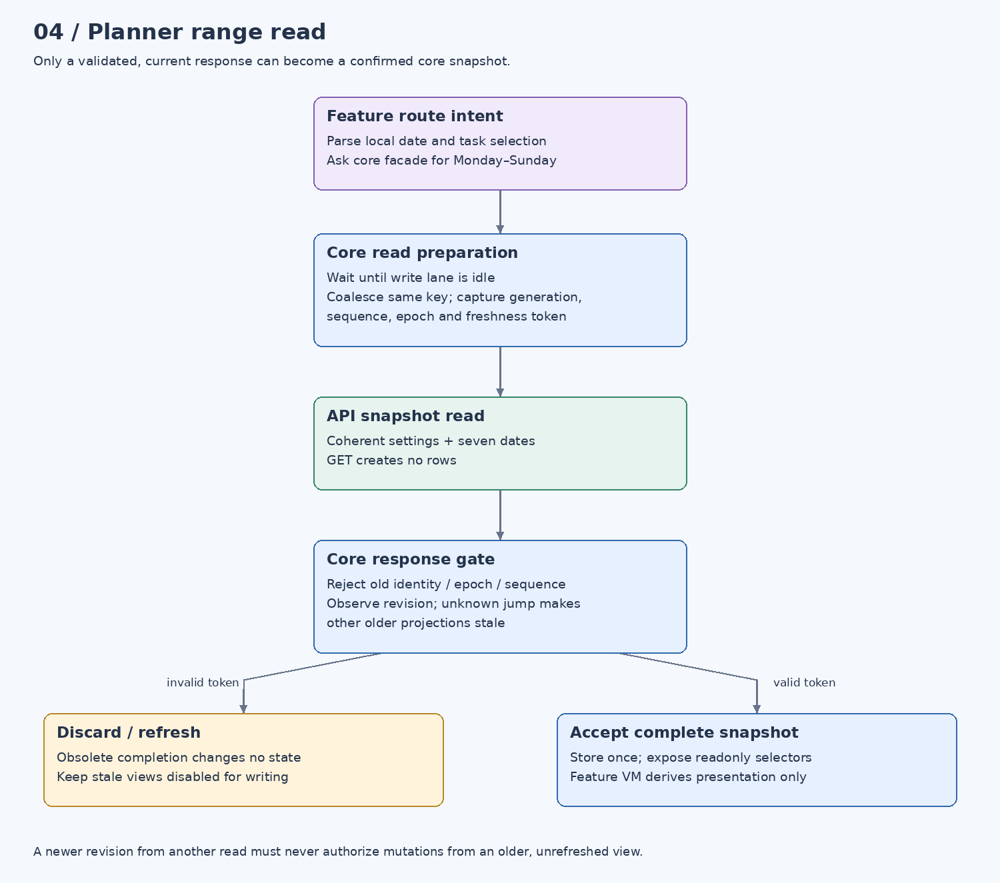

[SVG](assets/diagrams/04-range-read.svg) · [Mermaid source](assets/diagrams/04-range-read.mmd)

##### 05 autosave state

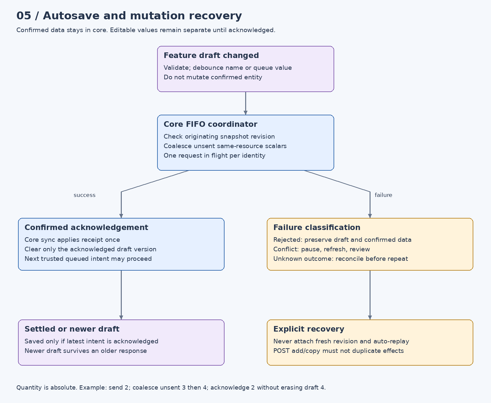

[SVG](assets/diagrams/05-autosave-state.svg) · [Mermaid source](assets/diagrams/05-autosave-state.mmd)

##### 06 sparse day lifecycle

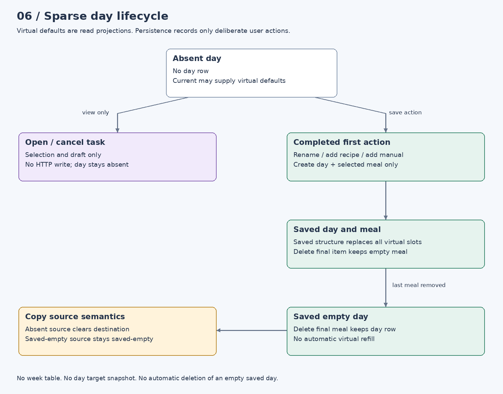

[SVG](assets/diagrams/06-sparse-day-lifecycle.svg) · [Mermaid source](assets/diagrams/06-sparse-day-lifecycle.mmd)

##### 07 copy week

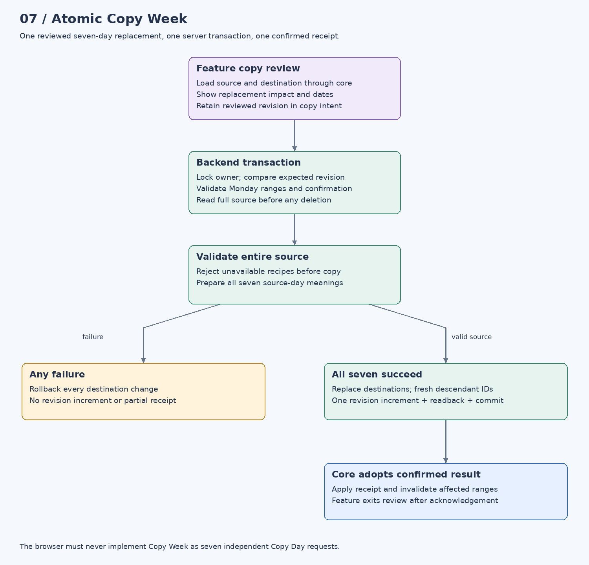

[SVG](assets/diagrams/07-copy-week.svg) · [Mermaid source](assets/diagrams/07-copy-week.mmd)

##### 08 nutrition policy

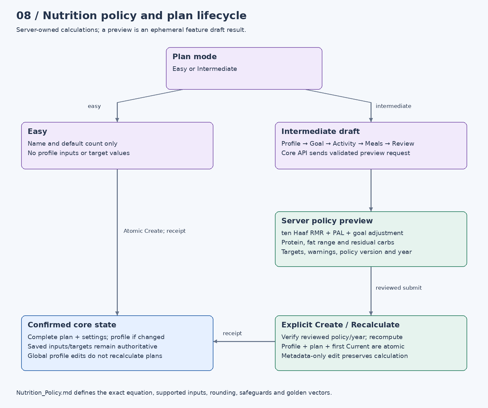

[SVG](assets/diagrams/08-nutrition-policy.svg) · [Mermaid source](assets/diagrams/08-nutrition-policy.mmd)

#### Supplied design and legacy references

References 01–09 show the intended major screens; 10 is an earlier edit concept and 11 is the actual header reference. Builder references 12–15 provide additional context. References 16–17 are old ERDs: do not implement their relationships when they differ from the canonical Data Model. No legacy image authorizes a new table, fractional servings, Advanced/Expert mode or target snapshots.

##### 01 meal planner main

Current design reference.

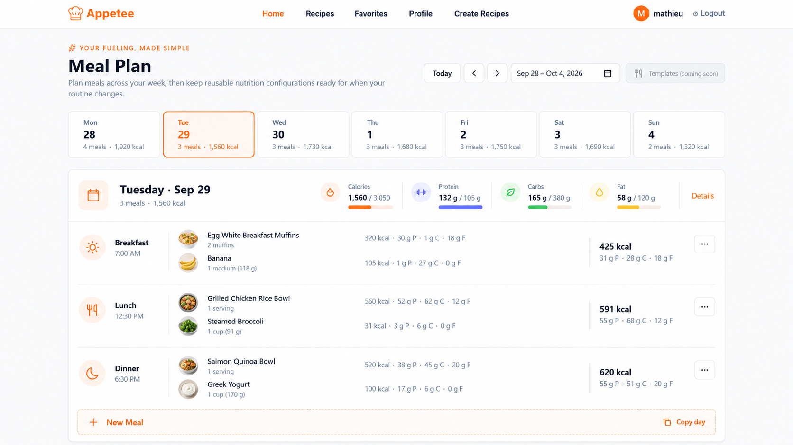

##### 02 meal editor

Current design reference.

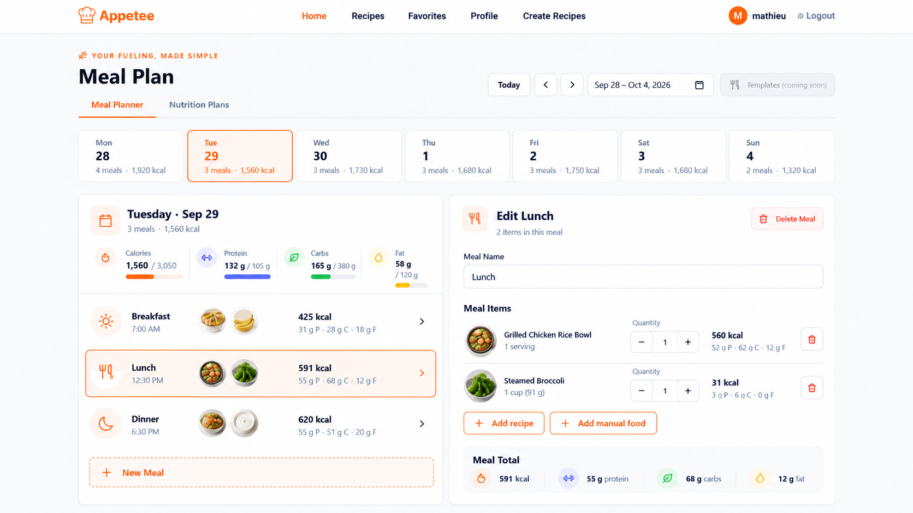

##### 03 recipe picker

Current design reference.

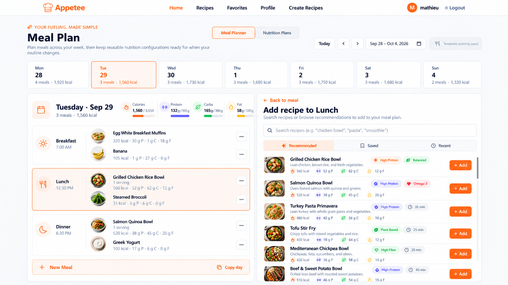

##### 04 nutrition plans

Current design reference.

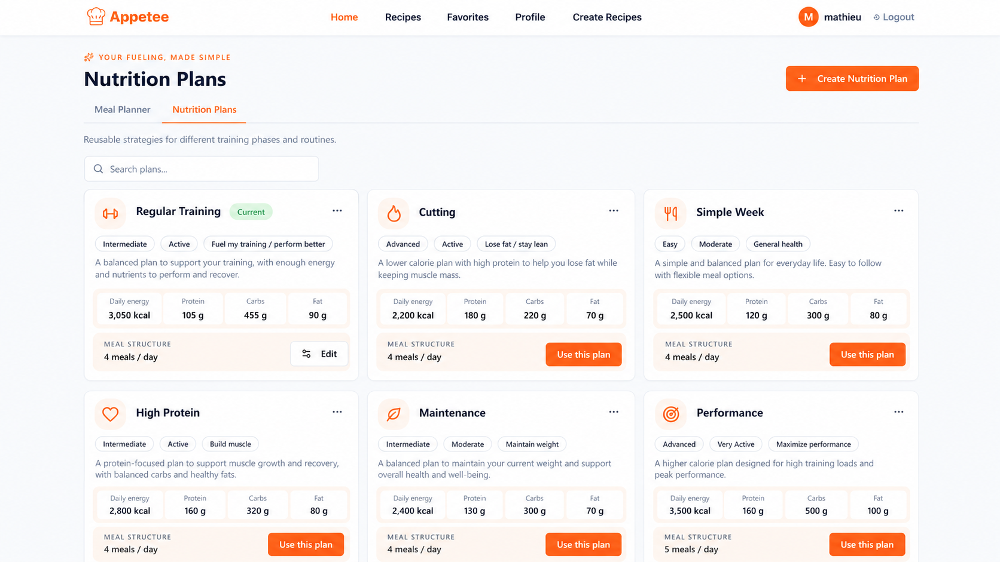

##### 05 create plan profile

Current design reference.

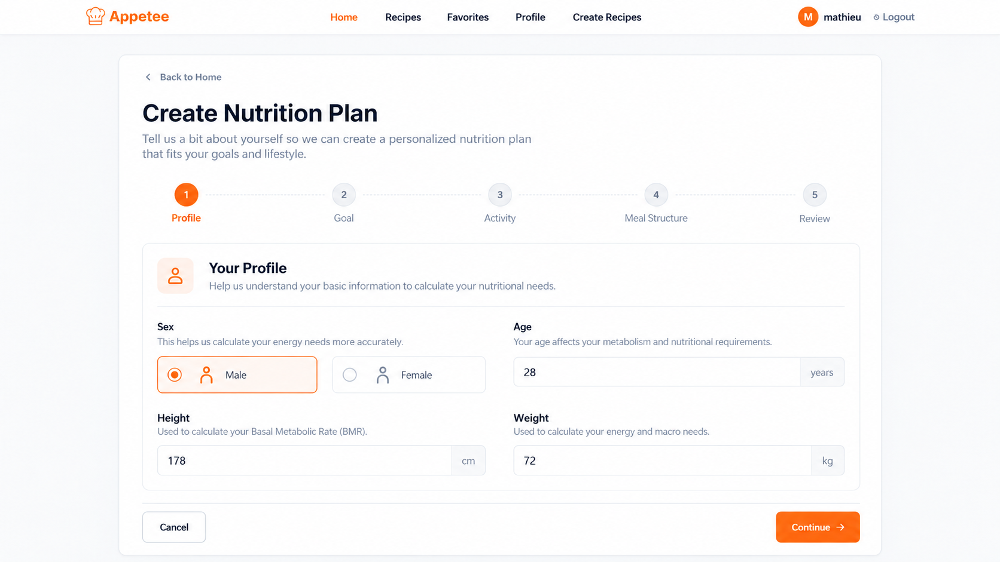

##### 06 create plan goal

Current design reference.

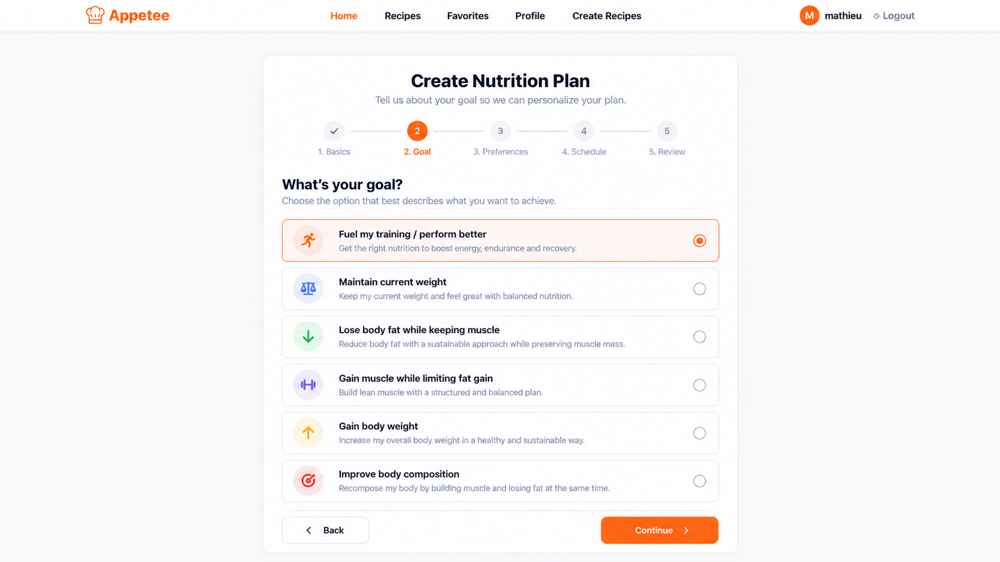

##### 07 create plan activity

Current design reference.

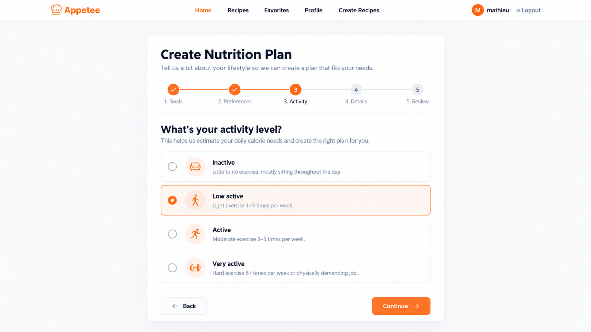

##### 08 create plan meal structure

Current design reference.

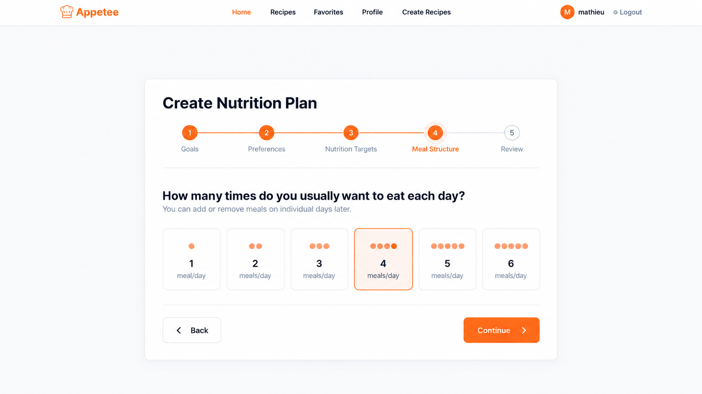

##### 09 create plan review

Current design reference.

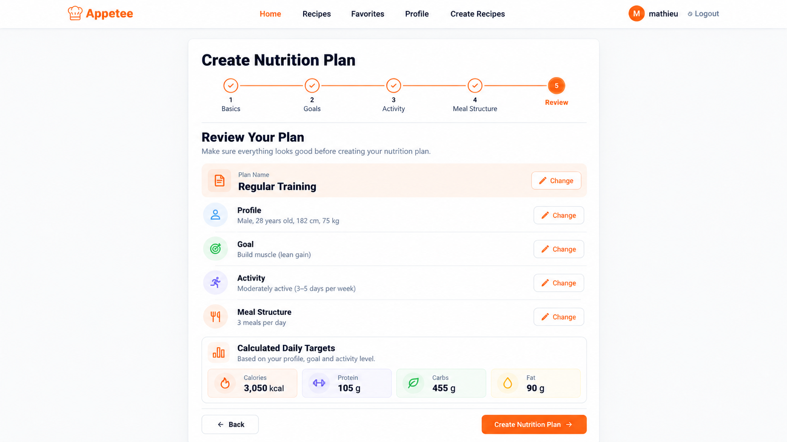

##### 10 edit nutrition plan reference

Earlier edit-page reference; align with current header.

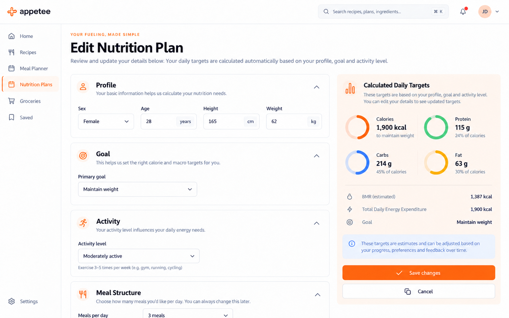

##### 11 header reference

Current design reference.


##### 12 builder visual reference

Builder reference.


##### 13 builder day details

Builder reference.


##### 14 builder current screen

Builder reference.


##### 15 builder add recipes

Builder reference.


##### 16 legacy meal plan erd

Legacy ERD — noncanonical.


##### 17 legacy appetee erd

Legacy general ERD — noncanonical.


#### Preserved source mapping

| Original handoff path | Packaged asset | SHA-256 |
|---|---|---|
| `images/01_meal_planner_main.png` | [asset](assets/references/01_meal_planner_main.png) | `204fafe6610bf7fb326101a335b70128043f6dddf0fb59f0e3b304902b99c077` |
| `images/02_meal_editor.png` | [asset](assets/references/02_meal_editor.png) | `dbd05c755a9d62311840d209956e5637fbf26aef219c327cc8ad53bf37d08a54` |
| `images/03_recipe_picker.png` | [asset](assets/references/03_recipe_picker.png) | `1c27f31e3ae6871df678f6c56d16ad03ddd98874eed51e064ad9e5592d70a1f1` |
| `images/04_nutrition_plans.png` | [asset](assets/references/04_nutrition_plans.png) | `2c567771aad80e19a4f10c3ce3d785a25c94da8a1102d4ed76165ca1585865f6` |
| `images/05_create_plan_profile.png` | [asset](assets/references/05_create_plan_profile.png) | `5bd2a19434738266c8ac8f20350e4d5b64db98fdaa8cd81a0dafa896760dd307` |
| `images/06_create_plan_goal.png` | [asset](assets/references/06_create_plan_goal.png) | `83ba71b6abc628b63b46aa4c1a92d4411c5209e78d4c25fee3c507de855ed392` |
| `images/07_create_plan_activity.png` | [asset](assets/references/07_create_plan_activity.png) | `61bc1852512edf9a60c6a87161a2dc6639c60f2d6d9b17ad84b1e0d08647479b` |
| `images/08_create_plan_meal_structure.png` | [asset](assets/references/08_create_plan_meal_structure.png) | `8c311b8190d6988221a55dc3b45d1b0e50c8dd60faa1f53b3cfcb177d5d9c90c` |
| `images/09_create_plan_review.png` | [asset](assets/references/09_create_plan_review.png) | `85f7fbd67c4136ed3b4b380740f038478cd7d2fd8ce094ffc581d11709406862` |
| `images/10_edit_nutrition_plan_reference.png` | [asset](assets/references/10_edit_nutrition_plan_reference.png) | `a06c5aa8bc02b7d7123293508624abce2a22a430f2e59fddc7eb2c483fa86df6` |
| `images/11_header_reference.png` | [asset](assets/references/11_header_reference.png) | `08707b413a58413fd4467890890790c6dfe94bf95fee703a46e4c24f8153853d` |
| `references/builder_current/ChatGPT_Image_Oct_4,_2026,_01_38_02_AM.png` | [asset](assets/references/12_builder_visual_reference.png) | `0e6e7bd53736be72f1dfc1994060836867df6a55c4faccdb26ec65105be9d930` |
| `references/builder_current/DetailsDay.png` | [asset](assets/references/13_builder_day_details.png) | `2e29d60ef1c945f28c601d85d66b2a99afe5bac34b2083a0aa25e9c88bfee37c` |
| `references/builder_current/Screenshot_2026-10-04_013844.png` | [asset](assets/references/14_builder_current_screen.png) | `903a85029e4b7978ffc2596bc2f024fb81134f32bd010c75a59b1801727d4949` |
| `references/builder_current/addRecipes.png` | [asset](assets/references/15_builder_add_recipes.png) | `c3b14bbabdbf81f81aa18c3fff47bf3cb527563af14dd16bed6eb6e0d9bc9623` |
| `database_architecture/meal_plan_v1/meal_plan_v1_erd.png` | [asset](assets/references/16_legacy_meal_plan_erd.png) | `3064c0a7a829ae83588f8ba3f60f7966b94dac9a1c6d522da0399a2d53344b85` |
| `database_architecture/general_appetee_reference/appetee_database_erd.png` | [asset](assets/references/17_legacy_appetee_erd.png) | `323a0fd9608e1658a3e83383ab980838c725214bbd6c667ae0d567a9d422ecb3` |
| `database_architecture/meal_plan_v1/meal_plan_v1_erd.svg` | [asset](assets/references/16_legacy_meal_plan_erd.svg) | `b3d2e1a0608da1b7a4bd89e5a476651f1314eeab45bcd938330f0083d4c0ac7b` |
| `database_architecture/general_appetee_reference/appetee_database_erd.svg` | [asset](assets/references/17_legacy_appetee_erd.svg) | `91599c417e6f9bbdd91e05fb4f716115030c8389860da54f069c4434274d5f9f` |


### Original specification package validation (historical)

The reorganized package contains README.md, 15 backend phase files, 17 frontend phase files and assets only. There is no v1 directory, HTML file, application source or executable migration. The approved calculation policy identifier and original reference filenames are preserved as provenance; they do not create a versioned folder structure.

Every original phase section is retained under the appropriate frontend/backend template heading. Shared source documents have one mapped canonical destination. The original specification task checked local links/anchors and asset paths and preserved image bytes; it did not change application repositories or run application tests. Subsequent implementation/tests are recorded separately above and in frontend verification records, not inferred from this historical package validation.
