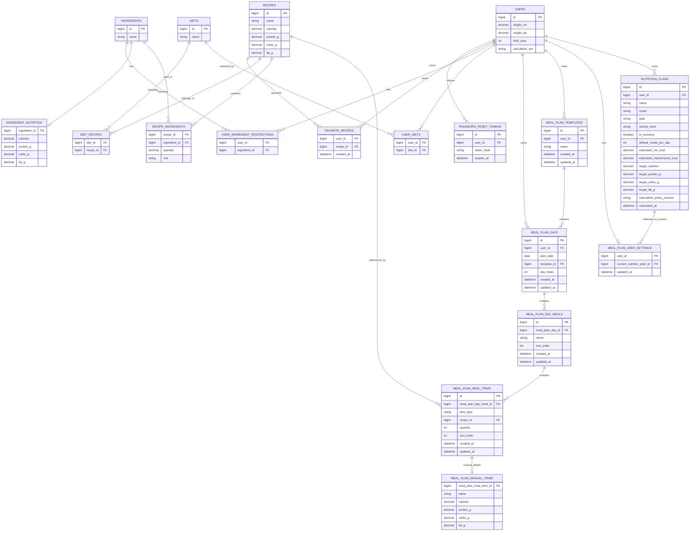

# Appetee Meal Planner V1 ERD

## Mermaid ERD

## Important V1 constraints

### MEAL_PLAN_DAYS
A row is either a real dated day or a template day.

DATED:
- `plan_date` required
- `template_id` NULL
- `day_index` NULL

TEMPLATE:
- `plan_date` NULL
- `template_id` required
- `day_index` 0-6

Recommended constraints:
- `UNIQUE(user_id, plan_date)`
- `UNIQUE(template_id, day_index)`

### MEAL_PLAN_MEAL_ITEMS

RECIPE:
- `item_type = RECIPE`
- `recipe_id` required
- `quantity` integer >= 1

MANUAL:
- `item_type = MANUAL`
- `recipe_id` NULL
- `quantity` NULL
- one matching `MEAL_PLAN_MANUAL_ITEMS` row

### Manual item validation
- name required
- calories > 0
- protein_g > 0
- carbs_g > 0
- fat_g > 0
