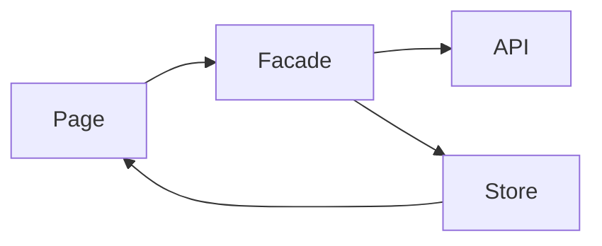

# F-XXX — Feature Name — Frontend

## Canonical Contract

The feature [`README.md`](./README.md) owns product behavior, shared data requirements, database-impact requirements, API endpoint definitions, request/response contracts, and error semantics.

This document describes how the Angular frontend implements that contract.

Do not redefine an incompatible API or data model here.

## Frontend Goal

Describe what the frontend must provide for this feature.

## Routes

| Route | Access | Purpose |
|---|---|---|
| `/example` | Authenticated | |

Frontend guards provide navigation/user-experience behavior only. Backend authorization remains authoritative.

## Page and Component Structure

```text
FeaturePage
├── ...
└── ...
```

Identify shared components owned by other features instead of duplicating them.

## State Ownership

### Application/session state

- None.

### Complete entity cache

- None.

### Query/list state

- None.

### Temporary feature/flow state

- None.

### Component-local state

- None.

Remove unused sections.

## State Lifetime

For every nontrivial store, document:

```text
Created when:
Survives:
Destroyed/reset when:
Invalidated when:
```

Temporary feature state should normally be provided by the feature/page/flow that owns it rather than `providedIn: 'root'`.

For multi-step flows, prefer a persistent shell provider when child routes/components must share the same temporary store.

## Data Flow



Adjust as required.

## API Integration

| Endpoint | Frontend responsibility |
|---|---|
| `GET /api/...` | |

Canonical payloads remain in `README.md`.

## Loading Behavior

Describe initial loading, background refresh, cached rendering, concurrency and loading presentation.

Avoid one global loading Boolean when independent requests can occur concurrently.

## Empty States

| State | UI behavior |
|---|---|
| No results | |
| No user data | |

## Error Behavior

Describe frontend handling for the error outcomes defined in `README.md`.

## Caching and Invalidation

Describe:

```text
What is cached?
Who owns the cache?
When is it reused?
What invalidates it?
How does a mutation update it?
What happens on logout?
```

Do not duplicate complete server entities into multiple feature stores.

## Forms

When applicable:

- reactive form structure;
- client-side UX validation;
- temporary draft state;
- navigation between steps;
- unsaved-change behavior.

Frontend validation improves UX but does not replace backend validation.

## Responsive Behavior

Describe intended layout behavior.

## Accessibility

Validate when applicable:

- semantic buttons/links;
- labels;
- keyboard navigation;
- visible focus;
- dialog focus trapping/restoration;
- screen-reader status/error announcements;
- mobile reflow;
- 200%/400% zoom;
- reduced motion.

## Testing

### Unit/store

- [ ]

### Component

- [ ]

### Routing

- [ ]

### E2E

- [ ]

### Accessibility/manual

- [ ]

## Implementation Notes

Add implementation-specific guidance that helps development but does not belong in the shared feature contract.

## Dependencies

List frontend technical dependencies and relevant initiatives.
